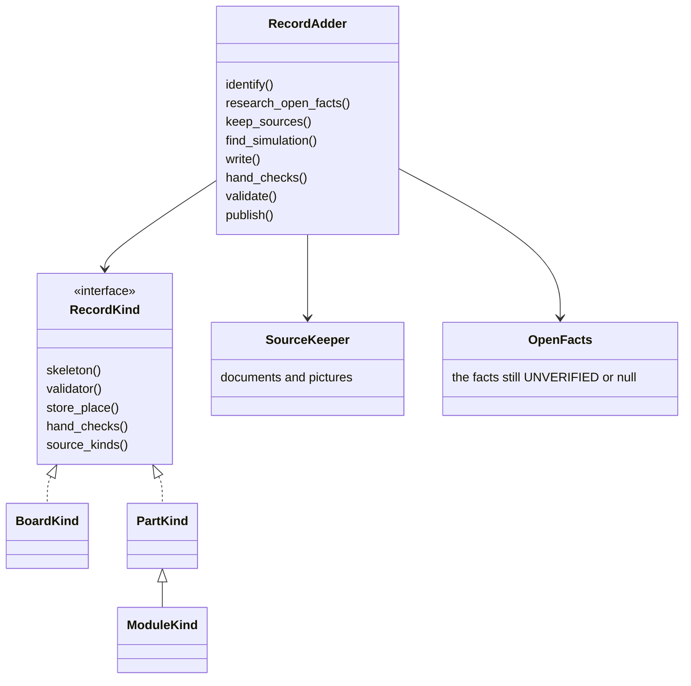

# A new board works end to end: the plan for P331 and the walks (2026-10-19)

> Adding anything to spark (a part, a module or a board) becomes one shared path: identify it, research its open
> facts, keep its sources and pictures, write the record into the store, run the hand checks, validate, and offer it
> in every project. The board goes first. Then spark deploys to the new board, and the reaction game with a screen on
> the T-Display proves it. Walk 1 on the XIAO runs now and needs only two small cards.

## What the PO asked

- *"lets have the council change the projects and the plans, including all missing steps and necessary additions,
  make a solid plan for this whole set of cards to deploy and test on these projects what we have so far."*
- *"I mean lets just make this whole part work, when a new board is being added. And probably there should be some
  common ancestor or functionality for adding any part, being a part a module or a board, that it finds all the data,
  the picture, etc.."*
- Earlier: games on the T-Display with display interaction, a guide that leads, research that keeps looking, and
  simulation that is not compulsory (PR #424).

Three lenses read the plans and the code (Sonnet): the PO's assistant with UX and AI-UX, the architect, and a
firmware and test lens. Claude merged them. One refuter (Opus) then corrected seven points: which functions a board
can reuse, the store place, the vendor check, what blocks walk 1, drawing a built-in display, the driver rule, and
a validation that would have locked out the T-Display.

## The shared core: adding any record

Today a part or a module has a path (`/spark:research`, `/spark:identify`, three agents, `parts.py`), and a board has
none: it is a JSON file written by hand. Only a few pieces are generic today: `keep_in_store`
(`scripts/parts.py:1102`), `store.keep` (`scripts/store.py:384`) and the picture strategy `PartPictures`
(`scripts/part_pictures.py:27`). The rest is tied to part records. The refuter ran them on the XIAO's record:
`unverified` (`scripts/parts.py:903`) and `fetch_documents` (:1326) find no part by that id, `open_questions_of`
(:889) reads only a part's `facts` and so calls the XIAO settled although its regulator rating is null, and
`skeleton` (:1429), `promote` (:1366) and `shelve` (:1028) write a part's shape and its layers. So the core moves
these behind `RecordKind`: the part kind keeps today's functions, and the board kind gets its own record finder,
open-facts reader (over `power`, `pin_roles` and the UNVERIFIED notes), validator and store place.



- `RecordAdder` keeps the order of the steps. It is the one core that the guide command, the CLI and the parts import
  call (one core, many interfaces).
- `RecordKind` holds what differs per kind. A board has the maker's schematic and pin table as sources, and its hand
  checks are the plug-in, the buttons and the pins. A module adds a photo of the person's own module.
- `SourceKeeper` keeps every document and picture in the store with its URL and sha256, reusing `store.keep`.
- `OpenFacts` lists what is still UNVERIFIED or null, names the source that would settle each one, and is what the
  research step and the guide ask about. This is the PO's "asks for more research when it still needs some more
  info" (P340, #434).
- `publish` writes the record into a store place that every project reads (`store.layers`, `scripts/store.py:73`),
  so an owned board is offered everywhere.

Build it with the board first, by moving the T-Display's hand-made path into it. Then the part and module kinds move
in, and the parts import of P329 (#421) calls the same core.

## Phases

```
A  adding a board works       B1 store place -> RecordAdder + BoardKind -> honest validation
                              + look fixes P333, P334 -> guide /spark:board (P339)
                              test: add the T-Display again, led by the guide, from the photo
B  deploying to it works      P335 image -> P332 built-in parts + their names in pins.py
                              -> P336 driver -> P337 (after the journey review)
                              test: the reaction game with a screen on the T-Display
C  the XIAO walks, alongside  walk 1 now; Wi-Fi and Bluetooth stand-ins before walks 2 and 3
D  the core for all kinds     PartKind, ModuleKind; the parts import P329 calls it
```

## The cards

Existing cards keep their numbers. New cards are named here and filed after the merge.

| card | change | size | phase |
|---|---|---|---|
| new: store place for boards | a new store place for board records, because the `boards` place already holds the deploy records by MAC (`scripts/board_facts.py:64-73`); a layer in `store.layers` (`scripts/store.py:73-84`) read by `boards.records` (`scripts/boards.py:216`); the vendor check accepts a board the store owns (`scripts/check_vendor_pins.py:123`) | M | A |
| new: RecordAdder and BoardKind | the shared core, board first: keep the record, its sources and pictures, list the open facts, find the simulation; the board kind's own finder, reader and validator | L | A |
| new: honest validation | count the UNVERIFIED and null facts beside "ok", a missing simulation included, without refusing the board: a refusal would lock out a board that the simulation stage already reports as could-not-run (`scripts/boards.py:353-355`) | S | A |
| P333 (#427) | one board is one port (non-empty USB serial), the USB-C orientation hint | S | A |
| P334 (#428) | one helper for the board choice, used by all six readers | S | A |
| P339 (#433) | the guide `/spark:board` over RecordAdder: step N of M, one action, a check after each | M | A |
| P340 (#434) | research from the open facts, which asks to look further | M | A, then D |
| P335 (#429) | the ESP32_GENERIC image, its interpreter padded to 0x1000 inside the image | S | B |
| P332 (#426) | built-in parts in the record, their pins never handed out, their names in `pins.py` (`scripts/assign_pins.py:416`), and drawn in the Wokwi diagram, both for a board alone and with parts (`scripts/check_spine.py:508-513, 543-555`) | M | B |
| P336 (#430) | the display driver as a pinned third-party download into `firmware/`, never committed; spark writes no driver (AGENTS.md), it points to one, so this needs the PO's yes | M | B |
| P337 (#431) | the gate for a display Wokwi cannot model, after the journey review | M | B |
| new: what a run did not cover | a "not covered" line in the run log, shown before a deploy (`scripts/run_scenario.py:212`, `scripts/project_image.py:57`) | S | B, C |
| new: XIAO current rating | the 3.3 V regulator's rating with its datasheet, so the physics check can run (`boards/xiao-esp32-c6.json:209`) | S | C |
| new: network and bluetooth stand-ins | the import check accepts Wi-Fi and Bluetooth firmware (`scripts/stand_in/machine.py:52-56`) | M | C |
| new: spike | does Wokwi's C6 scan Wi-Fi, and does the XIAO's MicroPython hold `bluetooth`? | S | C |
| new: spike | can Wokwi simulate the T-Display's ST7789, as a part or a custom chip, wired like an external SPI display? | S | B, before P337 |
| P338 (#432) | becomes the T-Display walk: first the screen fills and switches colors, then the reaction game with the screen | walk | B |

## The display in the simulation

The PO, during the council: *"And regarding the display, in wokwi cant we just add it as a normal external (probably
spi) display, get the type and pins from datasheet, the driver and simulate it"*

That fits the built-in parts of P332. The record lists the display as a part with its pins, so the Wokwi diagram can
draw it as an external SPI display on the same GPIOs of the stand-in devkit, and the firmware with its driver runs
against it. Whether Wokwi has an ST7789 part is not settled: Wokwi's display pages list the ILI9341 (a different
controller), and a search finds Wokwi projects with ST7789 displays but no part page
([wokwi.com/makers/pa0o](https://wokwi.com/makers/pa0o), read 2026-10-19). So a spike settles it first: an ST7789
part in Wokwi's diagram format, or else a Wokwi custom chip that draws on a display. An ILI9341 in its place is not a
test of this board, because its controller and its start-up commands differ. If the spike finds a way, P337 becomes
small: the screen is simulated, and the gate stays as it is.

The PO then: *"And this part, to find out what to do and how to simulate it best, that should also work."* So finding
the best simulation is a step of the shared core, `find_simulation`, for every kind. For a new part, module or board
it looks for, in this order: Wokwi's own part for the exact thing; the same chip or controller on another Wokwi part
(a stand-in, as the XIAO and FireBeetle records already say with `wokwi_is_stand_in`); then a custom chip. It writes
the choice into the record with its source, and it lists what the simulation will not cover (for the T-Display:
perhaps the screen, the battery sense), so each later run can say "not covered" instead of passing it. When it finds
nothing, it says so and asks the person, like the research step. The spike above is this step done once by hand for
the ST7789, and its notes become the step's first rules.

## The walks and their checks

| walk | board | tests | simulation | on the bench |
|---|---|---|---|---|
| 1 reaction game (P326) | XIAO | the whole basic journey | buttons and console lines; LED and timing not covered | LED at "go", false start, five rounds, a second deploy |
| add the T-Display again | T-Display | phase A, led by the guide | none | plug-in, USB-C orientation, buttons on the console |
| 2 Wi-Fi hot and cold (P327) | XIAO | a project with no parts, Wi-Fi | a fixed Wokwi-GUEST scan at best | blinking speeds up near the router |
| 3 phone nearby (P328) | XIAO | a radio the simulation cannot cover | Bluetooth not simulated (Wokwi) | LED follows the phone; a BLE app on the phone |
| reaction game with a screen (P338) | T-Display | phase B, a new board end to end | screen not simulated | the screen shows wait, GO, the time and the best |

Each walk keeps a short record: the date, the board, each step and its check, what spark did that nobody predicted,
and what stopped it, with its rows in `docs/observations/rows/<card>-<topic>.md`. Wi-Fi passwords are asked on the
console and never written into firmware or the repository. Reflashing the T-Display (it runs MicroPython v1.18) needs
the PO's yes. The journey review on optional simulation comes after walk 1, with its evidence, and before P337.

## Order

1. Walk 1 on the XIAO now. Nothing blocks it: the deploy asks only for a passed run, a look and a yes
   (`scripts/project_image.py:57-69`), not for the full check. "What a run did not cover" and the XIAO current rating
   make its record more honest and can land during the walk.
2. Phase A, at most four in flight: the store place, P333, P334 and honest validation, then RecordAdder and the
   guide, then the T-Display added again through the guide.
3. The journey review with the PO.
4. Phase B, then the reaction game with a screen on the T-Display.
5. Walks 2 and 3 when their stand-ins and the spike are done. Phase D after the T-Display walk.

## What the lenses checked and corrected

- A board-alone project does not make `check_all` exit 2 (the P327 plan predicted it): the architect ran it on
  `blink-c6`, and it answered ok with physics skipped. A project with parts does stop at physics, because the XIAO's
  regulator rating is null, and also when any part's current draw is missing (`scripts/check_physics.py:300`). The
  deploy does not read the full check, so this does not block walk 1.
- The P326 plan's claim that the second button's new name breaks the import check does not hold: only the constant's
  name changes.
- Wokwi simulates Wi-Fi on every ESP32 variant and does not implement Bluetooth (docs.wokwi.com/guides/esp32, read by
  the firmware lens). Whether a scan returns networks is not stated, so the spike checks it.
