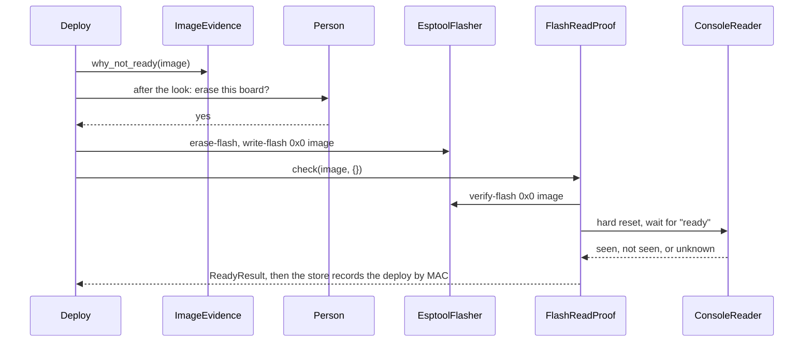

# P221 finding: Arduino as a second firmware platform

[P221 #203](https://github.com/xmejkal/spark/issues/203), 2026-10-20: Opus synthesis of the five lenses here. File:lines checked.

> **TL;DR.** Yes, "the same, but object-oriented C++ in Arduino" works. The facts stay: needs, parts, pins, diagram,
> sheet and the `ready` line. The language, the firmware tree, the image and the REPL change. The deploy keeps esptool and
> `ready`, `esptool verify-flash` replaces the file hashes, and no facts go on the board. Estimate: 7 refactor PRs, then
> 6 Arduino PRs, then 1 to 3 bench fixes, 12 to 18 in all. Six of the seven refactors pay off without Arduino. The
> biggest risk is the heavy esp32 core on the person's Mac.

Spark is language-blind up to the diagram and the sheet, and assumes MicroPython from the pin map down. One seam exists
(`FirmwarePlatform`), and Arduino is the reason to finish it as small role classes behind one `platform` key. The MVP is
one board (XIAO ESP32-C6) and one project (button and LED), with no REPL, no live code and no facts file.

## 1. What it means for spark, and the MVP

Stays: idea, parts, drawer, the board record (less one key), pin facts, diagram, sheet, look, grant, gate, esptool flash,
download-mode recovery. Lost for Arduino: the REPL, `live`, `reach`, the Mac import
test and the pin guard for code. The platform is picked in two places today (`deploy.py:171`, `run_scenario.py:150`).
P323 decides one `platform` key in requirements.json, default `micropython`. Nothing Arduino starts before it. The MVP:

1. `platform: arduino`. The board record gets `firmware_images: {micropython, arduino: {fqbn, core}}`, and
   `micropython_port` (`boards/xiao-esp32-c6.json:9`, read at `flash_image.py:89`) moves into it.
2. The same pin facts render as `firmware/pins.h` beside `firmware/firmware.ino`. The conversation writes the sketch.
3. The check is `arduino-cli compile` ("compiled", never "checked"). The image is one merged `.bin` at 0x0 (the
   compile's own, or `esptool merge-bin`, unverified for core 3.x on the C6).
4. The deploy: look, yes, erase and write (`flasher.py:40`, unchanged), verify-flash, reset, read `ready`.
5. `wokwi.toml` gets the real `.elf` (`sim_project.py:191` writes the image twice). Wokwi on an Arduino C6 image is
   unverified. Whether a deploy needs a passed run is P337's rule, and Arduino follows it.

## 2. What changes, the deploy included

| Part | Today | Arduino | Seam |
|---|---|---|---|
| Pin map | Python, `assign_pins.py:392`, `#` marker `check_spine.py:896` | `pins.h`, `//` marker | `PinMapRenderer` |
| Firmware tree | `main.py`, `run_scenario.py:142`, `import_firmware.py:42` | `firmware.ino` | `FirmwareLayout` |
| Mac check | import with a `machine` stand-in | compile | `FirmwareCheck` |
| Image | interpreter plus littlefs, `--micropython` at `run_scenario.py:239` | compile, merge | `ImageBuilder` |
| Port list | `mpremote devs`, `board_look.py:67` | pyserial | `PortFinder` takes a lister |
| Proof on board | `spark.json` (`board_facts.py:19`), REPL hashes, `import main` (`ready_check.py:61`) | verify-flash, reset, `ready` | `BoardProof` |
| Console | pyserial in mpremote's Python (`board_console.py:43`) | pyserial in esptool's Python | `ConsoleReader` |
| Tools | `firmware-image`, `board-shell` (`data/tools.json:10`, `data/tools.json:16`) | add `compiler` | roles by job |

**Decided: verify-flash proves the image, not a build id** (board lens over mvp lens). It compares the flash with the
image and needs no firmware code. After an erase and a verified write, no old sketch is left to print `ready`. The mvp
lens's id, the image's sha256, cannot work: an image cannot hold its own hash. Verify-flash on the C6 is unverified.
**Decided: no facts on the board.** Arduino has no file system for `spark.json`, and the Mac already keeps each deploy by
the board's MAC (`board_facts.py:55`). **Decided: the run log names its platform**, and the gate compares it (ripple).

## 3. No REPL: what replaces it

The sketch boots by itself after esptool's hard reset, so no `import main`. Verify-flash proves the whole image, which is
stronger than file hashes. The serial console, read with today's `ConsoleProbe` code, shows what it does. The C6 needs
the fqbn option `CDCOnBoot=cdc`, or the board looks dead (unverified), so the board record pins it. A live line is gone:
`live`, `reach` and the doctor's cure answer `not_for_platform`, a code, never a pass. A change costs compile, flash and
boot, about a minute (unverified), against seconds for a file copy.

## 4. How much work

| # | Refactor PR (MicroPython runs through the seam, tests' outside unchanged) | Pays off alone? |
|---|---|---|
| T1 | `ServiceCase.make_service()` and a `FakeToolFinder` in `tests/fakes.py` | Yes: one edit per constructor change |
| R1 | the `platform` key, one picker, `PinMapRenderer` out of `assign_pins.py` | Yes: a 510-line script shrinks |
| R2 | board record `firmware_images`, one reader, `micropython_port` optional in `board.ts` | Yes: no key named after a tool |
| R3 | `FirmwareLayout`, `FirmwareCheck`, `ImageBuilder` behind the platform | Little: three modules share one fact |
| R4 | `BoardProof`, `ConsoleReader`, optional `BoardShell`, `DeployService.verify` (`deploy_service.py:149`) free of mpremote | Yes: REPL and serial errors told apart |
| R5 | `FirmwarePlatform` as role objects, with a `PlatformContract` test | Yes: finishes P239 PR 8 |
| R6 | pull-up text from the renderer, platform in the run log, wake facts under `micropython` | Yes: no API word in a board fact |

Arduino PRs: A0 a bench spike (core, compile, flash, verify-flash, `ready` on the C6, docs only). A1 `compiler` role and
`CppPinMap`. A2 layout, compile check, merged image. A3 `ArduinoPlatform`. A4 commands, skills, agent prompts. A5 docs,
journey table, `tools/journey.py`, Miro. In all 12 to 18 PRs, about 14, over 3 to 6 weeks (unverified) set by the PO's
bench time. Arduino with no refactor first is 4 to 8 PRs (unverified), with `if platform` in callers. R1 to R5 touch P323's files.

## 5. The target seams

```mermaid
classDiagram
  <<Platform>> FirmwarePlatform
  FirmwarePlatform *-- PinMapRenderer
  FirmwarePlatform *-- FirmwareLayout
  FirmwarePlatform *-- FirmwareCheck
  FirmwarePlatform *-- ImageBuilder
  FirmwarePlatform *-- Flasher
  FirmwarePlatform *-- BoardProof
  FirmwarePlatform *-- ConsoleReader
  FirmwarePlatform o-- BoardShell : optional
  PinMapRenderer <|-- PythonPinMap
  PinMapRenderer <|-- CppPinMap
  FirmwareCheck <|-- StandInImport
  FirmwareCheck <|-- ArduinoCompile
  ImageBuilder <|-- InterpreterImage
  ImageBuilder <|-- ArduinoImage
  Flasher <|-- EsptoolFlasher
  BoardProof <|-- ReplProof
  BoardProof <|-- FlashReadProof
  BoardProof ..> ConsoleReader : wait for ready
  BoardProof ..> ImageEvidence : expected_files
```

`micropython()` and `arduino()` build the platform, and each role is a Strategy. `ImageEvidence` is P337's seam
(`scripts/image_evidence.py`, branch `p337-no-simulation`), platform-blind, but its `{}` for one blob needs a code. Names:
"firmware" is the person's code, "image" what the flasher writes, "evidence" before the flash, "proof" on the board.



## 6. What else changes (ripple lens)

21 groups in about 45 files, 7 where a check says ok for what it cannot see. R6: the pull-up waiver names `Pin.PULL_UP`
(`compare_design.py:211`), so a `pins.h` without the pull passes and the button floats. Wake facts in board records are
MicroPython API facts (`boards/xiao-esp32-c6.json:195`). A3: `reach` on a healthy Arduino board fails the raw REPL, and
the doctor's cure fires. A2: on a lone `firmware.ino` the import test says `could-not-run` (run 2026-10-20, so loud, not
the "ok" the ripple lens feared), but it talks about `main.py`. A4, A5: `commands/build.md`, the spark-design skill and
`tools/check_docs.py:25` steer Claude to Python files.

## 7. How we test it (tests lens)

Keep the outside fixed: `tests/test_json_contracts.py`, the CLI tests, `tests/test_deploy_json.py` and `tools/snapshot.py
--against`. Arduino adds goldens and never edits old ones. The levels: contract, unit with fakes, CLI golden, compile
only, simulation with the fake wokwi, bench. A compile is not a pass, and a missing `arduino-cli` gives `skipped`. One
`PlatformContract` mixin is written against MicroPython in R5, and Arduino's test inherits it. The first step is T1:
`tools.find` is patched about 60 times, and PR #454's small refactor touched 12 test files.

## 8. The three biggest risks

1. **The heavy core**: 5.5 GB on this Mac, all chips and old versions (board lens, measured). A C6-only install is
   smaller (unverified). "A user installs nothing heavy" (`AGENTS.md:34`), so Arduino stays optional like KiCad.
2. **The C6 board side**: the merged image boots at 0x0, verify-flash works over USB-Serial/JTAG, `ready` shows within
   `READY_WAIT_S` (`ready_check.py:17`), the board leaves download mode. All unverified. A0 tests them before code.
3. **Claude's C++ loop**: the compiler is the only test before the board, errors are long, a cold compile takes minutes
   (unverified). Cut errors to the first lines, and use only the core in the MVP.

Out: PlatformIO, ESP-IDF, Rust, CircuitPython, other boards before the C6 walks, the REPL tools for Arduino, host C++ tests,
the C++ pin guard (`scripts/restricted_pins.py` reads Python, so it says `skipped`), and facts on the board.

## 9. Decisions waiting on the PO

1. Refactor first (T1, R1 to R6), then Arduino? Recommend **yes**: six pay off alone, and Arduino adds no `if platform`.
2. Run R1 to R5 inside or after P323's package move, never beside it? Recommend **yes**: the same files.
3. Proof by verify-flash, with no build id and no facts on the board? Recommend **yes**.
4. Arduino follows P337's simulation rule, with no gate of its own? Recommend **yes**: one rule for both.
5. Arduino optional like KiCad, its size named before the install? Recommend **yes**.
6. Start T1 now, and A0 (the core on his Mac, one bench flash) after P337 and the retro? Recommend **yes**.

## 10. Sources

Code on main d2f6b4d, `firmware_platform.py:41` and the references above. P323's design.md on its branch. `platforms.md` of
P218. https://docs.wokwi.com/vscode/project-config (via platforms.md). No web search ran. Measured 2026-10-20: the core's
`du` and `esptool --help` 5.5.0 (board lens), the test counts (tests lens), the import run (synthesis).
