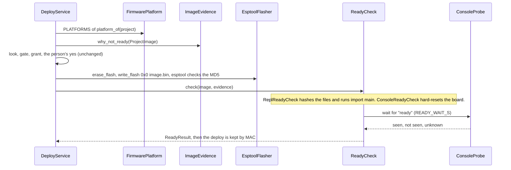

# P221 final plan: four firmware platforms, seams first

[P221 #203](https://github.com/xmejkal/spark/issues/203), 2026-10-20. Opus synthesis of round 1 and round 2.

> **TL;DR.** Spark gets four platforms in four slices, and something works after each one. Slice 0 cuts the seams with
> MicroPython only (8 to 11 PRs). Slice 1 adds Arduino by arduino-cli on the XIAO ESP32-C6 (10 to 14). Slice 2 adds
> ESP-IDF (6 to 9). Slice 3 adds PlatformIO as a second build tool, not a fourth language (4 to 6). In all 28 to 40 PRs
> and about 5 to 8 hours of the PO's bench. The test of the seams: slices 2 and 3 edit no caller and no golden.

One `platform` key in requirements.json names the language the conversation writes: `micropython`, `arduino` or
`esp-idf`. The build tool is a job in `data/tools.json`, so a person points that job at PlatformIO the way spark
already switches any tool. The device side (esptool, the look, the `ready` line) is one shared path for all four.

## 1. Council

| Round | Who | What it changed |
|---|---|---|
| 1 | Five lenses (chain, board, MVP, ripple, tests) on Sonnet, synthesis on Opus | The change map, the seams, 21 ripple groups, 12 to 18 PRs |
| 1 | Refuter, Opus (`refuter-1.md`) | 8 errors confirmed. The count is 14 to 16. Three pieces of work had no PR. 102 files name MicroPython, not 45. verify-flash adds nothing. "No facts on the board" overrode D22 and D34 unnamed. P323 is a draft. The install is 12 GB on disk |
| 2 | Architect, Opus | Two families and one shared device side. One class with role objects. W1 as one rule in the contract |
| 2 | ESP-IDF and PlatformIO specialist, Sonnet | Sources: `idf.py merge-bin` at 0x0, the C6 console over USB, official PlatformIO lacks Arduino on the C6 |
| 2 | Plan and test lens, Sonnet | Slice order, PR ranges per slice, the opt-in compile tests, the 10 PO decisions |

**Disagreements, settled by this synthesis.**
- *Second platform: arduino-cli.* The PO asked for "object-oriented C++ in Arduino". Core 3.3.10 has the C6 (refuter
  #8). Official PlatformIO reaches Arduino on the C6 only through the third-party pioarduino fork (2024 threads, today
  unverified). ESP-IDF has no Arduino API. So arduino-cli puts no fork on the path.
- *No `toolchain` key.* PlatformIO builds Arduino or ESP-IDF code, so it is a build tool, not a language.
  `data/tools.json` already points a job at a tool, per person or per project. A new key duplicates that choice.
- *Wokwi's token is not new:* MicroPython runs need it today (`data/tools.json:53`, `run_scenario.py:248`). *No
  verify-flash:* esptool's write already checks the MD5 (refuter #3), which closes the specialist's open MD5 point.
- *Reuse names.* The architect's `FirmwareImage`, `BoardProof`, `ConsoleReader` and `BoardShell` exist already as
  `ProjectImage`, `ReadyCheck`, `ConsoleProbe` and `BoardConnection` (developing.md's naming table). One word, one thing.

## 2. The architecture

`FirmwarePlatform` already is one class built by a function (`firmware_platform.py:41`, `FirmwarePlatform.micropython`).
It keeps that shape. `PLATFORMS` maps a name to its builder, and the compiled platforms share
`compiled_platform(name, layout, image_builder)`. No subclass per platform.

| Role (kind) | MicroPython | Arduino | ESP-IDF | Shared |
|---|---|---|---|---|
| `FirmwareLayout` (Value) | `firmware/main.py`, `pins.py` | `firmware/firmware.ino`, `pins.h` | `CMakeLists.txt`, `main/`, `main/pins.h` | no |
| `PinMapRenderer` (Renderer) | `PythonPinMapRenderer` | `CHeaderPinMapRenderer` | `CHeaderPinMapRenderer` | the header, by two |
| `FirmwareCheck` (Strategy) | `StandInImportFirmwareCheck` | `CompileFirmwareCheck` | `CompileFirmwareCheck` | the compile, by two |
| `ImageBuilder` (Strategy, Adapter) | `InterpreterImageBuilder` | `ArduinoCliImageBuilder` | `EspIdfImageBuilder` | no |
| `ReadyCheck` (Strategy) | `ReplReadyCheck` | `ConsoleReadyCheck` | `ConsoleReadyCheck` | two families |
| `BoardConnection` (Adapter, optional) | mpremote | None | None | MicroPython only |

`EsptoolFlasher` and `ConsoleProbe` serve all four. PlatformIO adds only `PlatformioImageBuilder`. "Firmware" is the
person's code, the "image" is what the flasher writes (`ProjectImage` gains `elf` and `platform`), "evidence" holds before
the flash (P337's `ImageEvidence`), and the ready check reads the board after it. The pin map is a C header, never Kconfig.

```mermaid
classDiagram
  <<Platform>> FirmwarePlatform
  <<Value>> ProjectImage
  FirmwarePlatform *-- FirmwareLayout
  FirmwarePlatform *-- PinMapRenderer
  FirmwarePlatform *-- FirmwareCheck
  FirmwarePlatform *-- ImageBuilder
  FirmwarePlatform *-- ReadyCheck
  FirmwarePlatform o-- BoardConnection : optional
  PinMapRenderer <|-- PythonPinMapRenderer
  PinMapRenderer <|-- CHeaderPinMapRenderer
  FirmwareCheck <|-- StandInImportFirmwareCheck
  FirmwareCheck <|-- CompileFirmwareCheck
  ImageBuilder <|-- InterpreterImageBuilder
  ImageBuilder <|-- ArduinoCliImageBuilder
  ImageBuilder <|-- EspIdfImageBuilder
  ImageBuilder <|-- PlatformioImageBuilder
  ImageBuilder ..> ProjectImage : builds
  ReadyCheck <|-- ReplReadyCheck
  ReadyCheck <|-- ConsoleReadyCheck
  ReplReadyCheck --> BoardConnection
  ReadyCheck --> ConsoleProbe
```



**Shared by all four:** needs, parts, the drawer, pin facts, the diagram, the sheet, the look, the grant, the gate,
esptool's erase and write at 0x0, the `ready` line, the deploy kept by MAC (`board_facts.py:55`), P337's evidence rule.
**Different:** the language, the firmware tree, the Mac check, the image, the REPL. A compiled board has no `live`, `reach`, doctor's cure, `spark.json` or import pin guard.

**The skip rule (W1).** A step a platform does not support prints `skipped` with code `not_for_platform` and its cause,
never `ok`. One helper writes it. `PlatformContract` asserts it for every step, so no caller holds the rule.

**Facts each record needs (facts only, never behaviour).**
- Board record: a `platforms` block replaces `micropython_port` (`boards/xiao-esp32-c6.json:9`): `micropython.port`,
  `arduino.fqbn` (`esp32:esp32:XIAO_ESP32C6`), `esp-idf.target` (`esp32c6`), each with its origin. A missing block means
  the board lacks that platform. The wake facts (`boards/xiao-esp32-c6.json:195`) move under `platforms.micropython`.
- requirements.json: `platform`, default `micropython`. could-not-run with code `unknown_platform` for an unknown name,
  and `no_platform_for_board` for a board without the block.
- tools.json: optional jobs `arduino-builder` and `esp-idf-builder`, each pinned, with fetch, checksum and size. The run
  log: `platform`, the build tool and its version, and the gate compares the platform.

**P323's draft #414.** Reuse: the `platform` key and default, `SimulationEngine`, the `<Name>Contract` tests, slice 1a.
Amend: one class built by a function, not a subclass per platform. `make_image` becomes `ImageBuilder.build`, returning a
`ProjectImage`. `micropython_port` moves under `platforms`. Source roles go in `firmware/`, device roles in `bench/`. Replace: nothing.

## 3. The slices

**Slice 0, the seams, MicroPython only (8 to 11 PRs).** Its refactor PRs keep every outside test green. After it,
everything works as today, through the roles. Later platform PRs add strategies and goldens. Slice 0 pays off alone: `assign_pins.py` shrinks, no record key names a tool, and REPL errors part from serial errors.
- T1 `FakeToolFinder` and `ServiceCase.make_service()` (`tools.find` is patched about 60 times).
- R1 `platform`, `PLATFORMS`, `platform_of`, used by `deploy.py:171` and `run_scenario.py:150`. `parts.py
  --requirements` writes the key, so `/spark:idea` is where a person picks it.
- R2 board record `platforms.micropython.port`, one reader for `flash_image.py:89`, the key optional in `board.ts`.
- R3 `PinMapRenderer` out of `assign_pins.py:392`, with the marker (`check_spine.py:896`) and the pull-up text (`compare_design.py:211`).
- R4 `FirmwareLayout` and `ImageBuilder`. `run_scenario` stops calling `flash_image` itself. R5 `FirmwareCheck`.
- R6 `ReplReadyCheck` out of `ready_check.py:61`, `BoardConnection` optional, `DeployService.verify` (`deploy_service.py:149`) free of mpremote.
- R7 `PlatformContract` with the skip rule, the run log's platform, wake facts moved, `PROJECT_FILES`
  (`tools/check_docs.py:25`) per platform. Plus 0 to 3 review-fix PRs.
- Tests: outside goldens unedited, `tools/snapshot.py --against` at the end, the contract on MicroPython. Bench: a
  30-minute MicroPython regression walk. Docs: developing.md's Platform row, agents.md's `platform`, in R1 and R7.

**Slice 1, Arduino on the C6 (10 to 14 PRs).** After it: button and LED, `pins.h`, compile, flash, `ready`, sheet, diagram.
- A0 bench spike, docs only: arduino-cli and core 3.3.10, a C6 compile, the merged image at 0x0 (the core's
  `platform.txt` recipe), the write's MD5, `ready` over USB, Wokwi on the `.elf`, the measured install.
- A1 setup: `arduino-builder` in `data/tools.json` with fetch, checksum and a pinned core. `/spark:setup` names the size first.
- A2 `CHeaderPinMapRenderer` writes `firmware/pins.h` with a `//` marker. A3 `ArduinoCliImageBuilder` and
  `CompileFirmwareCheck` (first 40 error lines, a missing tool gives could-not-run). It ends refuter #6.
- A4 the `arduino` entry: `ConsoleReadyCheck`, no `BoardConnection`, so `live`, `reach` and the cure say `skipped`. A5 Wokwi
  for a compiled image: `sim_project.py:191` writes the real `elf`, and the token rule stays as today.
- A6 the platform pick in `/spark:idea` and `/spark:init`. A7 commands, skills and agent prompts (102 files name
  MicroPython, about 25 steer Claude), 1 to 2 PRs. A8 README table, `tools/journey.py`, Miro, the guides.
- The bench walk and 1 to 3 fixes. Tests: the contract subclass, added goldens, `FakeImageBuilder`, an opt-in compile test.

**Slice 2, ESP-IDF on the C6 (6 to 9 PRs).** After it: the same project in C or C++, `idf.py build`, the same deploy.
E0 spike (EIM install size, `idf.py set-target esp32c6`, `idf.py merge-bin` at 0x0, `ready` on USB, Wokwi from
`flasher_args.json`). E1 setup. E2 `EspIdfImageBuilder` and its layout. E3 the record block and the contract subclass.
E4 prompts and docs. 1 to 2 bench fixes. Success: no caller, contract or golden edited.

**Slice 3, PlatformIO as a build tool (4 to 6 PRs).** After it: a person points `arduino-builder` or `esp-idf-builder`
at PlatformIO, and the same project builds. P0 spike (pioarduino's state, the C6 board file, the size). P1 `PlatformioImageBuilder`
writes `platformio.ini` from the record. P2 the tools row. P3 docs. 1 bench fix. An unfit fork ends the slice as a finding.

**Tests in every slice.** (1) The outside never changes: `tests/test_json_contracts.py`, `tests/test_deploy_json.py`,
the CLI tests, the snapshot. (2) `PlatformContract`: the pin map passes its own check, an empty tree is could-not-run, an
unsupported step is `skipped` with a code, an unknown ready line is never a pass. (3) Fakes in `tests/fakes.py` fed with
recorded tool output. (4) Compile tests run with `SPARK_TEST_TOOLCHAINS=1` and the tool found, and say `skipped`
otherwise. A compile is "compiled", not "checked". (5) A mutation table per logic PR. (6) One bench walk per platform.

## 4. The cost

| Slice | PRs | PO bench (unverified) |
|---|---|---|
| 0 seams | 8 to 11 | 30 min regression walk |
| 1 Arduino | 10 to 14 | A0 1 h, walk 1 to 2 h, fixes 30 min each |
| 2 ESP-IDF | 6 to 9 | 1 to 2 h with the install |
| 3 PlatformIO | 4 to 6 | 45 min |
| **Total** | **28 to 40** | **about 5 to 8 h, in 4 to 6 sittings** |

Basis: 80 PRs merged in the 7 days to 10-20, and P239's deploy seam took 8 PRs for a smaller change than slice 0. The
bench sets the calendar, about 4 to 7 weeks (unverified). Install sizes: the Arduino esp32 core is about 6 GB to fetch
and 12 GB on disk (measured, refuter #7). ESP-IDF, PlatformIO and a C6-only core: unverified, measured in E0, P0 and A0.

## 5. Risks and what is out

1. **Heavy installs.** 12 GB for Arduino breaks "a user installs nothing heavy" (`AGENTS.md:34`). Each builder stays
   optional like KiCad, and `/spark:setup` names the size and asks first.
2. **The C6 side is unverified.** The merged image boots at 0x0, `ready` shows over USB within `READY_WAIT_S`
   (`ready_check.py:17`), and Wokwi runs a compiled C6 image. A0 and E0 test these before any platform code.
3. **PlatformIO rides on a fork.** It comes last and stays optional. A failed P0 stops only slice 3.

Out: Rust, CircuitPython, other boards before the C6 walks, a REPL for compiled platforms, host C++ tests (the conversation's
firmware owns them), the C++ pin guard (it says `skipped`), Kconfig pin maps, `idf.py flash` or `pio run -t upload` as flashers.

## 6. Decisions for the PO

1. Slice 0 first, MicroPython only, before any platform? **Yes.** It pays off alone, and no caller gets an `if platform`.
2. Arduino by arduino-cli second, then ESP-IDF, then PlatformIO? **Yes.** The C6 is in the core today, with no fork.
3. One `platform` key, and the build tool as a job in `data/tools.json`, no `toolchain` key? **Yes.** One setting per choice.
4. D22 and D34 stay for MicroPython, and a compiled platform says `skipped` with its cause while the Mac keeps the deploy
   by MAC? **Yes.** A littlefs facts file is a later card on request.
5. Merge P323's draft #414 with the amendments in section 2? **Yes.** Slice 0 builds on its names and contracts.
6. Slice 0 starts after P337 #431 closes and the retro? **Yes.** Finish before switching.
7. Walk 1's fixes (P351's plan) go before R1, with only T1 beside them? **Yes.** They serve a working breadboard now.
8. Compiled platforms follow P337's simulation rule, with no gate of their own? **Yes.** One rule for all.
9. One epic with four one-sentence stories, and only slice 0 and A0 refined now? **Yes.** Plans shrink with distance.
10. One bench hour for A0 after slice 0? **Yes.** It is the first proof on the C6.

## 7. Sources

- Code: the file:line references above, on main d2f6b4d (`scripts/image_evidence.py` came with PR #454). The council: `finding.md`, `lens-*.md`, `refuter-1.md`, `round2-architect.md`, `round2-idf-pio.md`, `round2-plan.md`.
- esptool's cmds.py, lines 1938 to 1958, and core 3.3.10's boards.txt, line 37932 (refuter-1, outside the repo).
- https://docs.espressif.com/projects/esp-idf/en/latest/esp32c6/api-guides/tools/idf-py.html#merge-binaries-merge-bin and https://docs.espressif.com/projects/esp-idf/en/latest/esp32c6/api-guides/usb-serial-jtag-console.html
- https://community.platformio.org/t/how-to-flash-xiao-seeed-esp32-c6/44742, https://docs.wokwi.com/vscode/esp-idf and https://docs.wokwi.com/vscode/platformio
