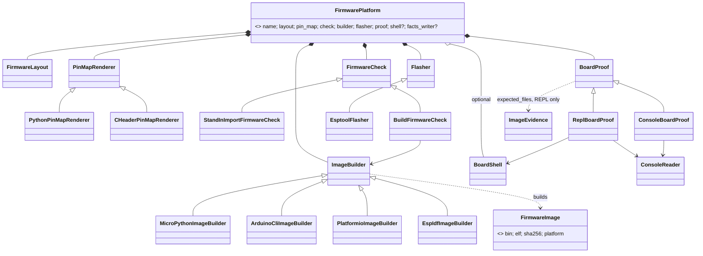

# P221 round 2: the architect (Opus, 2026-10-20)

Input: finding.md, refuter-1.md (trusted over finding.md), the five lenses, P323's design.md (draft PR #414),
`scripts/firmware_platform.py`, `scripts/flasher.py`, `scripts/image_evidence.py` (branch `p337-no-simulation`).
New constraint, the PO 2026-10-20: ESP-IDF and PlatformIO will come, maybe more. "(unverified)" = not run or not opened.

> **TL;DR.** Four platforms split into two families. MicroPython copies files and has a REPL. Arduino, PlatformIO and
> ESP-IDF compile one image and only print on serial, and they differ in just two things: where the sources live and
> which tool builds the image. So `FirmwarePlatform` becomes one class made of role objects, built by a function per
> platform, and the three compiled platforms share one builder function. The device side (esptool, the look, the
> `ready` line) is shared by all four. Cut the `platform` key and the `PLATFORMS` registry first.

## 1. Decisions

| # | Decision | Why |
|---|---|---|
| D1 | `FirmwarePlatform` is **one class that composes role objects**, not a subclass per platform. `PLATFORMS = {"micropython": micropython_platform, "arduino": ..., "platformio": ..., "esp-idf": ...}` maps a name to a builder function. | The three compiled platforms share about 80 percent. Subclasses would nest, and a function per platform is one line in the registry. This amends P323's "one subclass". |
| D2 | **Two families, one shared device side.** The source side varies: `FirmwareLayout`, `PinMapRenderer`, `FirmwareCheck`, `ImageBuilder`. The device side is shared: `EsptoolFlasher`, `BoardReader` (the look), `ConsoleReader`. `BoardProof` has two strategies, one per family. | One `compiled_platform(name, layout, builder)` builds Arduino, PlatformIO and ESP-IDF. A fourth compiled platform adds one Adapter and one layout. |
| D3 | **esptool flashes all four.** `idf.py flash` and `pio run -t upload` are rejected as flashers. | Both wrap esptool (unverified for the versions in use). The look, the grant, the gate, the retry and the boot hint stay in one place. "One tool per job" (AGENTS.md). |
| D4 | **Every image is a `FirmwareImage` Value**: `bin` (the whole flash from 0x0), `elf` (None for MicroPython), `sha256`, `platform`. The simulator, the evidence, the flasher and the run log read only this. | The flasher and `sim_project` stay platform-blind. `wokwi.toml` gets the real `elf` (finding section 1.5). |
| D5 | **Proof = esptool's own write check, then `ready`** for the compiled family (refuter #3: no separate verify-flash). `ReplBoardProof` (today's `ReadyCheck`: hashes, `import main`, `ready`) stays for MicroPython. `ImageEvidence.expected_files` is read only by `ReplBoardProof`, so its `{}` needs no new code (answers refuter round 1's open point). | The compiled board boots by itself. Only the REPL family has files to hash. |
| D6 | **A missing step reports `skipped`, never `ok` (W1).** An optional role (`BoardShell` for live, reach and the doctor's cure; `BoardFactsWriter`) returns None. One helper `skip_step(platform, step)` writes `skipped` with code `WHY_NOT_FOR_PLATFORM`. `PlatformContract` asserts it for every step in `STEPS`. | Refuter #9: W1 had no single rule. The rule lives in the contract, never in a caller. |
| D7 | **The platform is chosen once**: requirements.json `platform`, default `micropython`, read by `platform_of(project)`. An unknown name is `could-not-run`, code `unknown_platform`. A board record without that platform's block is `could-not-run`, code `no_platform_for_board`. | P323 D-table row 54. Today it is picked at `deploy.py:171` and inside `run_scenario.py:150`. |
| D8 | **Facts on the board stay a PO question** (refuter #4: D22 and D34). The design leaves room: `BoardFactsWriter` is optional. MicroPython writes `spark.json`. A compiled platform gives None, so `skipped`, and the Mac keeps the deploy by MAC. | It keeps the PO's choice open without blocking any PR before A3. |

## 2. Roles, names and who varies

Names follow developing.md: a subclass is what varies, then the base's whole name. Round 1's `StandInImport`,
`ReplProof` and `FlashReadProof` break this rule and are renamed here.

| Role (kind) | MicroPython | Arduino | PlatformIO | ESP-IDF | Shared? |
|---|---|---|---|---|---|
| `FirmwareLayout` (Value) | `firmware/main.py`, `pins.py` | `firmware/firmware.ino`, `pins.h` | `platformio.ini`, `src/`, `include/pins.h` | `CMakeLists.txt`, `main/`, `main/pins.h` | no, a Value per platform |
| `PinMapRenderer` (Renderer) | `PythonPinMapRenderer` | `CHeaderPinMapRenderer` | same | same | the C header is shared by 3 |
| `FirmwareCheck` (Strategy) | `StandInImportFirmwareCheck` | `BuildFirmwareCheck(builder)` | same | same | the compile check is shared by 3 |
| `ImageBuilder` (Strategy, Adapters) | `MicroPythonImageBuilder` (interpreter and littlefs) | `ArduinoCliImageBuilder` | `PlatformioImageBuilder` | `EspIdfImageBuilder` (`idf.py build`, `esptool merge-bin`) | no |
| `Flasher` (Strategy) | `EsptoolFlasher` | same | same | same | yes |
| `ConsoleReader` (Adapter, pyserial) | yes | yes | yes | yes | yes, from esptool's Python (unverified) |
| `BoardProof` (Strategy) | `ReplBoardProof` | `ConsoleBoardProof` | same | same | two |
| `BoardShell` (Adapter, optional) | `BoardConnection` (mpremote) | None, so `skipped` | None | None | MicroPython only |

The pin map is one C header, never Kconfig: a pin is a fact, and Kconfig is a menu for a person's settings. The ESP-IDF
`pins.h` is plain `#define` lines, so C and C++ both read it. "firmware" is the person's code, "image" is what gets
flashed, "evidence" is what holds before the flash, and "proof" is what the board shows after it.

## 3. Data from records (facts only)

- **Board record**: one `platforms` block replaces `micropython_port` (`boards/xiao-esp32-c6.json:9`):
  `"platforms": {"micropython": {"port": ...}, "arduino": {"fqbn": "esp32:esp32:XIAO_ESP32C6"},
  "platformio": {"board": ...}, "esp-idf": {"target": "esp32c6"}}`. Each value carries its origin. A missing block
  means the board does not support that platform (D7). The wake facts move under `platforms.micropython` (ripple A6).
- **tools.json**: roles stay named by job. Add `arduino-builder`, `platformio-builder` and `esp-idf-builder`, each with
  a pinned version (the esp32 core, the platform, the IDF release), its install size, and `optional: true`. Refuter #7:
  the Arduino core is about 12 GB on disk. ESP-IDF and PlatformIO are heavy too (unverified). Each one is named and
  asked about before install, like KiCad. Rename the contract `micropython-esp32-bin` to `interpreter-image`.
- **requirements.json**: `platform`. The run log adds `platform`, and the gate compares it (finding section 2).

## 4. Class diagram



## 5. A deploy through the platform-neutral path

```mermaid
sequenceDiagram
  participant D as DeployService
  participant P as PLATFORMS[platform_of(project)]
  participant E as ImageEvidence
  participant F as EsptoolFlasher
  participant B as BoardProof
  participant C as ConsoleReader
  D->>P: build the platform (flasher, proof, shell?)
  D->>E: why_not_ready(FirmwareImage)
  D->>D: look, gate, grant, the person's yes (unchanged)
  D->>F: erase_flash, write_flash 0x0 image.bin (MD5 checked by esptool)
  D->>B: check(image, evidence)
  alt ReplBoardProof (MicroPython)
    B->>B: hash the files, import main
  else ConsoleBoardProof (compiled)
    B->>C: hard reset
  end
  B->>C: wait for "ready" (READY_WAIT_S)
  C-->>B: seen, not seen, unknown
  B-->>D: ReadyResult; facts_writer or skipped; the deploy is recorded by MAC
```

## 6. Order of refactors (MicroPython works and the goldens stay the same after each one)

| Step | PR | First, because |
|---|---|---|
| T1 | `FakeToolFinder` and `ServiceCase.make_service()`, merged with P323 slice 1a (refuter #5) | `tools.find` is patched about 60 times |
| R1 | **`platform` key, `PLATFORMS`, `platform_of`**. `deploy.py:171` and `run_scenario.py` use it. One entry. | **The seam to cut first**: every role hangs from it, and no output changes |
| R2 | board record `platforms.micropython`, one reader, `board.ts` optional key | It removes a key named after a tool |
| R3 | `PinMapRenderer` out of `assign_pins.py:392`, with the header marker (`check_spine.py:896`) and the pull-up text | It is the smallest seam with two clear forms |
| R4 | `FirmwareLayout`, then `ImageBuilder` returning `FirmwareImage`. `run_scenario` stops calling `flash_image` directly. | `main.py` is hard-coded in three modules |
| R5 | `FirmwareCheck` | It wraps `import_firmware` |
| R6 | `BoardProof` and `ConsoleReader` out of `ReadyCheck` and `BoardConnection`. `BoardShell` becomes optional. | REPL errors and serial errors are told apart |
| R7 | `PlatformContract` with the `skipped` rule (D6), the run log names its platform, the wake facts move | It locks in the seam before a second platform |

Then come Arduino (A0 bench spike, A1 to A5, plus the setup, Wokwi `elf` and platform-pick PRs that refuter #2 found
missing). After that, PlatformIO and ESP-IDF each take about 3 PRs (unverified): a builder Adapter and a layout, then
record blocks and tools rows, then docs. **The test of this design**: neither one edits a caller, a contract or a golden.

## 7. Relation to P323 (draft PR #414, parked; walk 1 first, the PO 2026-10-19)

| P323 piece | Here |
|---|---|
| `platform` key, default `micropython`, the only choice (2.5, D-table 54) | **Reuse**, plus the two error codes from D7 |
| "one `FirmwarePlatform` subclass, one line in `PLATFORMS`" | **Amend**: a builder function, not a subclass (D1) |
| Class `FirmwarePlatform { make_flasher, make_connection, pin_map_text, make_image }` | **Amend**: the eight roles in section 2. `make_image(project)` becomes `ImageBuilder.build(project) -> FirmwareImage` |
| `micropython_port` as a fact the platform reads | **Amend**: under `platforms.micropython.port` |
| `SimulationEngine` / `WokwiCliEngine` | **Reuse**. It takes a `FirmwareImage` |
| Areas: `FirmwarePlatform` in `bench` | **Amend**: source roles in `firmware/`, device roles in `bench/`, the registry in `bench` |
| S13 and S14 contracts (`<Name>Contract`; the platform loops over board records) | **Reuse**: `PlatformContract`, `ImageBuilderContract` |
| Slice 1a before walk 1 | **Reuse**: T1 joins it. R1 to R7 land with the first story that needs them, never beside a P323 move of the same files |

Nothing in P323 is replaced. No R-PR starts before walk 1 and P337, unless the PO says so. One refuter for the final plan.
## 8. Unverified, to settle in A0 or the specialist lens

esptool under `idf.py flash` and `pio run -t upload`. PlatformIO's esp32-c6 board id and its Arduino-core support.
ESP-IDF's merged image (`idf.py merge-bin` or `esptool merge-bin`). Wokwi running a PlatformIO or ESP-IDF `elf` on the
C6. pyserial in esptool's Python. The install sizes of PlatformIO and ESP-IDF.
