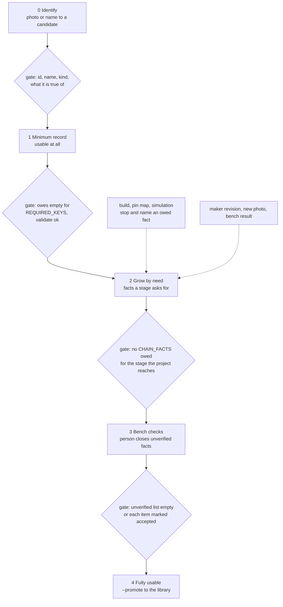

# P372 council lens: spark engineering senior, the process

> **TL;DR.** Today two commands (`/spark:research`, `/spark:identify`) run one long path: reuse, find, read, write the
> record, check it. The path has no stage for "usable at all", and "fully usable" is not defined. The pieces for it
> already exist: `parts.owes()` lists what the chain still asks of a record (`REQUIRED_KEYS` and `CHAIN_FACTS`),
> `--unverified` lists what no one checked, and `--fact-set` fills a fact in place. One process follows: identify,
> minimum record, grow by need, bench checks, fully usable. New: one gate name per stage, one `--stage` view over
> `owes()`, and a rule for chipless modules. Nothing else is new.

## Today's process, step by step

Sources: `commands/research.md`, `commands/identify.md`, `agents/parts-researcher.md`, `agents/part-finder.md`,
`agents/datasheet-reader.md`, `scripts/parts.py` (`--help`, `owes`, `audit`), and the 16 rows of
`docs/observations/rows/p366-photo-walk.md` (R1 to R16 below).

| # | step | who | tool | walk gap |
| --- | --- | --- | --- | --- |
| 1 | Photos, both sides, flat, ruler in frame | person | camera | R16 photos too poor for drawings |
| 2 | Read the image, list markings | Claude (lead) | Read | R4 no written image reading apart from the web |
| 3 | Reuse: `--need`, `--kept` | script | `parts.py` | R2 expected, R3 no search path for AliExpress, R9 `--kept` misses a project record |
| 4 | Ask: does the person own one | Claude | drawer | none |
| 5 | Choose the route: commodity or module | Claude | `research.md` step 2 | R6 a chipless module fits neither route |
| 6a | Commodity: find 2 candidates, person picks | agent `part-finder` | web, JLCPCB | none (walk used 6b) |
| 6b | Module or photo: research the vendors, write the record | agent `parts-researcher` | web, Write | R4 web search is not required, R5 no schema file, R6 no rule for look-alike datasheets |
| 7 | Write the skeleton | script | `--skeleton` | R12 needs `--kind` (only the error says so), writes `sourcing: []` for an owned part |
| 8 | Keep documents | script | `--fetch`, `--keep` | R7 `--fetch` reads only keyed URLs, R8 kept name is the download name |
| 9 | Read datasheet pages | agent `datasheet-reader` | `--read` | R10 LABEL ONLY on tables without row labels |
| 10 | Fill facts and cite | agent | Edit, `--fact-set` | R13 `+5V` refused, the way out is in the error only |
| 11 | Check | script | `--validate`, `--sources`, `--unverified` | R11 crash under `python3 -I`, R14 `--unverified` misses a guessed body size |
| 12 | Drawer entry, `--promote` | Claude, script | `--drawer-set`, `--promote` | none |
| 13 | Bench checks | person | meter, ruler | R15 waits on the PO, nothing records the result |

What the map shows. Steps 1 to 12 run without a gate between them. The only gates are `--validate` (shape), and
`owes()` (read only when `--match` or `--audit` runs, never at the end of research). So "done" means "the agent
stopped", not "the chain can use it". Step 13 has no tool at all: a bench result has no way back into the record.

## What the process owes, from the principles

- Records grow by need (AGENTS.md). A fact enters when a stage reads it. So the stages, not the part kinds, order the facts.
- Spark exports facts. The process writes no behaviour, so no stage holds a threshold or a driver.
- One core. The stage view lives in `parts.py`, and the commands and agents call it. No agent prompt repeats it.
- Names say the role. One word per stage, used in code, docs and Miro.

## The proposed process

Five stages. Each record sits at the highest stage whose gate it passes. A stage never needs the next one to start.

The dotted arrows are the grow-by-need loop: a stage that stops on an absent fact sends the record back to stage 2 for
that one fact. An update enters the same way, at stage 2, from a new source.

### The steps, with input, output, tool and done-check

| stage | input | output | script or agent (existing unless marked NEW) | done when |
| --- | --- | --- | --- | --- |
| 0 Identify | photos of both sides, or a name | markings list, board name, the exact thing the record is true of (W5) | lead reads the image (Read), `--need`, `--kept`, then a web search that is required, not optional (R4) | the lead can write one line "this is X, sold as Y, seen in photo Z", and `--need` found no match |
| 1 Minimum record | stage 0 line | `parts/<id>.json` with `schema`, `id`, `name`, `kind`, `needs` | `--skeleton` (NEW: `--kind` defaulted from the stage 0 line, R12), `parts-researcher` for a module, `part-finder` plus `--skeleton` for a commodity part | `--validate` says ok and `owes()` holds no `REQUIRED_KEYS` |
| 2 Grow by need | the name of one absent fact, from `owes()` or from a stage that stopped | that fact, with `value`, `verified`, `source` | `datasheet-reader` for a datasheet fact, `parts-researcher` for a module fact, `--fact-set` to write, `--read` to read | `owes()` no longer lists that fact, `--validate` ok |
| 3 Bench checks | the `--unverified` list, each item with how to check it | the same facts with `verified: true` and a `cites` of "bench, date" (NEW: one citation form) | person with meter and ruler, Claude writes the result with `--fact-set` | each item is verified or marked accepted by the person |
| 4 Fully usable | a record with stages 1 to 3 passed | copy in the library | `--promote`, `--sources` | `--sources` all ok, `--audit` lists it as current |

### What "minimum" and "fully usable" mean here

- Minimum (stage 1) is the five `REQUIRED_KEYS`. It is enough for `--need` to find it and for `--match` to offer it.
  It is not enough to build: `owes()` still lists the `CHAIN_FACTS`. That is correct, because the person sees what is owed.
- Fully usable is a project-reach question. A record is usable for a breadboard when the build stage owes nothing:
  `footprint`, `pin_order`, `pin_order_proof`, `body_mm`, `simulation` today. A later stage (PCB, 3D, schematic symbol:
  P370, P371) adds its fact names to the list. Nothing else changes.
- Fully usable also means stage 3 is closed. A record with `verified: false` facts is usable but marked. This keeps
  the existing rule: `unverified` is not a pass.

## What is new, and the smallest way to build it

1. **`--stage PART`** (NEW, small): one line per record, "stage 2, owes footprint, 9 unverified". It wraps
   `owes()` and `unverified`. No new data in the record. The stage is derived, never stored, so it cannot go stale.
2. **A stage table in code**: `STAGE_FACTS = {"build": CHAIN_FACTS, ...}` beside `CHAIN_FACTS`. A story that needs a fact adds it
   to one stage. This is the "grow by need" rule made literal and answers the PO's "what is needed and when".
3. **Bench result form** (NEW): `cites: {"document": "bench", "at": "2026-10-21, meter, PO"}`. `--validate` accepts it.
   Closes R15 and gives step 13 a path back into the record.
4. **Chipless module rule** (text in `research.md`, no code): a look-alike maker's document is cited as `verified: false`
   with the words "look-alike", a computed value inherits `false` from its inputs, and a nameless board is named by its
   seller label. Closes R6.
5. **Agent briefs say "stage and owed facts"**: both commands pass `parts.owes()` output to the agent in place of
   the long fact table in `research.md` section 3. The table stays as the default for a new commodity part.

## Walk gaps by where they land

| lands in | rows | action |
| --- | --- | --- |
| stage 0 | R3, R4, R16 | web search required in `identify.md` step 2 (R4), the seller list is spike P368 (R3), the picture is P370 (R16) |
| stage 1 | R5, R12, R13 | a schema pointer in `identify.md` (`part-data.md` exists, name it), clearer `--skeleton` errors, put the `+5V` rule in `--help` |
| stage 2 | R6, R7, R8, R9, R10, R14 | tool fixes, each a small card: `--fetch` over list sources, `--keep --as NAME`, `--kept` over projects, `--read` label-less rows, `--unverified` lists guessed `body_mm` |
| stage 3 | R15 | the bench form above |
| all | R11 | bug P369 #471, already acted |
| stage 4 | none | the walk passed it (R1) |

## Updating a part

Same stages, entered at 2. Input is a trigger: a new revision, a new photo, a bench result, or an owed fact. The
`--kept` check first, then `--fact-set` on the one fact, then `--validate`. Rule to add: an update that changes a
verified value moves it to `verified: false` until the new source is cited, so a stage never reads a stale pass.

## Open points for the council

- Does `--stage` live in `parts.py` or in `needs.py`, where `owes` is already read for `--match`? One core argues for `parts.py`.
- Types or traits (question 4 of the spike): not decided here. The stage table above works with either, since it keys on
  fact names, not on kinds. The `kind` field stays one word.
- The walk had one module and no commodity part. Stage 0 to 1 for a commodity part is untested.
