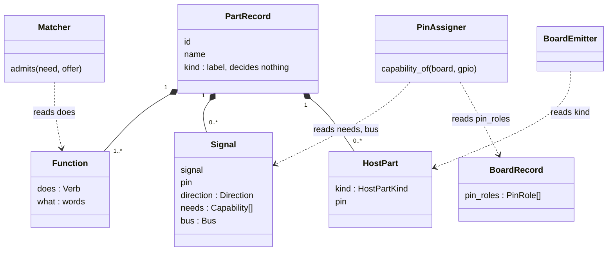

# Types or traits: the architect lens (P372)

> **TL;DR.** Traits, not a hierarchy. Spark already has four closed trait vocabularies (`function` verbs, signal
> `needs`, `host_parts` kinds, board `pin_roles`), and each has a stage that reads it. The `kind` field is a free label,
> and it still decides one thing (`KIND_FUNCTION`). Make `kind` a label that decides nothing, write `function` on each
> record, and give signal `direction` a reader or stop carrying it. A joystick then says "input joystick" and "input
> button" on its own record, and the matcher finds it without a drawer entry.

Summary. A part type hierarchy forces one parent per part, and real modules do several jobs: the joystick is two pots
and a button. ESPHome, Google Home and Wokwi all avoid a deep tree, and keep a flat label beside a set of capabilities.
Spark's own rules (records grow by need, closed vocabularies, checks read facts) already point the same way, so the
change is small: one fallback map to retire, one field to write on every record, one unread trait to settle.

## 1. What spark has today

| Field | Where it lives | Closed? | Which stage reads it |
|---|---|---|---|
| `kind` (part) | required key, `scripts/parts.py:51` | no, any string | listings (`parts.py:1694`), the `--need` search (`scripts/matching.py:189`), `KIND_FUNCTION` fallback (`parts.py:66`, `parts.py:76`) |
| `function[].does` | 13 `VERBS`, `parts.py:61` | yes, refused if unknown (`parts.py:85`, `parts.py:859`) | the matcher: `admits` (`matching.py:149`), weight 1.0 (`matching.py:19`) |
| signal `needs` | `CAPABILITIES = ("wake", "adc", "pwm")`, `parts.py:217` | yes, refused (`parts.py:664`, `scripts/assign_pins.py:207`) | `assign_pins`: a pin is usable when `needs <= pin["can"]` (`assign_pins.py:290`) |
| signal `bus` | `BUSES`, `parts.py:358` | yes | `assign_pins`, the named bus pin path (`assign_pins.py:232`) |
| signal `direction` | `in`, `out`, `bidirectional`, `parts.py:652` | yes | none. Validated only |
| `host_parts[].kind` | `HOST_PART_KINDS`, `parts.py:431` | yes, refused (`parts.py:524`) | `emit_board.py:654`, `breadboard.py:164`, `design.py:294` |
| board `pin_roles` | `PIN_ROLES`, `scripts/boards.py:95` | yes, refused as "a role no script reads" (`boards.py:423`) | `assign_pins` (`UNAVAILABLE_ROLES`, `ROLE_PENALTY`, `assign_pins.py:61`, `assign_pins.py:72`) |

Three findings from the joystick (`joystick-module-mh`, in the person's shelf):

1. Its `kind` is `joystick`, which is not in `KIND_FUNCTION`, and the record has no `function`. So `function_of`
   returns nothing (`parts.py:76`), the store lists it as silent (`parts.py:167`), and `admits` drops it for any need
   with a verb (`matching.py:151`). Only the drawer entry's `function` (`tests/matching/drawer/joystick-module.json`)
   makes it findable (`matching.py:84`). A joystick in the store but not in the drawer is invisible to `--match`.
2. Its three signals carry `direction: "out"`. No stage reads signal direction. This breaks the rule that
   `PIN_ROLES` states for boards: a value nobody reads is carried and ignored.
3. The PO's "has a button" is already expressible. The joystick's switch is a signal (`JOY_SW`) with a pull-up
   `host_part`. Nothing on the record says "this part has a button" as a function.

So spark is already a trait system in four places. `kind` is the one field that acts like a type, and it is the
weakest one: open, and read by a per-kind map, which is logic written per part.

## 2. How other tools model it

- **ESPHome** groups by what an entity does (sensor, binary sensor, output, light, cover), and one device appears
  under several groups: the AM43 is both a cover and a sensor, and "it will appear multiple times" when a sensor fits
  several categories. The grouping is by capability, and a device holds many.
  Source: https://esphome.io/components/
- **Google Home** keeps a fixed list of device types, but "the functionality for device types comes from the traits
  that you add to each one", and "you can add whichever ones you want". The type is a label. Traits carry behaviour.
  Source: https://developers.home.google.com/cloud-to-cloud/traits
- **Wokwi** names each part with one flat string (`wokwi-led`, `wokwi-analog-joystick`) and puts settings in
  `attrs`. There is no category in the file. The prefix does not say the category either (`board-ssd1306` is a
  display). Source: https://docs.wokwi.com/diagram-format

None of the three uses a deep inheritance tree. Each keeps a flat name for people and a set of capabilities for
programs.

## 3. Recommendation: a label plus closed traits

One model, in three rules.

1. **`kind` is a label.** It stays required, free, and one word. People read it in listings and search for it. No
   code decides on it. `KIND_FUNCTION` becomes a one-time migration: each shipped record gets its `function`
   written, and then `function_of` reads only the record. This removes the only per-kind logic.
2. **Every trait is a closed vocabulary with a reader.** One constant in the module that validates it, refused
   when unknown, as `PIN_ROLES` and `CAPABILITIES` do now. A test checks that each value has a reading stage. A value
   with no reader does not enter.
3. **A trait enters by need, with its origin.** No "physical shape" enum now: `legs`, `pin_order`, `footprint` and
   `body_mm` already say the shape, and no stage asks "is it a module or a discrete part". A `display` verb, a
   `touch` capability or an `output_only` flag enters when a check or a stage asks for it.

The PO's examples in this model:

| PO's words | Where it lives | Reader |
|---|---|---|
| has a button | `function: {does: input, what: button}`, a second entry on the joystick | the matcher, at `/spark:idea` |
| shows something | `function: {does: indicate, what: display}` | the matcher |
| is output only | each signal's `direction: out` (the part drives the line). "Output only" for a whole part is derived, never stored | none yet. A candidate reader is the pin map, which exports each signal's direction as a fact for the firmware to set the pin mode |

Each trait and the stage that reads it:

| Trait | Values | Stage |
|---|---|---|
| `Function.does` | the 13 `VERBS` | idea: match a need to a part |
| `Signal.needs` | `wake`, `adc`, `pwm` | pin map: pick a pin |
| `Signal.bus` | `i2c`, `spi`, `i2s` | pin map: the bus pins |
| `Signal.direction` | `in`, `out`, `bidirectional` | none today. Give it the pin map export, or drop it |
| `HostPart.kind` | `pulldown`, `pullup`, `divider`, `series` | build: place the passive, breadboard sheet |
| `PinRole` (board) | the 10 `PIN_ROLES` | pin map: refuse or penalize a pin |

The names follow the developing.md table: `Function`, `Signal`, `HostPart` and `PinRole` are Values (facts, no
actions). `Matcher` is a Strategy (`NameContains`, `WordOverlap`). `PinAssigner` and `BoardEmitter` are the stage
names for `assign_pins` and `emit_board` in the diagram only. They are not classes in the code today.

## 4. Why not a hierarchy

- A tree gives one parent. The joystick is an input joystick and a button. A display module with a touch layer is an
  indicator and an input. A tree needs a second parent or a duplicate, and ESPHome lists such a device twice.
- A tree invites per-type code (`if kind == "sensor"`). Spark's rule is that checks read facts. `KIND_FUNCTION` is the
  one place where this happened, and it broke on the first new kind (the joystick).
- A tree is decided up front. Spark's records grow by need, and a closed trait list grows one value at a time, each
  with its reader.

## 5. What this asks of the record process

For the minimum record (the other lenses own the full stage list): `function` is required on every new part record,
with at least one verb. `/spark:research` and `/spark:identify` write it, because a record with no function is
invisible to the matcher. The validator refuses an unknown verb, as it does now.

## Proposed cards (for the council to decide)

1. Write `function` on each shipped part record and on the joystick, then retire `KIND_FUNCTION`.
2. Require `function` on a new part record (`/spark:research`, `/spark:identify`, `--skeleton`).
3. Signal `direction`: export it in the pin map as a fact, or stop carrying it. One decision, one card.
4. A test that every value of each closed vocabulary has a reader, beside `tests/test_no_magic_strings.py`.
