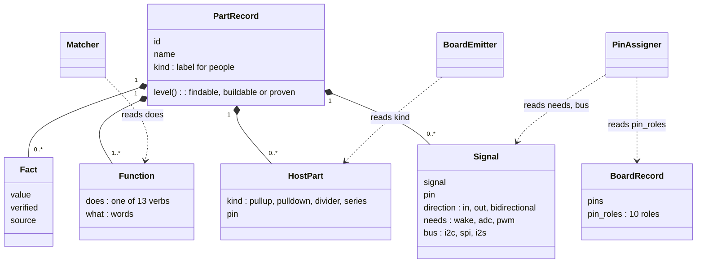
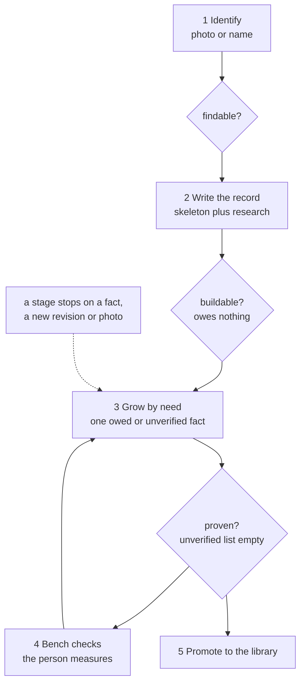

# P372 finding: what a part record needs, stage by stage, from the joystick (2026-10-20)

> **TL;DR.** The joystick record is good enough to build with today, but spark cannot tell how far a record is.
> The chain needs only a few fields, and almost every fact in the record is for people. Spark refuses a record
> only when one of ten fields (5 required keys and 5 chain facts) is absent, and nothing checks whether a guessed value was ever measured. Records
> get three levels: `findable`, `buildable` and `proven`. Spark works out the level from the record and never
> stores it. The answer on types is traits, not a hierarchy. `kind` stays a label that decides nothing. One
> process covers a new part and an update. Three cards follow. One fixes a real bug, and one unblocks the bench.

Summary. Five council lenses (reviewers, each with one question) read the code stage by stage. The synthesis and a
refuter (a reviewer that tries to prove the claims wrong) checked the main claims in the code. `owes()` lists the
fields a record lacks that the chain needs. An unverified fact is one with `verified: false`. The joystick
`joystick-module-mh` owes nothing. It builds, and it sits at `buildable` with 9 unverified facts. `--unverified` hides its guessed body size, which is a real bug. `--fact-set` cannot write a bench
result into `facts`, so the bench checks have no way back into the record. A board's fields differ from a part's, so this finding
adds a stage table for boards. The shared way to add a record is in the P331 plan (PR #435, see Sources), and this finding
does not repeat it.

## 1. The joystick, stage by stage

"Stops" means the stage refuses. "Says" means the stage prints the gap and goes on. "Silent" means no message.

| Stage | What it reads | What the joystick holds | Gap, and why |
|---|---|---|---|
| Idea, `--need` | `id`, `name`, `kind`, `also_known_as` (`scripts/matching.py`, `NameContains`) | all four | none. Walk row 1 found it by "joystick" |
| Idea, `--match` | `function`, else `KIND_FUNCTION[kind]` (`scripts/parts.py:66-84`), then the drawer entries' `function` | no `function`, and `joystick` is not in `KIND_FUNCTION` | A gap, not a bug today (see the note below the table) |
| Requirements | `owes()`: the required keys plus `footprint`, `pin_order`, `pin_order_proof`, `body_mm`, `simulation` | all of them | none. Checked: `owes` returns `[]` |
| Pin map (`assign_pins.py`) | `needs[].signal`, `.needs` (only `wake`, `adc`, `pwm`), `.bus` | `JOY_X`, `JOY_Y` ask `adc`. `JOY_SW` asks nothing | "ADC1 only, 11 dB" is prose in `host_requirements`. No capability word says it |
| Pull choice (`design.py:285-297`) | `host_parts[kind=pullup].internal_will_do` | a 10k pull-up, `internal_will_do: true` | the fact `module_has_switch_pullup` repeats it, and nothing compares the two |
| Board file (`emit_board.py`) | `pin_order`, `footprint`, `body_mm`, `power[]`, `host_parts`, the fact a `draws` names | all present | `body_mm` 34 x 26 is a guess with `verified: false`, and the chain builds on it as a number |
| Rail current | `power[VCC].draws` points at `facts.supply_current_ma` | 0.66 mA, computed from an unverified pot value | one of the 2 facts of the 8 that a stage reads. `conflicts_of` reads `supply_range_v` (`parts.py:1500`) and stops early here, because the module has no pull-up fact |
| Breadboard sheet | `host_parts`, `legs`, `host_requirements`, `unused_pins` | all present | `legs` and `host_requirements` have no type check (`RECORD_TYPES`, `parts.py:311`), so a typo drops them in silence |
| Simulation | `simulation.wokwi` | `wokwi-analog-joystick`, mapped by pin name | the axis directions are not measured, as `stand_in` says |
| Review (`--unverified`) | `facts[*].verified`, `pin_order_proof.verified` (`open_questions_of`, `parts.py:889`) | 9 unverified facts | **Bug.** Checked: `body_mm.verified: false` is not on the list (walk row 14). The pin map's own unverified list comes from the same function (`assign_pins.py:489`), so it hides the guess too |
| Bench result write (`--fact-set`) | only `CHAIN_FACTS` and `about`, `description`, `tags` (`parts.py:2040`) | 8 `facts` entries | **Blocks the bench.** A write to `facts.pot_resistance_ohms` is refused (exit 1). A verified fact with a prose source already validates, so only the write is missing |
| Drawer match by number | `sku`, `vendor` | both `null` | a maker-less AliExpress module has neither. The aliases find it |
| Firmware, deploy | nothing from the record | not applicable | a guess in the record reaches the bench unchanged |

Note on `--match`. `function_of` returns `[]` for the joystick. With the record alone, `SameWords.admits` is False for
`{does: input, what: joystick}`. The PO's drawer entry gives the function. The drawer is one per store
(`drawer.entries()` reads `store.place("drawer")`), so every project sees it. A store record with no drawer entry
stays hidden from `--match`. The research rules have no step that writes `function`.

Why the gaps exist. The module has no chip and no maker, so every fact rests on Joy-IT's KY-023 documents (a
look-alike from another seller) or on photos. The research rules assume a chip datasheet (walk row 6). Six of the 8
facts are read by no stage. They are notes for the person and Claude who write the firmware. That is correct, because
spark exports facts and the conversation writes the firmware. Nothing marks a fact as a note or as an input.

## 2. Record levels

One word per level. Each level includes the one before it. Spark works out the level from facts the record and the
drawer already hold, so no new field stores it and it never goes stale. A missing value is not a pass at any level,
and `verified: false` is not a pass either.

| Level | The test, from what spark holds | Part (an LED) | Module (the joystick) | Board (the XIAO) |
|---|---|---|---|---|
| `findable` | `--need` finds it by name, and `--match` finds it by what it does | the required keys `schema`, `id`, `name`, `kind`, `needs`, and a `function` from the record, from `KIND_FUNCTION`, or from a drawer entry | the same, with `also_known_as` for seller names | `boards.py --validate` passes (nine keys, real `pins`), and the board kind gives `compute` |
| `buildable` (the PO's "even possible to use it in spark") | `owes()` is empty, so the pin map, the board file, the sheet and the build run | the five chain facts `footprint`, `pin_order`, `pin_order_proof`, `body_mm`, `simulation` (or `simulation.skip`) | the same | real `wake_capable_gpio` and `adc_gpio`, the footprint block (`physical.header`, `width_mm`, `height_mm`, `header_order`, `footprint_export`), `power_pads`, `wokwi_part_type`, `micropython_port` |
| `proven` (the PO's "fully usable") | `buildable`, and the `unverified` list is empty: every fact the record holds, read by a stage or not, is verified | verified pin order and body size | the walk row 15 bench checks written back with `verified: true` | no null or unverified power fact (`regulator_3v3_a` is null on the XIAO) |

The joystick is `findable` only through its drawer entry, because its record has no `function`. It is `buildable`,
with 9 unverified facts (10 once card 1 lands). Walk P364 (#466) starts at `buildable`. Its sheet carries "check with
a meter first" until the bench closes the pin order and `runs_at_3v3`.

`proven` counts every fact, also the six that no stage reads. A note for the firmware is still a claim about the
part. The bench result needs no new field: a fact with `verified: true` and a prose source such as "bench
2026-10-21, meter, PO" validates today. A picture, a symbol and a bench trial have no field yet. Each enters with the
card that needs it (P370, P371), and then joins `proven`. For a board, `vendor.arduino_variant`, the
`data/wokwi-geometry.json` entry and full `pin_roles` stay outside the levels, and their own stages say when one is
missing. The board stage table is in the board lens, and P331's "honest validation" card counts the same unverified
facts.

A later stage adds its own field names to one level and nothing else changes, as a symbol or a 3D model (P370, P371).

## 3. Types or traits

**Traits, not a hierarchy.** A tree gives a part one parent, and the joystick is two pots and a button. A display with
a touch layer is an indicator and an input. ESPHome lists such a device in two groups. Google Home keeps a flat type
and puts the behaviour in traits. Wokwi names a part with one flat string. Spark already has four closed trait
lists, and a stage reads each one: `function` verbs, signal `needs`, `host_parts` kinds and board `pin_roles`. Only
`kind` acts like a type, and `KIND_FUNCTION` is the one map that holds logic for each kind. That map broke on the
first new kind, the joystick.

Three rules:

1. `kind` is a label for people. It stays required, free and one word. No code decides on it. `KIND_FUNCTION`
   retires after each shipped record gets its own `function`.
2. Each trait is a closed list with a stage that reads it. A value that no stage reads does not enter.
3. A trait enters by need, with its origin. Spark gets no "display" or "touch" flag until a check asks for one.

| The PO's example | Where it lives | Which stage reads it |
|---|---|---|
| has a button | `function: {does: input, what: button}`, a second entry on the joystick, and a signal `JOY_SW` with a pull-up `host_part` | the matcher at `/spark:idea`, the board file |
| shows something | `function: {does: indicate, what: display}` | the matcher |
| is output only | `direction: out` on each signal. Spark works it out for the whole part and never stores it | none today. Checked: on `needs`, only `init_project.py:100` reads `direction`, and only for `in`. The PO decides (question 4) |

`Function`, `Signal`, `HostPart` and `Fact` are Values in the `docs/guide/developing.md` table. `Matcher` is a
Strategy, and `NameContains`, `SameWords` and `WordOverlap` are its members today. `PinAssigner` and
`BoardEmitter` stand for `assign_pins.py` and `emit_board.py` in this diagram only, and they are not classes yet.
`level()` reads the record and stores nothing.

## 4. The process for a new part or an update

One path for a part, a module and a board. A new record enters at step 1. An update enters at step 3 with one
trigger: a new revision, a new photo, a bench result or a stage that stopped. A changed verified value goes back to
`verified: false` until its new source is cited.

| Step | Input | Output | Tool | Done when | Exists or new |
|---|---|---|---|---|---|
| 1 Identify | photos of both sides with a ruler, or a name | one line: "this is X, sold as Y, seen in photo Z" | Claude reads the image, `--need`, `--kept`, a web search | `--need` finds no record of it, or finds it and the path stops here | exists. The web search becomes required in `commands/identify.md` (walk row 4) |
| 2 Write the record | the step 1 line | `parts/<id>.json`, with `function` or a drawer entry that gives one | `--skeleton`, `parts-researcher` (module) or `part-finder` (commodity part), `--drawer-set` | `--validate` ok and the level is `buildable` | exists. A record that writes its own `function` is a raised gap |
| 3 Grow by need | the name of one owed or unverified fact | that fact with `value`, `verified`, `source` | `datasheet-reader`, `--read`, `--fact-set` | the fact leaves the `owes()` or `unverified` list | exists for chain facts. A write to `facts.*` is new (card 2) |
| 4 Bench checks | the `unverified` list, each item with how to check it | the fact with `verified: true` and a prose source "bench, date, tool, who" | the person with a meter and a ruler, then Claude with `--fact-set` | the `unverified` list is empty | new: the `facts.*` write (card 2). The citation form exists |
| 5 Promote | a `proven` record, or a `buildable` one when the person says so | the record in the library | `--promote`, `--sources` | `--sources` all ok, `--audit` lists it | exists |
| Throughout | a record | its level, what it owes, what is unverified | `--level PART` | one line for the person, one field for Claude | new (card 3) |

A chipless module follows the same path, with one more rule in `commands/research.md`. A look-alike maker's document
is cited with `verified: false` and the words "look-alike". A value computed from an unverified fact stays
unverified. A nameless board takes its seller's label as its name. This rule is text only, and it stays a raised row.

## 5. Proposed cards

R10.2 (`scrum/RETROSPECTIVES.md`) applies: a row becomes a card only if it is a real bug or blocks the next walk. The next walks are P364 (#466),
P370 (#472) and P100 walk 2 (#6). Smallest first.

1. **Bug.** `--unverified` lists a `body_mm` with `verified: false` (`open_questions_of`, `scripts/parts.py:889`).
   The pin map's unverified list reads the same function (`assign_pins.py:489`). Done when `--unverified
   joystick-module-mh` lists 10 facts and a test pins it. It blocks P364's bench list.
2. **Blocks P364.** `--fact-set` accepts `facts.*` entries, each with `value`, `verified` and `source`. Today it takes
   only `CHAIN_FACTS` and `about`, `description`, `tags` (`parts.py:2040`). Done when the joystick's walk row 15 bench
   results are written with it and the record validates. A prose source "bench 2026-10-21, meter, PO" validates
   today, so no new `cites` form is needed.
3. `parts.py --level PART`: a level derived from the record and the drawer, one line for the person and `level`,
   `owes`, `unverified` in the JSON envelope's `data`. It also covers boards through P331's `RecordAdder`. Done when
   the joystick prints `buildable, 10 unverified` and a test covers each of the three levels. This card is the
   spike's outcome, not a row. It waits on the PO's answers below.

Not cards now (R10.2): research, identify and `--skeleton` writing `function`, the joystick's own `function`, the
chipless rule, retiring `KIND_FUNCTION`, a test that each closed list has a reader, typing `legs` and
`host_requirements`, the board validation gaps (they go into P331's honest validation card), and walk rows 3, 5, 7
to 10, 12 and 13. The drawer gives the joystick its function in every project, so none of these blocks a next walk.
Each stays a raised row.

## 6. The PO's decisions, one at a time

1. **Is an unverified pin order `buildable`?** The joystick's order comes from a photo, and a wrong order puts 3.3 V on
   a wiper. A: yes, and the sheet says "check with a meter first". B: no, the bench comes first.
   The PO's answer (2026-10-20): *"the best is when its exactly from the picture for example or datasheet of the exat
   part, then from a general lookalike part wheree we do have the sheet, or googling maybe, ... there should be like
   various trustworthiness levels or like what to believe when there is more info andwhat quality of info is better
   etc."* So each fact's source gets a rank, best first: the exact part's own photo or datasheet, a look-alike's
   datasheet, then a web search. A higher rank wins when sources disagree. This becomes card 4 below the three
   cards, beside P368 #470 (settings for the part search).
2. **Does a picture join `proven` once P370 gives it a field?** Without P370 the sheet draws a plain box for the
   joystick. A: `proven` stays facts only. B: `proven` waits for the part's own picture.
3. **Are the three words right?** `findable`, `buildable`, `proven`. The council's other choice is your
   "minimal" and "full". Example line: `joystick-module-mh: buildable, 10 unverified`.
4. **Signal `direction`: export it or drop it?** Today no stage reads `out` on the joystick's `JOY_X`. A: `pins.py`
   writes it beside each pin as a fact for the firmware. B: records stop carrying it.
5. **Is a bench result true for the part or for one project?** You measure the joystick's pot at 10 kOhm in the game.
   A: the store record keeps it, and every later project gets it. B: each project measures again.

## 7. Sources

Council lenses, in `docs/discovery/2026-10-20-p372-part-record-needs/council/`: `stages-parts.md` (tech expert),
`stages-boards.md` (board lens), `types-or-traits.md` (architect), `process.md` (spark engineering senior),
`po-ux.md` (the PO's assistant with UX and AI-UX).

- The PO's words: https://github.com/xmejkal/spark/issues/477. Walks: https://github.com/xmejkal/spark/issues/466, https://github.com/xmejkal/spark/issues/472 and
  https://github.com/xmejkal/spark/issues/6.
- The record: `joystick-module-mh.json` in the PO's store `shelf/`, and its drawer entry
  `analog-joystick-module-ps2-style-5-pins-mh-on-the-board.json` in `drawer/`.
- The walk rows: `docs/observations/rows/p366-photo-walk.md` (rows 1, 4, 6, 14, 15 cited here).
- Prior work: `docs/discovery/2026-10-19-p331-new-board-works/plan.md` (PR #435) (`RecordAdder`, honest validation).
- Code the synthesis checked on 2026-10-20: `scripts/parts.py` (`KIND_FUNCTION` :66, `function_of` :76,
  `RECORD_TYPES` :311, `cites` check :469, `open_questions_of` :889), `scripts/matching.py` (`Offer.from_record`,
  `Matcher.admits`, `NameContains`), `scripts/init_project.py:100`, `scripts/emit_board.py`, `scripts/design.py`,
  `scripts/boards.py`, `docs/guide/developing.md` (the naming table).
- The architect lens's models: https://esphome.io/components/, https://developers.home.google.com/cloud-to-cloud/traits,
  https://docs.wokwi.com/diagram-format
- Joy-IT KY-023 manual (2024-05-07, sha256 a3cf7969...f2f3):
  https://joy-it.net/files/files/Produkte/COM-KY023JM/COM-KY023JM_Manual_2024-05-07.pdf
- Joy-IT KY-023 datasheet via Conrad (14.05.2018, sha256 3326147b...8c4b):
  https://asset.conrad.com/media10/add/160267/c1/-/en/001707629DS01/datasheet-1707629-joy-it-ky023jm-1-pcs-compatible-with-development-kits-raspberry-pi-pcduino-banana-pi-arduino.pdf
- Joy-IT product page and SparkFun's thumb joystick: https://joy-it.net/en/products/COM-KY023JM,
  https://www.sparkfun.com/thumb-joystick.html
