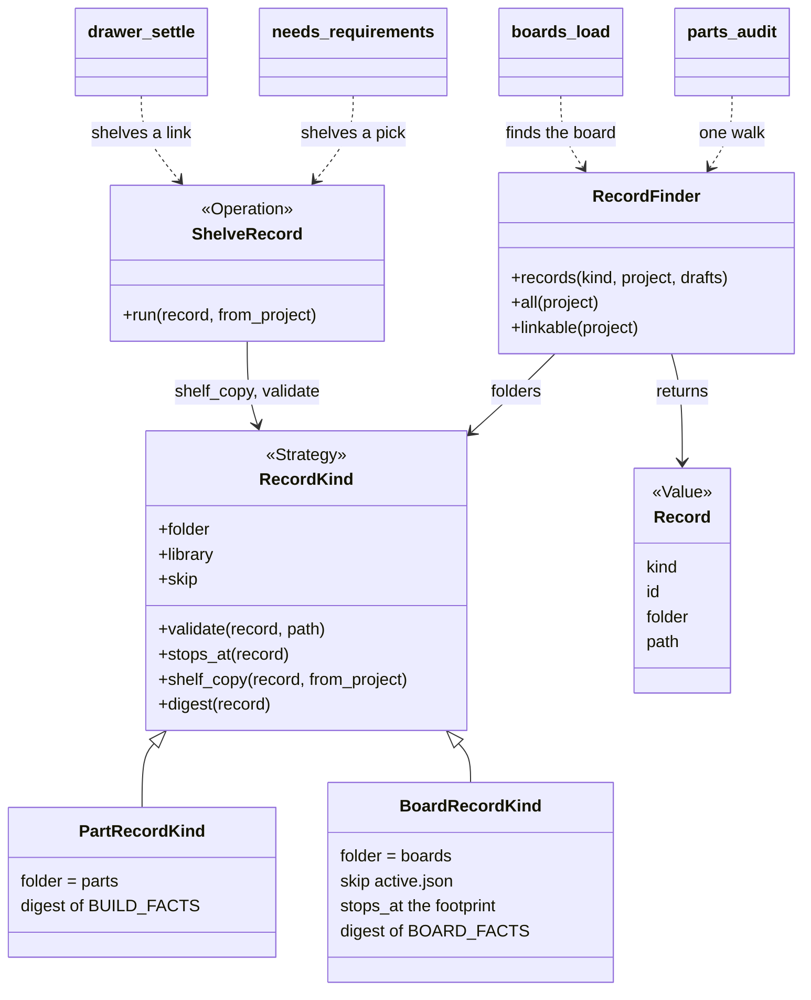
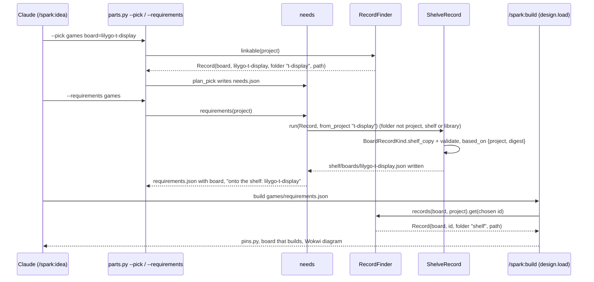

# P391, boards as modules in the store: the design

Written 2026-10-22 (Prague) by the architect (Fable 5.1) from three code maps (Sonnet 5.5, in `maps/`). An Opus 5.5
refuter then checked it. Its round changed the stage order, the names and the cost of each stage (section 7).

> **TL;DR.** Keep two record contracts under one `Record` envelope and one `RecordKind` strategy. A part consumes pins and a
> board provides them. Every folder (project, shelf, library, catalog) and every walk then reads both kinds through one finder.
> Stage 1 ships P390 first: boards get the shelf and the catalog, and a board pick is shelved as a part pick. The refactor
> to one finder follows. One accessor reads the project's board id, so a later `boards: [...]` list changes one function.

**Summary.** Today a board is a second type. It has its own walk, its own shelf gap and its own validator, and the per-MAC
store place is also called "boards". The recommended design is a `RecordKind` strategy (`PartRecordKind`, `BoardRecordKind`) over shared
store folders. `RecordFinder` reads them, and one `ShelveRecord` operation serves the requirements step and the drawer.
Six stages follow, each shippable alone. Stages 1 to 3 are MVP: boards onto the shelf first, then the refactor, then one
place for the board id. Stages 4 to 6 are later, and stage 6 is the many-boards step that stage 1 only keeps open.

## 1. Today: how boards and parts are kept, found and copied

Parts. The folders are project `parts/`, the shelf, the library, and the catalog for drafts (`scripts/store.py:73-83`). One
walk, nearest wins (`store.py:86-93`). `--requirements` shelves a part pick from the catalog or another project
(`scripts/needs.py:636`, `scripts/parts.py:2240-2242`). A drawer link shelves too (`scripts/drawer.py:213-215, 304-309`). The
shelf copy drops `SHELF_DROPS` and records `based_on` with a digest (`parts.py:978-1021`). `--promote` copies the catalog or
the shelf to `<project>/parts`, with the folder name hard-coded (`parts.py:1377`). The real shelf holds 7 part records flat
under `shelf/`, and the catalog holds 18 files (`~/.local/share/spark`, listed 2026-10-22).

Boards. The folders are project `boards/` and the library only. `store.layers` adds the shelf and the catalog for
`kind == "parts"` alone (`store.py:80,82`). `boards.records` calls `store.records("boards", LIBRARY, project, skip=NOT_A_BOARD)`
(`scripts/boards.py:227-229`). The project names its board in `boards/active.json` (`boards.py:198-224`). It names it again
in `requirements.json`, and the chain reads that one. The readers are `scripts/design.py:268,377`, `scripts/check_spine.py:368`,
`scripts/firmware_platform.py:20-22`, `scripts/flash_image.py:83`, `boards.py:308` and `scripts/board_look.py:290` (grep hit).
No command writes a board record. `commands/research.md` has no board step (grep: "board" there is the PCB). The T-Display
record was written by hand on the P330 walk (`spark-walks/t-display/boards/lilygo-t-display.json`, its header comment).

The gaps, each with its place:

- **No shelf or catalog folder for boards** (`store.py:80,82`). `tests/test_store.py:108-109` pins it: "boards have no shelf and
  no catalog". The T-Display record is found only by its project and by the other-projects glob in `drawer.py:135-137`.
- **Two places name the board.** `boards/active.json` (`boards.py:214`, written by `scripts/init_project.py:487-488`), and
  `requirements.json`'s `board` (`needs.py:649` writes it, the seven sites above read it).
- **Two meanings of the store's "boards".** The record kind (`boards.py:229`), and the per-MAC place of deployed boards
  (`store.py:61,65,98`, written by `scripts/board_facts.py:68-77`).
- **Duplicated board-vs-part branches.** The part-then-board walk, three times: `parts.py:146-147`, `drawer.py:132-137`,
  `parts.py:1228-1229`. The footprint-stop test, three times: `needs.py:143-146`, `boards.py:247-261`, `parts.py:171`. The
  `kind == "board"` validator switch, twice: `parts.py:164-165`, `needs.py:191-193`. The shelving loop skips every non-part
  pick (`needs.py:626-627`).
- **No tool creates a board record.** No `--skeleton` kind, no catalog write, no research agent step. `boards/README.md:53-74`
  still gives the smart bin's steps (`config.py`, `board.tsx`, `make`).

What the two contracts share today: `schema`, `id`, `name` and `function` (`parts.py:64-88`, `KIND_FUNCTION["board"]`).
Also `documents` (`boards.py:739` calls `parts.document_problems`), `vendor`, `sku` and `also_known_as` (`drawer.py:125-130`,
`scripts/matching.py:77-84`). What differs: a part has `kind` and `needs` (`parts.py:51`). A board has `chip`, `pins`,
`wokwi_part_type` and `physical` (`boards.py:66-67`). A part owes facts. A board owes nothing and can stop at the footprint
(`parts.py:117`, `needs.py:143-146`).

## 2. Options for "a board is a module in the store"

**A. One `Record` envelope, one `RecordKind` strategy, shared folders (recommended).** `RecordKind` holds what differs per
kind: folder, library, validator, owes, shelf copy, digest, stop. `store.layers(kind)` gives every kind the same four rows. One
`RecordFinder` replaces the three walks. Cost: one new module of about 150 lines and five call sites. Also a one-shot move of
the flat shelf and catalog files into `shelf/parts/` and `catalog/parts/`. Risk: the move touches the person's store. It is
idempotent and has a dry run. Both contracts stay as they are, so no record changes.

**B. A board record is a part record with an MCU role.** One contract, `role: "mcu"`, one validator. Cost: fold
`boards.validate` (`boards.py:569-740`, 172 lines of board-only rules) into `parts.validate`. Then teach every part reader that
`pins` means "provides" and `needs` means "consumes". Risk: the chain reads `board["pins"]` in `assign_pins.py:203,396` and
`emit_board.py:377-901`. Every one of those sites changes, for no MVP gain. Option A keeps the door open. A module that is both
(an MCU and pins it needs from a host) becomes a third `RecordKind`.

**C. Keep two types, add only a `shelf/boards/` branch in `store.layers`.** The smallest patch for P390. Cost: a day. Risk: it
adds a fourth copy of the kind branch. The three walks, the two validator switches and the folder hard-code stay. That is the
duplication the PO asked to remove.

**Recommendation: A**, with C's scope as its first stage, so P390 ships first. The names follow the table in
`docs/guide/developing.md`. `RecordKind` is a Strategy, and `PartRecordKind` and `BoardRecordKind` fill it. `Record` is a Value: today's
`(kind, id, where, path)` tuple of `drawer.linkable`, named. `RecordFinder` reads. `ShelveRecord` is the Operation, in `shelve_record.py`. The per-MAC place `boards` becomes `deployed` ("one record per physical board the person
deployed to", `store.py:61`), kept by a `DeployedStore` (later, see question 2). One word, one meaning: "board" is the record kind, "deployed" is
the unit.

## 3. The recommended design

`store.layers(kind, project, drafts)` returns `project/<folder>`, `shelf/<folder>`, `library` and `catalog/<folder>` for every
kind. `RecordKind.folder` is the same word under all four. It already is under a project and the library (`boards.py:42,45`,
`parts.py:46`). `boards.py` and `parts.py` stay the CLIs and import these classes. No agent prompt repeats the logic.

## 4. The vision: several boards of different platforms in one project

Later a project holds an ESP32 board, a Raspberry Pi and two Arduinos. Each is a `BoardRecordKind` record with a `platform` fact.
Today `micropython_port` implies that fact, and `boards.py` has no platform key (checked). A platform adapter is chosen from
that fact. Today there is one, `FirmwarePlatform.micropython` (`firmware_platform.py:41-50`). Each board gets a pin namespace.
The design stays additive: one board is the list of length one.

What that later step changes, and what stage 1 does about each:

| today | later | stage 1 only |
| --- | --- | --- |
| `requirements["board"]`, a string, read at seven sites | `"boards": [{"id", "as"}]`, with `board` kept as the one-entry shorthand | one accessor `boards.chosen(project)` returns the id (stage 3) |
| `Design.board`, one field (`design.py:45`) | `Design.boards`, with `.board` for the one-board case | nothing, the field stays |
| `assign_pins.assign(board, signals)` and `pin_module(board, ...)` (`assign_pins.py:203,396`): one namespace, one `pins.py` | a signal names its board (`"on": "main"`, default the first). One module per board, or one class per board. The adapter picks the file form | nothing, labels stay as they are |
| `emit_board` has one `Mcu` instance (`emit_board.py:377,501,633,870,901`) | an instance per board, `Mcu_<as>`, with traces between boards as nets. The hardest change | nothing |
| the Wokwi diagram holds one part `"id": "mcu"` (`check_spine.py:572`) | one part per board, inter-board wires as connections. Two MCUs in one Wokwi diagram: (not checked) | nothing |
| `deploy.py` builds one `FirmwarePlatform` (`deploy.py:191`), `board_of` reads the string (`firmware_platform.py:20-22`) | `--board <as>` picks the board, one platform and port per board. `deployed/<mac>.json` already fits many units (`board_facts.record_deploy`) | the accessor, and the `deployed` name |
| the history's `built` event has one `board` key (`store.py:275-276`) | a list | nothing, the event keys change with the list |

Stages 1 to 3 must not build any of this. They only read the board id through the accessor. It keeps `RecordKind` open for a third
kind. It keeps `platform` a fact in the record, not a branch in the code.

## 5. The staged refactor

Each stage is one PR, and the three demo projects still build after it. MVP stages come first. The refuter's round
(section 7) set this order: the smallest working change first, then the refactor, as the PO's rules ask.

**Stage 1 (MVP, P390): boards onto the shelf and into the catalog.** `store.layers` gives boards a `shelf/boards/` and a
`catalog/boards/` row (`store.py:80,82`). The flat part files stay where they are, so nothing in the person's store moves.
`needs.py:626-627` loses its `kind != "part"` skip, and the shelf copy of a board keeps `pins`, `physical` and
`documents`, with `based_on` from `BOARD_FACTS` (`parts.py:985`). `drawer.py:213-215` loses its `"part" in target`.
`store.place()` takes a kind folder, because `_target` refuses a key with "/" (`store.py:206`). Done when: a fixture
project holds the T-Display record and runs `--requirements`, a second project then finds it through `boards.load`, and
the text says "onto the shelf". Tests: `tests/test_store.py:108-109` changes from "boards have no shelf" to the new order,
and a board twin of `tests/test_needs.py:1528`. Cost: about four functions, one test edit, two new tests.

**Stage 2 (MVP): one finder, one shelving operation, behavior unchanged.** New `scripts/records.py` (it becomes `records/record_kind.py` and `records/record_finder.py` in the records move, plan version 2, section 3) with `RecordKind` (a
Strategy, by its docstring), `PartRecordKind`, `BoardRecordKind`, `Record` (a Value) and `RecordFinder`. One walk replaces
three (`parts.py:146-147,1228-1229`, `drawer.py:132-137`). `BoardRecordKind.stops_at` replaces three footprint-stop tests
(`needs.py:143-146`, `boards.py:247-261`, `parts.py:171`). `kind.validate` replaces two switches (`parts.py:164-165`,
`needs.py:191-193`). `ShelveRecord` (`scripts/shelve_record.py`) replaces `parts.shelve` and `drawer._shelve_from`.
`store.layers` keeps its string signature, so `tests/test_store.py:104-109` stays as stage 1 left it. The sites that
compare a path with the shelf or catalog folder go through the kind (`parts.py:1039-1041,1054,1961,1967,1977,1990-1992`).
Done when: every test passes, and a new test proves `RecordFinder.all(project)` returns today's rows on a fixture with a
part, a board and `active.json`.

**Stage 3 (MVP): one place names the board.** `boards.chosen(project)` reads `requirements.json`'s `board`, then falls back
to `active.json`. The readers call it: `design.py:268,377`, `check_spine.py:368`, `firmware_platform.py:20-22`,
`flash_image.py:83`, `boards.py:308`, `board_look.py:290`, and the `active_id` callers `boards.py:234,775,817,826` and
`live.py:34,78`. `project_root` and its copies (`boards.py:157`, `check_vendor_pins.py:119,170`, `flash_image.py:95`) find
a project by `.spark/`. `init_project --board X` writes `{"board": X, "parts": []}` for a project that has none. The docs
that say "wrote active.json" change (`commands/init.md:33,44`, `commands/idea.md:153`). Done when: `boards.py --id` and the
chain agree on a project with only `requirements.json`, and `tests/test_boards.py:89-116` runs against the accessor.

**Stage 4 (later): a board record is made as a part record is.** `parts.py --skeleton --kind board` writes a board draft
into `catalog/boards/`. `--fact-set`, `--promote`, `--validate` and `--audit` go by kind (`parts.py:1377,1951-2005`).
`/spark:identify` and `/spark:research` get a board sentence, and the research prompts write the catalog through a
`parts.py` write, not by path (`agents/parts-researcher.md:58`, `commands/research.md:105`). P389 has merged, so its onboard parts (display
with resolution, buttons, LED, charger, chips) already sit in `boards.py` as `OnboardRole` and `ONBOARD_ROLES`. They enter the
board contract here, as facts with sources. The Wokwi definition is a `documents` source under its sha256
(`WOKWI_DEFINITION`, P396). Done when:
`--skeleton` plus `--fact-set` lines rebuild the T-Display record, except its comments.

**Stage 5 (later): one layout for every folder, boards in `--need`.** The flat `shelf/*.json` and `catalog/*.json` move into
`shelf/parts/` and `catalog/parts/`, each `<id>/` sim-chip folder with its record (the real shelf holds
`sen0217-flow-meter/`), by an idempotent move with a dry run. The research prompts follow. About 124 test lines that spell
`home / "shelf"` or `"catalog"` change. The catalog's boards join `--need`'s offers, and P178's shared folder enters
`store.layers` as one more row. Done when: `--need "esp32 display"` lists the T-Display with its folder.

**Stage 6 (later, the vision): many boards.** The table in section 4, in this order: the requirements list (the accessor
returns a list), `Design.boards`, a pin namespace per board with the platform adapter picking the file form, a Wokwi part
per board and `deploy --board`, and last `emit_board`'s instance per board. Each step is its own card with a two-board
fixture (a XIAO and a FireBeetle, both in the library). Done when: one project builds a two-board breadboard sheet and two
`pins` modules, and deploys each board on its own port.

## 6. Questions for the PO (with the recommended answers)

1. **Boards onto the shelf first, the refactor second?** Recommended: yes (stages 1 then 2). P390 ships in one small PR.
2. **Rename the store's per-MAC `boards/` place to `deployed/`?** Recommended: yes, but as its own chore after stage 3. The
   real place also holds `photos/` (two XIAO pictures), which needs a home of its own first.
3. **Drop `boards/active.json`?** Recommended: yes, in stage 3, with the fallback until v0.13, so an old project still builds.
4. **Is a board a part with an MCU role?** Recommended: not now (option B). The first module-with-MCU record becomes a third
   `RecordKind`, and that is the moment to look again.
5. **Which stages are MVP?** Recommended: 1, 2 and 3. Stage 4 no longer waits for P389, which has merged. Stages 5 and 6 wait for P178 and a two-board
   walk.

## 7. The refuter's round (Opus 5.5) and what changed

- The order: the design said P390 ships early, but its refactor came first. Now stage 1 is P390 alone.
- Missed sites: the shelf and catalog path compares in `parts.py`, the "/" refusal in `store._target`, the research prompts
  that write the catalog by path, the `active_id` and `project_root` callers, and the docs that say "wrote active.json". Each is
  now in its stage.
- The move: it skipped the sim-chip folder and `photos/`, and about 124 test lines spell the flat folders. It moved from MVP to
  stage 5.
- A contradiction: `store.layers` cannot both take a `RecordKind` and leave its string test unchanged. It keeps the string.
- Names: `PartRecordKind` and `BoardRecordKind` end in their base's name, the Operation lives in `shelve_record.py`, and the
  per-MAC store is `DeployedStore`. `owes` and `function_of` left `RecordKind`, because no second kind needs them yet, and
  `ShelfStore` left too, because `ShelveRecord` writes through `store`.

Not checked: `breadboard.py`'s `THE_BOARD`, `emit_footprint --board`, `sim_project.py:50`, `check_all.py:218` and
`assign_pins.py:484-542` (map 3 only). Also the body of `docs/guide/how-it-works.md:171-209`, and Wokwi's support for two MCUs
in one diagram. Also the P336 driver-record card: the brief names it, and grep finds it in no guide.
