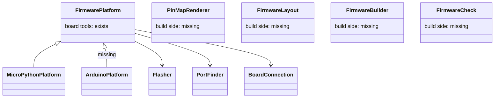

# Platform notes (P528 #730, epic P286 #336), refreshed 2026-11-02

These notes replace the 2026-10-17 map in [p218-finish/platforms.md](../2026-10-17-p218-finish/platforms.md). The spikes P529 #731 (Arduino), P530 #732 (ESP-IDF) and P531 #733 (Rust) read them and add what they find.

Summary: One seam now exists, `FirmwarePlatform` (with `Flasher` under it), and it covers the board tools: flash, port list, board read, connection, ready check, console probe. Everything on the build side is still MicroPython-only and has no seam: the pin-map writer, the firmware tree, the image build, the Mac import check, the pin guard, the Wokwi image lines and the breadboard wording. The easiest second platform is Arduino (arduino-cli), because its merged image fits the existing esptool flash path and the existing Wokwi lines. Nothing here is built.

## Change map (file:line is today's code, scripts/ unless noted)
| Stage | Where now | Seam today? | Arduino | PlatformIO | ESP-IDF (C, idf.py) | Rust (esp-hal no_std / esp-idf-hal std) |
|---|---|---|---|---|---|---|
| Pin map writer | assign_pins.py:403 pin_module, header :485, pin_module_for :492 | No | `pins.h` constexpr | same, in include/ | `pins.h` | `pins.rs` consts |
| Pin map file name | check_spine.py:90 PIN_MODULE, keep_pins :927 | No | `pins.h` | same | same | `src/pins.rs` |
| Pull-up text | assign_pins.py:426; breadboard.py:331; init_project.py:188 | No | `INPUT_PULLUP` | same | `gpio_set_pull_mode` | `Pull::Up` |
| Pin guard | restricted_pins.py:43 RestrictedPins (Python ast; used by board_live.py:64) | No | C++ parse or drop | same | same | Rust parse or drop |
| Firmware tree | run_scenario.py:463 and image_evidence.py:370 need firmware/main.py; import_firmware.py:55 | No | `<n>/<n>.ino` | `src/main.cpp`, platformio.ini | CMakeLists, main/, sdkconfig | Cargo.toml, src/main.rs |
| Mac check | import_firmware.py:111 + stand_in/machine.py; image_evidence.py:116 CompileCheck (py_compile) | No | compile only | compile or `pio test -e native` | `idf.py build` | `cargo check` |
| Build | flash_image.py:144 image, :157 board_build; tools.json:10,24,153-198 | No (MicroPython only) | `arduino-cli compile`, then merge | `pio run` | `idf.py build`, `esptool merge_bin` | `cargo build`, `espflash save-image --merge` |
| Board record key | `micropython_port` in boards/*.json:7-9, flash_image.py:172 | No | fqbn | env name | target (`esp32c6`) | target triple |
| Wokwi project | sim_project.py:403 wokwi_toml, :394 UNNAMED_FIRMWARE, :280 FIRMWARE_LINE | No | same keys, .bin | `.pio/build/..` | merged .bin or flasher_args.json | `firmware` and `elf` = target ELF |
| Scenario run | run_scenario.py:67 DEFAULT_IMAGE, :408 image_in, :463 main.py precheck | No | mostly stays | stays | stays | stays |
| Flash image onto board | flasher.py:18 Flasher, :35 EsptoolFlasher (IMAGE_OFFSET :40) | Yes | merged image at 0x0 fits | same | merged fits | `espflash` or merged fits |
| Board tools | firmware_platform.py:37 FirmwarePlatform, :82 MicroPythonPlatform | Yes | new subclass | new subclass | new subclass | new subclass |
| Deploy steps | deploy_service.py:62 DeployService, deploy.py:161 main (take `platform`) | Yes (over the platform) | stays | stays | stays | stays |
| Port list / board read | board_look.py:101 PortFinder (mpremote), :185 EsptoolReader (esptool) | Yes (made by platform) | PortFinder via pyserial | same | same | same |
| Ready proof | ready_check.py:43 ReadyCheck over board_connection.py:50 BoardConnection (mpremote raw REPL) | Yes, but REPL-shaped | needs a serial-only check | same | same | same |
| Console / live | board_console.py:95 ConsoleProbe; board_live.py:64; live.py; reach.py | Yes, probe may be None | no REPL: read only | same | same | same |
| Deploy gate / evidence | image_evidence.py:178 ImageEvidence, :345 NoSimulationEvidence (checks main.py, .py compile) | No | own evidence class | same | same | same |
| Tools list | data/tools.json:15-16 roles `flasher`, `board-shell`, `firmware-image` | Partly (roles by job) | add `compiler` | add `compiler` | add `compiler` (idf.py) | add `compiler` (cargo) |
| Doctor | board_doctor.py:76 BoardCheckStrategy, :134 BoardDoctorService | Yes | stays | stays | stays | stays |

Moved since the old notes: deploy.py `IMAGE_OFFSET` is now flasher.py:40. Not re-checked: whether deploy still copies and hashes files with mpremote (the old rows 19 and 20); the old deploy.py cites are stale.
Stays everywhere: board records minus one key, parts, needs, pin assignment, diagram.json, breadboard sheet, netlist, checks, scenario YAML, esptool chip read, the grant, the `ready` serial proof.

## Seams that exist

- `FirmwarePlatform` (firmware_platform.py:37): a factory for the project's board tools. One job: give deploy, look, doctor, live and reach their tools.
- `MicroPythonPlatform` (firmware_platform.py:82): the only platform. esptool and mpremote.
- `Flasher` (flasher.py:18): build the argv lists that put an image on a board, with a retry rule and a boot hint.
- `EsptoolFlasher` (flasher.py:35): erase, then write one image at 0x0.
- `PortFinder` (board_look.py:101) and `BoardReader`/`EsptoolReader` (:178, :185): list boards on USB; read the chip. Made by the platform.
- `BoardConnection` (board_connection.py:50) and `ReadyCheck` (ready_check.py:43): talk to the board and prove `ready`.
- `ConsoleProbe` (board_console.py:95): read what the console says; None when the shell cannot.
- `ImageEvidence` (image_evidence.py:178): why an image may go on a board (passed run, or no-simulation checks). Not yet platform-aware.
- `BoardCheckStrategy` (board_doctor.py:76): one doctor check per step.
- Test double: `FakeFirmwarePlatform` (tests/fakes.py:172).
Missing seams (old names still fit): FirmwareLayout, PinMapRenderer, FirmwareBuilder, FirmwareCheck (Mac check), a serial-only ready check, a per-platform ImageEvidence.

## Confirmed facts (see sources)
- Wokwi runs Rust: the project config page says a Rust project's `firmware` and `elf` both point at the ELF (target/<triple>/debug/<name>). The esp-rs template ships a wokwi.toml like that. A Wokwi project "[esp32c6" is a no_std esp-hal template on `esp32-c6-devkitc-1`. NOT confirmed: that it is an official Wokwi example (it may be a community project). wokwi.com/rust says online Rust compile is gone; use Wokwi for VS Code or the CLI locally.
- Arduino core for the C6: arduino-esp32 3.0.0 (based on ESP-IDF 5.1) added ESP32-C6 and H2.
- arduino-cli merged .bin: NOT confirmed. `--export-binaries` (-e) exports parts (app, bootloader, partitions), and CI examples merge with `esptool merge_bin` at 0x0, 0x8000, 0x10000. Plan on our own merge.
- Wokwi takes .bin, .elf or .uf2; a merged .bin with bootloader, partitions and app is the advised form. Unnamed offset defaults to 0x10000.

## Smallest steps for Arduino, in order (each testable alone)
1. Name the platform in the project record (`requirements.json`), default `micropython`. Test: old projects read the same.
2. `PinMapRenderer`: one class per language; today's `pin_module` becomes the Python one. Test: a golden for pins.py unchanged.
3. Add the C++ renderer for `pins.h` from the same assign result. Test: same name/gpio set as pins.py; a sketch including it compiles for the C6.
4. Board record: `firmware_images` map in place of `micropython_port` (read both while moving). Test: old records still resolve.
5. `FirmwareLayout`: where the files go and which one boots; make the main.py prechecks (run_scenario.py:463, image_evidence.py:370) ask it. Test: MicroPython unchanged; Arduino names the .ino.
6. `compiler` tool role in tools.json (arduino-cli, esp32 core 3.x pinned). Test: `tools.py` status shows it missing, then installed.
7. `FirmwareBuilder` for Arduino: compile, export, `esptool merge_bin` into the one image. Test: image offsets match the C6 map; runs without a board.
8. Wokwi lines accept the new image path (sim_project.py:403). Test: wokwi-cli runs the blink scenario and sees `ready` (pass line 1).
9. `ArduinoPlatform` subclass: same `EsptoolFlasher`, a serial-only ready check, no console probe. Test: FakeFirmwarePlatform-style deploy golden has the same JSON shape.
10. Arduino `ImageEvidence` (compile in place of py_compile). Test: gate refuses an image that did not compile.
11. Breadboard and init wording per platform (`INPUT_PULLUP`). Test: text golden.

## Open questions a spike must answer
Arduino (keep the old three):
- Wokwi runs the C6 build from the existing diagram.json and scenario. Pass: wokwi-cli exits 0 on the blink scenario with the merged image and `ready` seen.
- One pins.h and one pins.py from the same facts. Pass: both render from one assign result; a test shows the same name/gpio set; a sketch using pins.h compiles for the C6.
- Deploy proves an Arduino flash without a REPL. Pass: esptool writes the merged image on a real C6, serial shows `ready` in the wait, exit code and JSON match MicroPython's shape.
- (new) Does the core's build dir hold a merged .bin, or must spark merge? Pass: the file list of one compile on the C6 is written down.
PlatformIO:
- Does pioarduino build the C6 and does Wokwi take its firmware.bin? Pass: `pio run` image runs the blink scenario. Also: is the fork risk acceptable (PO call).
ESP-IDF:
- Can a user get idf.py without a heavy install (against the "installs nothing heavy" rule)? Pass: one install path under 10 minutes and under 2 GB, or a no.
- Does Wokwi run the idf.py merged image on the C6? Pass: scenario run with `ready` seen.
Rust:
- Does Wokwi run an esp-hal C6 ELF from wokwi.toml with `firmware` and `elf`? Pass: wokwi-cli exits 0 on a blink with the `ready` text.
- Can deploy flash it? Pass: `espflash save-image --merge` output goes through EsptoolFlasher on a real C6 and serial shows `ready`.
- Is the toolchain (rustup, riscv32imac target, espflash) free and light enough? Pass: install commands listed with sizes. Std (esp-idf-hal) needs the IDF too: expect it to fail the "not heavy" rule.

## Sources
- https://docs.wokwi.com/vscode/project-config (Rust: firmware and elf = ELF path)
- https://github.com/esp-rs/esp-template/blob/main/wokwi.toml (esp-rs template wokwi.toml)
- https://wokwi.com/projects/377857146822034433 (esp32c6 no_std esp-hal project; origin unconfirmed)
- https://wokwi.com/rust ("Online Rust compilation is no longer supported")
- https://docs.wokwi.com/guides/esp32 (.bin/.elf/.uf2, merge_bin advice, 0x10000 default)
- https://developer.espressif.com/blog/2023/11/announcing-the-arduino-esp32-core-version-3-0-0/ (3.0.0 adds C6)
- https://forum.arduino.cc/t/trying-to-export-binaries-from-arduino-cli-like-i-do-in-arduino-ide/1026890 (CLI export gives parts)
- https://docs.wokwi.com/vscode/platformio (PlatformIO in Wokwi)
- Old notes: docs/discovery/2026-10-17-p218-finish/platforms.md
