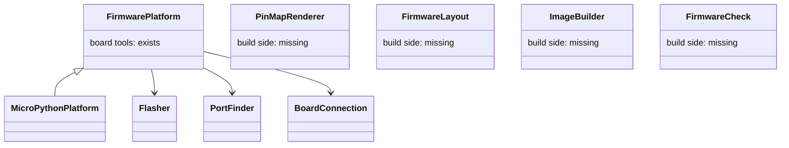

# Platform notes (P528 #730, epic P286 #336), refreshed 2026-11-02

These notes measure today's code against [the four-platform plan](../2026-10-20-p221-arduino/plan.md) that the PO approved on 2026-10-20 (epic P356 #457). Where the two differ, the plan's names and decisions hold. The notes add the Rust column that the plan lacks (P531 #733). They replace the 2026-10-17 map in [p218-finish/platforms.md](../2026-10-17-p218-finish/platforms.md).

Summary: One seam now exists, `FirmwarePlatform` (with `Flasher` under it), and it covers the board tools: flash, port list, board read, connection, ready check, console probe. Everything on the build side is still MicroPython-only and has no seam: the pin-map writer, the firmware tree, the image build, the Mac import check, the pin guard, the Wokwi image lines and the breadboard wording. The easiest second platform is Arduino (arduino-cli), because its merged image fits the existing esptool flash path and the existing Wokwi lines. Nothing here is built.

## Change map (file:line is today's code, scripts/ unless noted)
| Stage | Where now | Seam today? | Arduino | PlatformIO | ESP-IDF (C, idf.py) | Rust (esp-hal no_std / esp-idf-hal std) |
|---|---|---|---|---|---|---|
| Pin map writer | assign_pins.py:403 pin_module, header :485, pin_module_for :492 | No | `pins.h` constexpr | same, in include/ | `pins.h` | `pins.rs` consts |
| Pin map file name | check_spine.py:90 PIN_MODULE, keep_pins :927 | No | `pins.h` | same | same | `src/pins.rs` |
| Pull-up text | assign_pins.py:426; breadboard.py:331; init_project.py:188 | No | `INPUT_PULLUP` | same | `gpio_set_pull_mode` | `Pull::Up` |
| Pin guard | restricted_pins.py:43 RestrictedPins (Python ast; used by board_live.py:76) | No | C++ parse or drop | same | same | Rust parse or drop |
| Firmware tree | run_scenario.py:463 and image_evidence.py:370 need firmware/main.py; import_firmware.py:55 | No | `<n>/<n>.ino` | `src/main.cpp`, platformio.ini | CMakeLists, main/, sdkconfig | Cargo.toml, src/main.rs |
| Mac check | import_firmware.py:111 + stand_in/machine.py; image_evidence.py:116 CompileCheck (Python `compile()` in a child process) | No | compile only | compile or `pio test -e native` | `idf.py build` | `cargo check` |
| Build | flash_image.py:144 image, :157 board_build; data/tools.json:10,24,153-198 | No (MicroPython only) | `arduino-cli compile`, then merge | `pio run` | `idf.py build`, `esptool merge_bin` | `cargo build`, `espflash save-image --merge` (unsourced) |
| Board record key | `micropython_port` in boards/*.json:7-9, flash_image.py:172 | No | fqbn | env name | target (`esp32c6`) | target triple |
| Wokwi project | sim_project.py:403 wokwi_toml, :394 UNNAMED_FIRMWARE, :280 FIRMWARE_LINE | No | same keys, .bin | `.pio/build/..` | merged .bin or flasher_args.json | `firmware` and `elf` = target ELF |
| Scenario run | run_scenario.py:67 DEFAULT_IMAGE, :408 image_in, :463 main.py precheck | No | mostly stays | stays | stays | stays |
| Flash image onto board | flasher.py:18 Flasher, :35 EsptoolFlasher (IMAGE_OFFSET :40) | Yes | merged image at 0x0 fits | same | merged fits | `espflash` or merged fits |
| Board tools | firmware_platform.py:37 FirmwarePlatform, :82 MicroPythonPlatform | Yes | an `arduino` entry in `PLATFORMS` | a build tool, not a platform | an `esp-idf` entry | a `rust` entry |
| Deploy steps | deploy_service.py:62 DeployService, deploy.py:161 main (take `platform`) | Yes (over the platform) | stays | stays | stays | stays |
| Port list / board read | board_look.py:101 PortFinder (mpremote), :185 EsptoolReader (esptool) | Yes (made by platform) | PortFinder via pyserial (new) | same | same | same |
| Ready proof | ready_check.py:43 ReadyCheck over board_connection.py:50 BoardConnection (mpremote raw REPL) | Yes, but REPL-shaped | needs a serial-only check | same | same | same |
| Console / live | board_console.py:95 ConsoleProbe; board_live.py:64; live.py; reach.py | Yes, probe can be None | no REPL: read only | same | same | same |
| Deploy gate / evidence | image_evidence.py:178 ImageEvidence, :345 NoSimulationEvidence (checks main.py, .py compile) | No | own evidence class | same | same | same |
| Tools list | data/tools.json:10,15-16 roles `firmware-image`, `flasher`, `board-shell` | Partly (roles by job) | add `compiler` | add `compiler` | add `compiler` (idf.py) | add `compiler` (cargo) |
| Doctor | board_doctor.py:76 BoardCheckStrategy, :134 BoardDoctorService | Yes | stays | stays | stays | stays |

Moved since the old notes: deploy.py `IMAGE_OFFSET` is now flasher.py:40. Deploy still reads the board with mpremote (deploy.py:15, ready_check.py) and copies the facts after the flash (deploy.py:72). The old deploy.py cites are stale.
Stays everywhere: board records minus one key, parts, needs, pin assignment, diagram.json, breadboard sheet, netlist, checks, scenario YAML, esptool chip read, the grant, the `ready` serial proof.

## Seams that exist

- `FirmwarePlatform` (firmware_platform.py:37): a factory for the project's board tools. One job: give deploy, look, doctor, live and reach their tools.
- `MicroPythonPlatform` (firmware_platform.py:82): the only platform. esptool and mpremote.
- `Flasher` (flasher.py:18): build the argv lists that put an image on a board, with a retry rule and a boot hint.
- `EsptoolFlasher` (flasher.py:35): erase, then write one image at 0x0.
- `PortFinder` (board_look.py:101) and `BoardReader`/`EsptoolReader` (:178, :185): list boards on USB and read the chip. Made by the platform.
- `BoardConnection` (board_connection.py:50) and `ReadyCheck` (ready_check.py:43): talk to the board and prove `ready`.
- `ConsoleProbe` (board_console.py:95): read what the console says. It is None when the shell cannot.
- `ImageEvidence` (image_evidence.py:178): why an image can go on a board (passed run, or no-simulation checks). Not yet platform-aware.
- `BoardCheckStrategy` (board_doctor.py:76): one doctor check per step.
- Test double: `FakeFirmwarePlatform` (tests/fakes.py:172).
Missing roles, by the plan's names: `FirmwareLayout`, `PinMapRenderer`, `FirmwareCheck`, `ImageBuilder`, the split of `ReadyCheck` into `ReplReadyCheck` and `ConsoleReadyCheck`, and `PlatformContract` with the skip rule.

One difference from the plan: the plan says one class built by a function, with no subclass per platform. Today's code has a subclass, `MicroPythonPlatform` (firmware_platform.py:82). Slice 0 (R1) settles it.

## Confirmed facts (see sources)
- Wokwi runs Rust: the project config page says a Rust project's `firmware` and `elf` both point at the ELF (target/<triple>/debug/<name>). The esp-rs template ships a wokwi.toml like that. A Wokwi project "[esp32c6" is a no_std esp-hal template on `esp32-c6-devkitc-1`. NOT confirmed: that it is an official Wokwi example (origin unknown). wokwi.com/rust says online Rust compile is gone. Use Wokwi for VS Code or the CLI locally.
- Arduino core for the C6: arduino-esp32 3.0.0 (based on ESP-IDF 5.1) added ESP32-C6 and H2.
- arduino-cli merged .bin: NOT confirmed. `--export-binaries` (-e) exports parts (app, bootloader, partitions), and builds merge them with `esptool merge_bin` (offsets unsourced here). Plan on our own merge.
- Wokwi takes .bin, .elf or .uf2. A merged .bin with bootloader, partitions and app is the advised form. Unnamed offset defaults to 0x10000.

## Where the plan's slices stand (2026-11-02)

The steps for Arduino, ESP-IDF and PlatformIO are the plan's slices. All five cards are open, and none started:

- A0, a hand-made Arduino blink on the FireBeetle 2 ESP32-S3: P361 #462.
- Slice 0, the seams with MicroPython only (R1 to R7): P357 #458.
- Slice 1, Arduino by arduino-cli: P358 #459.
- Slice 2, ESP-IDF: P359 #460. The ESP-IDF install cost measured in P511 #706 is a comment there.
- Slice 3, PlatformIO as a second build tool: P360 #461.

## Open questions for Rust (P531 #733)

The plan's spikes A0, E0 and P0 hold the questions for the other three platforms. The MVP board for compiled platforms is the FireBeetle 2 ESP32-S3, and the C6 is Later.

Rust:
- Does Wokwi run an esp-hal C6 ELF from wokwi.toml with `firmware` and `elf`? Pass: wokwi-cli exits 0 on a blink with the `ready` text.
- Can deploy flash it? Pass: `espflash save-image --merge` (unsourced) output goes through EsptoolFlasher on a real C6 and serial shows `ready`.
- Is the toolchain (rustup, riscv32imac target, espflash) free and light enough? Pass: install commands listed with sizes. Std (esp-idf-hal) needs the IDF too: expect it to fail the "not heavy" rule.

## Sources
- https://docs.wokwi.com/vscode/project-config (Rust: firmware and elf = ELF path)
- https://github.com/esp-rs/esp-template/blob/main/wokwi.toml (esp-rs template wokwi.toml)
- https://wokwi.com/projects/377857146822034433 (esp32c6 no_std esp-hal project, origin unconfirmed)
- https://wokwi.com/rust ("Online Rust compilation is no longer supported")
- https://docs.wokwi.com/guides/esp32 (.bin/.elf/.uf2, merge_bin advice, 0x10000 default)
- https://developer.espressif.com/blog/2023/11/announcing-the-arduino-esp32-core-version-3-0-0/ (3.0.0 adds C6)
- https://forum.arduino.cc/t/trying-to-export-binaries-from-arduino-cli-like-i-do-in-arduino-ide/1026890 (CLI export gives parts)
- https://docs.wokwi.com/vscode/platformio (PlatformIO in Wokwi)
- https://www.cnx-software.com/2024/08/27/platform-espressif32-fork-platformio-arduino-esp32-c6-esp32-c5-esp32-h2-esp32-p4/ (pioarduino fork carries the C6)
- Unsourced here: `espflash save-image --merge`, the riscv32imac target, and that esp-idf-hal std needs the IDF. A Rust spike confirms them.
- Old notes: docs/discovery/2026-10-17-p218-finish/platforms.md
