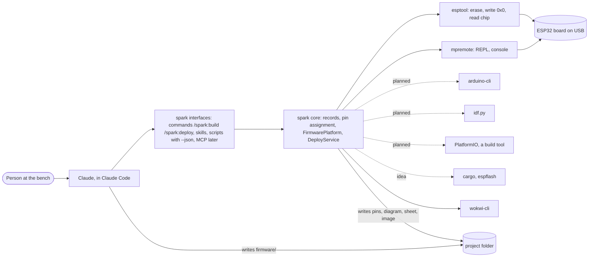
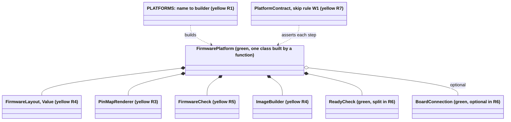
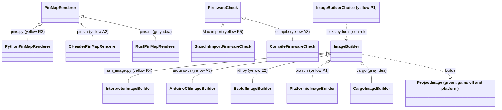
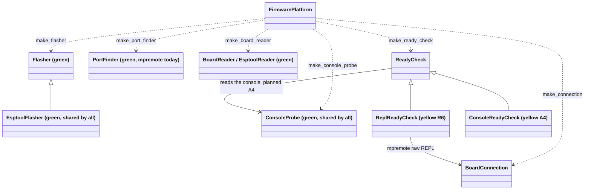
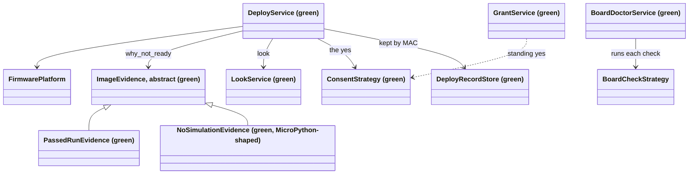
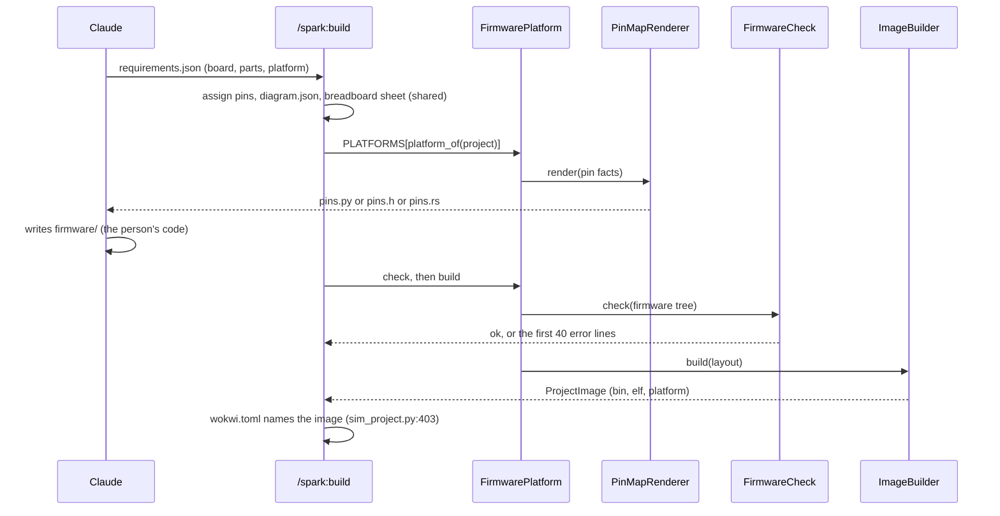
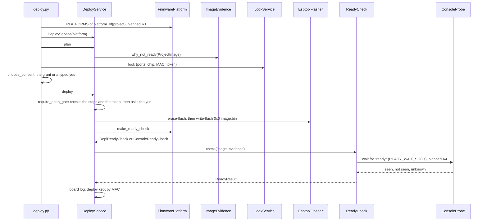
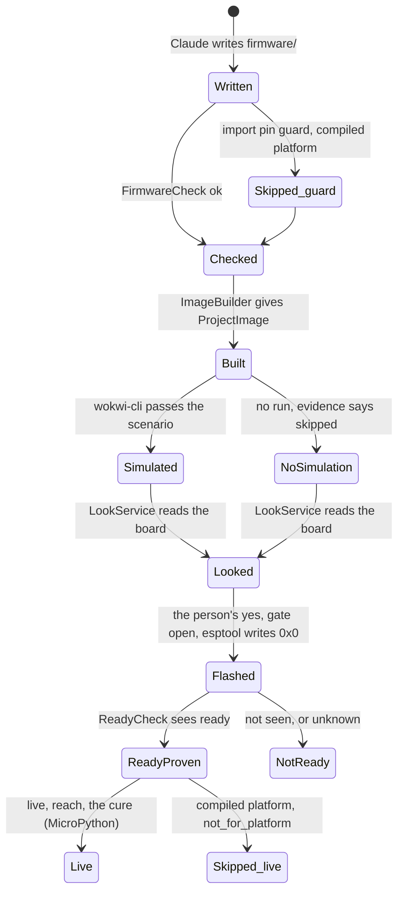

# spark for four platforms: how the system is organized (P532, 2026-11-02)
## 0. Summary and legend
Spark turns a requirements file into a pin map, a Wokwi diagram, a breadboard sheet and a flash on USB. Today it does this for MicroPython only, through one seam, `FirmwarePlatform`, that covers the board tools. The approved plan (P356 #457) adds five build roles inside that one class. Arduino, ESP-IDF and PlatformIO then plug in as strategies. Slices 2 and 3 change no caller, contract or golden.

Legend. Status colors: **green** = exists today in `scripts/`, **yellow** = planned in P356 (slice and card named), **gray** = idea only (Rust, P531 #733, not planned). Note format, one sticky per class: `Name: job. Where (file:line or slice). Status.` Everything cited as `file:line` was opened in the code on 2026-11-02.

## 1. The big picture

Spark exports facts, never behaviour. Claude writes the firmware. Spark writes what it derives from records.

## 2. What never changes per platform
- The board record (minus `micropython_port` and the wake facts, which move under `platforms`), the part records, the needs and the drawer.
- Pin assignment (`assign_pins.py:212 assign`) and the pin facts it derives.
- `diagram.json`, the breadboard sheet, the netlist and the design checks.
- The scenario YAML and the `ready` line (`run_scenario.py:55 READY`).
- The look (`board_look.py:420 LookService`), the grant (`board_grant.py:202 GrantService`), the gate (`deploy_gate.py:97 require_open_gate`).
- esptool erase, then one write at `0x0` (`flasher.py:35 EsptoolFlasher`, `IMAGE_OFFSET`).
- The deploy kept by MAC (`deploy_record_store.py:50 DeployRecordStore`).
- The evidence rule: no pass without proof (`image_evidence.py:178 ImageEvidence`).

## 3. The class diagram, in four regions
### 3a. The platform and its roles

### 3b. The build side: one strategy per platform

### 3c. The board side: the shared device path

### 3d. The deploy service and its evidence

## 4. One note per class (the sticky notes)
- `FirmwarePlatform`: the factories for a project's board tools. `firmware_platform.py:37`. Green. Gains the five build roles in slice 0.
- `MicroPythonPlatform`: today's only platform, esptool and mpremote. `firmware_platform.py:82`. Green. Becomes a builder function in R1.
- `PLATFORMS`: maps a platform name to its builder function. `platform_of` reads the name from requirements.json. R1 (P357 #458). Yellow.
- `FirmwareLayout`: a Value: the firmware tree and the pin map file name. R4. Yellow.
- `PinMapRenderer`: writes the pin map from pin facts, with the marker and pull-up text. Out of `assign_pins.py:403`. R3. Yellow.
- `PythonPinMapRenderer`: writes `firmware/pins.py`. Today's `pin_module`, `assign_pins.py:403`. R3. Yellow.
- `CHeaderPinMapRenderer`: writes `firmware/pins.h` with a `//` marker. Arduino and ESP-IDF share it. A2 (P358 #459). Yellow.
- `RustPinMapRenderer`: writes `src/pins.rs` consts. P531 #733. Gray, idea only.
- `FirmwareCheck`: the Mac check before any image. R5. Yellow.
- `StandInImportFirmwareCheck`: imports the firmware with stand-in `machine`. Today `import_one`, `import_firmware.py:68`. R5. Yellow.
- `CompileFirmwareCheck`: compiles, shows the first 40 error lines, reports a missing tool as not run. A3. Yellow.
- `ImageBuilder`: builds a `ProjectImage` from the firmware tree. R4. Yellow.
- `InterpreterImageBuilder`: interpreter plus littlefs at `0x200000`. Today `flash_image.py:144 image`. R4. Yellow.
- `ArduinoCliImageBuilder`: `arduino-cli compile`, then merge at `0x0`. A3. Yellow.
- `EspIdfImageBuilder`: `idf.py build`, then `merge-bin`. E2 (P359 #460). Yellow.
- `PlatformioImageBuilder`: `pio run` from a written `platformio.ini`. P1 (P360 #461). Yellow.
- `ImageBuilderChoice`: reads the tools.json role pick: PlatformIO or the platform's own builder. P1. Yellow.
- `CargoImageBuilder`: `cargo build`, merged image through EsptoolFlasher. Gray, idea only.
- `ProjectImage`: the image file and its sha256. `project_image.py:37`. Green. Gains `elf` and `platform`.
- `Flasher`: argv lists that put an image on a board, retry rule, boot hint. `flasher.py:18`. Green.
- `EsptoolFlasher`: erase, then write at `0x0`, watchdog reset after on the S3. `flasher.py:35`. Green, shared by all.
- `PortFinder`: lists boards on USB, opens no port. `board_look.py:101`. Green. pyserial version planned for compiled platforms.
- `EsptoolReader`: reads the chip and MAC on a port. `board_look.py:185`. Green, shared.
- `BoardConnection`: mpremote raw REPL to run code on the board. `board_connection.py:50`. Green. Optional after R6.
- `ReadyCheck`: proves `ready` and the files' hashes. `ready_check.py:43`. Green. Split in R6.
- `ReplReadyCheck`: the REPL proof, MicroPython only. R6. Yellow.
- `ConsoleReadyCheck`: waits for `ready` on the console, no REPL. A4. Yellow. Rust uses it too (gray).
- `ConsoleProbe`: reads what the console says. When the shell cannot read a port, it is None. `board_console.py:95`. Green, shared.
- `PlatformContract`: lists each step a platform lacks with its cause, asserts the skip rule. R7. Yellow.
- `DeployService`: plan, look, gate, flash, read back, over a platform. `deploy_service.py:62`. Green.
- `ImageEvidence`: why an image can go on a board. `image_evidence.py:178`. Green. When no simulation runs, it says `skipped`.
- `NoSimulationEvidence`: checks `main.py` and `.py` compile. `image_evidence.py:345`. Green, MicroPython-shaped today.
- `BoardDoctorService`: one `BoardCheckStrategy` per step. `board_doctor.py:134`. Green.
- `RestrictedPins`: the import pin guard, Python ast. `restricted_pins.py:43`. Green. `skipped` on compiled platforms.

## 5. Role by platform
| Role | MicroPython (green) | Arduino (yellow, slice 1) | ESP-IDF (yellow, slice 2) | PlatformIO, a build tool (yellow, slice 3) | Rust (gray, idea) |
|---|---|---|---|---|---|
| `FirmwareLayout` | `firmware/main.py`, `pins.py` | `firmware.ino`, `pins.h` | `CMakeLists.txt`, `main/pins.h` | the platform's, plus `platformio.ini` | `Cargo.toml`, `src/pins.rs` |
| `PinMapRenderer` | Python | C header | C header | the platform's | Rust consts |
| `FirmwareCheck` | stand-in import | compile | compile | compile | `cargo check` |
| `ImageBuilder` | interpreter + littlefs | arduino-cli | idf.py | `pio run` | cargo |
| `ReadyCheck` | REPL | console | console | the platform's | console |
| `BoardConnection` | mpremote | none | none | the platform's | none |
| Flasher | EsptoolFlasher at `0x0`, all five | | | | |
| Board record key | `platforms.micropython.port` | `platforms.arduino.fqbn` | `platforms.esp-idf.target` | none | `platforms.rust.target` |
| MVP board | XIAO C6, FireBeetle S3 | FireBeetle 2 ESP32-S3 | FireBeetle 2 ESP32-S3 | FireBeetle 2 ESP32-S3 | open |

## 6. Sequences
### 6a. Build: from requirements to a flashable image

The platform picks the strategy at the two `P->>` arrows. Everything above them is shared.

### 6b. Deploy: from the look to the ready proof

Today `verify` (`deploy_service.py:136`) gets a `BoardConnection` from `make_connection` and the check from `make_ready_check` (`deploy_service.py:152`, `:204`). Today `ReadyCheck` reads the board through the REPL (`connection.run_code`, `ready_check.py:61`). R6 splits `ReplReadyCheck` out of `ReadyCheck.check` and makes the connection optional. A4 adds the console read.

## 7. State: a project's firmware, from written to ready proven

Compiled platforms skip, with `skipped` and code `not_for_platform`, never `ok`: `live`, `reach`, the doctor's cure, the import pin guard, littlefs, `spark.json` and the interpreter fetch in `/spark:setup`. The evidence gate says `skipped` when no simulation can run, never a pass. `run_scenario` on ESP-IDF skips only if E0's Wokwi test fails. One helper writes the skip. `PlatformContract` lists each step.

## 8. How a new platform plugs in
1. A builder function in `PLATFORMS`, named after the platform.
2. A `FirmwareLayout` value: the tree, the pin map file name.
3. A `PinMapRenderer`, or one that exists.
4. A `FirmwareCheck` and an `ImageBuilder`, each an adapter over one free tool.
5. A `ReadyCheck` choice: REPL or console. When the platform has a REPL, add a `BoardConnection`.
6. A `platforms.<name>` block in the board record, facts with origin.
7. A `PlatformContract` subclass test and a tools.json role, pinned, with size.

The rule: slices 2 and 3 edit no caller, no contract and no golden. If one needs an edit, the seam is wrong.

## 9. Open questions and the known difference
Known difference. Today `MicroPythonPlatform` is a subclass (`firmware_platform.py:82`). The plan says one class built by a function, no subclass. R1 settles it.

Open questions.
- A0 (P361 #462): does the merged Arduino image boot at `0x0` on the S3, does `ready` show within 20 s, and does Wokwi run its `.elf` (A5)?
- `NoSimulationEvidence` reads `main.py` and compiles `.py`. Which class holds the compiled form: the evidence or `FirmwareCheck`?
- `PortFinder` uses mpremote. Compiled platforms need a pyserial list. Shared or per platform?
- Rust: does Wokwi run an esp-hal ELF, can `espflash save-image --merge` feed EsptoolFlasher, and is the toolchain light? Unsourced until a spike.
- The `ready` line in a compiled image: who writes it, Claude's firmware or a template?
