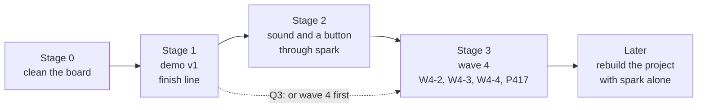

# P653: the games demo and spark's refactor, a proposed order (council, 2026-11-06)

Spark spike [#876](https://github.com/xmejkal/spark/issues/876) under the demo epic P652
[#875](https://github.com/xmejkal/spark/issues/875). Three Sonnet lenses wrote their reports in [council/](council/):
product and demo (PS), tech lead (TL) and lean flow (LF). Claude wrote this synthesis, and a Fable refuter
read it ([council/refuter.md](council/refuter.md)). Tags: E evidence with a pointer, H a hypothesis and its source,
D a decision (who, when). Nothing here is decided. The PO picks the order.

## Short version

> 1. The games work. Fire, the ball pit, the burning bodies and the rain run on the board at 22 to 25 fps.
>    The Mac suite passes 165 tests (TL-2 to TL-6). A demo needs almost no new engine code.
> 2. The story has no page and no pictures. Every step has a record, but the records sit in four places.
>    Neither repository holds a photo or clip of the board (PS-6, PS-7). That is the main gap.
> 3. Wave 4 of spark's refactor is one PR of four in. W4-1 is on main, and W4-2 to W4-4 have not started. Waiting
>    costs rebase drift, not a half-moved seam (TL-21 to TL-25). No card exists for W4-2 onward (LF-8).
> 4. The board is over its limits: 11 cards sit in the working stages against 4 in flight.
>    Three spark cards got no update for 17 to 21 days (LF-2, LF-5). Clean it up first.
> 5. Proposed order (Claude's opinion): stage 0 cleans the board. Stage 1 brings the demo to a
>    written finish line. Stage 2 adds sound and a button through spark's own chain. Stage 3 is wave 4. Stage 2
>    before wave 4 is the open question (Q3), because the lenses split on it.

## What works, and what does not

| part | state | evidence |
| --- | --- | --- |
| Fire, ball pit, burning bodies, rain | run on the board, 22 to 25 fps | E TL-3 to TL-6, bench.md:262, :458-476, :637-659 |
| Rain's C and Python swap on BOOT | the strongest "why C" number, 24 to 25 fps against 8 to 9 fps, live | E PS-5, TL-6 |
| Flappy with fire | removed by the PO on 2026-11-04. The fire code merged with no game that uses it | E TL-7, bench.md:441-456 (PS-10 says it exists: refuted by TL-7) |
| The other ten games | ran together at 22 to 25 fps in run107, before P633, P639, P601 and P646 | E TL-9, bench.md:475 · caveat: no smoke run on today's image |
| Tests for the ten arcade games | none by name | E TL-10 |
| Story page, photos, clips | none | E PS-6, PS-7 |
| Sound | no code, no speaker | E TL-31, PS-18 |
| Controls | two buttons, every game uses one | E TL-28, TL-29 |
| "Uses the S3's optimizations" | true for DMA and PSRAM, not for the PIE vector instructions | E PS-15 |
| "Built by talking to Claude with spark" | true for the screen's research, the first games and deploy. Claude built the C driver and engine outside spark's chain | E PS-19, spark README.md:124-125, :161 |

## The proposed order

Stage 0, clean the board (H, from LF-2, LF-5, TL-12 to TL-15):

- Mark which in-flight cards are epics (#812, #769, #787, #743), so that the flight count is true (LF-2).
- Park the idle spark Design cards #224, #304 and #417 in Idea, each with its reason (LF-5).
- Close P627 #840 and P628 #841 once their Miro work is done, or park them (their comments say what is left).
- Drafts: #46 stays parked (P649). #44 waits for P650 (its engine commit has no PR yet, TL-13). #10, the heavy
  RENT floors, needs your play or a park (TL-12).

Stage 1, demo v1. The proposed checklist comes from TL-38, LF section 2 and PS section 2, and you set it at Q1:

1. A smoke run passes for all 14 games on today's image, with one bench row (TL-9).
2. One game with an effect runs on the buttons: P651 #874, the Runner on fire, with its fps measured. Pinball,
   P615 #821, is the larger choice, and it needs P634 #848 first (TL-17, TL-19).
3. One story page in pixel-games tells the steps from "spark found the screen" to the C engine. Each step links
   its PR, card and bench row, and has a picture: a Mac render from `tools/render_scene.py` or a short board clip
   (PS section 2, PS-8). A new card is needed for it.
4. The page's claims are exact: DMA and PSRAM, not PIE (PS-15). Spark started the project, and Claude carried the
   C driver and engine outside spark's chain (PS-19).
5. No new games card enters Ready until 1 to 4 are met (LF-11).

Stage 2, sound and a second button through spark (H, from PS section 5, TL-32 to TL-34):

- The PO, 2026-11-06: "I'm looking forward to synthesising the fire sounds" and "the main demo about it is spark".
  Adding a speaker and a button is spark's own journey: idea, part, requirements file, build, breadboard sheet,
  pin map, deploy. So this stage tests spark on a real project (spark's bar, AGENTS.md) and brings the story back
  to spark.
- The PO, 2026-11-06: "i love that we can also use C optimized parts, hoping to also reuse this with the sound
  synthesis, using the s3's chip's advantages too". So the synthesis follows the engine's split. A C kernel fills
  the sample buffer. Python decides when a sound plays (D12 in pixel-games docs/engine-walkthrough.md). The
  S3's I2S peripheral can stream the buffer by DMA (H, model knowledge, not read). The PIE vector instructions that
  P601 #802 probed can mix the voices (H, the same source).
- Synthesized fire sound needs more than a buzzer. A crackle is filtered noise with random pops, which a PWM
  buzzer plays poorly (H, model knowledge, not read). An I2S amplifier and a small speaker are the likely parts.
  Spark's research picks them.
- A buzzer on one PWM pin is the small fallback, tens of lines (TL-33).

Stage 3, wave 4: file W4-2 as a card first, and refresh the plan's line numbers against main (TL-25, LF-8). Then
the PRs follow in this order: PR A P605 #807, then PR B W4-2 with E2 and P457 #617.
After them come PR C W4-3 with P383 #491, PR D W4-4 and the spike P417 #545.
The plan's own sizes: W4-2 about 300 product and 400 test lines, W4-3 about 350 and 300 (TL-26, estimates).

Later: rebuild the project with spark alone (the PO, 2026-11-06, on #875). That is a walk of its own.

## Not now

| card | why it waits |
| --- | --- |
| The engine structure cards: P621 to P623, P628 to P631, P634, P640 to P644 | none changes what a viewer sees (PS-16, TL-17). If you pick pinball, P634 comes in |
| P601 #802, P648 #870 | the bound probe answered P601's question (TL-18). Keep both for after the demo |
| P649 #871, P650 #872 | paused. P650's light flow is a polish, and the PO's pick of the clips stands |
| P597 #798, P600 #801, P610, P611, P625, P626 | more effects. P625 and P626 are the cheapest after stage 1 (PS section 3) |
| P635 to P637, the burning people | costly, feel slices. The PO called the subject "nicely controversial", so it is a question for an employer's demo (PS-13, Q4) |
| P539 #743, the public graphics library | the largest question, not on the finish line (LF section 3) |
| Spark's 189 Idea cards | no change in this stretch |

## Where the lenses split

- Stage 2 before or after wave 4. Product and demo: sound and controls come right after the minimum, as the
  act that returns the story to spark. Lean flow: wave 4 first, then controls and sound as new epics. Tech lead:
  no side. The two lines touch different files and can run in parallel, but your review time is shared (TL-37).
  This is Q3.
- Flappy with fire: PS-10 says it exists, TL-7 shows that you removed it on 2026-11-04. TL-7 holds.
- P622 #829 and P640 #858: lean flow puts them on the finish line because they sit in Ready. The tech lead says
  the demo needs neither. This synthesis leaves them off the line (Q5).

## Questions for the PO

1. Q1 · Is the stage 1 checklist your finish line, or do you add or drop an item? · decides when stage 1 ends.
2. Q2 · Which game with an effect: the Runner on fire (small), pinball (needs P634), or only the four scenes? · decides whether an engine card joins stage 1.
3. Q3 · After stage 1: sound and a button through spark, or wave 4 first? · decides stage 2's place.
4. Q4 · Are the burning people (P635 to P637) in a demo for an employer? · decides whether #850 stays in Ready.
5. Q5 · P622 #829 and P640 #858: keep in Ready or move to Idea? · decides the Ready column for stage 1.
6. Q6 · Who reads the page first: an employer who reads, or someone who watches a clip? · decides page first or video first.
7. Q7 · A time box for stage 1, for example five working days, after which the next stage starts anyway? · decides whether the line is a date or a checklist (LF section 2).
