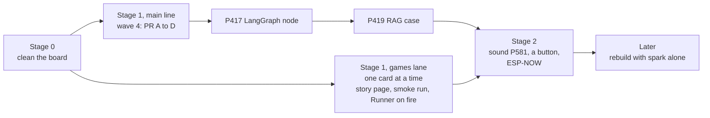

# P653: the games demo and spark's refactor, a proposed order (council, 2026-11-06)

Spark spike [#876](https://github.com/xmejkal/spark/issues/876) under the demo epic P652
[#875](https://github.com/xmejkal/spark/issues/875). Three Sonnet lenses wrote their reports in [council/](council/):
product and demo (PS), tech lead (TL) and lean flow (LF). Claude wrote this synthesis. A Fable refuter read the
first version ([council/refuter.md](council/refuter.md)), and its rival order is now the proposal. Tags: E evidence
with a pointer, H a hypothesis and its source, D a decision (who, when). Nothing here is decided. The PO picks.

## Short version

> 1. Proposed order (the refuter's rival, which Claude now holds): stage 0 cleans the board. The main line is
>    spark: wave 4, then LangGraph (P417 #545) and RAG (P419 #548) for the CV. Beside it runs one games card at a
>    time for the demo. Sound, a second button and ESP-NOW come after.
> 2. Why: the PO's own words point there. On 2026-11-04 he said "Finish wave 4 first". On 2026-11-06 he said
>    "we're actually manily working on spark, we need to finish the refactoring". The job goal needs P417, and
>    P417 needs wave 4.
> 3. The games run. The four effect scenes have their own bench rows. All 14 games started in one smoke run on
>    2026-11-04 (run107, before four later changes). The Mac suite passes 165 tests (TL-2).
> 4. The demo's main gap is a story page with pictures. Every step has a record, but in four places. pixel-games holds no photo or
>    clip of the board (PS-7), and spark holds only page screenshots.
> 5. Wave 4: W4-1 is done, and PR A to PR D are not started. No card exists for W4-2 onward (TL-21 to TL-25, LF-8). Waiting costs rebase
>    drift, not a half-moved seam.

## The PO's words this order rests on

| when | words, verbatim | where |
| --- | --- | --- |
| 2026-11-04 | "Finish wave 4 first" | spark #94 (board memory, 11-04) |
| 2026-11-06 | "we're actually manily working on spark, we need to finish the refactoring" | chat, about 12:50 Prague, quoted in council/refuter.md |
| 2026-11-06 | "finish it in some nice demonstratable state, some games using the effeevts we have, then we could get back on spark" | spark #875 |
| 2026-11-06 | "the main demo about it is spark, so we'll have to recreate the things later purely by using spark again, but thats later" | spark #875 |
| 2026-11-06 | "I'm looking forward to synthesising the fire sounds" and "hoping to also reuse this with the sound synthesis, using the s3's chip's advantages too" | spark #875 |
| 2026-11-06 | "And ESP now integration for multiplayer" | spark #875 |
| 2026-11-06 | "I also nered to have spark presentable for finding a job as ai eveloper so to also show it being used by langgraph, maybe RAG integration, atc, to send along my cv" | spark #875 |

The words split in one place. The demo comes "then we could get back on spark", but the refactor comes "first" on
11-04 and again on 11-06. This order runs both, with spark as the main line. Q1 asks whether that holds.

## What works, and what does not

| part | state | evidence |
| --- | --- | --- |
| Fire, ball pit, burning bodies, rain | run on the board. The burning bodies run at 24 fps in linear mode, but both modes miss their pass line D5 | E TL-3 to TL-6, bench.md:637-659 · caveat: the pit falls to 6 to 8 fps at 320 balls (bench.md:458-476) |
| Rain's C and Python swap on BOOT | C 24 to 25 fps, Python 8 to 9 fps, at 160 boxes, live on the board | E bench.md:398-399 (P590) · caveat: the Python HUD label is longer, "so its fps is slightly low" (bench.md:264) |
| All 14 games together | started at 22 to 25 fps in run107 (2026-11-04, games 9cb3cba) | E bench.md:475 · caveat: before P633, P639, P601 and P646. No smoke run on today's image |
| Flappy with fire | removed by the PO on 2026-11-04. The fire code merged with no game that uses it | E TL-7, bench.md:441-456 |
| Tests for the ten arcade games | none by name | E TL-10 |
| Story page, photos, clips | none | E PS-6, PS-7 |
| Sound | no code, no speaker. The card P581 #782 (2026-11-02) asks for "a small piezo buzzer" that "plays short cues on hits and deaths" | E TL-31, spark #782 title |
| Controls | two buttons, every game uses one | E TL-28, TL-29 |
| "Uses the S3's optimizations" | true for DMA and PSRAM, not for the PIE vector instructions | E PS-15 |
| "Built by talking to Claude with spark" | true for the screen's research, the first games and deploy. Claude built the C driver and engine outside spark's chain | E PS-19, spark README.md:124-125, :161 |

## The proposed order

Stage 0, clean the board (H, from LF-2, LF-5, TL-12 to TL-15):

- Mark which in-flight cards are epics (LF-2 guesses #224, #812 and #769). Epics count in no stage, so the true flight
  count is unknown until then. Eleven cards sit in the working stages (LF-2).
- Park the idle spark Design cards #224, #304 and #417 (card #417, not P417) in Idea, each with its reason (LF-5, figures not
  re-exported by the refuter).
- Close P627 #840 and P628 #841 once their Miro work is done, or park them (their comments say what is left).
- Drafts: #46 stays parked (P649). #44 waits for P650 (its engine commit ab970c4 is pushed with no PR). #10, the
  heavy RENT floors, needs your play or a park (TL-12).

Stage 1, main line, spark (H, from TL-21 to TL-26, LF-8):

1. File W4-2 as a card and refresh the wave 4 plan's line numbers against main. The plan was written on
   67c37600 on 2026-11-01.
2. PR A P605 #807 (schema, trace hook, Privacy step). Then PR B W4-2 with E2 and the littlefs fix P457 #617.
3. PR C W4-3 with P383 #491, then PR D W4-4.
4. P417 #545, one spark Operation as a LangGraph node. Then P419 #548, one RAG case beside it.

The plan's own sizes: W4-2 about 300 product and 400 test lines, W4-3 about 350 and 300 (TL-26, estimates).

Stage 1, games lane, one card in flight at a time, beside the main line. The two touch different files (TL-37), but your
review and play time is shared. The finish line, which you set at Q2:

1. One story page in pixel-games tells the steps from "spark found the screen" to the C engine. Each step links
   its PR, card and bench row, and has a picture: a Mac render from `tools/render_scene.py` or a short board clip
   (PS section 2, PS-8). Its claims are exact: DMA and PSRAM, not PIE (PS-15). Spark started the project, and
   Claude carried the C driver and engine outside spark's chain (PS-19). A new card is needed for it.
2. A smoke run passes for all 14 games on today's image, with one bench row (TL-9).
3. One game with an effect: P651 #874, the Runner on fire, with its fps measured (TL-17).
4. No new games card enters Ready until 1 to 3 are met (LF-11).

Stage 2, after the main line (H, from TL-31 to TL-34, PS section 5). This is games work with a short spark walk.
Spark's share is one part record, one requirements line and a regenerated `pins.py`. Walk 4 ran the same chain
for the screen (PS-1, refuter part 3):

- Sound starts from P581 #782, the buzzer card. Your wish is synthesized fire sound, which needs more than a buzzer
  (H, model knowledge, not read). So #782 is refined first: buzzer cues, or a speaker with an amplifier.
- The synthesis follows the engine's split: a C kernel fills the sample buffer, and Python starts each sound
  (D12 in pixel-games docs/engine-walkthrough.md). The S3's I2S peripheral can stream the buffer by DMA, and its
  PIE vector instructions can mix the voices (H, model knowledge, not read).
- A second button follows the same short walk (TL-32).
- Multiplayer over ESP-NOW, Espressif's direct radio link between ESP32 boards (H, not read). It needs a second
  board and one game that two people play.

Later: rebuild the project with spark alone (the PO, 2026-11-06, on #875). That is a walk of its own. It is
the one that serves spark's bar most (AGENTS.md: "a basic project closer to a breadboard with working firmware").

## Not now

| card | why it waits |
| --- | --- |
| The engine structure cards: P621 to P623, P628 to P631, P634, P640 to P644 | none changes what a viewer sees (PS-16, TL-17) |
| P601 #802, P648 #870 | the bound probe answered P601's question (TL-18). Keep both for after the demo |
| P649 #871, P650 #872 | paused. P650's light flow is a polish, and the PO's pick of the clips stands |
| P597 #798, P600 #801, P610, P611, P625, P626 | more effects. P625 and P626 are the cheapest after the games lane (PS section 3) |
| P635 to P637, the burning people | costly, feel slices. The PO called the subject "nicely controversial", so it is a question for an employer's demo (PS-13, Q4) |
| P539 #743, the public graphics library | the largest question, not on the finish line (LF section 3) |

## Where the views split

- The order. The first synthesis put the demo, then sound, then wave 4. The refuter refuted it. It cited the PO's
  11-04 and 11-06 words and the job goal. Lean flow also placed wave 4 before sound. The tech lead took no side. The
  product lens wanted sound right after the demo. This version follows the refuter (Q1).
- Flappy with fire: PS-10 says it exists, and TL-7 shows that you removed it on 2026-11-04. TL-7 holds.
- P622 #829 and P640 #858: lean flow puts them on the finish line because they sit in Ready. The tech lead says
  the demo needs neither. This synthesis leaves them off the line (Q5).

## Questions for the PO

1. Q1 · Spark as the main line (wave 4, then LangGraph and RAG), with one games card at a time beside it? Or the demo first? · decides the order.
2. Q2 · Is the games lane's checklist your finish line? Add or drop an item. · decides the end of the games lane.
3. Q3 · By what date must spark show LangGraph and RAG for your CV? · decides whether the games lane pauses for the main line.
4. Q4 · Are the burning people (P635 to P637) in a demo for an employer? · decides whether #850 stays in Ready.
5. Q5 · P622 #829 and P640 #858: keep in Ready or move to Idea? · decides the Ready column.
6. Q6 · Who reads the story page first: an employer who reads, or someone who watches a clip? · decides page first or video first.
7. Q7 · Sound: buzzer cues as P581 says, or a synthesized fire sound through a speaker? · decides how P581 #782 is refined.
