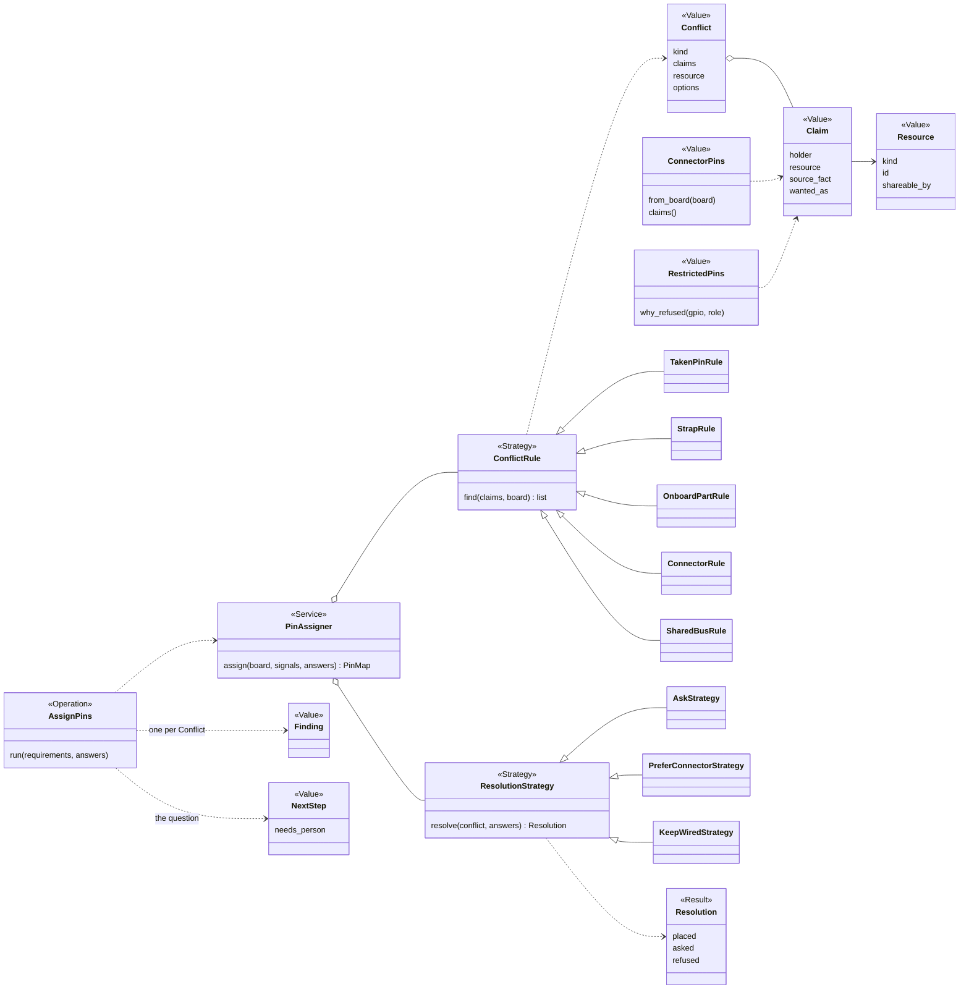

# P663 council: Architecture lens

Read: brief.md, jobs-and-journeys.md, the P323 `architecture/refactor-plan.md` (v2), `areas/design.md`, `wave4-plan.md`, `docs/guide/patterns-and-names.md`, `scripts/spark/core/*`, `scripts/assign_pins.py`, `scripts/restricted_pins.py`, issues #94 and #892. Nothing changed except this file. Paths below are relative to the repository root ~/Development/spark-p663.

## Findings

- AR-1 · The conflict model joins wave 6, in the `design` move (the third PR of the design-with-build area), not wave 4 or 5. The plan says the `design` move "takes `footprint_stop` and the `board-list` Operation, `BoardEmitter` with `read_inputs`, and `PinAssigner`", and wave 6 runs "firmware, breadboard, checks, design with build, records with sourcing" in that order. Design is fourth of five areas. · E · `docs/discovery/2026-10-19-p323-target-architecture/architecture/refactor-plan.md:558-572`; `areas/design.md:7,35-47` · supports only: the placement of the earliest clean landing. It does not say how many PRs wave 6 needs before design is pulled, and the plan gives no date for it (—).

- AR-2 · D2 ("in or after wave 6's design move") has a gap the plan leaves open: the design move itself is "moved from `assign_pins.py`" with `PinAssigner.assign(board, signals) PinMap` and `ImpossibleError`. A conflict model built before that move would be built on `assign_pins.py` (flat script, `Impossible` raised at 8 sites) and would then be moved. A conflict model built after it is built on `design/pin_assigner.py`. The cheaper order is: design net (goldens) and output slice (codes, `needs_person`) first, then the move, then the model as its own PR on the moved module. The wave's own order for an area is net, output slice, move (the move comes third). · E · `refactor-plan.md:560-563`; `assign_pins.py:126,222,245,254,265,268,283,305,419,476` (10 `raise Impossible`) · supports only: sequencing "net, output slice, move, then conflict model". Whether the PO wants the model inside the move PR or after it is a question (Q-A1).

- AR-3 · Today's conflict handling is four unrelated mechanisms, none a model: (a) "already taken" is one `taken_gpio` set and a raise; (b) a strap asked by name is refused through `UNAVAILABLE_ROLES` and `NAMED_STRAP_REFUSAL`; (c) an onboard part is a cost, `ROLE_PENALTY` plus `CONFLICTING_ROLES`, named only in the `why` sentence of a pin chosen for lack of a free one; (d) a shared bus line is an exception inside the named-pin loop (`bus_holders`, `SHARED_LINES`, the `SS` case). Each returns or raises its own text. No code is shared between them and none emits a kind. · E · `assign_pins.py:65-70` (strap), `:82-121` (penalty tables), `:272-283` (bus and taken), `:357-360` (shared onboard job named only when chosen) · supports only: that the model has to unify these four, which is a move of logic, not an addition.

- AR-4 · The core already holds three things a conflict reuses, and needs nothing new from them. (1) `Finding(severity, subject, code, sentence, fix)` carries one conflict as a problem: `subject` can name the pin or signal, `code` is the kind an agent decides on, `fix` the way out. (2) `NextStep(op, argv, why, effects, needs_yes, needs_person, env)` carries the question to the person: `needs_person` exists today as an optional key of `outcomes.step`. (3) `OperationResult.data` carries the structured claims. The envelope's `status_of` already makes a problem exit 1 and an unchecked item exit 2. · E · `scripts/spark/core/result.py:12-16,35-53`; `scripts/spark/core/outcomes.py:113-119` · supports only: that J5 (a conflict as data in `--json`) needs a `code` set and a `data` shape, not a new envelope key. The envelope keys are fixed by `output_schema()` (`result.py:28-32`), so a new top-level key would change every golden; I did not check how many.

- AR-5 · The ask-the-person step does not exist in the core as a mid-run prompt. By rule, no Operation asks or prints; consent is the only asking path, and it is a yes/no `ConsentStrategy` (`TerminalConsentStrategy`, `StandingConsentStrategy`, `RelayedConsentStrategy` in the wave 4 plan), "the person's yes" for an effect. "Cable or wires?" is a choice between options, not a yes. The two ways that fit the contract are: the Operation returns problems with a `NextStep` carrying `needs_person` and the choices, and the caller re-runs with the answer (the shape the plan already uses for a gate: "The Operation then returns `problems` with a NextStep `needs_yes`... The graph resumes with the next Operation"); or a new `ChoiceStrategy` beside `ConsentStrategy` is added to the outside. The first costs no core change. The second adds a seam that the three interfaces (terminal, MCP, graph) each fill. · E · `refactor-plan.md:233-262` (rule 2 and "Consent in a graph"); `wave4-plan.md:47-60` · supports only: that the re-run-with-answer shape is the contract's own and is the lower-cost candidate. I did not test it against the AskUserQuestion experience of Claude Code (—).

- AR-6 · Where a person's answer lives is the same question the plan already answered for neighbouring facts, and the plan's answer is "a record fact for what the part or board is, a requirements line for what this project chose, `.spark/project.json` for a setting of the project". The cable-or-wires answer is a project choice about one part on one board, so it fits a requirements line (the part entry or a `signals` entry already named with `pin` by P513). The GDI pins themselves are a board record fact (`facts.gdi_on_firebeetle2_s3_gpio` today, P460 for the shape). A default ("cable when the board has the connector") is a rule, so it is a strategy setting, not a stored fact. Three homes, three kinds of fact; mixing them is the cost in AR-12. · E for the homes: `areas/records.md:36` (`Brief` from `.spark/project.json`), `jobs-and-journeys.md` J1 today (signals with `pin`, P513), brief D1 · H for the mapping of "cable or wires" onto a requirements line (this lens's reading of the plan's homes; the PO has not said) · supports only: where the answer goes; the pin map it produces is derived, so it is never stored as the answer (rule: spark exports facts, never behaviour; AGENTS.md).

- AR-7 · What moves into the core from `assign_pins.py` (to `design/pin_assigner.py` and a sibling conflict module) and what stays thin. Moves: `assign` (the whole placement, 30+ lines of branching in one function, `:212-330`), `candidates`, `capability_of`, `roles_of`, `bus_line`, `board_dedicates_pins_to`, the penalty and role tables (the plan already says `ROLE_PENALTY` "stays in `assign_pins.py` and moves with it", `refactor-plan.md:323-324,375`), `Impossible` becoming `ImpossibleError`, `_why`/`_why_not` (the reasons, which become the explanations of a conflict), and `render`/`pin_module`/`onboard_lines`/`pin_module_for` as Renderers. Stays thin in `scripts/assign_pins.py`: `main()` (argument parsing, the two `except Impossible` blocks at `:538,545`, printing and the exit code), which becomes one `run_cli` call over an `AssignPins` Operation like `look.py` is over `LookAtBoard`. · E · `assign_pins.py` function list and `:510-575`; `scripts/look.py` as the worked example, `patterns-and-names.md` "The core contract" · supports only: the split. `assign` is over the 40-line limit R1 for new code, so it is split in the move; I did not count its lines.

- AR-8 · The names table already holds the role words a conflict model needs, so no new role word is required, only new names in existing roles. Value: a plain noun (`RestrictedPins` is the model for a Value that answers `why_refused`). Service: `...Service` runs the steps of one flow over given objects. Strategy: a base class a caller can swap, name ends in `Strategy` when the noun does not say it does something. Result: a namedtuple ending in `Result`. Error: ends `Error` (deploy only now; `ImpossibleError` is planned for wave 6). Operation: verb then object. Reader: a class that only reads says so (`...Reader`, `...Finder`, `...Probe`). `why_` returns a reason or None. A constant that decides is a named constant, never a sentence (P260). · E · `docs/guide/patterns-and-names.md` table and "One responsibility, one name"; `refactor-plan.md:227` · supports only: the naming of candidates below. Whether "claim" and "conflict" clash with an existing word is not checked: GLOSSARY.md holds `CONFLICT` as a Wokwi/arithmetic output line (`GLOSSARY.md:75,80`) and the plan glossary has "claim" only as a prose word (`architecture/glossary.md:81`, "A name is a claim, not a test"). That is a naming clash to settle before the code (Q-A3).

- AR-9 · Candidate shapes, as options (class diagram in the section "Candidate shapes" below). Pattern for each, with source:
  1. `Claim` (Value): one signal or part wants one `Resource`, with a `holder` (a signal, a connector, an onboard part, an existing wire) and a `reason` that is a record fact's key path. The idea of resources and their requesters is the resource-allocation / constraint-satisfaction frame (variables, domains, constraints). Source: Russell and Norvig, *Artificial Intelligence: A Modern Approach*, ch. "Constraint Satisfaction Problems" (H, model knowledge, not read this session; pin assignment is a CSP with an all-different constraint plus unary role constraints).
  2. `Resource` (Value): a pin, a bus, a connector, a strap. A pin is exclusive; a bus line is shareable by holders on the same bus and line; this is today's `SHARED_LINES` and `bus_holders` as data. Source: Gamma et al., *Design Patterns*, Flyweight is not needed; the sharing rule is a plain attribute (H).
  3. `Conflict` (Value): `kind` (a code constant), the `Claim`s, the `Resource`, and the `options`. It maps one-to-one onto a `Finding` (code = kind, subject = resource) plus a `NextStep` with `needs_person`. Source: Martin Fowler, *Notification* / the Result pattern (H); inside spark, `Finding` already is that Value.
  4. `ConflictRule` chain: each kind of conflict (taken, strap, onboard, connector, bus) is one small rule that reads facts in the board record and a `Claim` list and returns zero or more `Conflict`s. Chain of Responsibility fits only if one rule handles a claim; here all rules run and all findings add up, so Specification / a list of Rule objects (a validation pipeline) fits better. Source: Gamma et al., *Design Patterns* (Chain of Responsibility, Strategy); Fowler, *Specification* (H, not read this session). This matches AGENTS.md's "checks read facts in records rather than logic per part" (P94).
  5. `ResolutionStrategy` (Strategy): what to do with a `Conflict`: `AskStrategy` (return the question), `PreferConnectorStrategy` (the cable-first default), `KeepWiredStrategy` (option D: keep existing pins), `RefuseStrategy` (stop). D1's A, B, C, D are four implementations of one Strategy. Source: Gamma et al., *Design Patterns* (Strategy); spark's own `ConsentStrategy` and `Platform` are the in-repo precedent (`patterns-and-names.md` roles Strategy and Platform). Setting it by a project setting follows AGENTS.md "a spark setting lets a person switch".
  6. `PinAssigner` (Service) keeps its job and calls the rules, then the strategy; it stays the one that places pins.
  · E for in-repo precedents (`patterns-and-names.md` roles table; `ConsentStrategy`) · H for the external pattern sources, all model knowledge, none read this session · supports only: the shape of the options, not a choice among them.

- AR-10 · The trace hook and the schemas need nothing from the model, and give it two things for free. `options.trace` gets the masked name, values, result and seconds once per run, so a run that found conflicts is traced with no change. `Operation.input_schema()` and `output_schema()` are generated from `Argument`s and the envelope keys, so an answer from the person (the chosen option) enters as one `Argument` on the Operation (for example a `--connector` or `--choose` argument, name not decided), and an MCP tool gets it without hand-written schema. The one catch: `output_schema()` today requires only the envelope keys and says nothing about `data`, so a conflict's `data` shape is untyped to an MCP client unless an Operation-level `data` schema is added. · E · `refactor-plan.md:247-262` rules 1, 3, 4; `result.py:28-32`; `spark/core/operation.py` (not read line by line, only the docstring at `:53`) · supports only: the reuse list and the one gap (an untyped `data` for a conflict). Whether a per-Operation `data` schema is planned elsewhere is — (not checked).

- AR-11 · The model reads facts and exports facts. The board record's `pin_roles` and `facts` hold the claims' sources (strapping, onboard parts, the GDI pins), `RestrictedPins.from_board(board)` already is such a reader of one record fact, and `onboard_functions`/`names_pins` exist in `records/board_records.py`. A `ConnectorPins` Value would be the second reader of this kind (P460 designs the record shape, still open). The model writes no behaviour: it names who wants what; the policy ("cable first") is a Strategy chosen by a setting, and the output (pin map, the sheet's line "plug the ribbon cable") is a fact derived from it. · E · `restricted_pins.py:43-65`; `refactor-plan.md:354` (`onboard_entries`, `names_pins`, `pin_labels`, `onboard_functions`) · supports only: that the model fits "spark exports facts, never behaviour". Where the Strategy's default lives in a record versus in code is open (AR-12, Q-A2).

- AR-12 · Cost of a wrong placement, by the three wrong placements that are plausible. (a) In the interfaces (the CLI's `main()` or the agent prompts): the rule "one core, many interfaces" is broken at once; MCP and a graph would each re-implement the conflict text, and the agent prompt would hold logic (AGENTS.md: "An agent prompt never repeats its logic"). Fix later means touching every interface and every golden. (b) In `assign_pins.py` as it is (before the design move): the model is moved with the script in wave 6, so it is written once and moved once; this is the cheapest wrong place, a rewrite is not needed but the new code starts outside the package and pays the move, its tests are rewritten (`from spark.design...`), and a new `Impossible` raise adds to the 10 the move must convert. (c) In the board records (a conflict as a stored fact): a derived result stored as a record fact goes stale when the board record or the project changes, and breaks "spark exports facts it derives from a record it holds"; the project's pins.py would hold a number that the record disagrees with, which is the P581 row 3 failure (`pins.TFT_DC` says 11 while the cable holds 3). (d) Policy hard-coded as a constant (the cable default in `ROLE_PENALTY`): option D and the next policy become edits of the core, not new Strategies. · H (reasoned from the repo's rules and the P581 evidence) · E for the P581 failure: `jobs-and-journeys.md` J2, `#892` body · supports only: the cost list; no cost is measured.

- AR-13 · The current code has one sign that the model cannot be a thin addition: `assign` is a single function that mixes four jobs (named pins, bus sharing, placing the rest, explaining), and its sorted-by-difficulty placement of unnamed pins (`difficulty(signal)`, `:297`) is the part that must run after connector pins are placed (D1: "the assigner places the connector's pins first"). So the order is already a pipeline of phases: claims from the record (connector, onboard), claims from the requirements (named pins), then the rest placed by cost. That is the Pipeline / Pipes and Filters shape, with the conflict rules reading the claim set between phases. · E · `assign_pins.py:212-330` (`assign`, `difficulty`), D1 in `brief.md` · supports only: that phases are the natural cut. The exact phase list is not specified here (—).

- AR-14 · Name-table fit for candidate names, checked against the table and glossary only (no code search for clashes beyond the two greps below): `Claim`, `Resource`, `Conflict` are plain nouns for Values, fit. `ConflictRule`, `ResolutionStrategy` end in role words, fit. `ConflictFinder` or `ConflictReader` if a class only reads (rule 5). `ConnectorPins` is a Value. `AssignPins` (verb, object) is the Operation, op `"assign-pins"` (already pinned by goldens, so its spelling stays per decision 5). A clash is possible with `Resource` (`Backends`, `Platform` and `Store` use "resource"? not checked) and with `GLOSSARY.md`'s "CONFLICT" output line of the arithmetic checker. · E for the table; — for clashes beyond `grep -n -i "conflict\|claim\|resource"` on the two glossaries (output: only GLOSSARY.md:75,80 and architecture/glossary.md:81) · supports only: that the candidates are not yet checked for clashes in code.

- AR-15 · The area map puts the model in `design`, and the imports go down: design imports sourcing, records and core. A conflict model that reads `pin_roles` and connector facts reads records (allowed). The breadboard area, which says "plug the ribbon cable", reads the pin map or the conflict resolution as input, so breadboard imports design or the shared Value from a lower module. If the `Claim`/`Conflict` Values live in design, breadboard importing design breaks "imports point down" only if breadboard is below design; the plan's arrows say the order of areas is firmware, breadboard, checks, design with build, so breadboard is pulled before design. Where the Value lives (core, records or design) decides that edge. · E for the area order and the arrow rule: `refactor-plan.md:53-66,560`; H for the conclusion that breadboard needs the resolution (J1 says the sheet names the cable: `brief.md` D1 text in #892) · supports only: the open question Q-A4 (which area owns the shared Values).

## Candidate shapes

Options, not a design. Names are candidates. Each box carries its role word as the patterns table asks.

What a person's answer becomes, in the candidate: the choice (cable or wires) is a requirements line for the part; the connector's pins and the strap facts stay in the board record (P460); the default strategy is a project setting; the pin map and the sheet's wiring lines are derived and never stored as the answer.

## What you could not check, and why

- Whether `Operation.input_schema()` can carry a choice argument with `choices`: I read the contract text in `patterns-and-names.md` ("An `Argument` can be `required` or have `choices`") but not `spark/core/operation.py` beyond line 53. — for the exact class fields.
- The size of `assign`, the number of goldens that pin its output, and so the size of the design net: not counted (no `wc` on the function, no golden listing). The plan says a golden net is the first PR of the area, not how many cases.
- Whether wave 5 (`bench in one folder`) and the rest of wave 4 are done: the wave4-plan status I read is dated 2026-11-06 (W4-3 built, W4-4 waits for the PO); the brief says the refactor's "next PRs (W4-4, wave 5) go first". I did not read the board, so the distance of the design move in time is — .
- The breadboard area's page and its imports (`areas/breadboard.md`) and `areas/checks.md`: not read; AR-15 rests on the plan's arrow rule only.
- `docs/discovery/2026-10-19-p323-target-architecture/design.md` and the council notes (`architect.md`, `round4-*`): not read, so an earlier decision on constraint or resource types may exist there; I grepped the glossary only, not the council folder.
- P460's record shape for connectors (#628, open): not read, so `ConnectorPins` is shaped from the board facts that I saw in `brief.md` and #892, not from a design.
- The external pattern sources in AR-9 are model knowledge. No page was read and no search was made. Page and version are — for each.
- Existing PlatformIO, ESPHome or KiCad ERC treatment of pin conflicts: not searched (the brief's budget names it; it belongs to the Existing-first lens).
- Behaviour of the code (no run). Every statement about `assign_pins.py` is from reading, with line numbers at the head of this worktree.

## Questions for the decider

- Q-A1 · Does the conflict model land in the design move's PR (so the move and the model are one PR), or in a PR after the move (the move first, as a pure move with goldens, then the model on `design/pin_assigner.py`)? · decides: the PR split and the risk of the move (a pure move is verified by byte-equal goldens; a move with new behaviour is not).
- Q-A2 · Is "cable first when the board has the connector" a default of a Strategy (a setting a person can switch, and option D or A can be selected) or a rule of the core (one behaviour)? · decides: whether `ResolutionStrategy` exists at all in the first slice, or only `AskStrategy`.
- Q-A3 · Which words does spark use for the model: "claim", "resource", "conflict"? `GLOSSARY.md` already uses CONFLICT for the arithmetic checker's output line. · decides: the names the glossary and the names pass (P382) have to accept before code.
- Q-A4 · In which area do the shared Values (`Claim`, `Resource`, `Conflict`) live: core, records or design? The breadboard area (pulled before design) reads the resolution to say "plug the ribbon cable". · decides: the import edges and whether breadboard imports design or a lower module.
- Q-A5 · May the person's choice come back as a re-run of the same Operation with an answer argument (the plan's gate shape), or does the PO want a `ChoiceStrategy` in the outside, like consent, that an interface fills in? · decides: whether the core gains a seam (and a rule-2 test) or not.
- Q-A6 · Does a conflict's `data` need its own typed schema in `output_schema()` for an MCP client, or is a documented `code` set and an untyped `data` enough for the first slice? · decides: whether the schema work of P605 is extended by this epic.

## Searches

none
