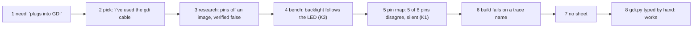
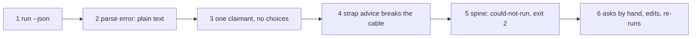
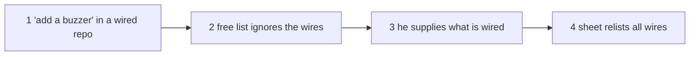
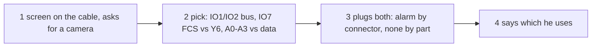

# Jobs and journeys
<!-- Tags as in the brief: E with a pointer, H with its source, D with who and when; an unknown is —. -->

## Who
<!-- One line per persona: who · evidence status (E pointer | H source).
e.g. `- Team leads who assign work · H Lena's belief, no interview yet` -->
- The maker at the bench (the PO, n = 1). He adds modules to a board he owns, some on a ribbon cable. He directs Claude and does not type commands · E `scrum/VISION.md:39`, walk P581 rows 1-13 (`~/Development/spark-walks/p581-sound-joystick/p581-rows.md`), walk 4 diary rows 19:42-19:49 (`~/Development/spark-walks/walk4/walk4-diary.md:23-26`) <!-- REQUIRED:who -->
- Claude, the agent at the keyboard. It acts on a script's answer without reading the script's source. It asks the person the questions that spark cannot answer · E `scrum/VISION.md:40`. That it needs a conflict as data, not as text, is H (the AI-UX lens, PO 2026-10-18)

## Jobs
<!-- One job story per line, each clause tagged: When …, I want to …, so I can ….
e.g. `- When I assign a task in a meeting [E tickets.csv:6], I want the assignee to see it that day [H Lena], so I can stop chasing people [E tickets.csv:7]` -->
- J1 · When a part plugs into a connector that the board fixes, such as the screen on the GDI cable [E walk 4 diary:24, the PO: "i've used the gdi cable", and E P581 row 1], I want spark to place the connector's pins first by default and say so in one line, with no question [D1, narrowed by D4, the PO, 2026-11-07], so I can plug the cable and wire only the other parts [H the PO's words in #892, "the sheet says plug the ribbon cable"]. <!-- REQUIRED:jobs -->
- J2 · When a pin that a part needs is also a strap or an onboard part's pin, such as DC on GPIO3 or the backlight on GPIO21 with the onboard LED [E P581 rows 3 and 4], I want spark to accept it when a connector fixes it and to name the second job [E #892 body, P527 #726], so I can trust that `pins.py` and the sheet match the wires on the bench [E P581 row 3: `pins.TFT_DC` says 11 while the cable holds 3].
- J3 · When two claims want the same pin and spark cannot pick alone [E `scripts/assign_pins.py:283`, "already taken" stops the run], I want one question that names both claims, the pin and the choices [D1, option B], so I can decide once and the next run keeps my answer [H, nobody asked yet where an answer lives].
- J4 · When I add parts to a gadget that already works and is wired [E P581 row 11: init "sees none of it"], I want spark to keep the pins already in use and give new parts the rest [H option D in #892, "later, not this card"], so I do not rewire a working project [H].
- J5 · (Claude) When a script meets a conflict [E `scripts/assign_pins.py:283`, `:65-70`], I want its kind, both claims, the pin and the person's choices in `--json` [H the AI-UX lens], so I can ask the person one clear question and pass the answer back [H].

## Today they…
<!-- Per job: what they do instead today (a competitor, a workaround or nothing), tagged.
e.g. `- Job 1 · paste each task into Slack by hand · E tickets.csv:7` -->
- J1 · pin each of the screen's signals by hand with top-level `signals: [{"name": ..., "pin": ...}]` (P513). Four of the five signals took. Nothing reads the record's `gdi_on_firebeetle2_s3_gpio` or its `host_requirements` line · E P581 rows 1 and 2 <!-- REQUIRED:today -->
- J2 · the fifth signal fails: a strap asked for by name is refused (close audit C4), so DC lands on a free pin that nothing is wired to · E `scripts/assign_pins.py:65-70`, P581 row 3. A shared onboard job is named only when the assigner chose that pin for lack of a free one, never when the person named it · E `scripts/assign_pins.py:357-360`, P581 row 4 (TFT_BL and ONBOARD_LED both 21, half-visible)
- J3 · the run stops with "asks for … which is already taken" and an exit code, with no choices. The person or Claude edits `requirements.json` and runs again · E `scripts/assign_pins.py:283`. Two shared bus lines and a second SPI select are handled without a stop · E `scripts/assign_pins.py:272-282`
- J4 · nothing. Init in a working project reports no board and no rails, and the person starts from zero · E P581 row 11
- J5 · Claude reads the one-line refusal text and turns it into a question by hand. Whether `--json` carries a conflict kind is — (the Feasibility lens reads it)

## Conflict kinds seen so far
<!-- Input for the lenses: each kind with where it was seen. Not a design. -->
- K1 · a connector's fixed pin against a pin the assigner gives another part (GPIO18 to I2S_BCLK, GPIO9 to JOY_SW) · E P581 row 1
- K2 · a connector's fixed pin on a strap (DC on GPIO3) · E P581 row 3, P527 #726
- K3 · a connector's fixed pin on an onboard part (BL and ONBOARD_LED on GPIO21) · E P581 row 4, walk 4 diary:26
- K4 · two connectors on one board share pins (GDI and camera both on IO1 and IO2, I2C) · E walk 4 diary:81-83 · caveat: read off a schematic image, unverified
- K5 · two signals name the same pin · E `scripts/assign_pins.py:283`
- K6 · the pins a working project already wires · E P581 row 11 · caveat: option D, later per #892
- K7 · a pin spent that a later need wanted (I2S on ADC2 blocks WiFi plus ADC there) · E P581 row 10 · caveat: not a conflict today, a cost

## Journeys
<!-- One ### per actor and scenario: the table, then a Mermaid flowchart of the same steps. Never a Mermaid
journey block: it forces a score on every task. "n/a — a one-step job" may replace both.
Filled at step 4, after the council. -->
Paths: W4 = `~/Development/spark-walks/walk4/walk4-diary.md`, P581 = `~/Development/spark-walks/p581-sound-joystick/p581-rows.md`. The two PO journeys are as they happened (E, from council/journey.md, re-read here at W4:23-27, :86 and P581 rows 1-7, 11, 13). The Claude journey is as the UX lens ran it (council/ux.md UX-1 to UX-6, UX-12). The last two are predicted (H): no session has run them.

### The PO, walk 4: the GDI screen added to a FireBeetle 2 ESP32-S3 (2026-11-01) <!-- REQUIRED:journey -->
| step | what they do | evidence | friction or harm | today | open question |
| --- | --- | --- | --- | --- | --- |
| 1 Idea: need | Says yes to a screen need with the condition "plugs into the board's GDI connector" | E W4:23 | `--match` ranks the same with or without the condition. Spark cannot tell which owned display has GDI | not yet | Does `/spark:idea` ask about a connector (ux Q5)? |
| 2 Idea: pick | Says "I have the 2 inch ips and i've used the gdi cable ... research it and lets update our records" | E W4:24 (19:46 row) | He gives the connector fact unasked. Spark has no field for it (W4 G23, G24) | not yet | — |
| 3 Research | Says yes to a web search. An agent reads the GDI and camera pins off the schematic image | E W4:25-26, :79-85 | The pins land in the part record as `verified: false`. The agent's two tables and its summary disagree on IO7 | partly | Who checks the pin table (risks Q8)? |
| 4 Bench | Sees "the display's backlight is kind of glowing like the LED, following the same rhythm" and drops the LED | E W4:86 (19:52 row) | K3 shows first by eye on hardware. The record held the fact (`gdi_backlight_gpio_on_firebeetle2_s3`) and nothing read it | not yet | Is K3 a stop, a note or nothing? |
| 5 Pin map | `assign_pins.py` places TFT_BL 38, CS 11, DC 12, RST 13, SD_CS 14. The cable holds 21, 18, 3, 38, 9 | E W4:86, G27 | 5 of 8 signals disagree with the cable. No warning. `pins.py` keeps `ONBOARD_LED` after the need left (G31) | partly | — |
| 6 Build | `check_spine.py --keep .` exits 1 on `source_trace_not_connected_error` with no trace named | E W4:87, G29, G30 | The trace fault masks the pin conflict | not yet | — |
| 7 Sheet | No breadboard sheet is produced | E W4:87 | The step that tells a wrong wire never ran | not yet | — |
| 8 Firmware and deploy | Claude types the cable's numbers (DC 3, RST 38, CS 18, SD_CS 9, BL 21) into `gdi.py`. The PO flashes and reports "It works" | E W4:30 (20:08 row), G27 | Two sources of truth: `gdi.py` and `pins.py` disagree. The rule "firmware never types a GPIO number" is broken | works, by going around spark | — |

### The PO, walk P581: an amplifier and a joystick added beside the screen on the cable (2026-11-07)
| step | what they do | evidence | friction or harm | today | open question |
| --- | --- | --- | --- | --- | --- |
| 1 Init | Runs init in the games repo that already works with the screen | E P581 row 11 | Spark sees no board, no rails, no goal. He starts from zero (K6) | not yet | Is K6 in the first slice (journey Q-D6)? |
| 2 Requirements | The screen, the amplifier, the joystick and the speaker terminal are listed | E P581 `requirements.json`, row 2 | No word says the screen sits on the cable | works | — |
| 3 Pin map, unpinned | `assign_pins.py` puts I2S_BCLK on GPIO18 and JOY_SW on GPIO9, the cable's CS and SD_CS | E P581 row 1 | Silent K1, exit 0. Built, two wires share a pin: the screen fails or the joystick always reads | not yet | — |
| 4 Pin map, pinned | Claude pins four signals by pad label (D3, D6, D7, D13) with top-level `signals` (P513) | E P581 row 2 | Needs the cable's pins from the PO's head through Claude. Four of five take | partly | Can a question name a pad label (journey Q-A4)? |
| 5 DC on GPIO3 | DC pinned to D2 is refused: "GPIO3 is strapping ... see P527 (#726)" (C4) | E P581 row 3, `scripts/assign_pins.py:69-70` | A dead end. Without `pin`, DC lands on GPIO11 and `pins.TFT_DC` says 11 while the cable holds 3 | not yet | — |
| 6 Backlight | TFT_BL = 21 is right. `ONBOARD_LED = 21` sits 11 lines below. The role word is in the comment, the second signal is not | E P581 row 4 | K3 half named. The role reaches the comment, the second claim does not | not yet | — |
| 7 Build | `check_spine.py --keep .` stops at 300 s, exit 2, no sheet | E P581 rows 5-6 | `pins.py` is still written. No sheet, so no wire list carried the conflict to the bench | not yet | P664 #893 filed |
| 8 Pin change | After a fix the pin map changes and `--keep` leaves the old `board.tsx` | E P581 row 7 | A second run builds the old board (P660 #886) | not yet | — |
| 9 Question | Claude asks how spark is to behave: A place, B ask, C warn, D keep wired. He chooses B with C as the net | E P581 row 13, #892, D1 | The decision lives in a chat, not in the project | partly | Where does the answer live (J3)? |

```mermaid
flowchart LR
  b1["1 init sees nothing (K6)"] --> b2["2 requirements, no cable word"] --> b3["3 unpinned: BCLK on 18, JOY_SW on 9 (K1)"]
  b3 --> b4["4 pinned by pad label, 4 of 5"] --> b5["5 DC refused: strap (K2)"] --> b6["6 BL and LED both 21, half named (K3)"]
  b6 --> b7["7 build stops at 300 s, no sheet"] --> b8["8 kept board.tsx stale"] --> b9["9 'A, B, C or D?' in chat: B"]
```

### Claude, meeting a refusal (the UX lens's run, 2026-11-07)
| step | what they do | evidence | friction or harm | today | open question |
| --- | --- | --- | --- | --- | --- |
| 1 | Runs `assign_pins.py req.json --project 
 --json` on two signals that name D3 | E ux.md UX-1, UX-2 | stdout is `cannot place every signal on this board: / TFT_RST asks for D3 (GPIO38), which is already taken`, not JSON. Exit 1 | not yet | Does `--json` print JSON on a refusal (existing Q4)? |
| 2 | Parses stdout | E UX-2, `scripts/assign_pins.py:538-540` | A parse error on the one answer it needs most | not yet | — |
| 3 | Reads the sentence | E UX-1, `:283-284` | One claimant named (TFT_RST), the other (TFT_CS) not. No choices | not yet | — |
| 4 | On a strap, reads "drop `pin` and spark picks another, or see P527 (#726)" | E UX-12, `:70-71` | The advice breaks the cable wiring. A card number is nothing Claude acts on | not yet | — |
| 5 | Runs the same file through `check_spine.py --json` | E UX-6, `scripts/check_spine.py:408-410` | Stage `schematic`, status `could-not-run`, exit 2, `detail` holds the sentence. No code to key on | not yet | One status word for a conflict (ux Q1)? |
| 6 | Asks the person a question it writes itself, edits `requirements.json` by hand and runs again | E UX-8 (no page holds the question), P581 row 2 | The question's text and choices live nowhere in spark. The next run has no memory of the answer | partly | Sentence-first or data-first (ux Q6)? |

### The PO, predicted (H): a wired gadget that works, one part added (K6)
Source: H, from P581 row 11, J4 and #892 option D (council/journey.md scenario a). No session has done it through spark.

| step | what they do | evidence | friction or harm | today | open question |
| --- | --- | --- | --- | --- | --- |
| 1 | Says "add a buzzer" in the repo of a working gadget | H, P581 row 11 | Init sees no board and no rails. Nothing says which pins the wires use | not yet | Where do the used pins come from (journey Q-A3)? |
| 2 | Spark picks pins from the free list | H, `assign_pins.py` reads the board record and `requirements.json` only | A new part takes the pin of an existing wire. Two outputs on one pin is the harmful case (physics PH-11) | not yet | — |
| 3 | He supplies the old requirements, a photo, or "what is wired" in words | H, `/spark:identify` exists for a photo | Spark did not ask. The firmware files (`gdi.py`, `pins.py`) are the only evidence of pins in use | — | — |
| 4 | The sheet lists wires for the new part and for the old ones | H | A sheet that relists all wires tells him to rewire a working gadget | not yet | — |

### The PO, predicted (H): two connectors share pins (K4: GDI and camera)
Source: H, from K4 (E W4:81-85, pins read off an image, `verified: false`) and physics PH-6, PH-7 (council/journey.md scenario b). No session has put a camera on this board.

| step | what they do | evidence | friction or harm | today | open question |
| --- | --- | --- | --- | --- | --- |
| 1 | Has the screen on the cable and asks for a camera | H | The board record names neither connector (P460 #628 open) | not yet | Is the camera connector in the first slice (physics Q5)? |
| 2 | Picks a camera module. IO1 and IO2 are the I2C pair on both connectors. IO7 is GDI FCS and camera Y6. IO4 to IO8 are the camera's data lines and the header's A0 to A3 | E W4:81-85, physics PH-6, PH-7 · caveat: unverified | A shared I2C bus is not a conflict. FCS against Y6 is. A joystick on A0 to A3 against camera data is two sources on one net | not yet | By part or by connector (journey Q-D5)? |
| 3 | Plugs both ribbons | H | The DFR0664 uses GDI pins 1 to 10 only, so with this screen nothing sits on IO1 or IO2. A check by connector raises a false alarm here | not yet | — |
| 4 | Says which connector he uses | H | The answer is "just the screen" in most cases, and nothing records it | not yet | — |

