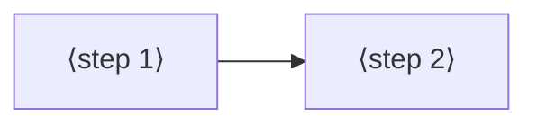

# Jobs and journeys
<!-- Tags as in the brief: E with a pointer, H with its source, D with who and when; an unknown is —. -->

## Who
<!-- One line per persona: who · evidence status (E pointer | H source).
e.g. `- Team leads who assign work · H Lena's belief, no interview yet` -->
- The maker at the bench (the PO, n = 1). He adds modules to a board he owns, some on a ribbon cable. He directs Claude and does not type commands · E `scrum/VISION.md:39`, walk P581 rows 1-13 (`~/Development/spark-walks/p581-sound-joystick/p581-rows.md`), walk 4 diary rows 19:42-19:49 (`~/Development/spark-walks/walk4/walk4-diary.md:23-26`) <!-- REQUIRED:who -->
- Claude, the agent at the keyboard. It acts on a script's answer without reading the script's source. It asks the person the questions that spark cannot answer · E `scrum/VISION.md:40`. That it needs a conflict as data, not as text, is H (the AI-UX lens, PO 2026-10-18)

## Jobs
<!-- One job story per line, each clause tagged: When …, I want to …, so I can ….
e.g. `- When I assign a task in a meeting [E tickets.csv:6], I want the assignee to see it that day [H Lena], so I can stop chasing people [E tickets.csv:7]` -->
- J1 · When a part plugs into a connector that the board fixes, such as the screen on the GDI cable [E walk 4 diary:24, the PO: "i've used the gdi cable", and E P581 row 1], I want spark to ask "cable or wires?" once and then place the connector's pins first [D1, the PO, 2026-11-07], so I can plug the cable and wire only the other parts [H the PO's words in #892, "the sheet says plug the ribbon cable"]. <!-- REQUIRED:jobs -->
- J2 · When a pin that a part needs is also a strap or an onboard part's pin, such as DC on GPIO3 or the backlight on GPIO21 with the onboard LED [E P581 rows 3 and 4], I want spark to accept it when a connector fixes it and to name the second job [E #892 body, P527 #726], so I can trust that `pins.py` and the sheet match the wires on the bench [E P581 row 3: `pins.TFT_DC` says 11 while the cable holds 3].
- J3 · When two claims want the same pin and spark cannot pick alone [E `scripts/assign_pins.py:283`, "already taken" stops the run], I want one question that names both claims, the pin and the choices [D1, option B], so I can decide once and the next run keeps my answer [H, nobody asked yet where an answer lives].
- J4 · When I add parts to a gadget that already works and is wired [E P581 row 11: init "sees none of it"], I want spark to keep the pins already in use and give new parts the rest [H option D in #892, "later, not this card"], so I do not rewire a working project [H].
- J5 · (Claude) When a script meets a conflict [E `scripts/assign_pins.py:283`, `:65-70`], I want its kind, both claims, the pin and the person's choices in `--json` [H the AI-UX lens], so I can ask the person one clear question and pass the answer back [H].

## Today they…
<!-- Per job: what they do instead today (a competitor, a workaround or nothing), tagged.
e.g. `- Job 1 · paste each task into Slack by hand · E tickets.csv:7` -->
- J1 · pin each of the screen's signals by hand with top-level `signals: [{"name": ..., "pin": ...}]` (P513). Four of the five signals took. Nothing reads the record's `gdi_on_firebeetle2_s3_gpio` or its `host_requirements` line · E P581 rows 1 and 2 <!-- REQUIRED:today -->
- J2 · the fifth signal fails: a strap asked for by name is refused (close audit C4), so DC lands on a free pin that nothing is wired to · E `scripts/assign_pins.py:65-70`, P581 row 3. A shared onboard job is named only when the assigner chose that pin for lack of a free one, never when the person named it · E `scripts/assign_pins.py:357-360`, P581 row 4 (TFT_BL and ONBOARD_LED both 21, unnamed)
- J3 · the run stops with "asks for … which is already taken" and an exit code, with no choices. The person or Claude edits `requirements.json` and runs again · E `scripts/assign_pins.py:283`. Two shared bus lines and a second SPI select are handled without a stop · E `scripts/assign_pins.py:272-282`
- J4 · nothing. Init in a working project reports no board and no rails, and the person starts from zero · E P581 row 11
- J5 · Claude reads the one-line refusal text and turns it into a question by hand. Whether `--json` carries a conflict kind is — (the Feasibility lens reads it)

## Conflict kinds seen so far
<!-- Input for the lenses: each kind with where it was seen. Not a design. -->
- K1 · a connector's fixed pin against a pin the assigner gives another part (GPIO18 to I2S_BCLK, GPIO9 to JOY_SW) · E P581 row 1
- K2 · a connector's fixed pin on a strap (DC on GPIO3) · E P581 row 3, P527 #726
- K3 · a connector's fixed pin on an onboard part (BL and ONBOARD_LED on GPIO21) · E P581 row 4, walk 4 diary:26
- K4 · two connectors on one board share pins (GDI and camera both on IO1 and IO2, I2C) · E walk 4 diary:81-83 · caveat: read off a schematic image, unverified
- K5 · two signals name the same pin · E `scripts/assign_pins.py:283`
- K6 · the pins a working project already wires · E P581 row 11 · caveat: option D, later per #892
- K7 · a pin spent that a later need wanted (I2S on ADC2 blocks WiFi plus ADC there) · E P581 row 10 · caveat: not a conflict today, a cost

## Journeys
<!-- One ### per actor and scenario: the table, then a Mermaid flowchart of the same steps. Never a Mermaid
journey block: it forces a score on every task. "n/a — a one-step job" may replace both.
Filled at step 4, after the council. -->
### ⟨actor⟩ — ⟨scenario⟩ <!-- REQUIRED:journey -->
| step | what they do | evidence | friction or harm | today | open question |
| --- | --- | --- | --- | --- | --- |
| 1 | ⟨fill⟩ | ⟨tag and pointer⟩ | ⟨fill⟩ | ⟨works, partly, not yet or —⟩ | ⟨fill or —⟩ |

