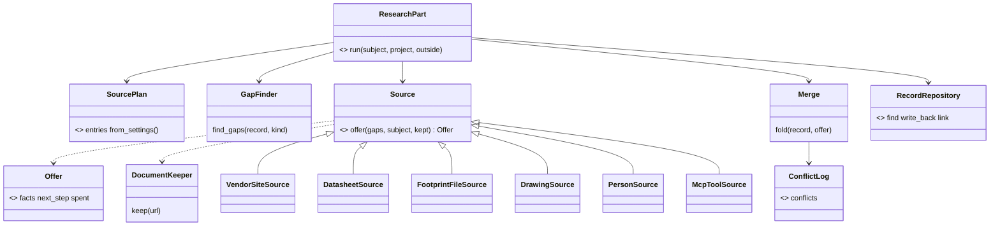

<!-- Resume: invoke product-discovery again. `discovery.py check <this folder>` names the next step. -->
# P735 full records of the PO's DFRobot parts: discovery brief

**Ready for:** collecting evidence. The frame (D1), the direction (D2, D5, D6) and the ratings (D7) are the PO's. The fact tree (D8), the pass line of A1, the architecture (Q6) and the jobs wait. <!-- REQUIRED:ready -->
**Stands on:** 6 H, 4 of which would change the decision (A1 to A4, D7) <!-- REQUIRED:debt -->
**Decision needed:** the PO reads the fact tree analysis (D8), sets the pass line of the geometry count (Q1) and picks the architecture direction (Q6). Then the design of the research pipeline starts in plan mode with a council (D2). <!-- REQUIRED:decision-needed -->

> TL;DR. Four walks ran spark's research flow on four owned DFRobot parts. All four made a valid record. DFRobot published hole and header coordinates in full for 2 of 4, but the record has no typed field for them, and the breadboard drawing reads none of them. Eight reproduced tool bugs and several flow gaps make each record a hand job. The PO's direction (D2, D5, D6) is a designed research pipeline with ordered, swappable sources of many kinds, DFRobot first, usable later from LangGraph, RAG, agents and people. The PO rated A1 to A4 high (D7) and asked for a dependency tree of information needs (D8).

## Frame
- Request, verbatim: "Run the product discovery for P735 (#1010): full records of my DFRobot parts, or at least a subset, and take notes, we'll fix gaps and bugs afterwards." Then, during the run: "So it might be a good idea to plan it with the council so that it fits our acrchitecture and usage cases and is ready for the after refactoring state, to be fully reusablew, with interchangable sources or strtegies, etc, we can just do MVP now of DFRobot, later we can add other search sources, probably it should also be configurable what it uses to get it from the online info, whether the datasheets, just site search, clcking through, a text description for a human or ai, or something elese. Let's really have it well designed so it becaomes a good base for all modules, parts and boards" (the PO, 2026-11-10, this session, spelling as typed). The card's words are in #1010. <!-- REQUIRED:request -->
- Decision · decider: what the research pipeline must do and in which order the gaps and bugs get fixed · the PO. <!-- REQUIRED:decision -->
- Outcome and how it is observed: a record of an owned DFRobot part holds the picture, schematic, outline, holes and connectors. Each has its source or "not published", and spark shows them. Proof: `parts.py --show <id>` for each walked part, and `boards.py` for a board. Showing the fields on the sheet or the board page needs a reader from P734 or P446, which this item does not build. <!-- REQUIRED:outcome -->
- Already decided: D1 the frame (walk a subset, take notes, fix afterwards). D2 the direction (a designed pipeline, swappable sources and strategies, DFRobot MVP, one base for modules, parts and boards). D3 the epic and its six sub-issues (#1010 comment, 2026-11-10). AGENTS.md: spark exports facts, records grow by need (P94), free few and local, never commit a vendor file, one core many interfaces (v0.13, #94). <!-- REQUIRED:decided -->
- Open questions: Q1 below. The scope of "every part" (PCB modules and boards, or also cables and motors). If DFRobot gives no shape, whether spark can make one (P446 and P734 disagree, PO-27). Which revision of DFR1117 the PO owns. <!-- REQUIRED:open -->
- Scope · out of scope (proposed): records of owned DFRobot PCB modules and boards, the research flow that makes them, and the bugs the walks found · out: AliExpress and other vendors (later sources under D2), the breadboard drawing code (P734), prices and stock. <!-- REQUIRED:scope -->
- Start and reach: start existing product · decider reachable yes · users the PO himself (n = 1), no other users reachable · data and connectors: the store and drawer (read), the web (read), Chrome (connected, not used), Miro (connected, not used) · decider as a user n = 1 · must not get worse: the existing 16 records and the build chain that reads them. <!-- REQUIRED:start-reach -->
- Flags:
  - sold or given away, or personal use: personal use, spark is public under MIT <!-- REQUIRED:flag-sold -->
  - connects to a network or runs software: no, records are data <!-- REQUIRED:flag-network -->
  - children or food contact: no <!-- REQUIRED:flag-children -->
  - market: none, records in the PO's own store <!-- REQUIRED:flag-market -->
  - radio: no, records only (DFR1117 has a radio, but no decision here rests on radio rules) <!-- REQUIRED:electronics-firmware:flag-radio -->
  - a Li-ion cell: no decision here rests on it (DFR1117 charges one) <!-- REQUIRED:electronics-firmware:flag-li-ion -->
  - mains: no <!-- REQUIRED:electronics-firmware:flag-mains -->
  <!-- EXTEND:flags -->
- Extensions: electronics-firmware · repo-has boards/*.json; spark-process · repo-has scrum/WORKING_AGREEMENTS.md <!-- REQUIRED:extensions -->
- The item: P735 #1010, an epic in Discovery · still open elsewhere: P733 #1003 waits on the PO's bench (sound lane), no open PR · push check: the push hook and `tools/check_backlog.py`. <!-- REQUIRED:spark-process:item -->
<!-- EXTEND:frame -->
- Depth: TRIO (PO assistant, user, tech lead), three agents on Sonnet, plus four walk agents (spark's parts-researcher, Opus) and one refuter. <!-- REQUIRED:depth -->
- Search budget: 22 searches for the council (3 PO assistant, 2 tech lead, 8 reuse, 3 architect, 2 UX, 4 refuter, none for the user), and 8 searches and 12 fetches per walk (the researcher's own rule). Used: 10 web searches in council/ by the reports' own lists (the check counts 13 lines), 5 over the walks. <!-- REQUIRED:budget -->
- Appetite: unknown, asked at the design council. <!-- REQUIRED:appetite -->

## What we found <!-- CLAIMS -->
- [★C1] None of the 4 records holds hole and pin positions marked verified, because a part record has no field for them and the rule marks a drawing read unverified. DFRobot dimensioned holes for 2 of 4 (SEN0526, DFR0995) and header positions for 2 of 4 (the SEN0526 drawing, the DFR1117 KiCad footprint). Height or thickness was missing in 2 of 4 (DFR0457, DFR1117). · E council/refuter.md:20, walk/dfr1117/diary.md:20, walk/dfr0457/diary.md:89 · caveat: 4 parts picked by Claude for shape variety, shows what DFRobot publishes for these 4, not how often <!-- REQUIRED:findings -->
- [★C2] A part record has no typed field for a picture, a schematic, hole or header coordinates or connectors. They go in only as ad hoc `facts` entries or `documents`, which no reader uses. The validator accepts unknown keys without a word. · E council/tech-lead.md:9, council/refuter.md:29 · caveat: none
- [★C3] The breadboard sheet draws a part only if its record names a Wokwi part that `data/wokwi-geometry.json` holds, and that file holds 4 types. One undrawable part stops the whole drawing. · E council/tech-lead.md:12 · caveat: fuller records alone change nothing on screen until a reader exists (P446 or P734)
- [★C4] Reuse-first misses parts the PO owns. `parts.py --need "load switch"` finds nothing, though the drawer holds 8 DFR0457 with function load-switch and the shelf holds its record. `--need ESP32-C6` misses the shipped XIAO ESP32-C6 board. `--need mosfet` does find DFR0457. · E council/tech-lead.md:26, council/refuter.md:38, `parts.py --need load switch` run 2026-11-10 · caveat: by the words of the need, not by kind. `--need` uses the name-contains matcher, a P211 default that changes only with the PO's yes, and `--match` already reads drawer functions
- [★C5] Spark has no research flow for a dev board. research.md covers parts only, `--skeleton` writes only `parts/<id>.json` and nothing writes a `boards/<id>.json` skeleton, and `--unverified` and `--sources` answer "no part called …" for a board. · E walk/dfr1117/diary.md:39, council/tech-lead.md:30, council/refuter.md:45 · caveat: none
- [★C6] Eight walk bugs reproduce: `--skeleton` writes the forbidden `sourcing` block with prices, `--skeleton` hides a shelf record with no warning, `--fact-set` refuses `legs` and `host_requirements`, `--read` answers FOUND on the absolute-maximum row and on a revision-history row, `check_vendor_pins` fails bare GPIO labels, `boards.py --validate` passes a stand-in with no Wokwi document. · E council/tech-lead.md:27, council/tech-lead.md:33 · caveat: reproduced on scratch copies, nothing changed
- [★C7] `--fetch` skips zips (it keeps .pdf, .jpg, .jpeg, .png, .webp and .svg), so a vendor zip needs a hand download and `--keep`. No command reads inside a kept zip. · E scripts/spark/sourcing/datasheets.py:31, walk/dfr1117/diary.md:44 · caveat: the store holds 3 DFR1117 zips kept by hand today
- [★C8] Vendor pages carry harm. The SEN0526 wiki pin table order is not the pad order, and wiring by the table swaps 3V3 and GND. DFR0995 says "3.3V" in one table and "DC3.3V-5V" in another. DFR1117 VIN is the USB 5 V wire, so VIN plus USB back-feeds the computer, and a board record has no warnings list. · E walk/sen0526/sen0526-i2s-mic.json:282, walk/dfr0995/diary.md:47, walk/dfr1117/diary.md:67 · caveat: read from vendor documents, not measured
- [★C9] The 99 DFRobot drawer entries are not 99 modules. They include cables, motors, a solar panel, a lock and a mystery box. 16 of 112 drawer entries link a record (an `is` key), and 8 of the 99 DFRobot ones do. · E council/po-assistant.md:11, council/refuter.md:71 · caveat: the PCB-module count is not counted (H about 50 to 60)
- [★C10] One record costs 1 to 2 searches, 3 to 10 fetches and 0 to 16 URL checks (DFR1117 could not run `--sources`), and 7 to 30 minutes of agent wall time. The total is that times the scope of Q3, not times 99. · E council/refuter.md:80, walk/dfr0995/diary.md:74, walk/dfr1117/diary.md:84 · caveat: 4 walks, times are the agents' own estimates, no token figure
- [C11] The DFR0457 shelf record says 12 V logic exceeds the opto's 50 mA limit. The arithmetic gives 23 mA at 12 V. · E council/tech-lead.md:75 · caveat: calculated from a typical forward voltage
- [C12] Two hardware revisions sell as DFR1117, with a different regulator (0.6 A against 2 A) and deep-sleep current (14 µA against 37 µA, stated). The PO's revision is unknown. · E council/tech-lead.md:80 · caveat: a photo of the board's back settles it
- [C13] The open cards disagree. P446 says a shape source never calls an AI, the PO's words on P734 list "AI generated and vectorized". P446 plans a `PartShape`, a board record holds `physical`. · E council/po-assistant.md:50 · caveat: none
- [C14] part-data.md:51 says "DFRobot ships no KiCad footprints". The DFR1117 layout zip holds one. · E council/po-assistant.md:22, walk/dfr1117/diary.md:20 · caveat: one SKU

- [★C17] No code or file says which consumer reads which fact. The need lives in four unconnected forms: tuples in code (`CHAIN_FACTS`, `PART_GAPS`, `LAYOUT_FACTS`, `ACTIVE_LEVEL_MEANING`), pointers inside records, free-text `why_it_matters`, and the 5-row prose table in commands/research.md that no code reads. Of the SEN0526 walk record's facts, `sel_has_pull`, `sd_pulldown_ohms` and `needs_mclk` have no reader. · E council/fact-tree.md:9, council/fact-tree.md:22, scripts/spark/records/record_kind.py:37 · caveat: the no-reader count is a grep over spot-checked fact names

## Options <!-- CLAIMS -->
- Q2 what first · design the research pipeline in plan mode with a council (sources and strategies as swappable parts, one record shape for parts and boards, the bugs of ★C6, reproduced on scratch copies, as its first slices) · a plan and two council rounds · that the shape fits the v0.13 core before code · opinion (Claude's, after D2) · D the PO 2026-11-10 · caveat: none <!-- REQUIRED:options -->
- Q2 what first · fix the bugs of ★C6 (reproduced on scratch copies) and ★C7 (zips kept by hand) first, design after · about six small cards · that the hand steps go away · opinion (the tech lead's) · E council/tech-lead.md:27 · caveat: fixes can be redone by the design
- Q2 what first · batch the remaining owned parts now with today's tools · 3 to 10 fetches a record times the scope of Q3 (★C10, estimates) · nothing new, it copies each bug into every record · opinion (none holds it) · E council/tech-lead.md:49 · caveat: none
- Q6 architecture · A: one research Operation in Python runs an ordered chain of sources (Strategy adapters per kind: vendor site, kept documents, footprint file, person, MCP tool), and a source that needs Claude, a person or an MCP server returns a next step · 6 to 8 modules · that one core serves the CLI, Claude, a LangGraph node and a person · opinion (the architect's) · H council/arch-architect.md:27 · caveat: rough module count, no walk record run through the types
- Q6 architecture · B: the agent runs the loop, Python gives three Operations (list the gaps, gather from one source, tell facts) · 4 to 5 modules · that today's shape is enough · opinion (the architect's, not preferred) · H council/arch-architect.md:108 · caveat: keeps the order and the stop rule in prose, against AGENTS.md
- Q6 architecture · C: A plus a source plan with scope, budget and an automatic or ask-first mode per source, a scheduler, and a conflicts list · 7 to 9 modules · that cost and conflicts are data · opinion (the architect's: C as the target, built as A first, with C's conflicts list in the MVP) · H council/arch-architect.md:169 · caveat: the risk is an over-designed plan format
- D8 fact tree · a `FactNeed` value (fact path, consumer, stage, severity, condition) in a registry read from one data file. The gap finder plans research from it, `--unverified` says what depends on a fact from it, and a stage that stops names its need from it. The first file holds only rows that have a reader today (P94) · one data file, one small class, a cycle test with the stdlib `graphlib` · that every fact has a named consumer · opinion (the fact-tree lens's) · H council/fact-tree.md:93 · caveat: the as-is half rests on ★C17, a grep over spot-checked names

Diagram of option A as the architect drew it (council/arch-architect.md:62), with C's conflicts list added. C's Scheduler, PlanEntry and Budget are left out. The architect proposes the store as a port, so that a shared store or a RAG index is a later adapter (D6), and leaves open whether the MVP pays for that port (Q-A9):

- Proposed no-gos and rabbit holes: no vendor file in the repository, keep it in the store only, because the licence is unknown. No AI-made shape until the PO settles C13. No batch before the pipeline. Rabbit hole: reading hole positions out of STEP B-splines (the DFR0995 STEP has 0 circles). · E council/po-assistant.md:50, walk/dfr0995/diary.md:22 · caveat: proposals until the PO confirms them <!-- REQUIRED:nogos -->

## Riskiest assumption and its test
- Riskiest: A1, DFRobot publishes enough geometry (hole and header coordinates) for most owned PCB modules. The walks give full hole and header coordinates for 2 of 4 (SEN0526, and DFR1117, which has no holes), holes only for DFR0995, and neither for DFR0457 (★C1, 4 parts picked by Claude) · proposed — the PO assistant's opinion, pending Q1 <!-- REQUIRED:riskiest -->
- Test · kind · pass line: a script with no AI reads the wiki page of each owned PCB module and counts which link a dimension drawing, a schematic, a STEP and a layout zip. Then a person reads the drawings of 10 modules picked at random for hole and header coordinates · a spike · proposed pass line (set 2026-11-10, after the refuter, before the spike): of 10 owned PCB modules picked at random, at least 7 have a drawing or footprint that gives hole and header coordinates · proposed — Claude's opinion, after the refuter, pending Q1 <!-- REQUIRED:test -->

## Questions
- Q0 · Is this frame right: the decision, the start and reach, the extensions and the depth? · decides: the frame · status: answered D1 (the PO's request names the frame) <!-- REQUIRED:q0 -->
- Q1 · How important is each assumption, and what pass line must the riskiest test meet? · decides: importance and pass lines · status: asked 2026-11-10, importance answered D7, the pass line open after D8 <!-- REQUIRED:q1 -->
- Q2 · What goes first: the design, the bug fixes, or a batch? · decides: the order · options above · status: answered D2 (design with a council) <!-- REQUIRED:q2 -->
- Q3 · Which owned parts are in scope: PCB modules and boards only, or also cables, motors and panels? · decides: the size of the run and the meaning of "done" · status: queued
- Q4 · Which revision is printed on the back of your three DFR1117 boards? · kind: account · decides: which regulator and sleep current the record holds · status: queued, a photo settles it
- Q5 · Should `--need` match the drawer's functions and boards, as `--match` does, in place of the P211 name-contains default? · decides: the `--need` item in items.md · status: queued
- Q6 · Which architecture: A, B or C? The architect's opinion is C as the target, built as A first. Its ten detail questions (council/arch-architect.md:306) go to the design council · decides: the shape of the pipeline · status: queued
- Q7 · Is the first tree about facts only, or also the tools a stage needs and the stage hand-overs (council/fact-tree.md:227)? · decides: one registry or two · status: queued

## Decisions
- D1 · the frame: walk a subset of the owned DFRobot parts through spark's research flow, take notes, fix gaps and bugs afterwards · the PO · 2026-11-10 · this session's first request
- D2 · the direction: plan the research pipeline with the council so that it fits the architecture and the usage cases and the after-refactoring state, reusable, with interchangeable sources and strategies, configurable acquisition (datasheets, site search, clicking through, a text description for a human or AI, or something else), DFRobot as the MVP, a base for all modules, parts and boards · the PO · 2026-11-10 · this session · confirms a direction, not the remaining risk
- D3 · P329, P206, P209, P446 and P734 become sub-issues of P735, and the epic moves to Discovery · the PO · 2026-11-10 · #1010 comment
- D4 · standing approval: discovery output lands by PR, and cards move and get comments as the work happens · the PO · rules.md "The board", read 2026-11-10 · filing items is not covered

- D5 · the direction widens: "various sources should be usable like MCP , I know that there are also parts MCPs from manufacturesrs, so also multiple kinds of sources, again, reusable/interchangable/interactive/automatic etc.. And maybe some order of the sources, so it knows where to look first, etc.. Let's have the council rethink the architectre given this. Also we should have an up to date sotry map for it and journey." · the PO · 2026-11-10 · this session · confirms a direction and asks for an architecture council, an updated story map and journey
- D6 · later interfaces and stores: "And remember later it should all be usable with other interfaces and stores, so langgraph, RAG, agents, humans.." · the PO · 2026-11-10 · this session · confirms a direction (P417 LangGraph, P419 RAG)
- D7 · A1, A2, A3 and A4 are high importance, A5 and A6 low · the PO · 2026-11-10 · this session, Q1 part 1 · confirms the ratings, not the pass line
- D8 · "Maybe we should actually implement some kind of dependency tree for a few things in spark and one of them would be information, like what needs what specific info for what part or bus or somethhing, let's also analyze that and add it" · the PO · 2026-11-10 · this session, in place of an answer to Q1 part 2 · asks for an analysis, council/fact-tree.md

## Found on the way <!-- CLAIMS -->
- [C15] The DFR0457 shelf record holds irrigation wording (signal `VALVE_CTRL`, "four valves", "ESP32-S3") in a record every project finds. · E walk/dfr0457/diary.md:69 · caveat: none <!-- REQUIRED:found -->
- [C16] Library records disagree on whether a pin order read off a drawing is verified: `vl6180x-breakout` and `led-red-5mm` say true, the researcher\'s rule says false. · E walk/sen0526/diary.md:40 · caveat: none

## Board actions <!-- REQUIRED:spark-process:board-actions -->
- #1010 is in Discovery · taken before this session, D3
- set Waiting on: the PO and Waiting since 2026-11-10 on #1010 while Q1 waits · pending, D4
- comment on #1010 with the brief's link and the PR · pending, D4
- file the items in items.md · pending, needs the PO's yes
<!-- EXTEND:brief-sections -->

## Hand-off
not yet: the jobs, the importance of A1 to A6 and the pass line of A1 wait on Q1. <!-- REQUIRED:handoff -->

## Files
[Jobs and journeys](jobs-and-journeys.md) · [Story map](story-map.md) · [Risks and tests](risks-and-tests.md) · [Verification](verification.md) · [Items](items.md) · council/ · walk/
