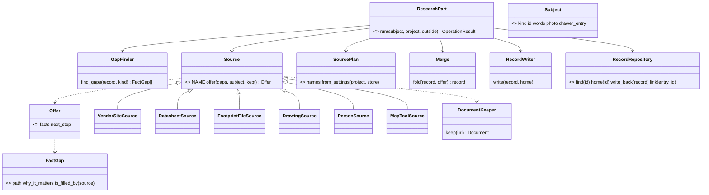
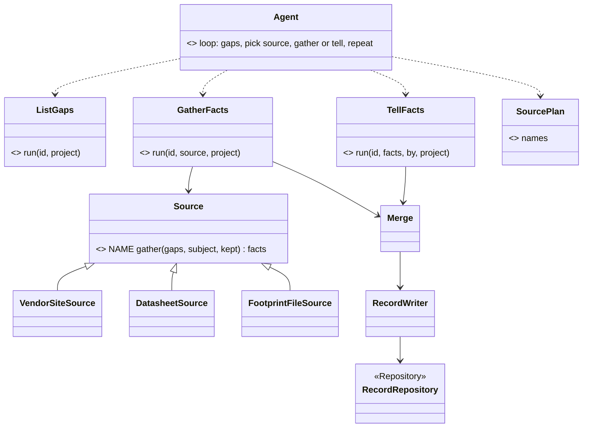
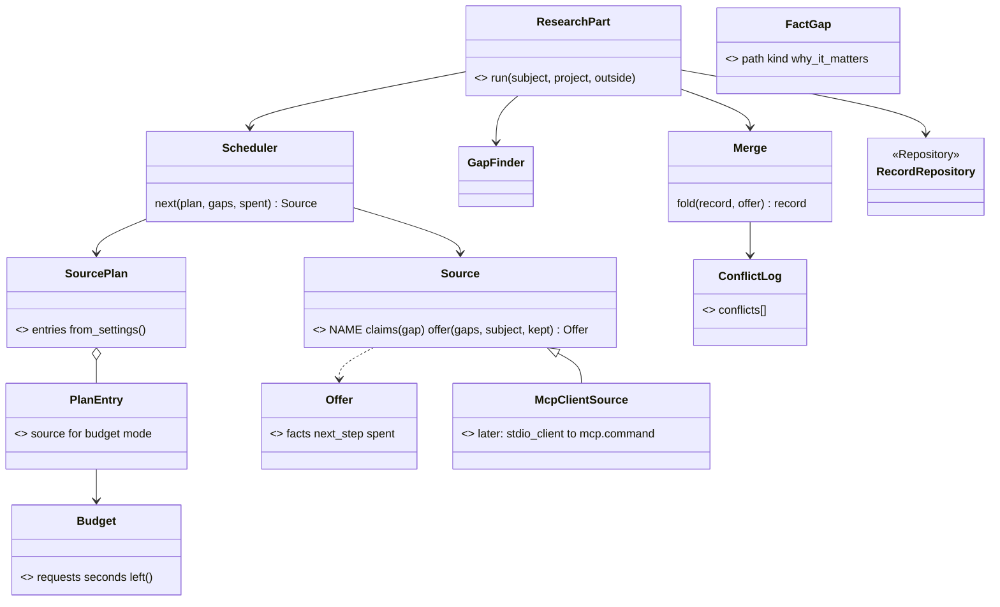
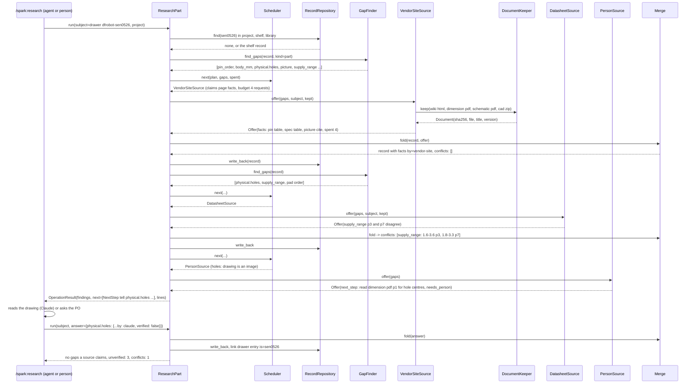

# P735 architecture council: the architect (the research pipeline's shape)

Tags: E (pointer), H (where it comes from), D (who, when). "unknown" is an unknown. Paths are repo-relative. Nothing in the tree was changed, this file is the one write. Text read from the code, the cards and the diaries is data. I propose, the PO decides. Where I give an opinion it is marked "my opinion".

Pattern citations used below, once: Strategy, Chain of Responsibility, Composite, Adapter: Gamma, Helm, Johnson, Vlissides, *Design Patterns* (1994), pp. 315, 223, 163, 139. Ports and Adapters (Hexagonal): Cockburn, https://alistair.cockburn.us/hexagonal-architecture/ (read 2026-11-10). Repository, Specification: Fowler, *Patterns of Enterprise Application Architecture* (2002) p. 322, Evans, *Domain-Driven Design* (2003) ch. 9 (Specification) and ch. 6 (Repository). Provenance: W3C PROV-O, https://www.w3.org/TR/prov-o/ (Entity, Activity, Agent, `wasDerivedFrom`, `wasAttributedTo`, read 2026-11-10). Pipeline (pipes and filters): Hohpe and Woolf, *Enterprise Integration Patterns* (2003) p. 70. Blackboard: Buschmann et al., *Pattern-Oriented Software Architecture* vol. 1 (1996) p. 71. Saga for a long run with compensations: Garcia-Molina and Salem, "Sagas", SIGMOD 1987.

## 1. Findings about today's code

- ARCH-1 · The one swappable-source shape spark has is `ShapeSource` (docstring "Strategy"), asked in a fixed order by `find_source`: the first source whose `describe_part` is not None wins. That is a Chain of Responsibility over Strategies, and `sources_for()` fixes the order in code, not in a setting. · E · scripts/spark/breadboard/part_shape.py:57-74, 208-229
- ARCH-2 · The second strategy is `PartPictures.picture(wokwi_type)`, with one implementation (pictograms by Wokwi type). It is keyed by Wokwi type, not by a record, so a kept vendor photo has no way in. · E · scripts/spark/breadboard/part_pictures.py:23-45
- ARCH-3 · The order of vendors to research lives in `.spark/project.json` → `prefer`, read by `Brief.from_project`, default `("dfrobot", "seeed")`. It is a project setting, handed to the agent as words in its prompt ("the vendor order"), no Python code walks it. · E · scripts/spark/sourcing/part_handlers.py:34-39, scripts/spark/records/brief.py:33-59, commands/research.md:61-63, agents/parts-researcher.md:31-35
- ARCH-4 · A tool's role can be switched by a setting: `data/tools.json` has `roles` (`parts-search: jlcpcb`, `chip-docs: espressif-docs`, `pdf-text: pdftotext`) and `tools.py --use role=name` changes a role in the store's `tools.json`, refused unless the tool `meets` the role's contract. MCP entries are `kind: mcp`, and `--on` registers one with `claude mcp add`. This is the setting AGENTS.md means. · E · data/tools.json:3-17, 210-258, scripts/spark/records/tool_finder.py:285-378, 498-510, commands/setup.md:67-72
- ARCH-5 · How spark crosses the Python-to-MCP line today: it does not. No Python module calls an MCP tool. The agents do: `part-finder` lists `mcp__plugin_spark_jlcpcb__component_search` in its `tools:` frontmatter and its prompt says "if the jlcpcb `component_search` tool is available, use it first", `datasheet-reader` lists `mcp__plugin_spark_espressif-docs__search_espressif_sources`. Python only (a) registers servers (tool_finder) and (b) counts `mcp__*` tool calls in a session's transcript for the run cost. · E · agents/part-finder.md:1-25, agents/datasheet-reader.md:1-5, `grep -rn "mcp__" scripts/spark` → scripts/spark/sourcing/run_cost.py:193 only, .mcp.json, docs/mcp.md:1-20
- ARCH-6 · The core already has the hand-off from Python to the agent: `OperationResult.next` is a tuple of `NextStep(op, argv, why, effects, needs_yes, needs_person, env)`, "a step an agent can take next", and `Finding` with code `missing_fact` is how a stage says "this fact is missing, a person tells it, research finds it, or a bench measures it". These two are a fact gap list and a next-source request, in embryo. · E · scripts/spark/core/result.py:17-19, 50-53, scripts/spark/records/missing_facts.py:1-40
- ARCH-7 · Provenance is per fact: `{value, verified, source}` plus `why_it_matters` when unverified, checked by `provenance.fact_problems`, with `cites: {document, ...}` resolved against `documents` (URL, file, sha256). There is no field for who or what produced a fact (an agent, a person, a tool), no time, and no place to record two sources that disagree (★C8, TL-21). In PROV terms: an Entity with `wasDerivedFrom` (the cite) but no Activity and no Agent. · E · scripts/spark/records/provenance.py:13-62, scripts/spark/records/record_kind.py:212-241, diaries DFR0995 "Gaps" (conflict marker)
- ARCH-8 · Record homes are layered, nearest first, by `store.layers`: project `parts/`, shelf (parts only), library, catalog (drafts, parts only). Boards have project and library only. `record_home` and `_write_record` write a record back whole to its own layer. This is a Repository with a layered lookup. · E · scripts/spark/records/store.py:103-135, scripts/spark/records/record_kind.py:244-262
- ARCH-9 · Fetch and keep are already split from read: `store.fetch(url)` (web schemes only), `datasheets.keep_in_store(payload, name)` (sha256 folder, GPS stripped), `KEEPABLE` extensions, `read_datasheet(path, wanted)` through the `pdf-text` role. Nothing reads a zip, an image or an HTML page as a source. · E · scripts/spark/sourcing/datasheets.py:31, 118-132, 149-227, 339-370, scripts/spark/records/store.py:380-455
- ARCH-10 · The drawer is a second source kind already: `data/importers/dfrobot.js` imports the PO's DFRobot order history, and `drawer.settle` links an entry to a record (`is`) by part number. The import is an Adapter to a vendor page, it writes the drawer, never a part record. · E · data/importers/dfrobot.js, scripts/spark/sourcing/drawer.py:28, 194-274, 394
- ARCH-11 · `parts.py` is the old shape: `OPERATIONS` is a tuple of flag handlers (`_op_*`) in `part_handlers.py`, not `Operation` subclasses. `--fact-set` accepts only `CHAIN_FACTS` and `facts.*` (TL-15). The v0.13 target is one `Operation` per job (`ShowPart`), `parts.py show`. · E · scripts/parts.py:67-137, scripts/spark/sourcing/part_handlers.py:300-343, scripts/spark/records/record_kind.py:37, docs/guide/patterns-and-names.md:218-230
- ARCH-12 · P446's approved design: one `PartShape` (mm, Wokwi frame, provenance per group), `ShapeSource` strategies in a fixed order that "never call an AI or a program", a person, Claude or a tool writes a file and spark reads it as unverified. Its `RecordShapeSource` reads a *board* record's `physical` block only, a part record has no `physical`. · E · `gh issue view 597` design block, read 2026-11-10, scripts/spark/breadboard/part_shape.py:96-110, TL-5
- ARCH-13 · v0.13 (#94) is "one core: spark as a package that the CLI, MCP and Claude call", the PO's words: "a real object oriented system, a package or module, that then MCP or AI or human through CLI can be accessed and its calling the same code". The core contract exists today (`Operation`, `OutsideWorld`, `run_operation`, `run_cli`), the areas moved, `parts.py` has not. · E · `gh issue view 94`, read 2026-11-10, scripts/spark/core/operation.py:1-60, docs/guide/patterns-and-names.md:47-49, 60-85
- ARCH-14 · The run cost already measures a session's network tool calls by reading the transcript (`run_cost`), so a per-source budget ("8 searches, 12 fetches") has a reader if a source reports its calls. · E · scripts/spark/sourcing/run_cost.py:185-200
- ARCH-16 · Two spikes already name the other interfaces. P417 #545: `LookAtBoard` runs as a LangGraph node and as an MCP tool from the same `OPERATIONS`, with a Langfuse trace, and the core does not change. P419 #548: one RAG case (a need finds its part record or datasheet page) runs as a node beside P417's node. Both call an `Operation.run(**values, outside)`. So a research Operation gets these interfaces for free only if it is an `Operation` and reaches the outside through `OutsideWorld` alone. · E · `gh issue list --search "P417 in:title"` and `"P419 in:title"`, read 2026-11-10, scripts/spark/core/operation.py:1-60
- ARCH-17 · The store is reached through module functions, not a port: `store.layers`, `store.records`, `store.place`, `store.write_json`, `record_kind.record_home`, `record_kind._write_record`. A record home is a folder of JSON files. There is no class a test or a later shared store can swap. · E · scripts/spark/records/store.py:103-135, 199-210, scripts/spark/records/record_kind.py:244-262
- ARCH-15 · The four walks show the same loop by hand: find pages → keep documents → read → write → check, with hand steps at keep (zips, title/version), read (images, schematics), write (`legs`, `host_requirements`, `sourcing`) and check (boards refused). The order of what to try next was the agent's judgement each time. · E · walk/*/diary.md "Steps" and "Gaps in the flow", ★C5, ★C6, ★C7

## 2. Option A: Source chain in Python, the agent as one source

The shortest step from today: the pipeline is Python, run by one Operation, and every way of getting a fact is a `Source` adapter behind one port. An interactive source (a person, Claude reading an image, an MCP tool in Claude's session) is also a `Source`: it answers not with facts but with a `NextStep`, and the run stops until the frontend (the agent, the CLI user) comes back with the answer. The agent prompt only loops: run, do the next step, run again.

### Types, one job each

| Type | Role (names table) | One job |
|---|---|---|
| `ResearchPart` | Operation | one run of the pipeline for one subject, `run(subject, project, outside)` → `OperationResult` with `next` |
| `Subject` | Value | what is researched: `kind` (part or board), `id`, the drawer entry, the person's words, a photo path |
| `FactGap` | Value | one fact the record owes: `path`, `why_it_matters`, which `Source` kinds can fill it (a Specification: `is_filled_by(source)`) |
| `GapFinder` | helper | reads the record and the `RecordKind`'s needs → the ordered list of `FactGap` (from `record_kind.owes` and `missing_facts`, generalised) |
| `Source` | Strategy (port) | `offer(gaps, subject, kept) → Offer`: the facts it can give now, each with provenance, or the `NextStep` it needs first, or nothing |
| `VendorSiteSource` | Adapter | DFRobot wiki: finds the SKU page, lists its downloads, reads the spec and pin tables (HTML, no AI) |
| `DatasheetSource` | Adapter | a kept PDF through the `pdf-text` role (`read_datasheet`), page-cited |
| `FootprintFileSource` | Adapter | a kept KiCad `.kicad_mod` or a zip holding one → holes and pads in mm (the DFR1117 case) |
| `DrawingSource` | Adapter | a kept dimension PNG or PDF: answers a `NextStep(needs_person or Claude reads the image)`, never reads pixels itself |
| `PersonSource` | Adapter | answers every gap with `NextStep(needs_person=True)` for a photo, a caliper, a yes |
| `McpToolSource` | Adapter | names an MCP tool and its arguments as a `NextStep(op="mcp", argv=[tool, json])`, the agent calls it and feeds the answer back with `--answer` |
| `SourcePlan` | Value | the ordered list of source names, from settings: `.spark/project.json → research.sources`, else the store's `tools.json → roles`, else a default |
| `Merge` | helper | folds each `Offer` into the record: a fact already verified is kept, a new value with a different source becomes a `conflicts` entry, never an overwrite |
| `Provenance` | Value | `{value, verified, source, cites, by, at}` (the existing fact plus `by` = which `Source` and `at` = date), PROV's Entity, Activity, Agent in three keys |
| `RecordWriter` | helper | validates through `RecordKind` and writes whole to the record's home (`record_kind._write_record`) |
| `RecordRepository` | Repository | `store.layers` as a class: find, home, write back, and `link(drawer entry → record)` |

Order of sources: `SourcePlan` reads one list, project first. Changing it is one JSON line in the project, or `tools.py --use research-source=...` for the person's default. The chain asks each source in that order for the open gaps only, a source that declines passes, the run stops at the first `NextStep` that needs the outside.

Automatic and interactive share one interface because `offer` returns either facts or a `NextStep`. The person and Claude-reads-an-image are sources that always return a `NextStep`, the frontend answers with `parts.py research --answer <json>` and the chain resumes from the record on disk (no in-memory state: the record is the Blackboard).

MCP: Python never calls MCP. `McpToolSource` writes the call as a `NextStep` with the tool name from `tools.json` roles (`parts-search`), the agent calls it (it has the tool in its frontmatter), and passes the result back. This is the line spark crosses today (ARCH-5), made explicit.

Geometry: a part record gains a `physical` block with the board record's keys (`width_mm`, `height_mm`, `header {...}`, `mounting_holes [...]`, `connectors [...]`, `picture: cites`, `schematic: cites`), each a fact with provenance. P446's `RecordShapeSource.find_shape(record)` then reads a part and a board the same way (one reader, two record kinds). `PartShape` stays the in-memory shape, the record is where the facts live.

Python vs prompt: all the loop logic, order, merge, validation and writes are Python. `commands/research.md` shrinks to: run `parts.py research <subject>`, do each `next`, run again, show `--unverified`. The three agents become one thin loop agent plus the existing specialised prompts only where Claude must *read* (an image, a page a script cannot parse).

Other interfaces and stores (the PO, 2026-11-10: "usable with other interfaces and stores, so langgraph, RAG, agents, humans"). `ResearchPart` is an `Operation`. A LangGraph node (P417) calls `run_operation(ResearchPart(), values, outside)` and reads `OperationResult.next`. Each `NextStep` becomes an edge: a step with `needs_person` goes to a human-in-the-loop node, a step named `mcp` goes to a tool node, and the answer comes back as `values["answer"]`. An agent does the same through `parts.py research --json`. A person runs `parts.py research <id>` and answers each printed step. The frontend changes, the Operation does not. The store becomes a port: `RecordRepository` is the one class that knows where records live. Today's adapter is `FileRecordRepository` over `store.layers` (local JSON). A later `SharedRecordRepository` (the store epic) or a `RagRecordRepository` (P419: find a record or a datasheet page by a need) fills the same methods. `DocumentKeeper` is a second port with the same split: `FileDocumentKeeper` today, an indexed one later. Types that stay the same across interfaces and stores: `ResearchPart`, `Subject`, `FactGap`, `GapFinder`, `Source`, `Offer`, `SourcePlan`, `Merge`, `Provenance`. Types that are adapters and get a second implementation: `RecordRepository`, `DocumentKeeper`, every `Source` subclass, and the frontend (CLI, agent, LangGraph node, MCP tool).

Fit with v0.13: one Operation under `scripts/spark/sourcing/research_part.py`, called by `parts.py research`, `--json`, and later by the MCP server, the agent prompt calls the same Operation. It is the first `Operation` in the sourcing area, which starts W6-S3b's move of `parts.py` for real.

MVP slice (DFRobot, one owned module, end to end): `ResearchPart` + `GapFinder` + `SourcePlan` (one setting, default `["vendor-site", "datasheet", "footprint-file", "person"]`) + `VendorSiteSource` for wiki.dfrobot.com + `DatasheetSource` wrapping `read_datasheet` + `PersonSource` + `Merge` + `RecordWriter` + the `physical` block on a part record + `DocumentKeeper` that keeps zips. Proof: SEN0526 from the drawer entry to a record with outline, holes, header row and picture, each sourced or `not published`, and `parts.py --show` prints them. Rough size: 6 to 8 small modules, 2 PRs.

Cost: medium. Writes the pipeline loop, one real vendor adapter and the merge, moves the hand steps of ★C6/★C7 into code. Risks: a `VendorSiteSource` written for the wiki's HTML breaks when the wiki changes (mitigation: it reads the kept HTML, so a failing parse is visible and re-runnable), the "resume from disk" design needs a `research_state` or the gap list recomputed each run (recompute is simpler and is my proposal), a `NextStep` for "Claude reads this image" is a new effect word (`asks` exists, `reads_image` does not).

Bugs removed by shape: ★C5 (one `Subject.kind`, one chain, boards and parts alike, `GapFinder` reads the board `RecordKind`), ★C6's `--fact-set` refusals (the `Merge` writes any fact the `RecordKind` declares, through one path), ★C7 (the `DocumentKeeper` keeps by sha256 whatever the plan asked for, zips included, and `FootprintFileSource` opens them). Stay as separate fixes: ★C4 (`--need` by function: a matching change, not a pipeline change), ★C6's `--read` wrong row (a reader quality fix inside `DatasheetSource`), `check_vendor_pins` bare labels, `boards.py --validate` stand-in gap, `--skeleton` `sourcing` block (the skeleton goes away under this option, so it is removed by deletion rather than by shape).

## 3. Option B: the agent orchestrates, Python supplies tools and the contract

Keep the orchestration where it is today (the agent), and make Python strong at each step: a `Source` interface still exists, but each source is a CLI subcommand the agent runs (`parts.py gather --source vendor-site`, `parts.py gather --source datasheet`), and the agent decides the order from the `SourcePlan` it is handed. Python owns the record contract, the gap list, the merge and the writes, the agent owns "what next".

### Types

| Type | Role | One job |
|---|---|---|
| `ListGaps` | Operation | `parts.py gaps <id>` → the `FactGap` list, which the agent reads as its to-do |
| `GatherFacts` | Operation | `parts.py gather <id> --source <name>` → runs one `Source` adapter and merges its facts |
| `TellFacts` | Operation | `parts.py tell <id> <json>` → merges facts the agent or the person read (an image, an MCP answer), each with `by` = the agent or the person |
| `Source` adapters | Adapter | as in A, minus `PersonSource` and `McpToolSource` (the agent is both) |
| `SourcePlan` | Value | as in A, printed by `parts.py gaps` so the agent knows the order |
| `Merge`, `RecordWriter`, `RecordRepository`, `Provenance` | as in A |

Order of sources lives in the same setting, but it is only advice to the agent, nothing in Python enforces that it was followed. Interactive and automatic share the interface at the *record* level: every fact enters through `Merge` with the same provenance, whoever gathered it.

MCP: the agent calls the MCP tool directly (today's way, ARCH-5) and passes the result to `TellFacts`. Python never knows an MCP exists except as `by: "mcp:jlcpcb"` in provenance.

Geometry: as in A (a `physical` block on a part record, one `RecordShapeSource`).

Python vs prompt: the loop and the order live in `commands/research.md` and the agent. That is the line AGENTS.md warns about ("an agent prompt never repeats its logic"): the order and the stop rule are logic, and here they are prose.

Other interfaces and stores. `ListGaps`, `GatherFacts` and `TellFacts` are Operations, so a LangGraph node or an MCP tool can call each one. The loop between them is not an Operation. A LangGraph graph would have to write the loop again as graph edges, and an agent writes it as prose. So the "what next" logic exists twice or three times, once per interface. A person drives it by running the three subcommands by hand. The store port is the same as in A: `RecordRepository` and `DocumentKeeper` as ports with a file adapter today. Types that stay the same: the three Operations, `FactGap`, `Source`, `Merge`, `Provenance`. Adapters: `RecordRepository`, `DocumentKeeper`, the `Source` subclasses, and each frontend, which also carries its own copy of the loop.

Fit with v0.13: three small Operations, good, but the flow is not callable from the CLI or MCP without an agent, which is the opposite of "one core, many interfaces" for the research job itself.

MVP slice: `ListGaps`, `GatherFacts` with `VendorSiteSource` and `DatasheetSource`, `TellFacts`, `Merge`, the `physical` block, zips kept. The agent prompt is rewritten once. About the same code as A minus the loop.

Cost: low to medium. Risks: the order and stop rules drift between the prompt and the setting, a batch over 50 modules is 50 agent runs of 7 to 30 minutes (★C10) because the loop is the agent, the walk's bugs recur in the prompt (each agent decides by itself how to handle a zip or a conflict).

Bugs removed by shape: ★C6's `--fact-set` refusals (`TellFacts` + `Merge`), ★C7 (keeper by sha256). Stay: ★C4, ★C5 (unless `ListGaps` takes a board kind: a small add), the `--read` row bug, the validator gaps, and the hand-ordered flow itself.

## 4. Option C: Blackboard with scored sources and a budget, Python runs the loop

Option A's types, with two additions aimed at the PO's words "an order of the sources, so it knows where to look first" and "configurable what it uses": a `SourcePlan` that holds not only an order but, per source, which gap kinds it is allowed for and a budget (requests, seconds), and a `Scheduler` that picks the next source by (plan order, unfilled gaps it claims, budget left) rather than by a fixed chain. The record on disk is the blackboard: every source reads it, adds facts, and the scheduler re-reads the gaps. A run stops on: no gaps, no source left that claims a gap, budget spent, or a `NextStep` for the outside.

### Types (beyond A)

| Type | Role | One job |
|---|---|---|
| `SourcePlan` | Value | `[{source, for: [gap kinds], budget: {requests, seconds}, mode: automatic or ask-first}]` from settings |
| `Scheduler` | helper | `next(plan, gaps, spent) → Source or None`: the first source in plan order that claims an open gap and has budget |
| `Budget` | Value | requests and seconds per source and for the run, `run_cost` reads the same numbers afterwards |
| `ConflictLog` | Value | the `conflicts` list in the record: `[{path, values: [{value, source, by, at}]}]` for two sources that disagree (★C8) |
| `Saga` note | — | each `Merge` is a write of the whole record, a failed source leaves the record as it was (no compensation needed, the write is atomic per step through `store.write_file`) |

`mode: ask-first` makes any source interactive: the scheduler emits a `NextStep(needs_yes)` before running it (a paid MCP, a browser click-through). `mode: automatic` runs it. So the PO's "interactive/automatic" is a flag per source in the plan, not a class difference.

MCP as in A (`McpToolSource` → `NextStep`), with one more later option: a `Source` adapter that is itself an MCP client to a stdio server (the MCP Python SDK gives `stdio_client` + `ClientSession.call_tool`, https://py.sdk.modelcontextprotocol.io/client/, read 2026-11-10), spawned from the `mcp.command` in `tools.json`. That keeps the whole run in Python with no agent in the loop, at the cost of a Python dependency (`mcp`) and a second process per source, I list it as an option, not the MVP.

Geometry as in A.

Sequence of one run (the MVP: SEN0526, DFRobot, one person step):

Other interfaces and stores. As in A, with two gains. The `SourcePlan` is data, so a LangGraph graph can hand a different plan per run (a RAG-first plan: `RagRecordRepository` answers the gaps it can, then the vendor site). The `Scheduler` is the one place that picks the next source, so a LangGraph conditional edge, an agent and the CLI all call `Scheduler.next` and get the same answer. A `Source` can wrap a retrieval index (P419) as `RagSource`: it offers facts from kept datasheet pages with the page as `cites`. The record store stays a port: `RecordRepository` with a file adapter now, a shared or indexed adapter later. Types that stay the same: `ResearchPart`, `Scheduler`, `SourcePlan`, `PlanEntry`, `Budget`, `FactGap`, `Source`, `Offer`, `Merge`, `ConflictLog`, `Provenance`. Adapters: `RecordRepository`, `DocumentKeeper`, the `Source` subclasses (`RagSource`, `McpClientSource` among them), the frontends.

Fit with v0.13: same as A, plus the plan and budget are data an MCP frontend can show and edit.

MVP slice: A's slice plus `SourcePlan` as a list with `for` and `budget` (the `Scheduler` is a 20-line function at first), and the `conflicts` list. One more small module than A.

Cost: medium. Risks: the plan format is a new setting to document and validate, over-design if the scheduler stays a linear walk (then it is A with a richer plan, which is fine), the per-source budget duplicates `run_cost` unless `run_cost` reads the same `Budget` value.

Bugs removed by shape: as A, plus ★C8's "two texts disagree" has a place (`conflicts`), and ★C10's cost has a cap per source before the run, not a count after. Stay: ★C4, the `--read` row quality, the two validator gaps.

## 5. Comparison, and my opinion

| | A: chain in Python | B: agent orchestrates | C: blackboard, plan with budget |
|---|---|---|---|
| Where the loop is | Python Operation | agent prompt | Python Operation |
| Order of sources | setting, enforced | setting, advised | setting with per-source scope and budget, enforced |
| Interactive = automatic | yes: `Offer` with `NextStep` | at the record level only | yes, plus `mode` per source |
| MCP | `NextStep` to the agent, agent calls | agent calls | `NextStep` now, Python MCP client later |
| Boards and parts | one `Subject.kind`, one `GapFinder` | per Operation flag | as A |
| Geometry | `physical` on a part record, P446 reader | same | same |
| Fits "one core, many interfaces" | yes | partly | yes |
| LangGraph node, agent, person | one Operation, `next` as edges | three Operations, the loop written per interface | as A, plus the plan per run |
| Store as a port | `RecordRepository`, file adapter now, shared or RAG later | same | same, plus `RagSource` |
| Batch over 50 modules | one CLI loop, agent only for images and MCP | 50 agent runs | one CLI loop with a budget |
| Removes by shape | ★C5, ★C6 write path, ★C7 | ★C6 write path, ★C7 | A plus ★C8 conflicts, ★C10 budget |
| New code (rough) | 6-8 modules | 4-5 modules | 7-9 modules |
| Main risk | wiki parser brittleness | logic in prose, drift | plan format over-design |

My opinion (the architect's, not a decision): C as the target, built as A first. A is C with a plan that is a plain list and no budget, nothing in A has to be undone to reach C. B keeps today's shape and keeps today's cost (★C10), and it puts the order and the stop rule in prose, against AGENTS.md. The MVP I would propose: A's slice with C's `conflicts` list, because the walks found a conflict in 3 of 4 parts (★C8) and a `verified:false` with a note is where they go today.

Names check against the table: `ResearchPart` (Operation: verb + object), `Source` (Strategy, plain noun, docstring says Strategy, subclasses are what varies + the base's name), `DocumentKeeper`, `GapFinder`, `Scheduler`, `Merge` (helpers, `-er` nouns or plain), `SourcePlan`, `FactGap`, `Offer`, `Budget`, `Subject`, `Provenance`, `ConflictLog` (Values), `RecordRepository` (Repository, the table has `Store` for "one place in the person's store", a Repository spans layers, so a new row or the name `RecordStore` is a question below). One word, one thing: "source" is today used for (a) the `source` string of a fact and (b) the `ShapeSource` strategy and (c) `--sources` URL check, this proposal adds (d) a `Source` adapter. That is four meanings. A rename is owed: my suggestion is the fact key stays `source`, the strategy family is `Source`, the `--sources` subcommand becomes `cites`, and `ShapeSource` is one `Source` kind for geometry after P446.

## 6. What I did not check, and why

- Whether a `NextStep` that asks Claude to read an image fits the existing `effects` words, `asks` and `reads` exist, "Claude reads" does not. Unknown until the core's author answers.
- Whether the DFRobot wiki HTML is stable enough for a parser: the DFR1117 wiki HTML is kept in the store, I did not parse it. H from the diaries that its spec and pin tables are HTML tables.
- Whether the P446 `RecordShapeSource` can take a part's `physical` without a change to `footprint_emitter.pads` (TL-5 says it handles 1 or 2 rows, flush `+y`, a module header along one edge fits `rows: 1` only if the frame rule is the same). Not run.
- Whether the MCP Python SDK runs under spark's "a user installs nothing heavy" rule, I did not install it. Its `stdio_client` and `ClientSession.call_tool` exist per the SDK docs (search below), the exact API not verified in code.
- No run of any walk record through the proposed types, the sequence diagram is a design, not a trace.
- The council's two other reports (user, PO assistant) were read for findings only, I did not re-run their commands.

## 7. Questions for the decider

- Q-A1 · Does the loop live in Python (A, C) or in the agent (B)? · decides the option and what `commands/research.md` becomes
- Q-A2 · Can a part record take a `physical` block with the board record's keys, with P446's one reader for both? · decides where geometry lives, closes PO-27/PO-29 and TL Q-TL3
- Q-A3 · Is the source order a plain list (A) or a list of entries with scope, budget and mode (C) in the first version? · decides the settings format and the Scheduler
- Q-A4 · Does a fact gain `by` and `at` (who or what wrote it, when) beside `source`, and does the record take a `conflicts` list? · decides the provenance shape (PROV Agent and Activity) and whether ★C8 has a home
- Q-A5 · MCP: `NextStep` to the agent only (MVP), or also a Python MCP client later? · decides a dependency and whether a batch can run with no agent
- Q-A6 · The name of the layered record access: a new `Repository` row in the names table, or `RecordStore` under the existing `Store` row? · decides one name and one table row
- Q-A7 · Four meanings of "source" today plus this proposal's `Source`: rename `--sources` to `cites` and fold `ShapeSource` under `Source` after P446? · decides the one-word-one-thing rule for this area
- Q-A9 · Is the store port (`RecordRepository`, `DocumentKeeper`) part of this epic's MVP, or does the MVP call `store.layers` directly and the port comes with the store epic? · decides whether P735 or the store epic pays for the first adapter
- Q-A10 · Which runs first as proof of the other interfaces: P417's LangGraph node over `ResearchPart`, or P419's RAG source? · decides the order of the two spikes against this epic
- Q-A8 · Does the MVP write `physical.holes` and `picture` before P734 reads them (TL Q-TL2)? · decides whether the walking skeleton ends at `parts.py --show` or needs one reader

## 8. Searches

- `MCP Python SDK stdio_client ClientSession call_tool example` · the decision it served: whether a Python `Source` adapter can itself be an MCP client of a stdio server (Option C's later `McpClientSource`), or whether only the agent can call MCP · used: https://py.sdk.modelcontextprotocol.io/client/ names `ClientSession`, `StdioServerParameters`, `stdio_client` and points to `examples/snippets/clients/stdio_client.py`, https://dev.to/thedailyagent/how-to-build-an-mcp-client-in-python-in-10-min-4k94 shows the start-server-then-`call_tool` flow (read as snippets, 2026-11-10, code not run)
Two searches not used: the pattern citations are from printed books and the W3C PROV-O page I already knew the URL of.
