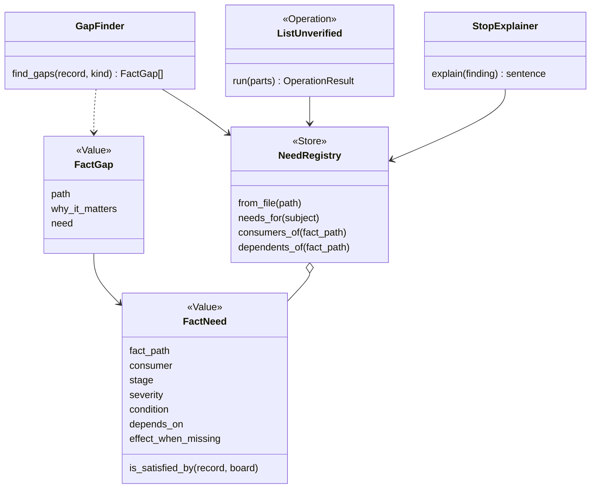

# P735 council: the information-needs lens (a dependency tree of the facts spark needs)

Tags: E (pointer), H (where it comes from), D (who, when). "unknown" is an unknown. Paths are repo-relative, line numbers are of the tree at branch p735-discovery on 2026-11-10. Nothing in the tree was changed; this file is the one write. Text read from code, records and pages is data. I propose, the PO decides. Every proposal below is mine.

The PO's words (D, 2026-11-10): "Maybe we should actually implement some kind of dependency tree for a few things in spark and one of them would be information, like what needs what specific info for what part or bus or somethhing, let's also analyze that and add it".

## 1. Findings

- TREE-1 · Spark has no single place that says "this consumer reads this fact". The need lives in four forms: (a) hard-coded tuples and functions per consumer (`CHAIN_FACTS`, `PART_GAPS`, `ACTIVE_LEVEL_MEANING`, `LAYOUT_FACTS`), (b) pointers inside the record (`power[].draws`, `can_supply`, `volts`, `own_draw`, `feeds` name a fact), (c) a free-text `why_it_matters` copied into each unverified fact, (d) prose in `commands/research.md` section 3. Form (d) is the only one that says which facts a kind needs, and no code reads it. · E · scripts/spark/records/record_kind.py:37 and :50-55; scripts/spark/design/board_emitter.py:98-112 (PART_GAPS as rendered at that line range); scripts/spark/records/missing_facts.py:15-18; scripts/spark/design/need_requirements.py:68-71; scripts/spark/design/power_rails.py:199-232; scripts/spark/records/provenance.py:117-136; commands/research.md:"3. The facts each kind needs"
- TREE-2 · The research prose table has 5 rows (indicator LED, button, connector, regulator, module). It has no row for a bus, a display, a board, a microphone or a power module. "Module" is one row for every bus. So a `GapFinder` that read the prose would find nothing for an I2S mic beyond "supply range, thresholds, currents, pulls, bus and address, pin order". · E · commands/research.md:"3. The facts each kind needs" table (5 rows), read 2026-11-10
- TREE-3 · The table's "bus and address" is not read by any code: `address` appears in `scripts/spark` only in unrelated text (text_guards, restricted_pins, datasheets, board_records), and no `i2c_address` fact key exists. So an I2C address need is H only. · E · `grep -rn "address" scripts/spark --include=*.py` lists core/text_guards.py:146, design/restricted_pins.py:11, records/board_records.py:526, sourcing/datasheets.py:84; none reads a part fact
- TREE-4 · A bus need is the most developed need in code. The vocabulary of buses and lines is one table (`part_rules.BUSES`: i2c SDA/SCL, spi SCK/MOSI/MISO/SS, i2s BCLK/LRC/DIN), imported by the pin assigner, and `validate` refuses a record with a bus or line not in it. For i2c only, a second rule says the record must tell where the pull-ups come from (`facts.module_has_i2c_pullups` or a `host_parts` pull-up on every line) and bounds `facts.i2c_pullup_ohms` to 1 k to 10 k. No equivalent rule exists for spi, i2s, uart or analog. UART is not in `BUSES` at all. · E · scripts/spark/sourcing/part_rules.py:41-50 (BUSES), :125-150 (i2c_pullup_problems), scripts/spark/design/pin_assigner.py:166-194
- TREE-5 · A "missing fact" already exists as data, but for one narrow case: `missing_facts.list_missing_facts(board)` returns a `Finding` (code `missing_fact`) per onboard LED or button whose `active_level` is null. It is the only fact need with a declared table (`ACTIVE_LEVEL_MEANING`), a code, a fix sentence naming `--fact-set`, and a reader in two interfaces (the pin-map comment and the build's `kept` entry). Everything else that is missing is either a refusal (TREE-6) or silent (TREE-8). · E · scripts/spark/records/missing_facts.py:15-37; scripts/spark/design/pin_assigner.py:454, 490-503; scripts/spark/build/kept_files.py:260-262
- TREE-6 · "What a record owes" is a second declared need: `CHAIN_FACTS = (footprint, pin_order, pin_order_proof, body_mm, simulation)`, read by `owes()`, which the idea matcher output (`needs.py:221`), the requirements writer (`need_requirements.py:252`), and the goal handler (`goal_handlers.py:56`) show. `LAYOUT_FACTS = ("body_mm",)` splits it: a record owing only `body_mm` is placed at a placeholder size and said, any other owed fact refuses. That split is a priority/severity on a need, already data. But `CHAIN_FACTS` is flat: it does not depend on the part kind, the bus or the rail. · E · scripts/spark/records/record_kind.py:37-52; scripts/spark/design/need_requirements.py:68-71, 252-255; scripts/spark/design/needs.py:221
- TREE-7 · `--unverified` answers "what depends on it" from text stored in the record, not from a graph: each unverified row carries the fact's own `why_it_matters`, and the only machine table is `PROOF_BLOCKS = {"pin_order_proof": ("pin_order", "a pin order read wrong reverses a supply or swaps a signal")}`. So for `facts.supply_range_v` the consumer (the CONFLICT arithmetic in `conflicts_of`) is known to code but is not named in the answer, unless the researcher wrote it into `why_it_matters`. `conflicts_of` does compute `rests_on` (the facts a conflict used that nobody verified) and `upgrade` (how to settle) per conflict, which is the one place a consumer reports its own inputs. · E · scripts/spark/records/provenance.py:117-145; scripts/spark/sourcing/part_rules.py:270-322; scripts/spark/sourcing/part_handlers.py:96-108
- TREE-8 · Silent defaults still exist: `body_of` returns 16 x 12 mm when `body_mm` is absent (guarded by the `NO_OUTLINE` refusal, which `--assume-missing-sizes` lifts); `legs` is optional and the sheet just omits the leg text (`legs.get(port.get("name"))`, no warning); a `host_requirements` list that is empty prints nothing; `internal_pull_up_ohms` absent on a board means "every resistor stays" (a quiet fallback, by design); `simulation` absent stops the simulation stage with a sentence (`sim_project.py:243`), but not the board build. · E · scripts/spark/design/board_components.py:15-24; scripts/spark/design/board_emitter.py:121-125 (assume_missing_sizes); scripts/spark/breadboard/wiring_steps.py:292; scripts/spark/design/loader.py:325-327; scripts/spark/firmware/sim_project.py:243
- TREE-9 · A `power[]` pin points at its facts by name, which is an edge in data: `draws: "supply_current_max_ua"` (SEN0526 3V3 pad), `can_supply`, `own_draw`, `volts` (must end `_volts`), `feeds`. `current_of` / `volts_of` return `{amps: None, why: "... is not stated"}` when the pointed-at fact is absent, and `rail_loads` lists it in `missing` instead of summing a guess. So the rail-load consumer already reports its missing inputs by name. The suffix rule (`_ua`, `_ma`, `_a`) is a unit convention read by code. · E · scripts/spark/design/power_rails.py:199-232, 274-307; walk/sen0526/sen0526-i2s-mic.json power[0] `draws`
- TREE-10 · The tool dependency graph is the second tree-shaped data in spark: `data/tools.json` has `roles` (role to tool), `contracts` (what a tool must meet), per-tool `for` and `meets`, and `tools.py --use` refuses a tool that does not meet the role's contract. It is a role-to-provider map, not a tree, but it is declared data read by code. · E · data/tools.json top keys `roles`, `contracts`; scripts/spark/records/tool_finder.py:285-378 (per ARCH-4 of council/arch-architect.md)
- TREE-11 · Geometry fields have few readers (TL-3, TL-27): `footprint` (every emitter), `body_mm` (placement), `pin_order` (pads), `legs` (sheet text), `physical` (boards only: footprint_emitter, part_shape, wiring_steps), `simulation.wokwi.part/pins/attrs/chip` (sim_project, drawing_catalog). `documents` is read by the citation checker and `--sources` only. The Wokwi drawing needs the Wokwi type to be in `data/wokwi-geometry.json` (4 types) or the sheet stops (TL-4). · E · council/tech-lead.md TL-3, TL-4, TL-27; scripts/spark/breadboard/drawing_catalog.py:29-45
- TREE-12 · The idea matcher reads very little of a record: `FACTS = ("kind", "power", "body_mm")`, plus `functions`, `tags`, names, text. It matches by words, not by facts a need requires (a need of "I2S microphone" is not checked against `needs[].bus`). · E · scripts/spark/sourcing/matching.py:22-28, 73-91
- TREE-13 · Bus placement reads `needs[].bus` and `needs[].line`, and `board.pin_roles` to decide whether the board has dedicated pins for the bus. A board that does not bring the bus out (I2S on an ESP32) lets every line go to any free pin; a missing line on a dedicated bus is `BUS_LINE_NOT_ON_BOARD`. So the board's facts a bus consumer needs differ per bus and per board. · E · scripts/spark/design/pin_assigner.py:197-243
- TREE-14 · A real fact that matters to a person is not a node of any consumer: the SEN0526 record holds 22 `facts` keys (e.g. `sel_has_pull`, `sd_pulldown_ohms`, `input_high_fraction_vdd`, `sck_min_mhz`, `needs_mclk`). By grep of `scripts/spark`, none of those key names is read by code (only the names in TREE-9 and `part_rules.conflicts_of` are). Their value is as a human-readable record and as input to the PO's judgment. That is the "data with no reader" the P94 rule warns about; with a tree it would be visible. · E · walk/sen0526/sen0526-i2s-mic.json `facts` keys (22 listed by command); `grep -rnoE` over scripts/spark for the fact names found only supply_range_v, input_high/low_threshold_v, onboard_input_pullups_ohms, module_has_i2c_pullups, i2c_pullup_ohms, supply_current_ua, forward_voltage_v, active_level
- TREE-15 · The architect's `GapFinder` is described as "reads the record and the `RecordKind`'s needs → ordered list of `FactGap`, from `record_kind.owes` and `missing_facts`, generalised". Those two sources are TREE-5 and TREE-6: flat, kind-blind, covering 5 part facts and 2 board facts. So the generalisation asked of `GapFinder` is exactly this tree. · E · council/arch-architect.md:37-38
- TREE-16 · A cache-like thing already exists on the consumer side: `digest(record, BUILD_FACTS)` hashes `("needs","power","unused_pins","pin_order","footprint","host_parts")` and `BOARD_FACTS` `("pins","power_pads","physical")` so a proof of an old pin order does not vouch for a corrected one. That is a second flat list of "facts a build reads", drifting from `CHAIN_FACTS` (it has no `body_mm`, `simulation`, `facts`). · E · scripts/spark/sourcing/part_facts.py:107-115
- TREE-17 · Published patterns that fit (my selection, citations in section 3): requirements traceability (a fact is a requirement, a consumer is the thing that traces to it); a dependency DAG (Make, Bazel, Python `graphlib`); the Specification pattern (a consumer's need is a predicate over a record); JSON Schema `if/then/else` and `dependentRequired` for conditions. · H · section 3

### As-is table: consumer, fact path, condition, what happens when missing

| Consumer | Fact path read | Condition | When missing | Need as data or prose |
|---|---|---|---|---|
| Part validation (`part_records.validate`) | `REQUIRED_KEYS`; `needs[].bus/line`, `power[].rail` (a name), `pin_order_proof`, `host_parts`, `simulation` | every part | stops (`parts.py --validate` lists problems); a key the record `owes` skips its own check | data: `RECORD_TYPES`, `REQUIRED_KEYS` (record_kind.py:172) |
| `owes()` (matcher output, requirements writer, goal handler) | `footprint, pin_order, pin_order_proof, body_mm, simulation` | every part, never a board | warns "owes ..."; refuses unless only `body_mm` (`LAYOUT_FACTS`) | data: `CHAIN_FACTS`, `LAYOUT_FACTS` |
| Pin assigner | `needs[].signal/pin/direction/needs[wake,adc,pwm]/bus/line/optional`; board `pin_roles`, `adc_gpio`, `wake_capable_gpio`, restricted pins | per signal; a bus signal also reads the board's `pin_roles` for that bus | stops with a code (`UNKNOWN_BUS`, `NOT_A_BUS_LINE`, `BUS_LINE_NOT_ON_BOARD`); a null `active_level` warns | data: `BUSES`, `CAPABILITIES` |
| Pin map (`pins.py`) | board `pin_roles.<role>.active_level` | onboard LED or button used | `missing_fact` Finding, comment in `pins.py`, `kept` entry | data: `ACTIVE_LEVEL_MEANING` |
| Board emitter | `footprint`, `pin_order` (pads), `body_mm` (placement), `host_parts`, `host_requirements`, `power[].rail` | every part on the board | stops: `NO_PART_FOOTPRINT`, `NO_PIN_ORDER`, `NO_OUTLINE` (the last lifted by `--assume-missing-sizes`) | data: `PART_GAPS` tuple of (finder, code, sentence) |
| Power rails / rail loads | `power[].rail/direction/draws/can_supply/volts/own_draw/feeds`, the named `facts.<x>_ua/_ma/_a/_volts`; board `power` | every part with `power` | warns and lists `missing` loads (no total guessed); a rail with no source stops | pointers in the record |
| Pull-up logic (`firmware_pulls`) | `host_parts[].kind=pullup/internal_will_do`, `needs[].needs=wake`; board `power.internal_pull_up_ohms` | only if the board states it | silent fallback: resistor stays | code |
| I2C pull-up rule | `facts.module_has_i2c_pullups`, `host_parts` pull-ups, `facts.i2c_pullup_ohms` | `needs[].bus == "i2c"` | stops (validate) | code, conditional on bus |
| Conflict arithmetic (`conflicts_of`) | `facts.onboard_input_pullups_ohms`, `input_high_threshold_v`, `input_low_threshold_v`, `supply_range_v`, `host_parts` pulldowns | only a part with an onboard input pull-up | silent when `onboard_input_pullups_ohms` absent; `rests_on` names unverified inputs | code, reports its own inputs |
| `check_physics` | the rules file (`max_current_a`, rails), part loads summed by `rail_loads` | per rail | reported "no maximum current stated" (a `could_not_run` style Finding) | code |
| Breadboard sheet and wiring steps | `legs`, `host_requirements`, `host_parts`, `pin_order` | `legs` per pin | silent (no leg text) | prose only |
| Breadboard drawing | `simulation.wokwi.part/pins/attrs`; board `wokwi_part_type`, `physical`; `data/wokwi-geometry.json` | every part on the sheet | stops the whole drawing (`NotDrawnError`) | data: geometry file |
| Wokwi diagram / sim project | `simulation.wokwi.part/chip/pins/attrs/stand_in/note` or `simulation.skip` | per part, at the simulation stage | stops with a sentence; `skip` needs a reason | code (`simulation_problems`) |
| `parts.py --unverified` | every fact with `verified != true`, `PROOF_BLOCKS`, any top-level object with `verified` | any record | n/a; prints `why_it_matters` text | prose per fact + one 1-row table |
| `parts.py --signals` | `needs[]`, `optional` | any record | n/a | code |
| `parts.py --requirements` / need matcher | `kind, power, body_mm, functions, tags, names`; `owes()` | per need | a record that owes is refused or placed as a placeholder | data: `FACTS`, `WEIGHTS` |
| Build digest | `BUILD_FACTS`, `BOARD_FACTS` | built project on the list | n/a | data (a third list) |
| Research (`commands/research.md`) | the 5-kind table | by kind | n/a | prose only |
| `check_vendor_pins` | board `pins` vs the vendor header | boards | fails on mismatch | code |

(Rows built by reading the cited modules; `check_physics` and the sheet were read in part, see section 6.)

## 2. Needs per bus and kind

E = some code reads it (pointer given). H = the research prose or my judgment says it matters. Nothing here is a claim that a datasheet states it.

| Kind or bus | Fact | E/H | Pointer or basis |
|---|---|---|---|
| Any part | `footprint`, `pin_order` + `pin_order_proof`, `needs`/`power` lists, `kind` | E | record_kind.py:37; board_emitter.py PART_GAPS |
| Any part | `body_mm` | E (placeholder allowed) | need_requirements.py:71 |
| Any part | `simulation` (wokwi stand-in or skip with a reason) | E | part_rules.py:186-222 |
| Any part | `legs` | E, optional | wiring_steps.py:292 |
| Any part | `host_requirements` (warnings) | E (printed) | board_sections.py:451; sheet.py:210 |
| Any part | `documents` + `cites` for each verified fact | E (checker) | provenance.py (fact_problems) |
| I2C | `needs[].bus=i2c`, lines SDA/SCL | E | part_rules.py:41 |
| I2C | pull-ups on module or via `host_parts` | E | part_rules.py:125-150 |
| I2C | `i2c_pullup_ohms` in 1 k to 10 k | E | part_rules.py:20-21, 144 |
| I2C | address (and whether it is selectable) | H | research.md "bus and address"; no reader (TREE-3) |
| I2C | logic level of the bus (3.3 V vs 5 V tolerance) | H | `input_high_threshold_v` is read, but only for the pull-down conflict, not for a level match |
| SPI | `bus=spi`, lines SCK/MOSI/MISO/SS; SS is per device | E | pin_assigner.py:170 |
| SPI | clock max, mode, CS polarity | H | nothing reads them |
| I2S | `bus=i2s`, lines BCLK/LRC/DIN; ESP32 routes to any pin, so the board needs no dedicated pins | E | part_rules.py:41-50; pin_assigner.py:197-203 |
| I2S | MCLK needed or not, SCK range, bits per sample, channel select strap level | H | SEN0526 record `needs_mclk`, `sck_min_mhz`, `sel_has_pull`; no reader (TREE-14) |
| UART | TX/RX lines, baud | H | UART is not in `BUSES` (TREE-4) |
| Analog input | `needs[].needs` has `adc`; board `adc_gpio`; source impedance, max input volts | E for `adc`; H for the rest | pin_assigner.py (CAPABILITIES); part_rules.py:30 |
| Digital input (button, wake) | `needs: wake`, internal pull-up possible, `internal_will_do`, board `internal_pull_up_ohms` | E | loader.py:325-340 |
| Digital input | active level | E for onboard LED/button on a board; H for a part's own pin | missing_facts.py |
| Digital input / output | input high and low thresholds vs host output levels | E only inside the pull-down conflict; H as a level check | part_rules.py:285-322; PHYS-2 in council/tech-lead.md |
| Power module (regulator, driver, MOSFET) | `power[].rail/direction`, `can_supply`, `volts`, `own_draw`, `feeds`, a `supply_range_v` | E | power_rails.py:274-307 |
| Power module | enable threshold, quiescent current, dropout | H | research.md regulator row; no reader |
| Any powered part | `draws` pointer and the fact it names | E | power_rails.py:199 |
| Any powered part | supply range, abs max | E only via `supply_range_v` in the conflict; H otherwise | part_rules.py:285 |
| Display | bus and its lines, backlight pin, resolution, controller | H | no display row in research.md; displays go through a bus above |
| Display / any module | drawing: Wokwi type in the geometry file | E | drawing_catalog.py:29-45 |
| Dev board | `pins`, `power_pads`, `pin_roles` (+ `active_level`), `adc_gpio`, `wake_capable_gpio`, `physical` header, `internal_pull_up_ohms`, restricted pins | E | board_records.py; footprint_emitter.py; part_facts.py:107-115 |
| Dev board | `wokwi_part_type` or `wokwi_is_stand_in` + a `wokwi-board` document, `wokwi_power_pins` | E (sheet, sim) | TL-8; board_engine.py |
| Dev board | host_requirements-like warnings (VIN back-feed) | H | ★C8, DFR1117 |

## 3. The proposal

Mine, not decided.

### 3.1 The shape

One small class, `FactNeed`, a Value: `{fact_path, consumer, severity, condition, effect_when_missing}`. A `NeedRegistry` holds the needs. A need is a Specification over a record (is it satisfied by this record?), with a condition (`kind == part`, `bus == i2s`, `board.pin_roles lacks i2s`). Three readers use the same registry:

- `GapFinder` (research): the needs whose condition holds for the subject and whose fact is absent or unverified, ordered by severity and by dependency (a fact other facts depend on comes first, for example `pin_order` before `legs`).
- `parts.py --unverified`: for each unverified fact, the consumers named in the registry replace free-text `why_it_matters` as the machine part. The free text stays as the human part.
- A check or stage that stops: it takes its Finding sentence from the need ("`build` needs `pin_order` for SEN0526: no pad order, so no pad can be numbered").

### 3.2 Who declares a need (three options, my ranking)

1. A data file, `data/fact-needs.json`, one row per need, read by a `NeedRegistry`. Pros: the research pipeline, `--unverified` and the PO read one table; easy to test (a row without a reader is found by a test that greps the consumer). Cons: the consumer's code and the row can drift (what `CHAIN_FACTS` and `BUILD_FACTS` already do).
2. Each consumer class declares its needs in a class attribute (`needs = (FactNeed(...),)`) and the registry collects them by importing the consumers. Pros: no drift, a consumer cannot read what it did not declare if a test guards it. Cons: the registry needs an import of every consumer, which crosses the module arrows in AGENTS.md's core shape; needs a tiny discovery list.
3. Decorators on the consumer functions. Pros: closest to the read; cons: hides data in code, harder for the pipeline to read without importing.
   My opinion: 1 as the MVP file, with a test that asserts each row's `consumer` names a real consumer (2 as the later guard). H.

### 3.3 The condition language

Keep it small: `{"kind": "part"|"board"|<RecordKind>, "bus": "i2s", "rail": "logic", "stage": "build"|"sheet"|"simulate"|"order", "when": "board.pin_roles has no <bus>"}`. If this grows, JSON Schema `if/then/else` and `dependentRequired` already express "if `needs[].bus == i2c` then these facts are required" and spark already ships a JSON validator pattern, so the condition rows could be JSON Schema fragments. I do not recommend that for the MVP because the rules read other records (the board), which a per-record schema cannot. H.

### 3.4 How the tree is read

- Planning research: topological order over `depends_on` edges between facts (`legs` depends on `pin_order`, `pin_order_proof` on `pin_order` and a cited `documents` entry, `power[].draws` on the fact it names, `host_parts` pull-up on `module_has_i2c_pullups`).
- Saying what depends on a fact: walk the reverse edges to the stages (`pin_order` to emitter to board to sheet).
- Explaining a stop: a stage that stops names the need, the stage, and the `--fact-set` fix.
- A cycle test: `graphlib.TopologicalSorter` raises `CycleError`, free and local (stdlib, Python 3.9+).

### 3.5 Published patterns, one citation each

- Requirements traceability: each fact is a requirement, each consumer a trace target; see Gotel and Finkelstein, "An analysis of the requirements traceability problem", ICRE 1994. H (printed paper, not read here).
- Dependency graph / DAG: GNU Make's rule graph (target, prerequisites); Python `graphlib.TopologicalSorter`, https://docs.python.org/3/library/graphlib (found by search 2026-11-10; `static_order()`, `CycleError`, added in 3.9).
- Specification pattern: Evans and Fowler, "Specifications", https://martinfowler.com/apsupp/spec.pdf (found by search 2026-11-10; separates the statement of how to match a candidate from the candidate). The name `is_satisfied_by` is from later code, not from the paper.
- Conditional requirements in a schema: JSON Schema `if/then/else` and `dependentRequired`, https://json-schema.org/understanding-json-schema/reference/conditionals (found by search 2026-11-10; if-schema valid then `then` applies, else `else`).
- Feature models: Kang et al., "Feature-Oriented Domain Analysis (FODA) feasibility study", CMU/SEI-90-TR-21, 1990 (mandatory, optional, alternative features with `requires`/`excludes`). H, printed, not read here. Fit: "I2S mic requires I2S host lines" is a requires edge.
- Make/Bazel as a build graph: Bazel's dependency model, https://bazel.build/concepts/build-ref. H, not read here.

### 3.6 Example: SEN0526 (I2S MEMS microphone)

Facts and consumers on its path (E = a reader exists today, tagged):

- Choose it (idea matcher): needs `kind, functions, tags, names`. E.
- Place its signals (pin assigner): `needs[]` with `bus=i2s`, lines SCK/WS/SD mapped to BCLK/LRC/DIN by `bus_line_of`. E. Board condition: the host board has no dedicated I2S pins, so any free pin. E.
- Wire power (rail logic): `power[3V3].rail=logic`, `draws -> facts.supply_current_max_ua`, and GND. SEL is a `power` entry on rail `ground` as a strap (the record's own workaround, no `straps` field). E.
- Pads (emitter): `footprint=pinrow6`, `pin_order` (6 entries) and `pin_order_proof`. E. The record says the pad order is `verified:false` and the wiki table order swaps 3V3 and GND (★C8). So the `pin_order_proof` unverified row is the one that "reverses a supply" (PROOF_BLOCKS). E.
- Place on the board: `body_mm` 16 x 11 (a layout fact, placeholder allowed). E.
- Sheet: `legs` (absent, silent). E but optional. `host_requirements` printed. E.
- Simulation: `simulation` is absent in the walk record, so `owes()` lists `simulation` and the simulation stage would stop. E (record_kind.py:37 and sim_project.py:243).
- Not read by anything: `sel_has_pull`, `sd_pulldown_ohms`, `needs_mclk`, `sck_min_mhz/max`, `chipen_tied_to_vcc`, 12 more facts. These are H and would be shown as "no consumer".

```mermaid
flowchart TD
  subgraph Record["SEN0526 record (facts)"]
    NEEDS["needs[] bus=i2s SCK WS SD"]
    PWR["power[] 3V3 rail=logic, draws"]
    CUR["facts.supply_current_max_ua"]
    FP["footprint pinrow6"]
    PO["pin_order (6 pads)"]
    PROOF["pin_order_proof verified=false"]
    BODY["body_mm 16x11"]
    SIM["simulation (absent)"]
    LEGS["legs (absent, optional)"]
    HR["host_requirements"]
    UNREAD["sel_has_pull, needs_mclk, sck_min_mhz, ... (no consumer)"]
  end
  subgraph Consumers["Consumers (stage)"]
    ASSIGN["pin assigner (build)"]
    RAILS["rail loads and rail check (build)"]
    EMIT["board emitter (build)"]
    SHEET["breadboard sheet (sheet)"]
    SIMS["simulation project (simulate)"]
    UNV["--unverified (report)"]
  end
  NEEDS --> ASSIGN
  PWR --> RAILS
  CUR --> RAILS
  FP --> EMIT
  PO --> EMIT
  PROOF --> EMIT
  BODY --> EMIT
  PO --> SHEET
  LEGS -.optional.-> SHEET
  HR --> SHEET
  SIM --> SIMS
  PO --> LEGS
  PROOF --> UNV
  UNREAD -.shown as "no consumer".-> UNV
  BOARDPR["host board pin_roles (no i2s pins)"] --> ASSIGN
```

### 3.7 Class diagram



## 4. Other candidates

One line each; candidates only, nothing decided.

- Tools a stage needs: `tools.json` `roles`/`contracts` already map role to tool; a stage-to-role edge ("the simulate stage needs `simulator`, `firmware-image`") would let `/spark:setup` say what a missing tool blocks. H.
- Stage hand-overs: each stage in `build/stages.py` hands a product to the next (requirements, pin map, board, sheet, sim); a product-to-product graph would explain "why did the build stop here". H.
- Settings: which setting each Operation reads (`prefer`, `research.sources`, rules file keys) as an edge from setting to consumer. H.
- Rules file keys: `rules.json` values `check_physics` needs (`max_current_a`) and which stage turns blind without them. H.
- Docs and tests: which doc page or test covers which Operation (the journey picture and README table already have a manual drift test). H.
- Drawer to record: `is` link from a drawer entry to its record (TL-11) as an edge for the batch work list. H.

## 5. Fit with the options

- GapFinder: the tree is its data. In option A/C, `GapFinder.find_gaps(record, kind)` reads `NeedRegistry.needs_for(subject)`; today's `owes()` and `list_missing_facts` become two rows sources of that registry (TREE-5, TREE-6, TREE-15). E for the claim that they are what the architect names; H for the rest.
- FactGap: gains `need` (so `is_filled_by(source)` has a `Source` kind per need, and `why_it_matters` is built from the consumer text). The architect's `FactGap.path` is the `fact_path`.
- SourcePlan (option C): `PlanEntry.for` ("which gap kinds a source is allowed for") can name fact paths or need severities; a source that claims no open need is skipped. So the tree is the vocabulary of C's `for`. H.
- Option B (`ListGaps` Operation): the same registry feeds it; no change to B. H.
- v0.13 shape: the registry is a Store-style class in `spark/records` (reads one data file), `FactNeed` a Value, `GapFinder` a helper (names table: `-er` noun), `ListUnverified` an Operation (verb + object); the CLI, MCP and LangGraph node call that code, no prompt repeats the table. This follows AGENTS.md "records grow by need ... prefer checks that read facts in records to logic written per part" and replaces the prose table in `commands/research.md` with a call. Names to check against docs/guide/patterns-and-names.md: `FactNeed` and `NeedRegistry` do not collide with `Finding`/`Check`/`Store` rows but "need" already means a goal need in `needs.py` and `needs[]` in a record; I suggest `FactNeed` is renamed `Requirement` or `FactRequirement` if the PO wants one word for one thing (open question Q-F3). H.
- Smallest first slice (mine): replace the 5-row prose table by `data/fact-needs.json` with the rows that already have a reader (TREE-6, TREE-5, TREE-9, TREE-4 i2c), then add I2S/SPI rows only when a reader appears. No new fact enters without a consumer (P94).

## 6. What I could not check, and why

- Whether `board_sections` and the sheet read `legs` or `host_requirements` anywhere else: I read the cited lines only, not the whole of each file.
- `check_physics` reads the rules file and the loads from `rail_loads`; I did not trace which part facts reach it beyond `draws`/`can_supply` pointers.
- I did not run `parts.py --validate` or `--unverified` on the SEN0526 walk record; claims about what it would print are from reading the code.
- The `breadboard/sheet.py` and `wiring_steps.py` paths when `pin_order` has a null pad: not read.
- No count of how many of the 16 library and shelf records hold facts that no code reads (TREE-14 is for one record, SEN0526 only).
- Whether UART parts exist in the library: I did not list `parts/` beyond file names.
- The FODA, Bazel and traceability citations are from memory (printed work or docs I did not open), tagged H.
- `bus` fields in the Wokwi and `circuit-to-wokwi` converter (`tools/circuit-to-wokwi/cli.ts`) were not read; it is a TypeScript tool outside `scripts/spark`.

## 7. Questions for the decider

| Question | What it decides |
|---|---|
| Q-F1 · Is the first tree about facts only, or the stage/tool tree too (section 4)? | whether this is one registry or two |
| Q-F2 · Data file (`data/fact-needs.json`) or needs declared on each consumer (section 3.2)? | where the registry lives and whether drift is allowed |
| Q-F3 · One word for a "need": goal need (`needs.py`), record `needs[]`, and this. Name this `FactRequirement`? | the names table row |
| Q-F4 · May the tree show facts with no consumer (TREE-14) as "no consumer" in `--unverified`, so P94 is visible, or must those fields be removed? | whether existing records are pruned |
| Q-F5 · Do bus rows for SPI, I2S, UART, analog wait until a reader exists, or do they enter as research-only needs (H) with `severity: research`? | P94 against the PO's "what needs what info" |
| Q-F6 · Does the severity split of `LAYOUT_FACTS` (stops, or placed with a warning) become a field on every need? | whether stops and warnings are data |

## 8. Searches

- `JSON Schema dependentRequired if then else conditional validation 2020-12` · decision: whether a condition on a need can be written as a JSON Schema fragment (section 3.3) · used (cited as an option, not recommended for the MVP).
- `Python graphlib TopologicalSorter standard library docs` · decision: whether a dependency order and a cycle test need a new tool (free, few, local) · used (stdlib, 3.9+).
- `Evans Fowler "Specifications" pattern paper is_satisfied_by` · decision: whether to name a need a Specification and which source to cite · used (paper at martinfowler.com; the method name is from later code).
