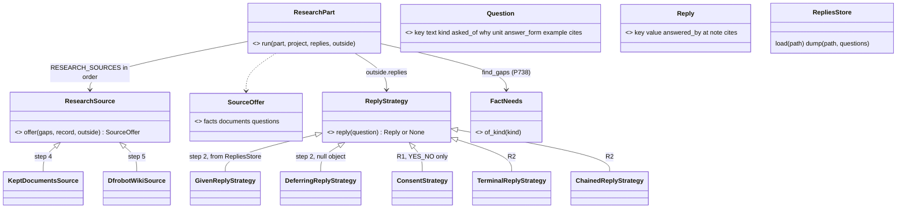
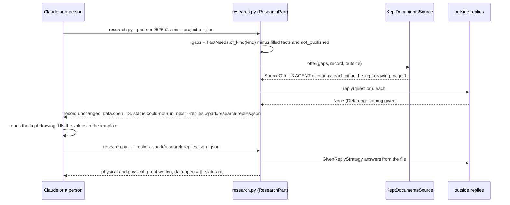

# P737: the research pipeline, live or scripted

Card [P737 #1013](https://github.com/xmejkal/spark/issues/1013), epic P735 [#1010](https://github.com/xmejkal/spark/issues/1010).
Built on [the discovery brief](brief.md) (its Hand-off and D12) and the architect's options in
[council/arch-architect.md](council/arch-architect.md). 2026-11-10. The fact need tree is
[P738 #1014](https://github.com/xmejkal/spark/issues/1014), and it feeds the gap list. The ★C and D numbers
are the brief's claims and decisions.

## Council

- **Round 1**, on the draft: an architecture lens, a UX and AI-UX lens, a tech lead and scope lens (Sonnet) and a
  refuter (Fable). They split the MVP into steps and made the first proof read kept documents with no network. They
  kept `ConsentStrategy` as the yes gate. They gave the open list one typed home, `data.open`, and shaped the replies file.
- **Round 2**, on the fixed plan: the architecture and names lens (Sonnet) and a refuter (Fable). They kept `body_mm`
  as the home of the width and height. They renamed `Offer` and `fold`, which exist in sourcing/matching.py. They
  gave a `FactNeed` a `status`, because no code reads a module's `physical` today, and fixed five names. Rejected: R1 right
  after step 2, because the PO's order is the MVP first, then the refactor (D12).

Every row is in [docs/observations/rows/p737-research-pipeline.md](../../observations/rows/p737-research-pipeline.md).

> **TL;DR.** One new Operation (spark's unit of work), `ResearchPart`, runs ordered, swappable research sources.
> It fills the gaps that the fact need tree names and writes one part record. Each question that a source cannot answer itself becomes a
> typed `Question`. A `ReplyStrategy` answers it: scripted from a replies file, live in a terminal (step R2), or "not
> now". A deferred question goes on the run's open list, and the next run takes the replies. `ConsentStrategy` keeps
> its erase guard and joins the same family in step R1. The MVP proves one owned part, SEN0526, from its kept drawing,
> with no network. Eight PRs, each tested and documented.

## Why

The discovery walked four owned DFRobot parts through today's research flow. Each record was a hand job. The loop,
the vendor order and the stop rule live in prose (commands/research.md, agents/parts-researcher.md). A part record
has no typed home for holes and headers (★C2). The PO asked for a designed pipeline with ordered, swappable sources,
DFRobot first (D2, D5, D6). Then he widened it (D12). Spark needs one interaction mechanism for all of spark. When a person or
Claude replies, it runs live. When the replies or grants come ahead, it runs scripted. It starts from `ConsentStrategy`. The
steps: a tested MVP first, then refactor, test and document step by step.

## What exists

Read 2026-11-10 and confirmed by two refuter passes.

- `ConsentStrategy` (scripts/spark/bench/deploy_gate.py:50) asks a yes or no only. Variants: Terminal (live, needs a
  tty), Relayed (another program, test callers only), Standing (a grant, board_grant.py:178). `opens_erase` guards the
  erase. `tools/measure.py:252` lists `TerminalConsentStrategy` as one of two classes that can touch a tty (rule X2).
- `OutsideWorld` (scripts/spark/core/outside.py:23) is a namedtuple `run find_tool report clock make_consent`. It gives
  `make_consent` only to an Operation that declares ASKS. Two callers build it positionally (outside.py:54,
  tests/fakes.py:353). Mutation rows p655 and p657 anchor substrings of the expression at outside.py:55. Its docstring
  (:4) already reserves `fetch`.
- No run pauses and resumes. Every other question ends the run with a Finding or a `NextStep` (`needs_yes`,
  `needs_person`, scripts/spark/core/result.py:19). No `--yes`, answer file or `--answer` flag exists.
- `COMMON_ARGUMENTS` (core/operation.py:27) is a dict that each Operation picks from, so a new entry changes no
  `--help` and no golden. `outcomes.envelope` passes `data` and `notes` through (outcomes.py:92-105). When an unchecked
  item has a `subject`, the envelope prints it (result.py:37-40).
- A part record refuses no unknown top-level key (records/record_kind.py:206-214). `provenance.list_type_problems`
  (provenance.py:31) reads `verified` and `source` only. When a block has `verified` or is in `PROOF_BLOCKS`,
  `--unverified` lists it (provenance.py:96,130). `body_mm` is `{width, height, verified, source, cites}`. Its rule is
  `part_records.body_problems` (:224). `skeleton()` writes it (sourcing/part_facts.py:180). It is in `CHAIN_FACTS`
  (record_kind.py:37), and `design/board_emitter.PART_GAPS` ("no outline", :92) and `need_requirements.LAYOUT_FACTS` (:71) read it.
- `RecordShapeSource` (breadboard/part_shape.py:99) reads a board's `physical` as bare numbers and demands `header`
  with `flush_edge`, `header_order` and five sizes (part_shape.py:121, design/footprint_emitter.py:75-88). No part
  record holds `physical` today.
- `Offer` (sourcing/matching.py:70) and `fold` (:45) exist. `store.find_kept` does not. `datasheets.find_kept`
  (sourcing/datasheets.py:270) returns prose lines. `store.fetch` (records/store.py:395), `store.keep` (:432),
  `KEEPABLE` (datasheets.py:31, no zip) exist.
- The store keeps the SEN0526 dimension drawing, schematic and datasheet (sources/aff604c1…), and the walk record
  ([walk/sen0526/sen0526-i2s-mic.json](walk/sen0526/sen0526-i2s-mic.json)) cites the drawing by that sha256. Its
  `body_mm` is verified (16 by 11). ★C1 says the drawing gives hole and header coordinates.

## The design

### The interaction mechanism, scripts/spark/core/replies.py (step 2)

- `Question` (Value) holds `key`, `text`, `kind`, `asked_of`, `why`, `unit`, `answer_form`, `example`, `choices` and
  `cites`. `key` is the fact path it fills, for example `physical.mounting_holes`, or a decision name. `text` is one
  sentence. `kind` is YES_NO, VALUE or CHOICE. `asked_of` is PERSON, AGENT or EITHER. `answer_form` is words, for
  example `a list of {x_mm, y_mm, drill_mm}`. `example` holds placeholders only, never a number that Claude can copy.
  `cites` is `{document, at}`, the kept document and the page. A question with `cites` is answerable from the store
  with no other reading. `to_dict()` is the envelope item.
- `Reply` (Value): `key`, `value`, `answered_by` (spark fills it: "replies file <name>", "typed in a terminal by …",
  a consent's `who`), `at`, `note`, `cites` (optional, from the reply).
- `ReplyStrategy` (Strategy, abc.ABC): `reply(question)` returns a Reply, or None for "not now".
  - `GivenReplyStrategy(replies)`: replies given ahead, a dict of key to Reply. Scripted. It knows no file.
  - `DeferringReplyStrategy`: returns None for everything. A null object with no state. The Operation computes the
    open list as the questions whose reply was None.
- `RepliesStore`: keeps one project file, `<project>/.spark/research-replies.json`, not the person's store. `load(path)`
  gives the dict of Reply with `answered_by` set, and null values left out, so a null is "not answered yet".
  `dump(path, questions)` writes every open key with `"value": null`, so run 1 leaves a template and Claude fills
  values and invents no key. The shape is `{"replies": {"<key>": {"value": …, "note": "…", "cites": {…}}}}`, and a
  bare `"<key>": value` is accepted for a hand-written file.
- `--replies <file>` enters `COMMON_ARGUMENTS`. Each Operation that asks adds it to its `arguments`, so the flag and
  its `input_schema` entry read the same everywhere.
- `OutsideWorld` gains a `replies` field (a ReplyStrategy) with a namedtuple default of `refuse_replies`, which raises
  the `undeclared_effect` SparkError as `refuse_consent` does. `build_outside_world` keeps the expression at
  outside.py:55 verbatim and appends `replies=` as a keyword, so the p655 and p657 anchors hold. The default keeps the
  positional fake at tests/fakes.py:353 running. `FakeOutsideWorld` gains `replies`.
- The open list in the envelope: `data.open` is the list of `Question.to_dict()`, the one home. One unchecked Finding
  per open question: code `needs_reply` (new, in codes.py and the json.md table), `subject` the key, sentence
  "waiting on a reply: <text>", `fix` "fill <file> and run <line>". `notes` says "record written, N facts unverified"
  when the run wrote anything. The status is `could-not-run`, exit 2, as today's rule says: an unanswered question is
  unchecked. `next[0]` is the same line with `--replies <file>`, `why` "N open". No new status or exit code.
  docs/guide/agents/never-assume.md gains one line: exit 2 with `needs_reply` means "run again with replies", not
  "broken".
- Reply failures, each a Finding, none silent: an unknown key is a problem `unknown_reply` with the nearest open key.
  A value that does not fit `answer_form` or `unit` is a problem `bad_reply` that quotes the question's `example`. A
  reply to a key that exists but is not open is a problem too, because a stray reply can overwrite a fact. Missing
  keys stay open. A rerun with the same file adds nothing twice.
- Who answers what: an AGENT question is never shown to a person in a terminal. A PERSON question (a revision, a
  soldered header) goes first in the open list with `needs_person` on the next step. EITHER goes to whoever is there.
  The MVP asks only AGENT questions.

### The record (step 3)

`body_mm` stays the home of the width and the height. `physical` on a part record holds only what `body_mm` does
not, as bare values with the board record's key names: `thickness_mm`, `mounting_holes` (a list of `{x_mm, y_mm,
drill_mm}`, from the board's top-left corner), `header` (`pitch_mm`, `row_spacing_mm`, `pins`, `rows`,
`first_pad_from_edge_mm`, optional). One `physical_proof` block sits beside it: `{verified, source, cites: {document,
at}, not_published: [keys], why_it_matters}`, with the entry shape of `body_mm`. `physical_proof` enters
`provenance.PROOF_BLOCKS`, so `--unverified` lists it. A new rule `part_records.physical_problems` (beside
`body_problems`, with its mutation row) says three things. When `physical` is present, `physical_proof` is required. Numbers
are finite and above 0. Each hole has `x_mm`, `y_mm` and `drill_mm`. A key that DFRobot did not publish is omitted from
`physical` and listed in `not_published`, never null and never an empty list. A module's `physical` is not drawn in
this epic. `RecordShapeSource` keeps reading boards only. The sheet reads a module's `physical` in slice 3 (P446,
P734). If the sheet needs `header_order` and `flush_edge`, slice 3 adds them. `parts.py --show` prints the block and its proof.

### The research side, scripts/spark/sourcing/research/ (steps 4 and 5)

- `research_part.py`: `ResearchPart` (Operation, op `research-part`, script `scripts/research.py` as the topic noun).
  Effects READS, WRITES, ASKS in step 4, plus FETCHES in step 5. Arguments: `--part <id>` (a record in the project's
  parts/, the shelf or the library), `--project`, `--replies`, `--json`. Its loop has five steps. It finds the gaps. It asks each
  source in `RESEARCH_SOURCES` order and collects each offer's facts, documents and questions. It answers the
  questions through `outside.replies`. It folds the replies and facts into the record and writes it. It prints the
  source order first, then the open list.
- `find_gaps(record, needs)` is a function: the `FactNeeds` rows for the record's kind whose fact is absent or
  unverified, minus the keys in `physical_proof.not_published`. `body_mm` filled counts as the outline need filled.
- `RESEARCH_SOURCES` is a dict from source name to class, as bench/__init__.py lists its Operations. The order is a
  constant tuple in `research_part.py`: `("kept-documents",)` in step 4, `("dfrobot-wiki", "kept-documents")` in step
  5. The run prints it as `sources: 1 dfrobot-wiki (web, free), 2 kept-documents (local)`. Settings come later (slice 1).
- `ResearchSource` (Strategy): `offer(gaps, record, outside)` returns a `SourceOffer` (facts, documents, questions). It
  takes the whole `OutsideWorld`, as an Operation does, and uses `fetch` and `report` only. The name is
  `ResearchSource`, not `Source`. "Source" already names the fact key, `ShapeSource` and `--sources`, and all of them
  mean "where a fact comes from".
  - `KeptDocumentsSource` (step 4): no network. If the record's `documents` hold a drawing whose file
    `store.place("sources") / sha256 / file` exists, it asks one AGENT Question per geometry gap, with `cites` to that
    document and page 1. Else it asks nothing.
  - `DfrobotWikiSource` (step 5): `outside.fetch` gets the wiki page by the record's `sku`. A small regex over `href`
    values ending in .pdf, .png, .jpg, .webp, .svg, .zip or .step finds the links. Each KEEPABLE link is kept with
    `store.keep` and enters `documents`. A link that exists but cannot be kept (a zip, a STEP) enters `documents` with
    its `url` and `kept: false`. A gap with no link at all enters `physical_proof.not_published`. The unit test fixture
    is a ten-line HTML page written by hand with spark's own words, never a vendor page. One test marked live, skipped
    by default, reads the real page.
- `merge.py`: `fold_replies(record, replies, questions)` in step 4 writes replies as facts. A reply by an AGENT read
  off a drawing is `verified: false`, source "read from <document> page N by <answered_by>", per the researcher's rule
  (★C16). If a reply carries `cites` to a datasheet row, it is `verified: true`. Otherwise it is `verified: false`. `fold_facts(record, offer)` in
  step 5: two sources with different values for one key never overwrite each other. The pair goes to the record's
  `conflicts` list, each side with its source (★C8).

### Names

Measured against [docs/guide/patterns-and-names.md](../../guide/patterns-and-names.md): `ResearchPart` (Operation, verb
and object), `research.py` (topic noun), op `research-part`, module `research_part.py` (one set of words).
`ResearchSource`, `ReplyStrategy` (Strategy, the suffix because the noun alone does not say it acts). `Question`,
`Reply`, `SourceOffer`, `FactNeed`, `FactNeeds` (Values, plain nouns, the last two P738's). `RepliesStore` (Store: the noun of what it keeps,
then Store, with a docstring that says it keeps one project file). `GivenReplyStrategy`, `DeferringReplyStrategy`,
`TerminalReplyStrategy`, `ChainedReplyStrategy` (what varies, then the base name). `KeptDocumentsSource` matches the
name `kept-documents`. `FETCHES` joins the effect words in operation.py and the effects sentence at patterns-and-names.md:29.
`needs_reply` beside `needs_yes` and `needs_person`. `asked_of` and `answered_by` say who, in one pattern.
`answer_form`, not `shape`, because shape means an outline. No new row in the names table.

## Steps

Each step is one PR with its tests, its docs and its mutation rows proven with `tools/mutate.py --anchors`. Something
works after each. Sizes are the scope lens's estimates.

0. P740 #1016 (XS bug, its own card, about 30 lines): `--skeleton` writes no `sourcing` block and names a shelf
   record. Independent and first because it is small. `ResearchPart` does not call `skeleton()`.
1. P738 #1014 thin (its own card, about 200 lines): `data/fact-needs.json`, `FactNeed` (Value: `fact_path`,
   `consumer`, `status`, `severity`, `condition`, `why`) and `FactNeeds.of_kind(kind)` in
   scripts/spark/records/fact_needs.py. `status` is `reads` or `will read: <card>`. The first rows, for a module:
   `body_mm` with consumer `spark.design.board_emitter` and status `reads`, and `physical.thickness_mm`,
   `physical.mounting_holes`, `physical.header` with consumer `spark.breadboard.part_shape.RecordShapeSource` and
   status `will read: P734`. The test imports each consumer and, for a `reads` row, finds the fact's key in the
   consumer module's source. `parts.py --unverified` names the consumer and status of each open fact. `CHAIN_FACTS`
   moves into the file later, not here.
2. The mechanism (about 250 lines, no network): scripts/spark/core/replies.py with Question, Reply, ReplyStrategy,
   Given, Deferring, RepliesStore. `OutsideWorld.replies`, `refuse_replies`, `--replies` in COMMON_ARGUMENTS, the codes
   `needs_reply`, `unknown_reply`, `bad_reply`. `FakeOutsideWorld.replies`. Unit tests. Docs: json.md (`data.open`,
   the replies shape, the codes), never-assume.md (one line). Anchors: p655, p657.
3. The record (about 150 lines): `physical` and `physical_proof` on a part record, `physical_problems`, `PROOF_BLOCKS`,
   `--show`, `--unverified`. Proof: a hand-written fixture record passes `--validate` and `--show` prints the block.
   Docs: the page that describes `body_mm`, and the json.md record section. Mutation rows for `physical_problems`.
4. The MVP (about 300 lines): the research package with `ResearchPart`, `KeptDocumentsSource`, `find_gaps`,
   `fold_replies`, `scripts/research.py`. The proof below. Docs: agents.md, agents/scripts.md, agents/json.md,
   commands/research.md (a short section: run research.py for a module with kept documents). Mutation rows for
   `find_gaps` and `fold_replies`.
5. The wiki (about 250 lines): `DfrobotWikiSource`, `FETCHES`, `OutsideWorld.fetch` over `store.fetch`, `refuse_fetch`,
   `kept: false` documents, `not_published`, `fold_facts` and `conflicts`. commands/research.md and
   agents/parts-researcher.md drive research.py for a DFRobot module, and that prose loop goes. The commodity path
   (part-finder, datasheet-reader), other vendors and the budgets stay prose until a later card. If the step's status
   changes, README "What works today" and tools/journey.py change.
R1. `ConsentStrategy` joins the family (about 40 lines): it subclasses `ReplyStrategy` and gains `reply(question)`.
   For a YES_NO question, `reply` calls `ask(question.text)` and returns a Reply with `answered_by = who`. For any
   other kind it returns None. `ask`, `who`, `yes_kind`, `opens_erase`, `require_ready` and `granted_by` stay. So
   deploy_gate.py and board_grant.py change no call, and the erase guard stays where it is. The tests' `Silent` and `NoKind` subclasses
   (test_deploy_gate.py:1018) keep passing. Goldens and the rows p242, p655, p657 pass unchanged. The class diagram
   in patterns-and-names.md gains the edge. A grant stays a Consent.
R2. Live mode (about 150 lines): `TerminalReplyStrategy` asks VALUE and CHOICE questions in a tty, one at a time,
   `[2/4] <text> (<unit>, Enter = later)`, then `why` and the cited page. Enter defers. Ctrl-C keeps what was written.
   It never shows an AGENT question. It shares the tty test and the mask with `TerminalConsentStrategy` through one
   small helper, and `tools/measure.py` TERMINAL_CLASSES lists it. `ChainedReplyStrategy` asks each in order and stops
   at the first Reply. The CLI picks Given, Terminal, Deferring with a tty and no `--json`, and Given, Deferring
   otherwise. One summary line: "3 answered, 1 left".

Later, one sentence each, not refined:

- the source order in settings per person and project (slice 1)
- the person as a source, and zips read (slice 2)
- the sheet draws a module from its `physical` (slice 3, P446 and P734)
- an MCP source behind the same slot, and a relayed ReplyStrategy for MCP elicitation (slice 4)
- `--need` by function (P743, slice 5)
- a ReplyStrategy that lets an agent answer in-process, for a LangGraph node (slice 6, P417), and RAG over the records (P419)
- the commodity and other-vendor paths as sources
- the batch over the owned modules (slice 7)

## Verification

- Unit tests per class and function, with `FakeOutsideWorld`. No network in any unit test. The store in tests is a
  temporary folder through `SPARK_HOME` inline.
- The MVP walk (step 4), in a scratch project outside the repository, with the real store (`SPARK_HOME` inline):
  1. Copy the walk record into `<scratch>/parts/`. Its `documents` cite the kept SEN0526 drawing by sha256.
  2. `research.py --part sen0526-i2s-mic --project <scratch> --json`: the printed source order, `data.open` with the
     three geometry questions citing the drawing and page 1, status `could-not-run`, `next[0]` with `--replies`.
  3. Claude reads the kept drawing and fills `.spark/research-replies.json`. If the drawing gives no thickness, the
     reply for it is null and the diary says so. Run 2 again with `--replies`.
  4. `parts.py --show sen0526-i2s-mic --project <scratch>` prints `physical` with its proof. `parts.py --validate --project <scratch>`
     passes. No hand edit of the record. `--unverified` lists `physical_proof` as read off a drawing.
- Step 5: the fixture test, and one live run by hand against the SEN0526 wiki, written in the PR as a diary.
- R1: `tests/test_deploy_gate.py`, `test_board_grant.py`, `test_grant.py`, the goldens, and
  `tools/mutate.py --anchors tests/mutations/p242-deploy-grant.json tests/mutations/p655-deploy-core.json tests/mutations/p657-grant-live-reach-core.json`.
- R2: `tests/test_architecture.py` (rule X2) and a tty test with the `Stream` fakes of test_deploy_gate.py.

## Board

P737 #1013 leaves Design with this page. When step 2 starts, it moves to Build. Steps 0 and 1 are P740 and P738, their
own cards, pulled first. Steps 2 to R2 are one card, P737, with one PR each.
