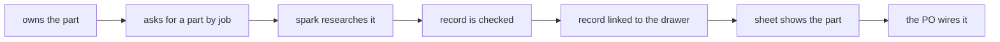
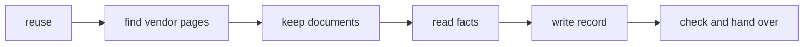
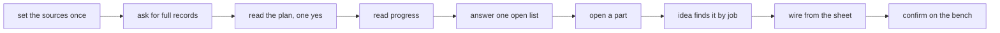
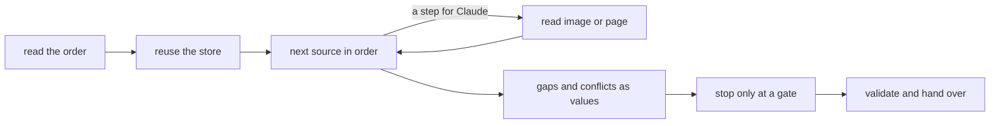

# Jobs and journeys

## Who
- The PO, a hobbyist in Prague who builds ESP32 gadgets with spark and owns 99 DFRobot drawer entries · E drawer, council/po-assistant.md PO-2 · n = 1 <!-- REQUIRED:who -->
- Claude, the agents and commands that pick and wire parts from records (`/spark:idea`, `/spark:build`, the researcher) · E commands/idea.md, commands/research.md
- The programs that read a record: the breadboard sheet, the Wokwi diagram, the board page · E council/tech-lead.md TL-3, TL-4

## Jobs
- Job 1 · When I pick a part for a goal [E commands/idea.md], I want spark to find the one I own by what it does [D the PO, P735 card], so I do not research or buy it again [E ★C4].
- Job 2 · When I wire a module on the breadboard [E STORY_MAP.md step 10], I want its real pin order and picture in front of me [D the PO, P735 card], so I do not swap 3V3 and GND [E ★C8]. <!-- REQUIRED:jobs -->
- Job 3 · When spark shows my gadget on the board page [D the PO, P735 card], I want each part's outline, holes and connectors [D the PO, P735 card], so I can plan the layout and the enclosure [H the user lens, USER-25].
- Job 4 · When Claude researches a part [E commands/research.md], it wants one flow with swappable sources and strategies [D2], so the same record comes from DFRobot today and from other shops later [D2].
- Job 5 · When a research run is driven by Claude, an agent graph or a person [D6], it wants the same run with its stops and questions as data [H council/arch-ux.md:131], so a LangGraph node, a RAG reader and a person reuse one core [D6].

## Today they…
- Job 1 · `--need` matches id, name, kind and alias, not the drawer's function, and does not search boards · E ★C4 <!-- REQUIRED:today -->
- Job 2 · the sheet prints "Put <Part> in the breadboard, each pin in its own row", and the drawing shows Wokwi's stock picture or stops · E council/user.md USER-2, USER-4, ★C3
- Job 3 · nothing shows holes or connectors. A board record holds `physical` header rows, a part record holds `body_mm` only · E ★C2
- Job 4 · the researcher runs about 20 commands and hand edits per part, reads code to learn the flow, and copies another record's shape · E walk/*/diary.md Steps and Gaps
- Job 5 · the interactive rules live in the prose of commands/research.md, so a graph or an index cannot reuse them · E council/arch-ux.md:131

## Journeys

The as-is journeys come first, then the to-be journeys (proposals from council/arch-ux.md:63 and :77, not decided).

### The PO: from an owned DFRobot part to a wired part <!-- REQUIRED:journey -->
| step | what they do | evidence | friction or harm | today | open question |
| --- | --- | --- | --- | --- | --- |
| 1 | owns the part, it is in the drawer | E drawer, ★C9 | 16 of 112 entries link a record | partly | which entries are in scope (Q3) |
| 2 | asks spark for a part that does the job | E ★C4 | the owned part is not found, spark says "Research it" | not yet | none |
| 3 | spark researches the part | E walk diaries | about 20 steps, hand edits, zips cannot be kept, boards have no flow | partly | none |
| 4 | the record is checked | E ★C6 | `--validate` passes a bent record (SEL as a ground pin), `--read` picks the wrong row | partly | none |
| 5 | the record is linked to the drawer entry | E walk/sen0526/diary.md Gaps | no step does it | not yet | none |
| 6 | the breadboard sheet shows the part | E ★C3 | stock picture or no drawing, no real pin order on the sheet | not yet | needs P734 |
| 7 | the PO wires it | E ★C8 | a wrong vendor table swaps supply pins, a warning on a board has no place | not yet | did a wrong pin order ever cost him a part? |



### Claude: researching one owned part
| step | what they do | evidence | friction or harm | today | open question |
| --- | --- | --- | --- | --- | --- |
| 1 | reuse: `--need`, `--kept` | E ★C4 | misses owned parts and boards | partly | none |
| 2 | find the vendor pages | E walk diaries Steps | the wiki URL is guessed, search returns shops | partly | which strategy first (D2) |
| 3 | keep the documents | E ★C7 | zips refused, keys are CDN hashes, title and version stay null | partly | none |
| 4 | read the facts | E ★C6 | `--read` picks wrong rows, schematics need hand rendering | partly | none |
| 5 | write the record | E ★C2, ★C6 | no field for the physical facts, `--fact-set` refuses `legs` | partly | where geometry lives (PO-28) |
| 6 | check and hand over | E ★C5 | boards have no `--unverified` or `--sources` | partly | none |



### The PO, to-be: from an owned DFRobot part to a wired part (proposal)
| step | what they do | evidence | friction or harm | today | open question |
| --- | --- | --- | --- | --- | --- |
| 0 | sets once which sources spark can use and in what order, and says yes to any paid source | H council/arch-ux.md:67 | one conversation, once | not yet | the default order |
| 1 | says "make full records for my DFRobot modules", or names one part | H council/arch-ux.md:68 | no commands to learn | not yet | none |
| 2 | reads one plan screen: the parts in scope, the source order with its cost, what will stop | H council/arch-ux.md:69 | one yes, no prompt per fetch | not yet | Q3, the scope |
| 3 | reads one progress line per part, with facts per source kind | H council/arch-ux.md:70 | no silent 25 minutes | not yet | none |
| 4 | answers one open list at the end: revisions, soldered headers, conflicts | H council/arch-ux.md:71 | he must hold the boards | not yet | none |
| 5 | opens a part: picture, outline, holes, connectors, each with its source kind or "not published", conflicts side by side | H council/arch-ux.md:72 | no hand edits | not yet | none |
| 6 | `/spark:idea` finds the owned part by what it does | E ★C4 | no "Research it" for an owned part | not yet | Q5 |
| 7 | wires it from the sheet, unverified facts marked | E ★C3 | needs P734 | not yet | none |
| 8 | checks one unverified pin order on the bench and writes the result back | H council/arch-ux.md:75 | a bench step | partly, `--fact-set` | none |



### Claude, to-be: one research run (proposal)
| step | what they do | evidence | friction or harm | today | open question |
| --- | --- | --- | --- | --- | --- |
| 1 | reads the printed source order for this run | H council/arch-ux.md:81 | no order read from markdown | not yet | Q-A3 |
| 2 | reuses the store by SKU and by drawer function | E ★C4 | no miss of owned parts | partly | Q5 |
| 3 | runs the next source in order until the facts are filled or the budget ends, and records kind and cost per fact | H council/arch-architect.md:27 | one loop, one record shape | not yet | Q-A1 |
| 4 | reads an image or a page when a source returns that step, and writes it unverified | H council/arch-ux.md:84 | no hand rendering | not yet | none |
| 5 | writes "not published" with the sources tried, and a conflict with both values | E ★C8 | no silent guess | not yet | Q-A4 |
| 6 | stops for the person only at a cost gate or a safety conflict with no rule | H council/arch-ux.md:86 | fewer stops | not yet | none |
| 7 | validates and hands over: record, revision, open list, cost line, drawer link | E ★C6 | no missing link step | partly | none |



### One run, four interfaces (proposal)
The same run is driven by a person at the CLI, by Claude in a conversation, by a LangGraph node, and read back by a RAG reader. council/arch-ux.md:131 holds the table, and council/arch-architect.md:275 holds the types that stay the same across them.

```mermaid
flowchart LR
  cli["a person at the CLI"] --> core["one research run"]
  claude["Claude in a conversation"] --> core
  graph["a LangGraph node"] --> core
  core --> open["the open list as data"]
  open --> cli
  open --> claude
  open --> graph
  core --> store["the record store port"] --> rag["a RAG reader, later"]
```
