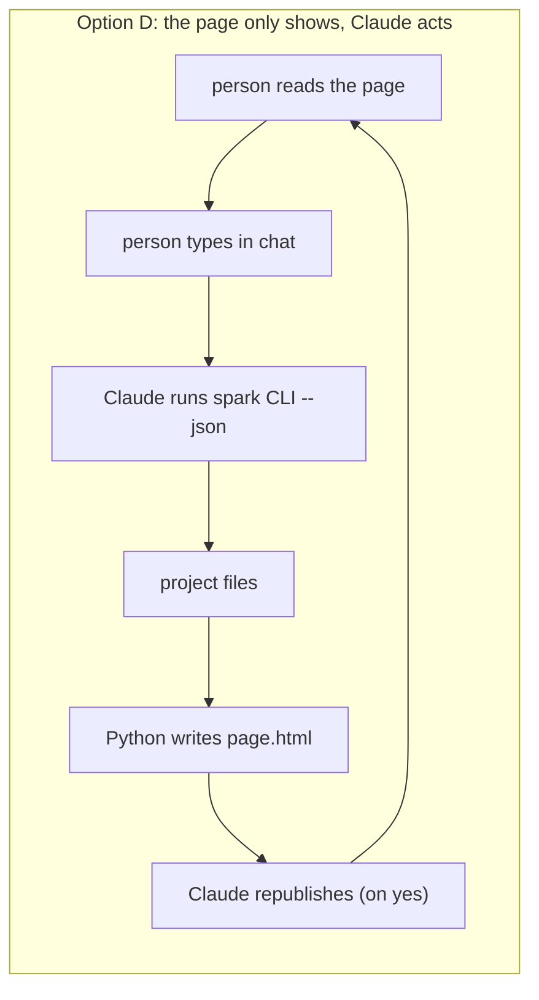
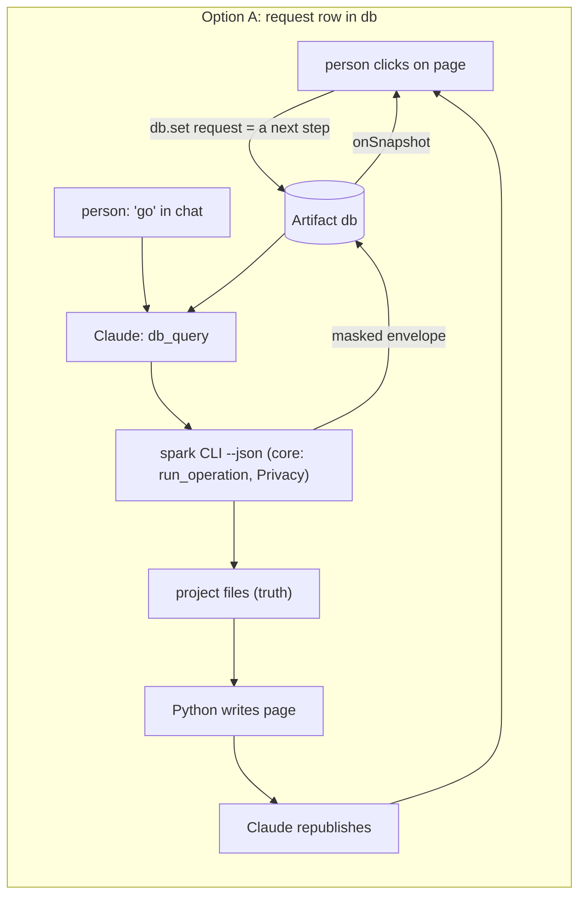
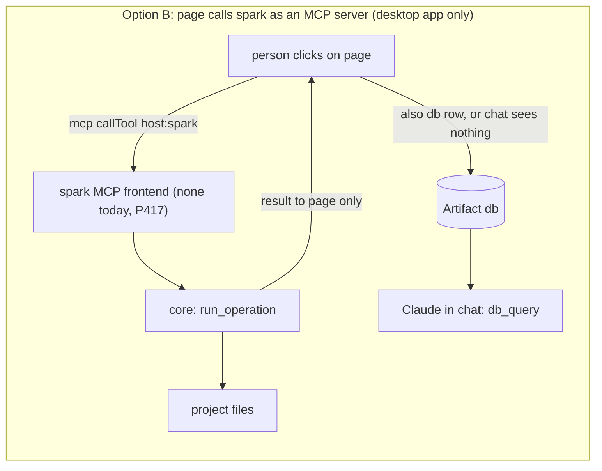
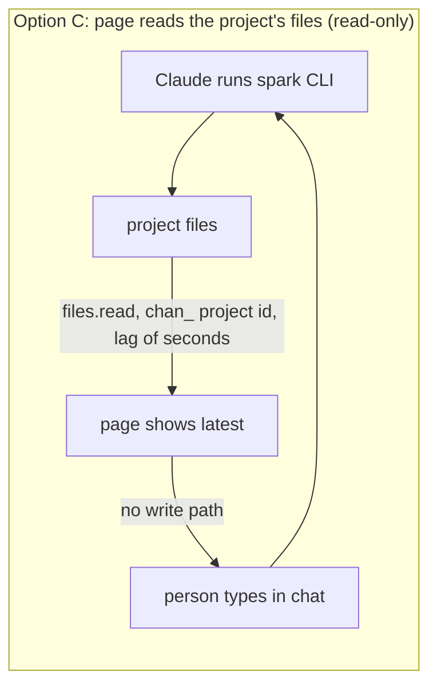
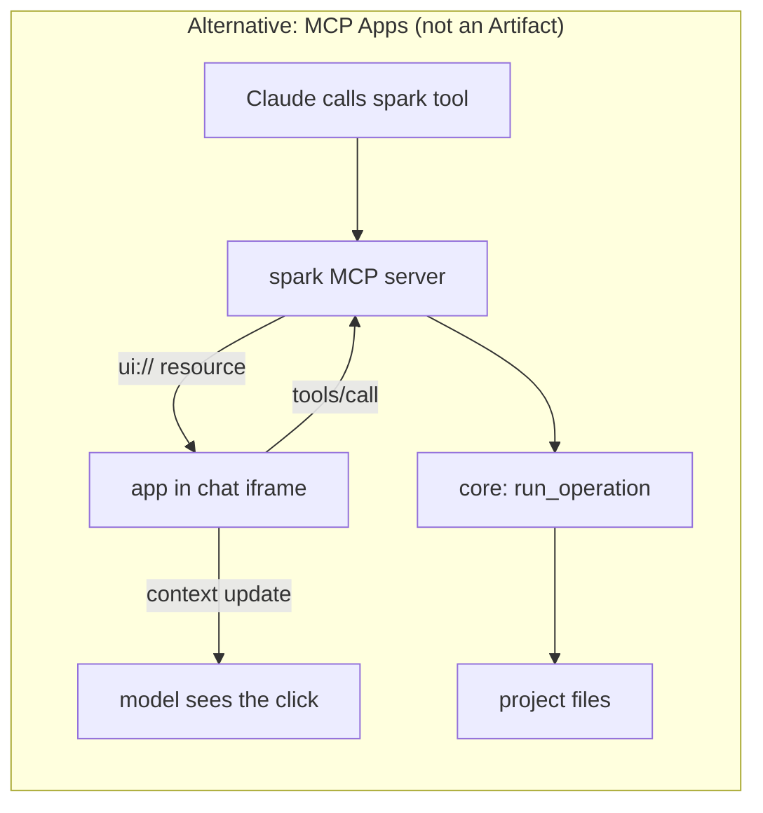

# Feasibility and architecture lens (the tech lead), P820 #1173

Read 2026-11-15 on main a1b94375. Runtime facts are from the claude-artifacts server's `describe_capabilities`
(runtime contract 0.2.96) and `guide` (pages, design), both called 2026-11-15 in this session. Tags: E (with a
pointer), H (with its source), D (who, when), — (unknown). Nothing here is decided.

## Findings

### What the Artifact runtime allows (open questions 2, 3, 7)

- FE-1 · A page can call spark as an MCP server only in the Claude app (desktop), and only if spark is a local MCP server there. The runtime says: "`server` is a connector's display name, or `host:<name>` for a local MCP server on the viewer's device (Claude app only; else `server_not_connected`)". In claude.ai in a browser, a local stdio server cannot be reached. A remote connector would mean a hosted spark server, which the brief puts out of scope. · E describe_capabilities(mcp), 2026-11-15; brief.md Frame, Scope ("out: … a hosted spark server") · supports only: option B works in the desktop app alone.
- FE-2 · spark has no MCP server today. The plugin's `.mcp.json` lists only `espressif-docs` and `jlcpcb`. There is no `scripts/spark/frontends/`. P417 #545, the spike that runs `LookAtBoard` as an MCP tool, is open and needs the MCP Python SDK installed (a cost the PO must hear first, per the card). · E .mcp.json; `ls scripts/spark` (no frontends); `gh issue view 545` · supports only: option B needs P417 (or its MCP half) first.
- FE-3 · An MCP call from the page does not reach the chat. The `mcp` capability documents `callTool` and `watchTool` with results for the page, and no way to tell the model what happened. The chat sees a page click only if the page also writes a `db` row that Claude reads, or the person says so. · E describe_capabilities(mcp) · supports only: option B still needs option A's shared state for "Claude acts on the same choice" (Job 4).
- FE-4 · A click cannot wake a local Claude Code session. `watch` says: "Wake this chat when the user sends a comment to Claude on an artifact … Only a cloud session can be woken." Nothing else in the capability list pushes into a chat. In Claude Code on the Mac, Claude learns of a click only when the person writes in the chat, or when Claude reads `db` on its own turn. · E the `watch` tool's description, this session, 2026-11-15; describe_capabilities list · supports only: in Claude Code, a click is a request that waits for the person's next chat message. It is never an event.
- FE-5 · `db` is the one state that both the page and Claude can read and write. The runtime says that `db` "keeps data outside the page: shared rows, per-person state, data Claude reads". This server gives Claude `db_get`, `db_list`, `db_query` and `db_write`. A write needs `ifVersion` for a document that exists, and "each op counts against a rate limit: send one db_write at a time". A page reads with `onSnapshot`. · E describe_capabilities(db); the db_write tool description, this session · supports only: the request row (option A) is buildable now with no spark code. It needs one write per change and a version check on each write.
- FE-6 · `db` works in Claude Code as well as in claude.ai. This session (Claude Code) lists `mcp__claude-artifacts__db_*`, `declare_capabilities` and `publish_files` as tools. The runtime says that its how-to "is written for Claude's built-in Artifact tool: write_db and read_db are its actions". The agent-type list in this session also names built-in tools `Artifact`, `ArtifactData` and `ArtifactCheck`. So two publishing paths exist: the MCP server's `publish_files` and the built-in `Artifact` tool. `commands/build.md:161` names only the second ("call the Artifact tool with `file_path`"). · E this session's tool list; describe_capabilities(db) note; commands/build.md:161 · supports only: open question 7. Which path a session has varies, and spark's command page must name both, or the page must not depend on one.
- FE-7 · `files` is read-only and scoped to a Claude Code project id. The runtime says: "`files` reads a Claude Code project's files as the viewer. Declare it only when you know the project's id (e.g. your session's): `{files: {project: "chan_..."}}`", with `list`, `read` and `download` and no write. It also says: "Don't copy file contents into the artifact's data … anyone it's shared with can read them." Whether a local Claude Code CLI session on the Mac has such a `chan_` id, and whether its files are the Mac's disk, is not stated. · E describe_capabilities(files); — for local sessions · supports only: option C can show the project's files (needs.json, breadboard.md) without a republish, if a spike shows that it reaches a local project. It cannot write a choice back.
- FE-8 · `sample` is a separate, memoryless Claude with no shell. "Memoryless: send instructions+data+format". Its only tools are page functions (`tools:[{name, description, inputSchema, execute}]`). It cannot run spark's scripts. "Ask Claude from the page" is therefore not the chat's Claude, and it does not act on spark. · E describe_capabilities(sample) · supports only: Job 3 ("ask Claude in the chat") cannot be met by `sample`. It is a third actor, and it adds a second source of answers.
- FE-9 · The `artifact` capability makes the page republish itself ("`await artifact.publish(html)` saves html … as the new version, and every open view … reloads"). That conflicts with spark's way: spark regenerates `page.html` from Python, and Claude republishes it after a build (commands/build.md:163, "To update it after a rebuild, call the tool again"). A page-made version would be overwritten by the next build, or it would cause a version conflict. · E describe_capabilities(artifact); commands/build.md:161-164 · supports only: `artifact` competes with spark's generator for the page's state. `db` does not.
- FE-10 · The page's frame blocks `fetch` to other hosts, downloads, alert, confirm and prompt, and `window.open`. Scripts load inline or from listed CDNs. The page is at most 16 MiB. localStorage "reaches no other viewer or device and not Claude". · E guide(pages), 2026-11-15 · supports only: a click cannot reach a local spark through HTTP. The only routes are `db`, `mcp` (FE-1) and the chat. The TS bundle must be inline (or from the listed CDNs).
- FE-11 · MCP Apps is an alternative that is not an Artifact. An MCP server returns a `ui://` HTML resource that the host renders in the chat. The app can call the server's tools and send "context update" messages to the model. The MCP site lists Claude (web) and Claude Desktop as hosts. The matrix lists Claude Code as a row, but its check marks did not survive the fetch, so whether Claude Code renders apps is unknown. · E https://modelcontextprotocol.io/docs/extensions/apps and https://modelcontextprotocol.io/extensions/client-matrix.md, read 2026-11-15; — for Claude Code · supports only: a path where a click reaches spark's tools and the model in one channel. It needs a spark MCP server (FE-2), it is not D-a's "Artifact page", and in the browser it reaches only a remote server (FE-1).

### What spark's core holds today (open questions 4, 6)

- FE-12 · The idea steps are already Operations on the core, and they answer the envelope. `parts.py`'s `OPERATIONS` holds `needs-set`, `needs`, `match`, `offer`, `pick`, `requirements`, `tally`, `needs-drop` and `step`, with `describe`. Their `--json` is the envelope with `next` steps `{op, argv, why, effects, needs_yes}`. · E scripts/parts.py:87-88; scripts/spark/design/design_operations.py:20-21; scripts/spark/sourcing/sourcing_operations.py:28-30; docs/guide/agents/json.md:227-288 · supports only: the idea half of the page (needs, matches, offers, picks, the tally) can be fed from one shape now.
- FE-13 · The build half is not on the core. `check_spine.py`, `breadboard.py` and `check_all.py` have their own `main` and no Operation (grep finds none). `check_spine`'s JSON is `check, stages, status, kept, …`, not the envelope. `check_all` has its own shape. `breadboard.py` takes no `--json` ("library-only until an Operation writes JSON"). · E `grep -n "def main\|run_cli\|Operation" scripts/check_spine.py scripts/breadboard.py` (main at :91 and :54, no Operation); scripts/breadboard.py:64; docs/guide/agents/json.md:131-141, 293-298 · supports only: a page that renders "the envelope" generically stops at the build. P804 #1138 is the card that moves the build and check_all onto the core.
- FE-14 · The wiring steps already exist as a value with swappable renderers. "`BreadboardSteps.walk()` is the one source. A renderer (`NumberedList`, `MermaidDiagram`, …) takes the steps and gives lines; it never decides the wiring again, and a new one needs no change here." `WiringStep` is `(words, edge)` and `End` carries `component, name, words, pin, job, value`. · E scripts/spark/breadboard/wiring_steps.py:1-13, 31-40 · supports only: a JSON renderer of the steps for the page is a new Renderer, with no change to the wiring logic. No card names it yet (H, the tech lead).
- FE-15 · Today's `page.html` holds no steps and no script. It is three CSS-only tabs (breadboard picture, schematic, PCB), and its docstring says "The page has no script and loads nothing from the web". · E scripts/spark/breadboard/tabbed_page.py:1-12, 62-68 · supports only: the step-by-step look is not in spark's output today.
- FE-16 · The step-by-step page the PO praised looks hand-made in a chat, not generated by spark. The artifact "Wire the rotary encoder, step by step" (2026-11-11, contract 0.0.0) holds a hand-written `STEPS` array of 8 steps in inline JS. Its source note says it is built from "spark's breadboard sheet for P758 (`build/breadboard.md`, steps 5, 7, 23, 28 and 29)". It adds safety advice and a meter procedure that no record holds ("If the lowest number is under 1 kΩ, stop"), and it ends "Tell Claude 'wired'". "FireBeetle 2 Amplifier Wiring" (2026-11-11) is the same kind of page by its title (not opened). · E read_artifact d142d2e6-283c-4a39-a44a-60f1379702cb, lines 80-129, 2026-11-15; list_artifacts · supports only: which page D-b names is H until the PO confirms it. If it is this one, its look is a set of hand-made per-step views, and part of its text is the conversation's judgment. Under "spark exports facts, never behaviour", spark can generate the facts (steps, pins, parts, the checks before power), and the conversation adds the rest.
- FE-17 · Each Operation already exposes the data that the page's controls need: `input_schema()` (a JSON Schema per Argument), `effects` (reads, writes, deletes, fetches, board) and `data_keys`. `DescribeOperations` turns these into `{op, flag, summary, effects, dry_run, arguments, data}`. Only `parts.py` registers `describe`. · E scripts/spark/core/operation.py:93-109; scripts/spark/core/describe_operations.py:42-76; `grep -rln DescribeOperations scripts` → parts.py only · supports only: open question 4. The page's list of steps, each step's form and its "this writes" or "needs your yes" badge can be generated today for the parts.py steps.
- FE-18 · The answer's `data` has no per-Operation schema. `output_schema()` is "the same for every Operation" and fixes only `envelope`, `status` and the required keys. `data_keys` lists names, not shapes. · E scripts/spark/core/result.py:39-43; scripts/spark/core/operation.py:68-70 · supports only: a view of each step's `data` (a needs table, an offer card) is hand-made per step until the Operations declare their data shapes. P481 #660 does not list data shapes among its elements (E #660 body, "Candidates seen today").
- FE-19 · P481's descriptions are not built. `Operation.summary` exists, but `LookAtBoard` and `DeployImage` set none (grep finds no `summary =` in either). Their sentence lives in the CLI's `HelpText`, out of reach of another interface. The card's step 1 ("The Operation gains `summary` and `details`") is still open. · E `gh issue view 660`; scripts/spark/core/cli.py:20-27; `grep -n "summary = "` on look_at_board.py and deploy_image.py (no hit) · supports only: the page's headers and help text for the bench steps would be hand-written until P481's steps 1 and 2.
- FE-20 · A page-driven erase is refused by design. A yes "relayed by another program" is kind `relayed`, and the gate raises `GateClosedError(RELAYED_REFUSED, …)` for the erase. Refactor plan §4: "every erase still needs a yes typed in the person's own terminal, or a deploy grant made there. Claude never supplies a yes." · E scripts/spark/bench/deploy_gate.py:28-31, 124-130, 177; refactor-plan.md:259-266 (§4) · supports only: the deploy step on a page can show the command and the grant. It cannot carry out the erase, by any of options A to D.
- FE-21 · Two state stores would exist. The CLI's state is the project's files: `<project>/.spark/needs.json` (needs, marks, picks), `requirements.json`, `breadboard.json` (a person's moves, kept across builds by P273), and `dist/`. A `db` row is a second copy that someone must sync. · E scripts/spark/design/needs.py:5, 36; commands/build.md:146-156 · supports only: open question 3. Either the files stay the truth, so `db` holds only requests and choices that Claude turns into Operation runs, or a sync rule is needed. The first fits "one core". Which one is the decider's.
- FE-22 · Some of what the page would show is private by design. "`<project>/.spark/needs.json` … holds no part numbers, no owned counts, no places and no reasons: it belongs to a project, which may be public." The drawer (owned counts, places) lives in the store. `Privacy` masks paths and tokens in each result. `db` shared docs are read by "signed-in people" the artifact is shared with. · E scripts/spark/design/needs.py:5-7; scripts/spark/core/privacy.py:1-11; describe_capabilities(db) · supports only: drawer data written to `db` or into the page would travel with a share. Writing only what `run_operation` returns (masked) to `db` keeps today's rule. The rule for owned counts is the decider's.

### The TypeScript stack and the hook (open question d)

- FE-23 · spark already ships one bundled TS file, and a test fails on a stale bundle. `bundle.sh` runs `bun build cli.ts --target=node --format=esm --outfile=dist/converter.mjs` and writes `dist/converter.sources.sha256`. "tests/test_check_spine.py fails while dist/converter.sources.sha256 does not match the sources." The committed bundle is 675,814 bytes and includes its npm dependencies. · E tools/circuit-to-wokwi/bundle.sh:1-14; `wc -c tools/circuit-to-wokwi/dist/converter.mjs` → 675814 · supports only: a page bundle can follow the same pattern with `--target=browser`. Its size fits 16 MiB with room. It must be inlined, because the page cannot load its own script from a path unless it is published from files (FE-10; guide(pages) "A page published from files may also load its own files by relative path").
- FE-24 · The hook runs the converter's TS suite through one Python test, and the story run maps one TS folder. `tests/test_converter.py` runs `bun run test` and is skipped without bun ("check_commit.py insists on it"). `tools/story_tests.py` has `CONVERTER_FOLDER = "tools/circuit-to-wokwi/"` → `test_converter`, one constant. `check_commit.lend_node_modules` lends `node_modules` to that one folder. · E tests/test_converter.py:60-64; tools/story_tests.py:46-47; tools/check_commit.py:65-78 · supports only: a second TS package (the page) needs its own folder mapping, its own `node_modules` loan and its own wrapper test, or it must live inside the converter's folder. The hook runs no browser today, so a page's DOM behaviour is not tested on push (H: no headless browser in the tools list; not searched).
- FE-25 · Today's page is generated by Python, with each SVG in an `` as a data URI so that one SVG's styles cannot reach another. Its colors are tokens with a dark mode, as the Artifact rules ask. · E scripts/spark/breadboard/tabbed_page.py:62-92 · supports only: the page's generator, its tokens and its isolation rule exist. A TS renderer would sit beside it, or the Python writer would embed the data and the bundle.
- FE-26 · The `next` step of the envelope already has the shape of a request row: `{op, argv, why, effects, needs_yes, needs_person?, env?}`, with "ids only in `argv`". · E scripts/spark/core/outcomes.py:126-140 (`step`, `add_env`) · supports only: a click can write the `next` step it chose to `db`, and Claude runs `argv` with `--json`. No new request format is needed. `env` carries a store path (`SPARK_HOME`, json.md:283). Under FE-22 it must be masked before the row is written.

### Fit with spark's direction

- FE-27 · AGENTS.md orders the tools: "a local CLI before a web service or an MCP server". An Artifact page is a hosted claude.ai page, and its `db` lives on that service. Publishing needs the person's yes. · E AGENTS.md "Free, few and local"; commands/build.md:161 (D-e) · supports only: options A and C keep the CLI as the one route to the core, and Claude runs it. Option B adds an MCP server as a second route. It would be the first interface that spark itself serves, which is the order AGENTS.md puts last.
- FE-28 · The core contract fits a page as one more frontend, if the page only parses and renders (rule X2) and every action is an Operation run through `run_operation`, with Privacy before any frontend sees the result. · E docs/discovery/2026-10-19-p323-target-architecture/architecture/README.md:103-121 (contract, X2, C2); refactor-plan.md:233-258 (§4 rules 1-4) · supports only: logic in the TS bundle (choosing the next step, filtering offers, deciding a wire) would break X2 and "spark exports facts". The page reads `next`, `status`, `problems` and `unchecked` and decides nothing again.
- FE-29 · The goal-to-needs step is Claude's language work. `needs-set` takes a JSON list that Claude composes (the payload of `--needs-set PROJECT FILE`). · E scripts/spark/design/set_needs.py:14-34; commands/idea.md "S — the goal becomes needs" · supports only: the page cannot start the journey alone. Its first step is always a chat turn, in every option. Only `sample` (FE-8) could draft needs on the page, and it cannot write them through spark.
- FE-30 · Prior lens TL-19 and TL-20 hold, with three corrections. The CDN list now also has `cdn.jsdelivr.net/pyodide/`, `cdn.jsdelivr.net/gh/python-visualization/` and `cdn.plot.ly`. A page published from files may load its own files by relative path. `ArtifactData` is now one of two routes to `db`, beside this server's `db_*` tools. · E docs/discovery/2026-10-16-p269-views-and-editors/council/tech-lead.md:264-274; guide(pages), 2026-11-15 · supports only: a bundle can also ship as a second file of a multi-file artifact through `publish_files`. Pyodide is an allowed source, so the Python core could in principle run in the page (TL-22 (c)), but it has no tsci, no Node and no disk.

### What each option takes and touches

- FE-31 · Option D, the page only shows and Claude acts: it touches the page generator alone (`tabbed_page.py`, plus a step renderer from FE-14). It needs no runtime capability. It is today's practice ("Tell Claude 'wired'", FE-16). It does not meet D-c's "by clicks", because a click changes nothing that Claude sees. · E FE-15, FE-16 · H for the cost (the tech lead) · supports only: the floor.
- FE-32 · Option A, a request row in `db`: it touches the generator, a TS bundle that writes `db` rows (the chosen `next` step, or a choice such as a part per need), a capability declaration (`{db:{}, user:{}}`, with rules), and a command-page procedure for Claude (read the rows, run the Operation with `--json`, write the masked envelope back, republish the page when the files changed). It works in Claude Code and in claude.ai the same way (FE-6). In claude.ai web with no Claude Code, Claude has no shell to run spark, so the rows wait. · E FE-5, FE-6, FE-26; — for whether claude.ai's code sandbox can run spark's chain (it needs tsci and Node, commands/build.md:118-121) · supports only: the only option where a click and a chat message reach the same state with no new spark server.
- FE-33 · Option B, the page calls spark's MCP server: it touches all of option A (for the chat to see the click, FE-3), plus a spark MCP frontend (P417's MCP half), an install of the MCP SDK, the desktop app's MCP configuration, and the `mcp` capability declaration with the exact tool names. It works only in the desktop app (FE-1). The build steps need P804 first (FE-13). · E FE-1 to FE-3, FE-13 · supports only: the most plumbing, and the narrowest reach.
- FE-34 · Option C, the page reads the project's files: it touches the generator and a `files` declaration with a `chan_` project id. It saves a republish after each step. It is read-only, so it is a display aid for options A or D, not a way to click. · E FE-7 · supports only: an addition, after a spike settles FE-7's unknown.

### The refactorings, in order (open question 6)

- FE-35 · Proposed order, by what each option needs (H, the tech lead, from FE-12 to FE-19):
  1. A JSON renderer of `BreadboardSteps` and a page writer that embeds data. It is needed by every option and touches no Operation (FE-14). No card yet.
  2. P481 #660, steps 1 and 2 only (`summary` and `details` on the Operation, one `OperationDescription`). The page's step titles and help come from them (FE-19). Its MCP step 3 waits for option B.
  3. P804 #1138: the build and check_all become Operations with the envelope. This is the first refactoring that the build half of the page needs to be rendered by the same code as the idea half (FE-13).
  4. P200 #153: the inventory. The page's list of steps could be its first reader. It does not block an MVP.
  5. P417 #545 (the MCP half): only if the decider picks option B or MCP Apps.
  6. P788 #1094: only when a frontend must run a look or a deploy on a project that is not on this disk. Options A, C and D never need it, because Claude runs the CLI on the Mac.
- FE-36 · Per-step data shapes (FE-18) are a refactoring that no card holds. Without them each step's view is hand-made TS, which the decider may accept for an MVP. · H (the tech lead) · supports only: open question 4's split.

### The smallest end-to-end slice, and the spike before it (open question 5)

- FE-37 · Proposed walking skeleton (H, the tech lead): one page per project, written by Python. It embeds the masked envelopes of `parts.py --needs --match --offer` and the wiring steps (FE-14) as JSON. One inline TS bundle renders a needs panel and the step-by-step wiring panel. One kind of click writes a `db` row, "pick part X for need N", in the shape of a `next` step. Claude, on the person's next chat message, reads the row with `db_query`, runs `parts.py --pick … --json`, then `--requirements` and the build, and republishes the page. Proof: the `db` row, the chat transcript, and `needs.json` holding the pick. It skips the goal-to-needs step (always chat, FE-29), the store, and the deploy (FE-20).
- FE-38 · A spike must settle these before that slice. Each is a run, not a reading:
  1. A page published from Claude Code with `publish_files`, then `declare_capabilities({db:{}, user:{}})`: does a click's row reach `db_get` in the same Claude Code session, and with what delay? (FE-5, FE-6.)
  2. Do the `db` rows survive the republish that follows each build? (—: the runtime says this for localStorage, not for `db`.)
  3. Does the built-in `Artifact` tool in `commands/build.md` and this server's `publish_files` reach the same artifact and the same `db`? (FE-6.)
  4. Does `files` reach a local Claude Code session's project at all? (FE-7.)
  5. The size and load time of a page with the bundle and button-light's three SVGs. (FE-23; — for the size of today's page.html: none is kept in the repo, and the P272 test artifact published, E list_artifacts "proj circuit".)
  6. Only if B is in play: does `host:<name>` reach a local stdio server in the PO's desktop app? (FE-1.)

## What I could not check, and why

- Whether a local Claude Code CLI session has a `chan_` project id that the `files` capability can read. The runtime does not say, and checking needs a published test artifact. This lens publishes nothing (FE-7, spike 4).
- Whether `db` rows survive a republish, the latency from a click to `db_get`, and the rate limit's numbers. These need a published page with a declared `db` (spike 1 and 2).
- Whether Claude Code renders MCP Apps. The client matrix's check marks were lost in the fetched text (FE-11).
- Whether claude.ai's own code sandbox could run spark's chain (Python, tsci, Node). Not searched. The brief's scope keeps a hosted server out (FE-32).
- The second hand-made artifact, "FireBeetle 2 Amplifier Wiring", was not opened. Which artifact the PO meant by "the breadboard with the nice pictures and the step by step guide" is his to say (FE-16).
- The size of a current `page.html`: none is kept in the repository, and I ran no build (FE-38, 5).
- Whether the built-in `Artifact` tool and this server's tools share one artifact and its `db`. Their descriptions suggest it, and a run would settle it (FE-6).
- I did not run the test suite, as the brief asked.

## Questions for the decider

- Q-F1 · Is the page's state the project's files, with `db` holding only requests and choices that Claude turns into Operation runs, or does `db` hold state that the files do not? · decides: open question 3, whether a sync rule is needed, and whether the CLI and the page can disagree (FE-21).
- Q-F2 · Is a click allowed to wait for the person's next chat message in Claude Code (no push exists, FE-4), or must a click act at once? · decides: option A against B or MCP Apps, and whether the desktop app becomes a requirement (FE-1).
- Q-F3 · Must the page work in claude.ai in a browser with no Claude Code, where Claude has no shell to run spark? · decides: whether option A is enough or a hosted or MCP route returns to scope (FE-1, FE-32).
- Q-F4 · Is the step-by-step page you praised the hand-made "Wire the rotary encoder, step by step" of 2026-11-11? · decides: which parts of D-b's look spark generates (facts) and which the conversation adds (judgment such as the meter procedure) (FE-16).
- Q-F5 · May drawer facts (what you own, how many, where) appear on a page or in its `db`, given that a share carries them? · decides: what the page shows of the store, and the Privacy rule for `db` writes (FE-22).
- Q-F6 · Does MCP Apps, which is not an Artifact, count as meeting D-a ("the Artifact page")? · decides: whether FE-11 is an option at all.
- Q-F7 · Is per-step hand-made TS acceptable for the MVP, or do the Operations first declare their data shapes? · decides: open question 4's split, and whether a card for data shapes comes before the MVP (FE-18, FE-36).
- Q-F8 · Install the MCP Python SDK (free) for P417's MCP half now, or only if option B is chosen? · decides: the order of step 5 in FE-35 (FE-2).

## Searches

- "MCP Apps extension ui:// interactive UI Claude support local server" · decision served: whether a page in Claude can call a local spark server's tools and tell the model (option B against MCP Apps, Q-F2 and Q-F6) · used: yes, for FE-11. Its results were third-party blogs, so I read two primary pages by WebFetch (not searches): https://modelcontextprotocol.io/docs/extensions/apps and https://modelcontextprotocol.io/extensions/client-matrix.md, both on 2026-11-15.
