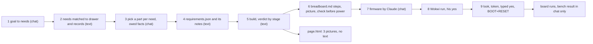

# User's-journey lens: P820 #1173 (the Artifact interface)

Read 2026-11-15. Tags: E (pointer), H (source), D (who, when), — (unknown). Paths are under ~/Development/spark unless they start with spark-walks, which is ~/Development/spark-walks. I read and changed nothing but this file.

## 1. Findings

The journey, as the PO does it today. "Today" is my reading of the primary artefacts; the brief's own table (jobs-and-journeys.md:30-37) differs at steps 4 to 6, noted in the findings.

| step | what he does | evidence | friction or harm | today |
| --- | --- | --- | --- | --- |
| 1 Idea | Says the goal to Claude; `/spark:idea` writes needs (verb, what, condition) and asks at most 3 questions | commands/idea.md:49; spark-walks/walk4/walk4-diary.md row 19:16 (needs came "from the person's words with no question") | The goal given at the start did not reach the brief (walk4-rows.md row 9). The idea page reads the brief but only init in step L writes it (row 1). He cannot see the needs as a list he can edit; a wrong need id is "fixed by hand in .spark/needs.json" (commands/idea.md:~35) | partly |
| 2 Needs matched | Reads owned and known candidates per need, with free/held counts, `[other words]`, owes lines | commands/idea.md:69-90 | Text only. `--match` listed `xiao-esp32-c6-fresh (button-light)` for all 3 needs with no word on what it is, open from walk 2 to walk 4 (walk4-rows.md row 5). `sound` did not match the amplifier (p581-rows.md row 8) | partly |
| 3 Parts and store options | Picks a part per need; passed-over reasons in his words; fixes owed facts | commands/idea.md:119-160 | The "store" here is his drawer plus spark's records; "spark knows no prices" (idea.md:76). No shop, price or stock option exists in the step, though his rules prefer GME, Hadex, LaskaKit, Botland, TME (CLAUDE.local.md "Agents and tools"). A pick is refused when another project holds the board; the refusal offers 2 fixes, not the third he chose (walk4-rows.md rows 3, 4, 6, 7) | partly |
| 4 Requirements | `parts.py --requirements` writes requirements.json, with notes (placeholder outline, reserved not placed, unserved, rail has no supply) | commands/idea.md:~165-200 | Many notes, each "say it as printed". A pin a connector fixes cannot be pinned (p581-rows.md rows 1-3: DC landed on A5 and the sheet would tell him to wire A5, which is wrong for the GDI cable) | partly |
| 5 Build | `check_spine.py requirements.json --keep .`; verdict by stage; writes breadboard.md, breadboard.svg, breadboard.json, page.html, pins.py, sim/ | commands/build.md:127-168 | The verdict ended with no next step; the new user asked "what ask?" (walk4-diary.md 19:29; row 11). A build stopped at a fixed 300 s timeout while the real build took 8 min 16 s (p581-rows.md rows 5-6); a kept stale board.tsx builds the old pins (row 7) | works for button-light; partly for a bigger board |
| 6 Breadboard steps | Reads breadboard.md: parts table, numbered steps, mermaid, picture, points, "Before you power it" | spark-walks/reaction-game/breadboard.md | The numbered steps and the check-before-power lines are in breadboard.md, not in page.html (finding US-1). README says "no breadboard wired from a sheet has run yet" (README.md:127) | partly (no wiring-from-sheet run recorded) |
| 7 Firmware | Claude writes firmware/main.py from pins.py; he reviews in chat | docs/guide/journey/firmware.md:5-6; scrum/VISION.md Not goals (spark writes no behaviour) | Spark gives no page for it by design; the import check proves names, not that every signal is driven (README.md:125). Editor flags MicroPython names as unknown (walk4-rows.md row 14) | partly |
| 8 Simulate | Says yes to a Wokwi run (free CI minutes), reads the verdict | docs/guide/journey/simulate.md:3; walk4-diary.md S4 | A pass can test neither must line (walk3-rows.md row 32); display not testable in Wokwi (walk4 row 25) | works / partly |
| 9 Deploy | `look.py`, then token, then typed yes in his own terminal, then BOOT and RESET by hand | commands/deploy.md:13-26, 63-65; walk4-rows.md row 41 | 11 BOOT/RESET presses in one walk; auto mode cannot type the yes; "go ahead" in chat is not the yes | partly |

Findings. Format: US-n · claim · tag · pointer · supports only.

US-1 · The kept page.html holds three images and nothing else: three base64 SVG `` panels (Breadboard, Schematic, PCB), CSS radio tabs, no heading, no text, no numbered steps, no parts table, no "before you power" lines, no limits. The "nice pictures and step by step guide" the PO praised is split across breadboard.md (steps, points, before-power) and the picture; the page carries only the picture. · E · spark-walks/reaction-game/page.html (grep: 3 ``, no "power", no "PULL_UP"; 230452 bytes); spark-walks/t-display/page.html (same tabs, 382218 bytes); commands/build.md:161 ("It has no script and loads nothing from the web") · supports only: what exists today in two kept pages (n = 2, both from walks), not whether he reads the page or the md on the bench.

US-2 · "Standardize the breadboard page's look across all steps" starts from a page that has no steps in it. Whichever step's look he means (D-b in the brief), the numbered-step text lives in the md and the page is a viewer of pictures. Which of the two he calls "the breadboard page" is unknown. · E (US-1) plus — for his meaning · brief.md Frame D-b; spark-walks/reaction-game/breadboard.md · supports only: that the two artefacts differ; not which he means.

US-3 · The "check before power" lines are the only harm-prevention text the build hands to the person before wiring, and they exist only in breadboard.md under "## Before you power it". Example content: a missing resistor means the firmware must set Pin.PULL_UP, and a wake-polarity warning citing micropython#17334. A page that dropped them would remove the one place where a wiring mistake or a dead-sleep design is flagged. · E · scripts/spark/breadboard/sheet.py:361; spark-walks/reaction-game/breadboard.md "Before you power it" · supports only: the lines' presence and location; not that anyone read them (no read evidence in the diaries).

US-4 · No breadboard wired from the sheet has run on a bench yet, by the project's own table. The brief's step 5 ("wires from the page's steps · works · D the PO 2026-11-15") rests on his liking the page, not on a wiring run. So the click-through's last step before power is untested by a person, and a page that makes the steps prettier could still send wrong wiring, as p581 shows (DC on A5 where the cable fixes GPIO3). · E · README.md:127 ("no breadboard wired from a sheet has run yet"); spark-walks/p581-sound-joystick/p581-rows.md rows 1, 3 · supports only: the project's statement and one walk's raised rows; not that the sheet was wrong on a bench.

US-5 · What he supplies, step by step, in every walk: the goal in a sentence; a yes to the store writes (pick, step mark, build's `built` record); his hands on the board (BOOT and RESET); a typed yes in his own terminal; a choice among options at forks (free a hold or raise the count; how to wire the display; which speed step); "It works" as the bench result. What he does not supply and cannot: pin facts, footprints, datasheet values (these come from records and `/spark:research`); the exit decision of Wokwi (a pass can test neither must line). · E · spark-walks/walk4/walk4-diary.md S1-S36 list ("The person said yes at 19:20", "At 19:23 the person chose to raise the count", "the person pressed them 11 times"); walk3-diary.md S3-S7; commands/idea.md:49 · supports only: three walks of one person (n = 1).

US-6 · Two kinds of "yes" the page must not blur: a yes to a store write or a publish (a click can carry it) and the deploy erase yes, which only a typed yes in the person's own terminal (or a deploy grant he set there) opens. A "go ahead" in chat is not the yes; Claude Code's `!` has no terminal; auto mode refused deploy.py from Claude's shell. A clickable "flash" button would be a new way to a yes that the contract refuses today. · E · commands/deploy.md:24-26, 54-60, 67-68; walk3-diary.md S7; docs/guide/journey/bench.md (the PO answered `no` in his own terminal, nothing erased) · supports only: the written contract; whether the PO wants a click to count as the deploy yes is —.

US-7 · The hands-on stalls cluster at the bench, not at the idea. In walk 4 the look needed his hands on BOOT and RESET 11 times in 2 h 42 min; in walk 3 at least 3 times. These are friction a page cannot remove, only name; the proposed fix (P472, no-hands download mode) is on a card, not shipped. · E · walk4-rows.md row 41; walk3-rows.md rows 19, 34; walk4-diary.md (walk 19:16 to 21:58) · supports only: this board (FireBeetle 2 S3), this person.

US-8 · The idea steps are where the click gain is smallest today and the choice count is highest. Needs, matches, held counts and owes lines are read in text and answered in words ("say why in the conversation", the reasons are not written to the project, idea.md:~83). A pick across 3 needs, with held-by-other-project refusals, is a table with one choice per row, which is what a page does well and chat does badly (walk4 rows 3, 4, 6, 7 all come from this table). · E for the pain (walk4-rows.md rows 3-7); H (mine) that a table and a click is better than chat for this step · supports only: that these rows were raised; no evidence he would prefer clicking.

US-9 · Steps that work as chat and gain little from a page: firmware (spark writes no behaviour, VISION.md Not goals; Claude writes it from pins.py), the Wokwi yes (one yes), research of a gap (`/spark:research` asks replies in a file, replies.md). Steps that gain most, by my ordering and tagged H: (1) breadboard steps, because they are physical, numbered, and pictured, and he named them; (2) pick table; (3) the verdict and its next step (walk4 row 11 "the person did not know what to ask"). · H (mine, from the diaries and rows above; no study) · scrum/VISION.md; walk4-diary.md 19:29 · supports only: my ordering.

US-10 · Every `could-not-run`, `skipped`, `not checked`, `unknown` and limit must survive on a page as the stated sentence and not as green. Today's carriers: the verdict's `[ok  ]` lines and "the chain runs end to end"; `look.py` exit 2 and the `unchecked` list; "ready unknown is not a pass"; the "what this simulation cannot show" file; "traces differ" and "traces not compared"; "no drawn breadboard: …" and "no breadboard sheet: …"; the owes list on a pick. The README row for Bench says "partly". A tab that "could not be drawn says why" (build.md:161), the one place the page already carries a reason. · E · commands/deploy.md:52-53, 106; commands/build.md:100-101, 146-160; spark-walks/p581-sound-joystick/sim/WHAT-THIS-CANNOT-SHOW.md; AGENTS.md "never assume" · supports only: the list of carriers read; not that a page can carry them.

US-11 · A page that shows state and a chat that acts see different things today. The page is static and has no script and no network (build.md:161), and nothing the person clicks reaches Claude; Claude reads `--json` and kept files. A page that edits a pick or a need would write state that the store, the project's `.spark/needs.json`, requirements.json and the history already hold in four places. Which one is truth when the person edits on the page and Claude edits in chat is —. · E for the current shape (build.md:161; commands/idea.md writes needs.json, picks, requirements.json, history via `--step`); — for the design · supports only: today's single-writer shape.

US-12 · The store writes are already counted as the PO's yes each time: step marks, `--needs-set`, `--pick` (reserves what he owns), `check_spine` (writes `built`), `--drawer-set`. Walk 3 asked for a dry run on each; `--step`'s dry run is the only output that showed "would list walk3-2" before the write, and `check_spine.py` has no dry run (walk3-rows.md rows 17, 25, 27). A click that triggers one of these has to show the dry run as the confirmation, or he has no look before the write. · E · walk3-rows.md rows 8, 17, 25; commands/idea.md:~28-30 · supports only: a pattern in 3 rows.

US-13 · The PO's own rule is "walk a real project end to end" and "judge by one bar: closer to a breadboard with working firmware". The page's gain, by his bar, sits at steps 5 and 6 (the build's verdict and the wiring) and at the hand-off to the firmware, not in the idea. The first slice he proposed in the brief (button-light or P581) matches. · E · AGENTS.md "Judge a change by one bar"; brief.md Frame outcome · supports only: his rule; not that the idea steps are unimportant.

US-14 · A non-PO maker in Claude chat with no terminal is an hypothesis only; the vision says "at home in a terminal" and "no person outside the project has installed spark". The Artifact-in-chat path serves a persona with no evidence, while the PO (who has a terminal) is the only reachable user. · E for the vision's words (scrum/VISION.md "Who it is for": "Every 'stranger' so far was Claude in one of our sessions"); H that a chat-only maker exists · jobs-and-journeys.md "Who" third line · supports only: that no such user is reachable.

US-15 · Harm that has been met, which the page must not add to: wiring the wrong pin from a map that "lies" (p581 rows 3-4: A5 instead of the cable's GPIO3; TFT_BL and ONBOARD_LED are one pin); a kept stale `board.tsx` building old pins with no word (row 7, since answered by P660's `traces differ` line, build.md:~146); a fixed timeout that reads like a failure (row 5); a pick that reserves his one board against a finished walk (walk4 row 3); erasing a board's flash (deploy), gated. No electrical harm (a burnt part, a short) is recorded in the files I read. · E · p581-rows.md rows 1, 3, 4, 5, 7; walk4-rows.md row 3; commands/build.md:146 · supports only: the rows (all status `raised`); "nobody checked it after the walk" (walk4-rows.md intro).

US-16 · The diaries record his words where he stalled: "what ask?" at the build's end; "yeah, good orientation finally, but still slow"; "we definitelly should fix this" (the SPI build defect). Each is a candidate account question. The walk diaries are Claude's account of what he said, not his own text; the verbatim words are in the diary tables only where quoted. · E for the quotes' existence; the quotes are Claude's transcript · walk4-diary.md 19:29, 20:55; walk4-rows.md "Short version" · supports only: the diary as written by Claude.

## 2. What you could not check, and why

- Whether the PO reads page.html or breadboard.md at the bench: no diary records which he opened. I did not find a row about it. —
- Whether `page.html` is what he means by "the breadboard page with the nice pictures": I read two kept pages (reaction-game and t-display) and no published Artifact; I did not open claude.ai. — (the folder had no p581 page.html; its dist/ holds no page).
- Whether a page can carry click state back to Claude (artifact `db`, connectors): that is the feasibility lens's. I read build.md:161 for today's shape only.
- A second person's use: none reachable (brief.md "Start and reach").
- Whether the steps would have wired a real breadboard correctly: README.md:127 says no run exists; I ran no bench and no tool.
- Miro and the issue board: not read; the brief names P269's brief as the nearest design, which I read for its frame only (docs/discovery/2026-10-16-p269-views-and-editors/brief.md), not its findings.
- I did not read all 789 lines of the walk diaries: I read walk4's table headers and S-lists, the walk3, walk4 and p581 rows files, and grepped walk2 and walk3 diaries for his decisions. A friction in the unread rows is possible.
- The recorded-run pages in docs/guide/journey/ I read in part (idea, firmware, simulate, bench head); recorded-run.md, owed-facts.md, from-draft-to-order.md not opened.

## 3. Questions for the decider

Account questions (past tense, his own use; the answer is E, n = 1):

- Q-a · When you wired the reaction-game or the t-display circuit, did you follow breadboard.md, the picture, or page.html, and which one did you have open? · decides: what "the page" must carry (steps and before-power lines as well as pictures) and whether the md stays the source.
- Q-b · When you said "what ask?" after the build (walk 4, 19:29), what did you want to see on screen at that point? · decides: what the verdict's end shows, and whether the next step is a button, a line, or both.
- Q-c · When the pick was refused because walk 3 held the board, how did you decide to raise the count, and what would have helped you decide faster? · decides: whether the holds table is a click table and what it shows beside each hold.
- Q-d · Did you read the "Before you power it" lines of any breadboard.md before powering a board? · decides: whether those lines are shown first, at each wiring step, or as a gate before "power".
- Q-e · When you pressed BOOT and RESET 11 times in walk 4, which message told you to, and would a page's text have been better than the terminal line? · decides: whether the bench stage needs a page at all.

Decision questions:

- Q-f · Does a click on a page count as your yes to a store write (a pick, `--needs-set`, a build's `built` record), and is the deploy erase yes still only your typed line? · decides: the page's allowed actions and whether the flash step has a button.
- Q-g · Do you want shop and price options on the parts step (your rule names GME, Hadex, LaskaKit, Botland, TME), given that spark knows no prices? · decides: whether "store options" means the drawer and records, or a new shop lookup (cost and sources, not in the code today).
- Q-h · When the page and the chat both change a pick, which one wins, or does the second ask you? · decides: the shared-state rule.
- Q-i · Is a maker in Claude chat with no terminal a person you design for in this epic? · decides: whether the page must work with no terminal, and whether the CLI stays required.

## 4. Searches

none
