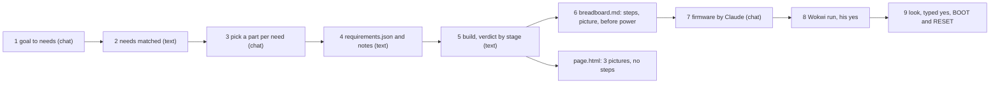
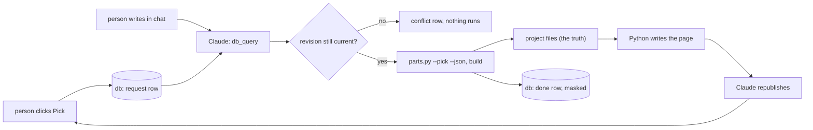

# Jobs and journeys
<!-- Tags as in the brief: E with a pointer, H with its source, D with who and when; an unknown is —. -->

## Who
<!-- One line per persona: who · evidence status (E pointer | H source).
e.g. `- Team leads who assign work · H Lena's belief, no interview yet` -->
- The PO, a maker who builds ESP32 gadgets from DFRobot modules and wants to drive spark from Claude, n = 1, the decider as a user · E the request (brief.md, Frame), D1 <!-- REQUIRED:who -->
- Claude, the agent that runs spark's steps for the person in Claude Code or claude.ai · E AGENTS.md ("If you are an AI agent using spark"), docs/guide/agents.md
- A maker who is not the PO, in Claude chat, with no terminal · H scrum/VISION.md personas; no such user reachable; the vision says "Every 'stranger' so far was Claude in one of our sessions" (council/user.md:63, US-14)

## Jobs
<!-- One job story per line, each clause tagged: When …, I want to …, so I can ….
e.g. `- When I assign a task in a meeting [E tickets.csv:6], I want the assignee to see it that day [H Lena], so I can stop chasing people [E tickets.csv:7]` -->
- Job 1 · When I have an idea for a gadget [D the PO 2026-11-15], I want to go through the needs, the parts, the store options and the build in one page I can click [D the PO 2026-11-15], so I can get to a breadboard with working firmware [E AGENTS.md, the one bar] <!-- REQUIRED:jobs -->
- Job 2 · When I wire the board [E commands/build.md, breadboard.md], I want pictures and numbered steps like the breadboard page's [D the PO 2026-11-15: "I love how you did the breadboard"], so I wire it right the first time [H the PO's walks, docs/observations/rows]
- Job 3 · When I am unsure about what the page shows [H], I want to ask Claude in the chat and have it act on the same choice [D the PO 2026-11-15], so I do not switch between a terminal, a page and a chat [H]
- Job 4 · (Claude) When the person clicks a choice on the page [D the PO 2026-11-15: "for people to use it and also claude"], I want to read that choice and run spark's next step from it [H], so my next step rests on the same state the person sees [E AGENTS.md, one core]

## Today they…
<!-- Per job: what they do instead today (a competitor, a workaround or nothing), tagged.
e.g. `- Job 1 · paste each task into Slack by hand · E tickets.csv:7` -->
- Job 1 · slash commands in Claude Code (`/spark:idea`, `/spark:build`) and scripts with `--json`; the answers are terminal text and files · E commands/, docs/guide/agents/scripts.md <!-- REQUIRED:today -->
- Job 2 · `breadboard.md` (numbered steps, a mermaid diagram, "Before you power it"), `breadboard.svg` and `page.html` with three picture tabs and no steps, published as an Artifact only on the person's yes · E commands/build.md:158-166, scripts/spark/breadboard/tabbed_page.py:1-11; council/user.md:37 (US-1). The step-by-step page the PO likely praised was typed by hand in a chat on 2026-11-11 · E council/feasibility.md:29 (FE-16), council/ux.md:11 (UX-1); which page he meant is unconfirmed
- Job 3 · the chat in Claude Code; the page has no script, so the chat cannot see what the person looks at on it · E commands/build.md:160 ("It has no script and loads nothing from the web"); council/user.md:57 (US-11)
- Job 4 · Claude reads the scripts' `--json` and the kept files; nothing the person clicks reaches it, and no page capability pushes a click into a local Claude Code chat · E council/feasibility.md:14 (FE-4, the `watch` tool: "Only a cloud session can be woken"); council/ux.md:156 (UX-24)

## Journeys
<!-- One ### per actor and scenario: the table, then a Mermaid flowchart of the same steps. Never a Mermaid
journey block: it forces a score on every task. "n/a — a one-step job" may replace both.
e.g. `| 2 | opens the app | E analytics, 90 days | never sees the task | not yet | Do they read email? |` -->
### The PO — from an idea to the board, today <!-- REQUIRED:journey -->
Extended from council/user.md:9-19 (the user lens read the walks; corrections to the first draft are marked). spark-walks is the sibling repository of the walks.

| step | what they do | evidence | friction or harm | today | open question |
| --- | --- | --- | --- | --- | --- |
| 1 Idea | says the goal to Claude Code; `/spark:idea` writes needs (a verb and a few words each) and asks at most three questions | E commands/idea.md:49; spark-walks/walk4/walk4-diary.md 19:16 | the goal did not reach the brief (walk4-rows.md row 9); a wrong need id is fixed by hand in `.spark/needs.json`; the needs are not a list he can edit | partly | always a chat turn: the page cannot start the journey (E council/feasibility.md:48, FE-29) |
| 2 Needs matched | reads owned and known candidates per need, with free and held counts, `[other words]`, owes lines | E commands/idea.md:69-90 | text only; `--match` listed one board for all 3 needs with no word on what it is (walk4-rows.md row 5); `sound` did not match the amplifier (p581-rows.md row 8) | partly | — |
| 3 Parts and store options | picks a part per need; says why in words; fixes owed facts | E commands/idea.md:119-160 | "store" means his drawer and spark's records; spark knows no prices (commands/idea.md:76); a pick another project holds is refused with 2 fixes, not the third he chose (walk4-rows.md rows 3, 4, 6, 7); the pick shows no electrical number (E council/physics.md:35, PH-15a) | partly | shops or the drawer? (brief Q15) |
| 4 Requirements | `parts.py --requirements` writes requirements.json with notes | E commands/idea.md, `--requirements`; docs/guide/agents/scripts.md | many notes, each "say it as printed"; a pin a connector fixes cannot be pinned, so DC landed on A5 (p581-rows.md rows 1-3) | partly | — |
| 5 Build | `check_spine.py requirements.json --keep .`; verdict by stage; writes breadboard.md, breadboard.svg, page.html, pins.py, sim/ | E commands/build.md:127-168 | the verdict ended with no next step: "what ask?" (walk4-diary.md 19:29); a build stopped at a fixed 300 s timeout while the real build took 8 min 16 s (p581-rows.md rows 5-6, n = 1) | works for button-light; partly for a bigger board (corrected from "works") | what did he want to see? (brief Q24) |
| 6 Breadboard steps | reads breadboard.md: parts table, numbered steps, mermaid, picture, "Before you power it" | E spark-walks/reaction-game/breadboard.md; council/user.md:41 (US-3) | the steps and the before-power lines are in the md, not in page.html; no breadboard wired from a sheet has run yet (E README.md:127) | partly (corrected from "works · D the PO": his liking is not a wiring run, council/user.md:43, US-4) | which did he have open at the bench? (brief Q3) |
| 7 Firmware | Claude writes firmware/main.py from pins.py; he reviews it in chat | E docs/guide/journey/firmware.md:5-6; scrum/VISION.md (spark writes no behaviour) | the import check proves names, not that every signal is driven (README.md:125) | partly | — |
| 8 Simulate | says yes to a Wokwi run (free CI minutes), reads the verdict | E docs/guide/journey/simulate.md:3 | a pass can test neither must line (walk3-rows.md row 32) | works, partly | — |
| 9 Deploy | `look.py`, a token, a typed yes in his own terminal, BOOT and RESET by hand | E commands/deploy.md:13-26; walk4-rows.md row 41 | 11 BOOT and RESET presses in one walk of 2 h 42 min (walk 4, 2026-11-01, n = 1); "go ahead" in chat is not the yes | partly | — |

### Claude — reading a click and acting (proposed, not built)
The path the tech lead's walking skeleton proposes (council/feasibility.md:71, FE-37), with a `db` request row. Every step past 1 is untested; the spike in risks-and-tests.md tests steps 2 to 4 and 7, and its step 6 tests a click made while no Claude session is open (A11). The click reaches the gate as no yes: a `deploy.py` run with no terminal stops at `NO_TERMINAL` (E scripts/spark/bench/deploy_gate.py:24).

| step | what Claude does | evidence | friction or harm | today | open question |
| --- | --- | --- | --- | --- | --- |
| 1 | the person clicks Pick on a need card; the page writes a request row in the shape of a `next` step (`op`, `argv`, `why`, `effects`, `needs_yes`) with the actor and the revision it saw | E scripts/spark/core/outcomes.py:114-121 (council/feasibility.md:42, FE-26) for the shape; H the row itself | `env` carries a store path, which must be masked before the row is written (FE-22, FE-26) | not yet | does a click count as his yes to a store write? (brief Q12) |
| 2 | nothing; the click does not reach Claude until the person writes in the chat | E council/feasibility.md:14 (FE-4); council/ux.md:157 (UX-25) | the person may click again or think the page is broken; the page must show "sent, not read yet" (council/ux.md:198, UX-36) | not yet | may a click wait for his next message? (brief Q5) |
| 3 | at its next turn, reads the open request rows with `db_query` | E the `db_query` tool exists in this Claude Code session (council/feasibility.md:16, FE-6); — whether a page's row reaches it | — latency, rate limit and size limit | not yet | the spike, step 1 |
| 4 | checks the row's revision against the project's files; on a newer state, writes a conflict and does not run | E council/ux.md:188 (UX-35, from P297's revision rule); `db_write` refuses a stale `ifVersion` (FE-5) | a click dropped without a word | not yet | who wins? (brief Q6) |
| 5 | runs `parts.py --pick … --json`, then `--requirements`, then the build | E scripts/parts.py OPERATIONS (council/feasibility.md:25, FE-12); commands/build.md:127 | the build half answers no envelope (FE-13); a build can run 300 s and stop "not a pass" (council/ux.md:114, UX-15) | works from chat today | — |
| 6 | writes the masked envelope back as a done row (`db_write` with `ifVersion`) | E council/feasibility.md:15 (FE-5), :35 (FE-22) | drawer facts in a shared row travel with a share | not yet | may drawer facts appear? (brief Q16) |
| 7 | Python writes the page from the files; Claude republishes it, then the page shows the change with its actor and Prague time | E commands/build.md:163-164 (republish by the same call); council/ux.md:171 (UX-31) | a republish reloads every open view; whether `db` rows survive it is unknown (FE-38, step 2) | partly: republish works on a yes today | may Claude republish without asking after the first yes? (brief Q17) |

