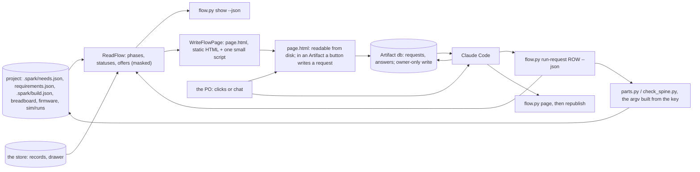

# P820 MVP: the whole flow in one page, controlled by the PO and by Claude

## Council

- Round 1 (2026-11-15): an architecture lens and a UX and AI-UX lens (Sonnet), then the refuter. The refuter ran on
  Opus, because Fable's limit was reached (HTTP 429). Changes: "phase" for the nine places in the flow (not "step");
  a request carries a key from an allowlist, never a command line or a path; the core writes every word and mark, and
  the script decides nothing; a request's answer carries the run's own status, never "done" alone; the build record is
  written by the keep step, where the missing facts are known; card 4's proof clicks one phase at a time; the page
  card split in two; the prompt reminder (the plugin's UserPromptSubmit hook) moved after the MVP.
- Round 2 (Opus): no must-fix. Folded in: card 4's proof starts with needs from /spark:idea (button-light has none);
  the simulate and deploy lines use the `${CLAUDE_PLUGIN_ROOT}/scripts/...` form, never a home path; requirements is
  `stale` when what `--requirements` would write differs from the file; a pick's effect line says it replaces the need's
  picks; `not-checked` already means "could not look" (outcomes.py:48), so the idea, firmware and simulate phases use
  `not-started` or a fact with no mark; "stale with the build" reuses `dist/board/built-from.json`; only the `<script`
  assertion is retired.

## Context

The PO asked for spark in one Artifact page (#1173). He clicks through the flow from the idea to the deploy, and Claude
acts on the same state from the chat. D5 (the PO, 2026-11-15) sets the MVP: "the whole spark screens and the whole
flow, including the schema and breadboard ... the pcb and 3d model we can add later, start with an mvp with the flow,
so both claude and I as a human can control it".

The spike (D6) showed that a click's `db` row reaches Claude Code (A1), that Claude's row shows on the open page in
under 1 s, and that rows survive a republish (A2). A click the PO made at 15:41:45 Prague time, while this session was
open and idle, waited in `db` and was read at the next turn. A11 (a click with Claude Code quit, read when a session
opens) is still open. A local session is never woken by the page (`wake: not_armed`, `no_address`), so a click waits
for the person's next chat message.

items.md predates D5. It plans a wiring page and one Pick click, not the whole flow, and its provisional numbers P823
and P824 are real cards now (#1178, #1179). This plan replaces its MVP rows; the cards below cite items.md's blocks by
their titles.

What exists (read 2026-11-15, checked by the lenses and the refuter):
- The page: `TabbedHtmlPage` (scripts/spark/breadboard/tabbed_page.py:66) writes `page.html`, three CSS-only tabs
  (breadboard, schematic, PCB SVGs as data URIs), from `keep_tabbed_page`, which `check_spine.report` calls in the keep
  step (scripts/check_spine.py:133-139) after a build with `--keep .` (commands/build.md:124). tests/test_tabbed_page.py:53-56
  pins "no `<script`".
- The keep step also gathers `missing_facts` (`_kept_pins`, scripts/spark/build/kept_files.py:329); the build's
  service writes only a history note to the store (scripts/spark/build/requirements_build.py:75).
- The wiring steps are data (`BreadboardSteps`, scripts/spark/breadboard/wiring_steps.py:137, `walk()` :144), rendered only as
  Markdown. The before-power lines are Markdown strings (`sheet._before_power`, sheet.py:195).
- The core: `Operation` (scripts/spark/core/operation.py:65), the envelope and the `next` step from `step()` (scripts/spark/core/outcomes.py:99-136, :114).
  `--pick` and `--requirements` have dry runs (pick_parts.py:63, write_requirements.py:50). `--match` answers no `next`.
  A `next` step's `argv` and `env` are unmasked by design (scripts/spark/core/privacy.py:11). Board steps carry no
  `board` effect (`look` has `[]`, scripts/spark/bench/board_envelope.py:52).
- No reader says where a project stands. No goal is stored (needs.py:51-53 refuses extra keys).
- One TypeScript package, tools/circuit-to-wokwi/: bun, one built file, its sources sha256 pinned in
  tests/test_check_spine.py, tests/test_converter.py wraps `bun run test`, tools/story_tests.py:46 maps the folder.
- The plugin has no hooks folder; plugin hooks load from `hooks/hooks.json`.

## Words (one word for one thing; added to docs/guide/patterns-and-names.md)

- phase: one of the nine places in the flow: idea, needs, parts, requirements, build, breadboard, firmware, simulate,
  deploy. Not "step" (a `next` step, a wiring step) and not "stage" (a build stage).
- offer: an action the page may send, named by a key such as `pick:led:wokwi-led-red`, `requirements` or `build`.
- request: an offer the person sent, a `db` row `{id, key, seen, at}`. answer: Claude's row for one request.
- revision: the sha256 of needs.json, requirements.json and .spark/build.json together.
- The status words stay the envelope's (`ok`, `problems`, `could-not-run`, `skipped`), plus `not-started` and `stale` as
  constants in `spark.core.outcomes`. A phase with nothing to check (idea, firmware, simulate) shows its fact with no
  mark; `not-checked` keeps its meaning, "could not look" (outcomes.py:48).
- The prompt reminder: the plugin's UserPromptSubmit hook (not "the hook", which is the pre-push script).

## The design

The project's files are the truth. The page is one renderer of them; `db` holds only requests and answers. One core
reads the flow, the CLI prints it, the page shows it. Python writes every word, mark and effect line; the script only
switches panels, steps through the wiring, and writes and shows rows. No path and no command line reaches the page or
`db`: the page holds keys and masked text, and `run-request` rebuilds the command from the key.

### The flow reader (card 1)

A new area `scripts/spark/flow/` with the CLI `scripts/flow.py` (subcommands `show`, `page`, `run-request`),
`flow_codes.py` and `flow_operations.py`. `ReadFlow` (op `show`, effects READS) reads the project and the store. Each
phase is a `PhaseReader` (the Strategy pattern, one small subclass per phase in a table) that answers a `Phase` value:
`phase`, `status`, `mark` (word and glyph), `by` (`you`, `claude` or `your terminal`), `facts` (masked by
`spark.core.privacy`) and `offers`.

| phase | reads | status rule | by | offers |
| --- | --- | --- | --- | --- |
| idea | nothing | no mark; "Tell Claude your goal in the chat" | you | none |
| needs | .spark/needs.json (`needs.read`) | `not-started` with no needs, else `ok` | claude | `needs-drop:<need>` |
| parts | the needs' picks; the match's candidates; the drawer's "you have" | `ok` when every need has a pick | you | `pick:<need>:<part>` |
| requirements | requirements.json | `not-started`, `ok`, or `stale` when `need_requirements.requirements(project)` differs from the file | claude | `requirements` |
| build | .spark/build.json | the build's status; `stale` when requirements.json's sha256 differs | claude | `build` |
| breadboard | the kept sheet files, dist/board/built-from.json | `not-started`, `ok`, or `stale` with the build | you | none |
| firmware | firmware/main.py and its time | no mark (a file is no pass) | claude | none |
| simulate | the newest sim/runs/*.log | no mark; the line to run names its cost | your terminal | none |
| deploy | nothing | `not-started`; "ask Claude to look first", then the typed line | your terminal | none |

Each offer carries its effect line from the core, for example "replaces the picks of need led in needs.json; holds 1
of your 3 red LEDs" or
"writes requirements.json; may shelve catalog records in your store". A null fact shows as "unknown", never empty. A
build that is `ok` with missing facts shows their count. The lines to type use the `${CLAUDE_PLUGIN_ROOT}/scripts/...`
form of commands/build.md:124, never a resolved path or `SPARK_HOME`. The parts phase calls `needs.match` directly (it
reads only; 0.27 s on plant-alarm); a pick
whose part is held refuses itself, as `--pick` does today, so the drawer stays out of the revision.

The build record: the keep step writes `.spark/build.json` beside `page.html` (`check_spine.report`, one more kept
entry, through a small `BuildRecordStore`): the stages, the status, `missing_facts`, requirements.json's sha256 and the
Prague time. A library build (`loader.is_library`) writes none.

### The page (cards 3a and 3b)

`WriteFlowPage` (op `page`, effects READS, WRITES) writes `page.html` with `FlowHtmlPage` (a Renderer beside
`TabbedHtmlPage`, whose three tabs become the build and breadboard panels' views). Python writes the static HTML: the
phase rail, each panel's mark, facts and offers with their effect lines, the schematic and breadboard views (PCB as
today, 3D later), the before-power lines, then the wiring steps. Opened from disk with no script, the page shows every
phase. The keep step calls the same writer, and `flow.py page` writes it at any phase.

The script is TypeScript in tools/flow-page/ (bun: one built file, its sources sha256 pinned by a test, a wrapper test,
the story run's folder map; no dependencies, so no `node_modules` loan). It switches panels, steps through the wiring
one at a time, and with `db` sends a request: the button shows the offer's effect line in the page first, then writes
`{id, key, seen, at}`. With no `db`, it shows the copy line ("Tell Claude: run the page request pick:led:..."), which
Python wrote.

A request's states on the page: "sent at 15:40, waits for your next message to Claude" (Copy beside it), "refused:
stale, the project changed; send again on the new page", "refused: not offered", and the run's own status word and
mark. Never "done" alone.

### The requests (card 4)

`RunRequest` (op `run-request`) reads the flow again and accepts a row only if its key is among the current offers and
`seen` is the current revision. The offers are an allowlist of four kinds (`pick`, `needs-drop`, `requirements`,
`build`); a key of any other kind is refused, so no click reaches a look, a deploy, a grant, live code or a simulation.
A table maps each kind to its script and arguments; `run-request` fills the project's real paths itself and runs it.
It answers the row to write: `{for, status, mark, line, revision}`, masked. A request whose `id` has an answer is
skipped; two open requests with the same key run once.

commands/page.md (`/spark:page`) only carries rows: publish the page (asks the first time), declare `db` with read for
viewers and write for the owner, keep the slug in `.spark/page.json`, `db_query` the requests with no answer in `at`
order, pass each to `flow.py run-request`, `db_write` its answer, `flow.py page`, republish. Free words go to the chat.

## The cards (replace items.md's MVP rows; numbers read just before filing)

1. S, story, the flow reader: `ReadFlow`, the `PhaseReader`s, the offers, `flow.py show --json`, `BuildRecordStore`.
   Proof: on fixtures (no needs, picked, built, a could-not-run stage, requirements changed after the build) a test
   pins each phase's status and offers.
2. S, task, the wiring steps and the before-power lines as data (items.md's "the wiring steps and the 'Before you power
   it' lines reach a page only as Markdown"). Proof: a test pins the data equal to breadboard.md's numbered list and its
   "Before you power it" section on a fixture.
3a. M, story, the page shell: `WriteFlowPage`, `FlowHtmlPage`, the rail and the panels, tools/flow-page/ (panels only).
   Retires only the `<script` assertion, tests/test_tabbed_page.py:55, on purpose (Q29); line 56 (nothing from http) stays. Folds items.md's legend card ("a could-not-run, a skipped
   and a null show as nothing or as a tick") and its focus card ("the page's tabs show no keyboard focus"). Proof:
   button-light's page, opened from disk, shows the nine phases, and a could-not-run stage is never a tick.
3b. S, story, the views and the wiring: the schematic and breadboard views on their panels, the wiring steps one at a
   time and all at once. Folds P306 #372 (a comment with its words). Proof: the P100 walk wires from the page.
4. M, story, the requests: `RunRequest`, the buttons, commands/page.md, `.spark/page.json`. Folds items.md's Pick card
   and its publish-routes card. Proof: on button-light, after /spark:idea writes its needs in the chat, the PO clicks Pick; at his next message Claude runs it and
   republishes; he clicks Requirements, then Build, each after the page shows the last result; `needs.json` holds the
   pick, `.spark/build.json` the build, and the page shows the build's own status.

After the MVP (one line each): the prompt reminder, with A11's test; P804 #1138 (the build as an Operation); P481 #660
(the panels' help from descriptions); a stored goal; the PCB and 3D views; shops with prices; an MCP route.

## Decisions (the PO, 2026-11-15, AskUserQuestion in this session; recorded in brief.md as D7 to D10)

- D7, Q29: `page.html` carries one inline script and still loads nothing from the web; only the `<script` test line is
  retired. With the script off, the page still shows every phase (Q8).
- D8, Q5: a click waits for his next chat message, and the page says so with Copy beside it.
- D9, Q12: a click he confirms on the page, after its effect line, is his yes for pick, drop a need, the requirements
  and the build. Never for the board or a simulation.
- D10, Q15 and Q16: "store options" means his drawer and spark's records; the page shows "you have" counts and holds,
  which go with any share; `db` rows hold no drawer facts; shops with prices come after the MVP.
- Firmware, simulate and deploy stay chat or terminal only in the MVP: the page shows them and the line, with no offer.

## After approval (a docs PR, then the board)

1. A branch `p820-mvp-plan`: brief.md gets D7 to D11, a link to this plan's Council section, and the 15:41:45 click under Results (read
   at the next turn while the session was open; A11 itself still open). items.md's MVP blocks are replaced by cards 1
   to 4 above; story-map.md's MVP row follows. The plan is copied to the discovery folder. A refuter on the PR, then
   merge when the gates pass.
2. File cards 1, 2, 3a, 3b and 4 as sub-issues of P820 #1173, slice Views and editors, numbers read just before filing;
   P306 #372 gets the comment with its words; the folded items.md cards are never filed. They go to Ready below P792,
   P459 and P711 until the PO orders Ready.
3. Queue the Miro update (the main frame's "spike waits" block, the MVP row) for the daily batch; delete the drawing
   agent's scratch folder.
4. Then the lane pulls the top of Ready, P792, as D4 said.

## Verification

- The pre-push hook's story run on each PR (the flow area's tests, the bundle's wrapper test).
- Card 4's walk on button-light with the PO: the `db` rows, the chat, `needs.json`, `.spark/build.json` and the page.
- A test pins that no path under the home folder appears in `page.html` or in an answer row.
- Mutation rows per PR, proved with `tools/mutate.py --anchors`.
