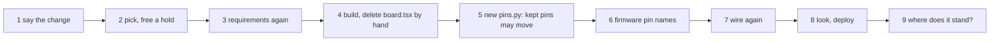
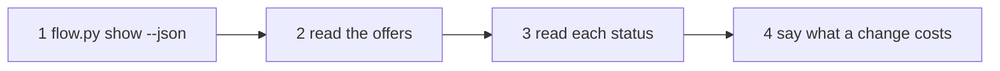

# Jobs and journeys
<!-- Tags as in the brief: E with a pointer, H with its source, D with who and when; an unknown is —. -->

## Who
<!-- One line per persona: who · evidence status (E pointer | H source).
e.g. `- Team leads who assign work · H Lena's belief, no interview yet` -->
- The maker (Petr, the PO): directs Claude in the chat, wires at his bench, reads the page · E scrum/VISION.md:39; the rows of his three walks of 2026-11-16 and 2026-11-17 (spark-walks/p711-*/rows.md), n = 1 <!-- REQUIRED:who -->
- The agent at the keyboard (Claude in a session): acts on a script's answer and its `next` step, without the script's source · E scrum/VISION.md:40; every logged walk ran through one
- The hobbyist (the primary persona): an idea in words, a board from the drawer, a terminal · H scrum/VISION.md:38, "Hypothesis. The PO's choice"; no person outside the project used spark
- A later AI framework that drives spark (a graph of steps) · H the PO's words on #1234, 2026-11-17 ("Later, it would be the frameworks"); nothing exists

## Jobs
<!-- One job story per line, each clause tagged: When …, I want to …, so I can ….
e.g. `- When I assign a task in a meeting [E tickets.csv:6], I want the assignee to see it that day [H Lena], so I can stop chasing people [E tickets.csv:7]` -->
- J1 · When I have a goal for a gadget [D the PO, #1234], I want to see at every moment where the project stands and what comes next [E page-notes.md, gap 9: "Nothing on the page says what is next or where the project stands"], so I can go on without asking Claude what to do [H the facilitator] <!-- REQUIRED:jobs -->
- J2 · When I change my mind in the middle ("let's add another joystick") [D the PO, #1234's comment], I want spark to say what the change makes out of date and to make it again [H the facilitator, from the walks' rows: p711-sound-demo/rows.md rows 13 and 16, #1234's comment], so I can trust that the breadboard, the pins, the firmware and the board on the bench agree [H the facilitator]
- J3 · When I want to return to an earlier phase [D the PO, #1234's comment: "when we can go back", "how"], I want to know what I keep and what I lose [H the facilitator], so I can decide before I go back [H the facilitator]
- J4 · When the parts are picked [D the PO, #1234], I want to see where to get each part, where else it is sold, which facts to test on the bench and which part to replace [D the PO, #1234], so I can order and test before I wire [H the facilitator]
- J5 · When I wire the breadboard [D the PO, #1234], I want the screen of the demo I praised, with pictures and animated connections [D the PO, #1234], so I can wire without a hand-written guide [E P828 #1186's title: "the wiring guide the PO praised is typed by hand in each session"]
- J6 · When I am an agent or a framework that drives spark [D the PO, #1234's comment], I want the same phases, states and next steps as the person sees [H the facilitator, from AGENTS.md "One core, many interfaces"], so I can act on the same state and never on a guess [E docs/guide/agents/never-assume.md, named in AGENTS.md]

## Today they…
<!-- Per job: what they do instead today (a competitor, a workaround or nothing), tagged.
e.g. `- Job 1 · paste each task into Slack by hand · E tickets.csv:7` -->
- J1 · `flow.py show` names nine phases and the first that is not done; the page shows three tabs and no phase · E scripts/spark/flow/flow_codes.py:9; page-notes.md, "What the page holds" <!-- REQUIRED:today -->
- J2 · the person deletes spark's own board.tsx by hand, removes old parts from requirements.json by hand, and learns of old pin names in the firmware only from a hint · E p711-sound-demo/rows.md row 13; #1234's comment (the walks' evidence list)
- J3 · nothing: no command or page says what going back keeps; a refused build removed the earlier pins.py, breadboard.md and page.html · E #1234's comment · caveat: seen once, in one walk
- J4 · shops: nowhere; facts to test: `parts.py --unverified`; a part to replace: `parts.py --match` ranks the candidates of a need, and the research command tells Claude to write a `why_not` into a catalog record of the store, which no script reads; none of them is a phase or a screen · E page-notes.md, "What the page does not hold"; commands/research.md:144; agents/parts-researcher.md:81-82; `/usr/bin/grep -rIn why_not scripts` on 2026-11-17 gave only function names (pin_assigner.py, drawing.py, sheet.py, the bench modules) · caveat: the page notes name "the catalog's why_not" as if spark read it; council/feasibility.md FE-14 says the passed-over reason is a history event of `--pick --passed-over`, not yet re-read by the facilitator
- J5 · Claude types the wiring guide by hand in the session, or the person reads breadboard.md; the Breadboard tab said "not drawn" for the amplifier · E #1186; page-notes.md, gap 1
- J6 · the agent reads each script's `next` step and the commands' Markdown; `flow.py show --json` gives the phases; no framework drives spark · E scripts/flow.py:17-31; docs/guide/agents.md

## Journeys
<!-- One ### per actor and scenario: the table, then a Mermaid flowchart of the same steps. Never a Mermaid
journey block: it forces a score on every task. "n/a — a one-step job" may replace both.
e.g. `| 2 | opens the app | E analytics, 90 days | never sees the task | not yet | Do they read email? |` -->
### The maker with Claude — "let's add another joystick" after the board is wired and flashed <!-- REQUIRED:journey -->
Today's journey, as the walks and the code show it. Each step says whether a walk saw it (E) or a lens read it from the code or the command text (H).

| step | what they do | evidence | friction or harm | today | open question |
| --- | --- | --- | --- | --- | --- |
| 1 | says the change in the chat; Claude adds a need | H commands/idea.md, council/user.md:70 (US-43) | no sentence says what the change will make out of date | partly | Q7: a plan first? |
| 2 | picks a part for the new need; a held part must be freed first | E spark-walks/p711-sound-demo/rows.md row 1; p711-identify-amp/rows.md row 5 | nothing says whether a hold is still in use | partly | — |
| 3 | writes the requirements again; old parts stay as "kept, not from a pick" | E #1234's comment; council/feasibility.md:38 (FE-17) | he removes entries by hand | partly | Q2 |
| 4 | builds; "traces differ: board.tsx" for the file spark wrote | E p711-sound-demo/rows.md row 13 | he deletes spark's own file by hand; a refused build removes the earlier pins.py, sheet and page (★C7 (by design)) | partly | Q2 |
| 5 | reads the new pins.py; 2 of 15 kept signals moved in the facilitator's run (★C4 (simulated; one board model)) | E the run of 2026-11-17, simulated | nothing names the moved pins as moved | not yet | Q3 |
| 6 | Claude rewrites the firmware's pin names | H council/feasibility.md:43 (FE-22) | no check that main.py names only pins that pins.py holds (★C5 (not run)) | not yet | — |
| 7 | wires again from "Changes since the last build" | E p711-sound-demo/rows.md row 6; council/physics.md:23 (PH-10) | the section compares with the earlier sheet, not with what he wired; no order of power, flash and wire (★C6 (not measured)) | partly | Q11 |
| 8 | looks at the board, then deploys with BOOT and RESET and his yes | E p711-sound-demo/rows.md row 14; p711-walk4-button-led/rows.md rows 3 and 5 | the look restarts the board and may read another project's board | partly | P865 #1231 |
| 9 | asks where the project stands | E the facilitator's runs of `flow.py show` (★C1 (one project), ★C2 (reads no record)) | the build and the breadboard read as done while the requirements are out of date; the deploy always reads "not started" | not yet | Q4, Q5 |

### The agent at the keyboard — reads where the project stands and acts
| step | what they do | evidence | friction or harm | today | open question |
| --- | --- | --- | --- | --- | --- |
| 1 | runs `flow.py show --json` and reads data.phases and data.stands_at | E docs/guide/agents/flow.md; council/architecture.md:278 (AR-17) | — | works | — |
| 2 | reads an offer: a key and one effect line | E council/ux.md:15 (UX-6); scripts/spark/flow/phase_readers.py:37 | no command, no "needs your yes", so it rebuilds the command from the command files' prose | partly | Q13 |
| 3 | reads a status | E the facilitator's run (★C10 (a board-only project)) | a tick for a build whose stages were all skipped; one dot for three meanings | partly | found on the way, C21 |
| 4 | tells the person what a change makes out of date | E council/ux.md:50 (UX-16) | nothing in the JSON says it, so the agent guesses or reads source | not yet | Q5, Q7 |

