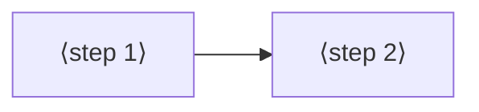

# Jobs and journeys
<!-- Tags as in the brief: E with a pointer, H with its source, D with who and when; an unknown is —. -->

## Who
<!-- One line per persona: who · evidence status (E pointer | H source).
e.g. `- Team leads who assign work · H Lena's belief, no interview yet` -->
- The maker (Petr, the PO): directs Claude in the chat, wires at his bench, reads the page · E scrum/VISION.md:39; the rows of his three walks of 2026-11-16 and 2026-11-17 (spark-walks/p711-*/rows.md), n = 1 <!-- REQUIRED:who -->
- The agent at the keyboard (Claude in a session): acts on a script's answer and its `next` step, without the script's source · E scrum/VISION.md:40; every logged walk ran through one
- The hobbyist (the primary persona): an idea in words, a board from the drawer, a terminal · H scrum/VISION.md:38, "Hypothesis. The PO's choice"; no person outside the project used spark
- A later AI framework that drives spark (a graph of steps) · H the PO's words on #1234, 2026-11-17 ("Later, it would be the frameworks"); nothing exists

## Jobs
<!-- One job story per line, each clause tagged: When …, I want to …, so I can ….
e.g. `- When I assign a task in a meeting [E tickets.csv:6], I want the assignee to see it that day [H Lena], so I can stop chasing people [E tickets.csv:7]` -->
- J1 · When I have a goal for a gadget [D the PO, #1234], I want to see at every moment where the project stands and what comes next [E page-notes.md, gap 9: "Nothing on the page says what is next or where the project stands"], so I can go on without asking Claude what to do [H the facilitator] <!-- REQUIRED:jobs -->
- J2 · When I change my mind in the middle ("let's add another joystick") [D the PO, #1234's comment], I want spark to say what the change makes out of date and to make it again [H the facilitator, from the walks' rows: p711-sound-demo/rows.md rows 13 and 16, #1234's comment], so I can trust that the breadboard, the pins, the firmware and the board on the bench agree [H the facilitator]
- J3 · When I want to return to an earlier phase [D the PO, #1234's comment: "when we can go back", "how"], I want to know what I keep and what I lose [H the facilitator], so I can decide before I go back [H the facilitator]
- J4 · When the parts are picked [D the PO, #1234], I want to see where to get each part, where else it is sold, which facts to test on the bench and which part to replace [D the PO, #1234], so I can order and test before I wire [H the facilitator]
- J5 · When I wire the breadboard [D the PO, #1234], I want the screen of the demo I praised, with pictures and animated connections [D the PO, #1234], so I can wire without a hand-written guide [E P828 #1186's title: "the wiring guide the PO praised is typed by hand in each session"]
- J6 · When I am an agent or a framework that drives spark [D the PO, #1234's comment], I want the same phases, states and next steps as the person sees [H the facilitator, from AGENTS.md "One core, many interfaces"], so I can act on the same state and never on a guess [E docs/guide/agents/never-assume.md, named in AGENTS.md]

## Today they…
<!-- Per job: what they do instead today (a competitor, a workaround or nothing), tagged.
e.g. `- Job 1 · paste each task into Slack by hand · E tickets.csv:7` -->
- J1 · `flow.py show` names nine phases and the first that is not done; the page shows three tabs and no phase · E scripts/spark/flow/flow_codes.py:9; page-notes.md, "What the page holds" <!-- REQUIRED:today -->
- J2 · the person deletes spark's own board.tsx by hand, removes old parts from requirements.json by hand, and learns of old pin names in the firmware only from a hint · E p711-sound-demo/rows.md row 13; #1234's comment (the walks' evidence list)
- J3 · nothing: no command or page says what going back keeps; a refused build removed the earlier pins.py, breadboard.md and page.html · E #1234's comment · caveat: seen once, in one walk
- J4 · shops: nowhere; facts to test: `parts.py --unverified`; a part to replace: `parts.py --match` ranks the candidates of a need, and the research command tells Claude to write a `why_not` into a catalog record of the store, which no script reads; none of them is a phase or a screen · E page-notes.md, "What the page does not hold"; commands/research.md:144; agents/parts-researcher.md:81-82; `/usr/bin/grep -rIn why_not scripts` on 2026-11-17 gave only function names (pin_assigner.py, drawing.py, sheet.py, the bench modules) · caveat: the page notes name "the catalog's why_not" as if spark read it; council/feasibility.md FE-14 says the passed-over reason is a history event of `--pick --passed-over`, not yet re-read by the facilitator
- J5 · Claude types the wiring guide by hand in the session, or the person reads breadboard.md; the Breadboard tab said "not drawn" for the amplifier · E #1186; page-notes.md, gap 1
- J6 · the agent reads each script's `next` step and the commands' Markdown; `flow.py show --json` gives the phases; no framework drives spark · E scripts/flow.py:17-31; docs/guide/agents.md

## Journeys
<!-- One ### per actor and scenario: the table, then a Mermaid flowchart of the same steps. Never a Mermaid
journey block: it forces a score on every task. "n/a — a one-step job" may replace both.
e.g. `| 2 | opens the app | E analytics, 90 days | never sees the task | not yet | Do they read email? |` -->
### ⟨actor⟩ — ⟨scenario⟩ <!-- REQUIRED:journey -->
| step | what they do | evidence | friction or harm | today | open question |
| --- | --- | --- | --- | --- | --- |
| 1 | ⟨fill⟩ | ⟨tag and pointer⟩ | ⟨fill⟩ | ⟨works, partly, not yet or —⟩ | ⟨fill or —⟩ |

