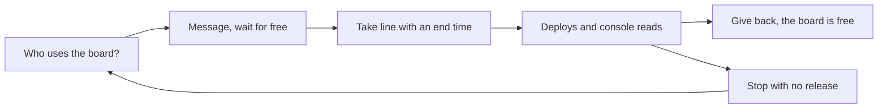

# Jobs and journeys
<!-- Tags as in the brief: E with a pointer, H with its source, D with who and when; an unknown is —. -->

## Who
<!-- One line per persona: who · evidence status (E pointer | H source).
e.g. `- Team leads who assign work · H Lena's belief, no interview yet` -->
- The PO at his bench, who owns the boards and plays on the game box · E the card #1298, "Needed by" · n = 1
- A Claude session that works on one project and needs the connected board for it · E the pixel-games session's account, brief ★C9 · two sessions, one day <!-- REQUIRED:who -->

## Jobs
<!-- One job story per line, each clause tagged: When …, I want to …, so I can ….
e.g. `- When I assign a task in a meeting [E tickets.csv:6], I want the assignee to see it that day [H Lena], so I can stop chasing people [E tickets.csv:7]` -->
- J1 · When a session works on one project and a board is connected [E the PO's words, comment 1 on #1298], I want to see which project uses that board now [E the same words: "at least to see how it's in the projects"], so I can tell whether I have to build and deploy again [E the same words: "it always has to build the other project"]
- J2 · When my project needs a board that another project also uses [E the pixel-games session's account, brief ★C9], I want to read who holds it and until when with no touch of the board [E the pixel-games session's account, brief ★C9], so I do not stop the other project's work or a running game [E brief ★C6: a read of the lineup stops the game]
- J3 · When I give the board back [E brief C10], I want the record to name what was on the board before my take [H the pixel-games session's finding], so the next user finds the board as it was [H the same]
- J4 · When the PO goes to his bench [D the sessions' agreement, item 5, on the card], he wants the holder to stop at the next safe point [D the same], so his own bench work comes first [D the same] <!-- REQUIRED:jobs -->

## Today they…
<!-- Per job: what they do instead today (a competitor, a workaround or nothing), tagged.
e.g. `- Job 1 · paste each task into Slack by hand · E tickets.csv:7` -->
- J1 · nothing shows the project that uses a board now. `look.py` prints the last deploy of a board, and it touches the board to do so · E comment 2 on #1298
- J2 · a message to the other session, its "free", and a take line as a comment on the card · E the card #1298, the agreement, items 2 and 3
- J3 · nothing. The holder has to remember what was on the board · E brief C10
- J4 · the PO says it in the chat, and the holder writes "The board is free" · E the card #1298, the agreement, item 5 <!-- REQUIRED:today -->

## Journeys
<!-- One ### per actor and scenario: the table, then a Mermaid flowchart of the same steps. Never a Mermaid
journey block: it forces a score on every task. "n/a — a one-step job" may replace both.
e.g. `| 2 | opens the app | E analytics, 90 days | never sees the task | not yet | Do they read email? |` -->
### A Claude session — it takes the game box for step 2c of P904 <!-- REQUIRED:journey -->
| step | what they do | evidence | friction or harm | today | open question |
| --- | --- | --- | --- | --- | --- |
| 1 | wants to know who uses the board now | E brief ★C9 | no record says it, and a read of the box stops a running game | not yet | Q3 |
| 2 | sends a message to the other session and waits for "free" | E the card #1298, the agreement, item 2 | the other session can be busy, and silence is not a yes | partly | — |
| 3 | writes the take line on the card with an end time | E the agreement, item 3. E brief C20: not used yet | the end time is a guess (C11) | partly | Q6 |
| 4 | deploys and reads the console, about 10 to 15 restarts | E brief C11, ★C15 | each touch restarts the board, and `box.py` passes no spark gate (★C6) | works | Q5 |
| 5 | gives the board back and writes "The board is free" | E the agreement, item 3 | the box holds a test lineup, and nothing names the old one (C10) | not yet | — |
| 6 | stops with no release (a clear, a restart near 100k) | H council/user.md USER-12 | the next session reads the card, and the hold ends at its time | partly | Q6 |

