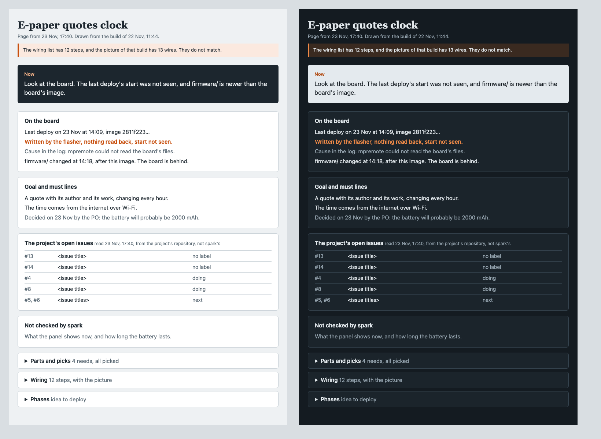
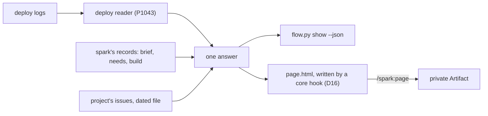
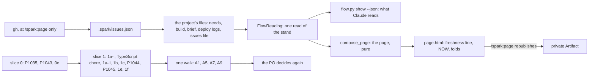

# P1038 discovery: the project page, designed

The discovery of epic P1038 #1521 ended on 2026-11-23 and is ready for design. The PO confirmed the frame, the jobs,
the direction and the remaining risk. A delegated council answered the rest, and he can change its answers. The full
record is [brief.md](brief.md). The pictures are in [diagrams.md](diagrams.md), and a mock of the first page slice is
below (D30). The mock is a starting picture, not a decision: the style slice comes after the walk (D25), and the
story's plan sets the deploy words (D10). Its goal line shortens the sketch's. Where the mock and the design's slice 1
mockup differ, the [design](design.md) holds.

## What we found

- In the P934 walk, the page was wrong because nothing wrote it again for about 27.5 hours. It said "NOW (firmware)"
  while the clock was wired and deployed.
- The deploy reader never reads a file, so a project past the firmware stands at "deploy, not started" for ever. The
  clock has 27 logged deploys.
- The page got 5 clicks in 11 minutes, and none after the build. The diary logs clicks, not views.
- The PO came back to the clock through a Claude session, not through the page (QA1). A partial build result read to
  him as "the build failed" (QA5).
- The PO's own words about the page are about readability and picking several parts at once.

## What is decided

- The page shows spark's records first, and the project's open GitHub issues beside them, marked as the project's
  (D4, D19, D23 delegated).
- The page is a snapshot with a dated stamp. It names the build it draws from (D5, D17).
- A core hook writes the page again after each run that writes to a project, with no GitHub call (D16, D23 delegated).
- A deploy that nobody saw start gets no tick. The page says what its log knows (D10).
- The first page slice is readability. The graphic style comes after a walk, with system fonts (D6, D11, D25 delegated).
- The deploy reader is its own story under P793, in parallel with the page (D7).
- Sharing comes later, on P834 (D9, D20). A live page is designed now and built later (D5).
- The frontend-design plugin is installed at user level, and Anthropic's design plugin is on for the spark checkout only (D8, D28).
- The page's script moves to TypeScript (D29). The TypeScript language server is installed for spark, but it does not run with TypeScript 7, and its fix waits for the PO.

## The design

The design is [design.md](design.md). The architect agent wrote it, and the full council reviewed it in two rounds. A
delegated council answered seven choices for the PO (Q-A to Q-G), and he can change each answer.

- One value, `FlowReading`, feeds both `flow.py show --json` and the page, so the two carry the same facts (D22).
- The page leads with a freshness line and one NOW box with "on the board" and "next". Parts and wiring fold while
  their phase is not NOW.
- The deploy line uses D10's words exactly. A cause comes from spark's own sentence, else "cause not recorded".
- The project's secret values are masked before the page is drawn. The secrets file's name never shows.
- The project's open issues come from one dated file that `/spark:page` writes. Issue text shows only on a page whose
  audience is known as owner only. A failed read keeps the old list and says why (Q-D, a change to D23).
- The picture records its own drawing version, so a page can say that the picture and the steps can differ (D17).
- The page's script moves to TypeScript. The compiled file stays committed, and a gate step checks that it matches
  the source (D29).

## What comes next

- The design PR, #1542, holds the design and the council's reports in council/design/. No sub-issue of P1038 starts
  before the PO confirms the design (Q-A, delegated). Slice 0 goes on under P793.
- Cards to file, by spark-main: 1a-i, the TypeScript chore, 1a-ii, 1b, 1c, 1e, 1f, 1d and the walk under P1038, and
  0c under P793. Cards to change: #1518, #1533, #1534 and #1535. The design's "Slice 0 and slice 1" holds each.
- Filed earlier: P1043 #1533 (the deploy reader), P1044 #1534 (Build on a wired board), P1045 #1535 (step numbers and
  the stamp) and P1046 #1536 (the README Bench row).
- The appetite: slice 0 and slice 1, then one walk with A1's and A9's tests, then the PO decides again (D25, delegated).

## Open for the PO

- D22 to D26 are delegated, so he confirms or changes them.
- The QA2 recount: with the goal and the must lines as two items, A2 meets its line. D19 stands anyway.
- QA6 conflicts with the diary: he said "already connected" at 11:41, before the picture existed at 11:44.
- The delegated council answered the PO seat's two proposals: no build of P1038's sub-issues before he confirms the
  design, and no Flash or Deploy button through the walk (Q-A, Q-B). He can change both.
- He confirms the design. At his yes, Claude reads him the twelve points in the design's section "The delegated
  council's answers".

## Files

[brief.md](brief.md) · [diagrams.md](diagrams.md) · [jobs-and-journeys.md](jobs-and-journeys.md) ·
[story-map.md](story-map.md) · [risks-and-tests.md](risks-and-tests.md) · [items.md](items.md) ·
[verification.md](verification.md) · council/ (three lens reports, the refuter's three passes, two council rounds) ·
[design.md](design.md) · council/design/ (the design's two rounds and the delegated council)
