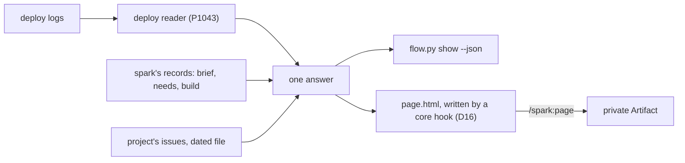

# P1038 discovery: the project page, designed

The discovery of epic P1038 #1521 ended on 2026-11-23 and is ready for design. The PO confirmed the frame, the jobs,
the direction and the remaining risk. A delegated council answered the rest, and he can change its answers. The full
record is [brief.md](brief.md). The pictures are in [diagrams.md](diagrams.md).

## What we found

- In the P934 walk, the page was wrong because nothing wrote it again for about 27.5 hours. It said "NOW (firmware)"
  while the clock was wired and deployed.
- The deploy reader never reads a file, so a project past the firmware stands at "deploy, not started" for ever. The
  clock has 27 logged deploys.
- The page got 5 clicks in 11 minutes, and none after the build. The diary logs clicks, not views.
- The PO came back to the clock through a Claude session, not through the page (QA1). A partial build result read to
  him as "the build failed" (QA5).
- The PO's own words about the page are about readability and picking several parts at once.

## What is decided

- The page shows spark's records first, and the project's open GitHub issues beside them, marked as the project's
  (D4, D19, D23).
- The page is a snapshot with a dated stamp. It names the build it draws from (D5, D17).
- A core hook writes the page again after each run that writes to a project, with no GitHub call (D16, D23).
- A deploy that nobody saw start gets no tick. The page says what its log knows (D10).
- The first page slice is readability. The graphic style comes after a walk, with system fonts (D6, D11, D25).
- The deploy reader is its own story under P793, in parallel with the page (D7).
- Sharing comes later, on P834 (D9, D20). A live page is designed now and built later (D5).
- The frontend-design skill goes in at user level at the page cards, and its install waits for the PO (D8).

## What comes next

- Spark-main merges this folder's PR, #1526, and starts the design in a new session, page-architecture. The architect
  and the full council use the Hand-off in [brief.md](brief.md).
- Filed cards: P1043 #1533 (the deploy reader), P1044 #1534 (Build on a wired board), P1045 #1535 (step numbers and
  the stamp) and P1046 #1536 (the README Bench row).
- The appetite: slice 0 and slice 1, then one walk with A1's and A9's tests, then the PO decides again (D25).

## Open for the PO

- D22 to D26 are delegated, so he confirms or changes them.
- The QA2 recount: with the goal and the must lines as two items, A2 meets its line. D19 stands anyway.
- QA6 conflicts with the diary: he said "already connected" at 11:41, before the picture existed at 11:44.
- He also decides two proposals of the PO seat: "no build before the design is confirmed", and the Flash and Deploy
  button no-go as "not now".

## Files

[brief.md](brief.md) · [diagrams.md](diagrams.md) · [jobs-and-journeys.md](jobs-and-journeys.md) ·
[story-map.md](story-map.md) · [risks-and-tests.md](risks-and-tests.md) · [items.md](items.md) ·
[verification.md](verification.md) · council/ (three lens reports, the refuter's three passes, two council rounds)
