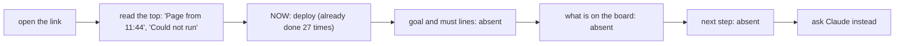
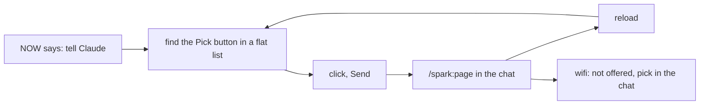
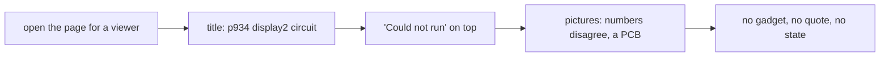
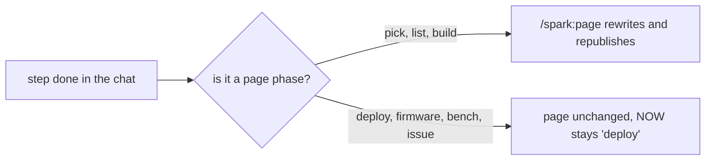

# P1038 council: the user's lens (the user's journey)

The lens: the user, on the user's journey. Opus, read-only, 2026-11-23, about 15:55 to 16:25 CET. I read the page
(page.html, without its two data URIs), the diary, the project's records, its git history and its GitHub issues. I
also read the store's deploy record, spark's flow code, the command page.md and P1011 #1470. On the published Artifact
I only read: `get_artifact`, `read_artifact` for lines 9 to 15, and `db_query` for requests and answers. I did not run
`flow.py page`: its `--help` and commands/page.md:30 say it writes page.html. I ran `flow.py show --project . --json`
instead, which its help says writes nothing. The page.html mtime (15:23:55) and the `.spark/` mtimes were unchanged
after the run. Tags: E (with a pointer), H (with its source), D (who, when), — (unknown). The PO's words are quoted
verbatim from diary.md with the line number.

Short names used below: **the diary** is `~/Development/spark-walks/p934-display2/diary.md`. **The page** is
`~/Development/spark-walks/p934-display2/page.html` (831 lines). **show** is the `flow.py show --json` output of
2026-11-23 16:0x CET. **The store record** is `$SPARK_HOME/boards/<the board MAC>.json` (the MAC is left out: spark is public).

## Findings

### Cross-cutting findings

- **USER-1** · The page cannot show the deploy as done, by design. `DeployReader.read` always returns not-started, and
  the guide's docstring says "The deploy is never done here, so there is one". So the NOW box says "When the
  breadboard is wired, plug the board into USB. Ask Claude to look at it first, then run the deploy in your terminal",
  while the store record holds 27 deploys of this project (18 `ready seen`, 9 `ready unknown`), the last at
  2026-11-23 14:09:49 CET under a standing yes. · E `scripts/spark/flow/phase_readers.py:554-560`,
  `scripts/spark/flow/guide.py:82`, page.html:13 and :482, the store record (27 deploys, counted 2026-11-23 16:1x CET)
  · supports only: the page's design today, for this one project. It does not show what the PO expects there.
- **USER-2** · The project is no longer the project the page describes. The page's title is "p934 display2 circuit".
  It shows no goal and no must line, and its idea phase says "Tell Claude your goal in the chat". The project's own
  records describe a quotes clock: the must lines are "A philosophical quote shows on the panel, with its author and
  its work, and it changes every hour." and "The time comes from the internet over Wi-Fi". The goal line in the same
  file still says "It should just display clock and react on pressing the button…". The project has 36 commits since
  2026-11-22 19:05 (quotes, Czech font, battery steps 1 to 6a, deep sleep) and its own private repository,
  with 14 issues (6 open: #4, #5, #6, #8, #13, #14) and 2 merged PRs. · E `.spark/project.json` (goal, must),
  `git log` in the project, `gh issue list` in the project, read 2026-11-23 16:1x CET, page.html:11,
  :403-406 · supports only: what the records hold. Which of the goal and the must lines is current is — (they
  disagree. The PO confirmed the must lines on 2026-11-22, commit 83d3e87).
- **USER-3** · Harm. The page offers "Build the board" to its owner today. A rebuild now moves two pins of a board
  that is already wired. P1010 is merged, and its test says "the C6 walk's control lines leave SDA and SCL free
  (EPD_RST on D11, EPD_BUSY on MISO)". The wired board has Reset on SDA (GPIO19) and Busy on SCL (GPIO20), and
  firmware/main.py does `import pins`. The build offer says it saves "the pin map your firmware imports". It does not
  say that the pins of a wired board can move. One click, Send and `/spark:page` then leave the breadboard, the pin
  map and the firmware out of step. Nothing on the page says the board is wired (page.html:487: "It does not know
  whether the board is wired or flashed"). · E page.html:450 (`data-key="build"` with `data-makes-stale`, so the
  script adds a button, page.html script `drawButtons`), spark commit a3a5ba50 message, firmware/pins.py:7-8,
  firmware/main.py:27 · H that a rebuild here gives exactly D11 and MISO (from the commit message's test, not
  run: a build writes files) · supports only: a risk on this project. It did not happen.
- **USER-4** · Harm (confusion). The page's step list and its breadboard picture now disagree in their numbers. The list
  has 12 steps: P1009 folds the 3V3_2 jumper into step 3. The inline picture still draws 13 numbered wires ("4 3V3_2
  to + rail", "5 VCC to + rail" … "13 Reset to SDA"), and breadboard.md has 13. The wiring section tells the person to
  match them: "each jumper carries a pill with its step's number". From step 4 on, the step N of the list is the pill
  N+1 of the picture. The cause: the page was rewritten at 15:23 with today's code, while the picture and the sheet
  come from the 2026-11-22 11:44 build. · E page.html:30 (the sentence), :39 ("Step 1 of 12"), :396 (picture text),
  breadboard.md:23-35, wiring-record.json (13 steps, `at` 2026-11-22T11:44:33+01:00), `git diff page.html` (13 → 12)
  · supports only: the file as it stands. Whether anyone wires from it again is —.
- **USER-5** · The page and breadboard.md disagree on the driver, a safety-relevant fact. The page's lines before power
  (read live from the record) say the IL0373/UC8151 set works. breadboard.md (written 11:44) still says "use a driver
  for the SSD1675/SSD1680 … IL0373/UC8151 … shows nothing". On the page itself, two lines of the same list contradict
  each other: "Wait for BUSY to go low before each command" and "BUSY read high all the time on the bench, so wait a
  fixed time". · E page.html:34, breadboard.md:104 and :108, diary.md:551 (row 15: "Not changed: the BUSY line in
  host_requirements") · supports only: the text as written.
- **USER-6** · The panel under the intro shows a stale answer at the top of the published page. The latest request is
  the build of 2026-11-22 11:36:57 CET, and its answer is `ran: true, status: could-not-run, line: "the board record
  names no wokwi_part_type"`. The script shows the latest request's answer under the intro, so the owner sees "?
  Could not run: the board record names no wokwi_part_type. Reload to see the new state." above the NOW box. That
  answer predates P1008's note. Reloading does not clear it: only a newer request replaces it. · E `db_query`
  requests and answers on artifact a193223a…, 2026-11-23 16:1x CET (5 requests, 5 answers), page.html script
  `shownState` and `drawPanel` (:724 onward) · H that it renders this way: from the script's logic, not seen in a
  browser · supports only: this Artifact's rows.
- **USER-7** · "Page from 11:44." gives the wrong date. `data-written` is "the newest change time of the three files"
  (needs.json, requirements.json, build.json), here 2026-11-22T11:44:33+01:00. The script prints it with `clock()`,
  hours and minutes only, as "Page from %s.". The page was written 2026-11-23 15:23 and republished at about 15:24. A
  person who comes back the next day reads "Page from 11:44" as today. · E page.html:9 (`data-written`), :732
  (`fill(this.words.page_from, clock(written))`), `flow.py page --help` (data-written), page.html mtime 15:23:55 ·
  supports only: the code path.
- **USER-8** · The status words contradict each other on one screen. The nav says "? build could not run" and the build
  phase says "the last build … could-not-run" and "simulation: could-not-run". The guide says DONE "build (no
  simulation)". The simulate phase says "No simulation files yet (sim/wokwi.toml). Ask Claude to build the board.",
  while LATER says "simulate (no Wokwi model of this board)". The last one sends the person to a rebuild that cannot
  give a simulation (and see USER-3). · E page.html:13-16, :23, :450-452, :474, show (`unchecked`:
  `phase_could_not_run`) · supports only: the page's text.
- **USER-9** · The page holds nothing on the work of the last 27 hours. It says nothing on the firmware beyond "firmware/main.py
  written 2026-11-23T14:18:49+01:00", and nothing on which image is on the board. The last deploy's image
  (sha256 2811f223…) equals sim/flash-with-firmware.bin, built 14:05:33. firmware/main.py and schedule.py changed at
  14:18:49, with the merge of PR #12. So firmware/ is perhaps newer than the board. The page says neither. It has nothing
  on the bench facts. It has nothing on the battery: the diary's 30-minute stall came from a battery the page never
  names. It has nothing on the project's open issues (#13 adds a wire, (title withheld: a private repository)). · E page.html:466,
  the store record's last deploy, `shasum` of the image, `ls -lT firmware`, diary.md:401-410, issue #13 title · H
  whether the image's files differ from firmware/ now: not unpacked · supports only: the files.
- **USER-10** · The published page stayed unchanged for about 27.5 hours of real work. It was republished at 11:46 on
  2026-11-22 (diary.md:204-205), and next at about 15:24 on 2026-11-23 (version 1795443868-e6e4). In between were 27
  deploys, 12 issues and 2 PRs. Only `/spark:page` or a build changes the page. The committed copy in
  the project's git (2026-11-22 19:05) said "NOW (firmware) … wire the breadboard (13 steps…)". · E `get_artifact`
  2026-11-23 16:1x CET, diary versions (1795343095 at 11:25 to 1795343751 at 11:36), `git log -- page.html` · H that
  the version ids count seconds (they fit the diary's times: 81 s and 178 s apart) · supports only: this one Artifact.
  Who republished at 15:24 is —.
- **USER-11** · For Claude, reading the page's state is a write. Both `flow.py page` and step 1 of /spark:page write
  page.html, and here that changes a tracked file in the project's git: `git status` shows ` M page.html`, 28 lines
  in, 26 out. The read-only `flow.py show` exists, but page.md never names it. · E commands/page.md:24-30 and :70,
  `git status --short` in the project, 2026-11-23 16:1x CET · supports only: the command text.
- **USER-12** · For Claude, the "read page.html whole" rule does not fit a 714 KB page. page.md says to read page.html
  whole before each publish and republish. With the data URIs cut, the page was still 106 KB, and my Read call was
  refused at 28,672 tokens (the limit is 25,000). · E commands/page.md:34 and :62, the Read tool's refusal in this
  run, ★C2 (607 KB of data URIs) · H that a whole read of the 714 KB file costs several hundred thousand tokens
  (not measured) · supports only: one read on this machine.
- **USER-13** · For Claude, the JSON names deploy as the next step, and nothing in it points to the deploy record.
  show answers `stands_at: "deploy"` and `guide.now.says` "plug the board into USB…", with `next: []`. A Claude that
  trusts it tells the PO to deploy again. To see better, Claude must open the store record, the project's git and its
  issues by itself, which the page contract never names. After a carry with no request waiting, page.md tells Claude
  to say "The page now shows where the project stands. Reload it." Here that sentence is false. · E show (`stands_at`,
  `guide.now`), commands/page.md:73 · supports only: the contract and this project.
- **USER-14** · For Claude, a click carries only a key. A request row is `{id, key, seen, at}`. The page cannot carry a
  question, a "this is wrong" or a free word ("The page sends only its buttons. Anything else the person wants, they
  say in the chat"). All 5 rows ever sent were picks, the parts list and the build, on 2026-11-22 between 11:25 and
  11:37 CET. None came after the build. · E commands/page.md:13, :104, `db_query` requests (5 rows) · supports only:
  this Artifact. Why no click came later is — (an account question).
- **USER-15** · The page shows developer lines and lines about other projects. Examples: "Not shown for board: 3 more
  picks; refused: “Seeed XIAO ESP32-C6” (none free, held by reaction-game). Claude can list them with parts.py
  --match.", four "Drop the … need" lines, 12 Pick offers for needs already picked (each "Uses 1 of your 1…"), the
  full build effect paragraph, a Schematic and a PCB picture (no PCB is planned) and the Marks legend between the
  pictures and the phases. The PO named these in the walk: "it's not very readable or intuitive or readable or good
  looking" (diary.md:89-90). · E page.html:397-398, :400, :410-414, :424-431, :450, P1011 #1470 body · supports only:
  an account (n = 1) and the page text.

### Job 1: come back after a break and see where the project really stands (the PO, 2026-11-23)

| step | what he does | evidence | friction or harm | today |
| --- | --- | --- | --- | --- |
| 1 | opens the Artifact link | E get_artifact: private, owner, version 1795443868-e6e4 | the title "p934 display2 circuit" names neither the quotes nor the clock | partly |
| 2 | reads the top: the intro, "Page from …", the answer panel | E page.html:9, :732. H rendering from the script, not seen | "Page from 11:44." has no date and is a day old (USER-7). "? Could not run: the board record names no wokwi_part_type" is from yesterday's build (USER-6) | not yet |
| 3 | reads the NOW box | E page.html:13 | it tells him to plug in and deploy, a step he did 27 times (USER-1) | not yet |
| 4 | looks for the goal and the must lines, and whether each is met | E page.html:403-406, .spark/project.json | not on the page. The goal and the must lines disagree in the record (USER-2). Must line 3 was met on the bench, diary.md:559 | not yet |
| 5 | looks for what is on the board now | E store record, page.html:466 | there is no deploy, no image, no verdict, only "main.py written 14:18:49" (USER-9) | not yet |
| 6 | looks for what to do next (his open issues #13 and #14) | E gh issue list | the page has nothing from the project's own to-do list | not yet |
| 7 | opens the wiring to add the wire of #13 | E page.html:30, :39, :396 | the step numbers and the pill numbers are off by one (USER-4). The new wire is not on the page | partly |
| 8 | wants the page brought up to date | E commands/page.md:70 | only by typing /spark:page. Nothing tells him the page is old | partly |

Today he asked Claude, the diary and GitHub instead: H. The diary's later entries were written by sessions. Whether he
opened the page at all after 11:50 on 2026-11-22 is — (Q-U1).

### Job 2: pick parts for the needs, several at once (the PO, 2026-11-22 11:24 to 11:36 CET)

| step | what he does | evidence | friction or harm | today |
| --- | --- | --- | --- | --- |
| 1 | reads the NOW box "Tell Claude a pick for each" | E diary.md:53, :93 | the Pick buttons sit further down the page | partly |
| 2 | clicks Pick C6 for board, Send, then types /spark:page | E diary.md:74-76 | after one pick the other buttons grey out: "I could only pick one, as I picked the board, the other pick buttons got grey, it might be good to allow the user to pick more at the same time" (diary.md:82-83). Four needs cost four round trips | works, one at a time |
| 3 | looks for the e-paper and the C6-for-button picks | E diary.md:113-117 | "take a look, it's not there" (diary.md:113). The button was the 7th item of a flat list. Offers for needs already picked stay first, and the list changes between reloads (:119-120) | partly |
| 4 | wants the board's Wi-Fi for the wifi need | E diary.md:56-57, :132-136 | not offered (P990). "yes, we want the board's wifi, or actually, does the c6 even have a wifi?" (:132). The pick goes through the chat | not yet |
| 5 | clicks Write the parts list | E diary.md:144-153 | works. The button stays after the list is written (:153) | works |
| 6 | today: the same 12 Pick offers are still shown, though all 4 needs are picked | E page.html:424-431, words `offers` (12 picks) | a click re-picks on a built and wired project and marks requirements stale | partly |

Whether he picks several at once, or wants the picks per need on one card, rests on one account
(diary.md:82-83). The discovery's "so I can finish in one sitting" is H.

### Job 3: show the project to someone (H: the CV memory, no account)

| step | what he does | evidence | friction or harm | today |
| --- | --- | --- | --- | --- |
| 1 | opens the page to show it | E get_artifact `read: owner` | the page is private, and only he sees it. Sharing it is his act on claude.ai | — (never done, as far as I know) |
| 2 | the viewer reads the title and the top | E page.html:10-17 | "p934 display2 circuit". No goal, no photo of the gadget, no quote shown. The top says "Could not run" (USER-6) | not yet |
| 3 | the viewer looks at the pictures | E page.html:54-398 | a breadboard drawing whose numbers disagree with the list, plus a schematic and a PCB of a board never ordered (USER-4, USER-15) | partly |
| 4 | he shows it from his own screen as the owner | E page.html script `start`: buttons only for the owner | the Pick and Build buttons show to him, so a misclick is one Send away from USER-3 | partly |
| 5 | the viewer reads lines about other projects | E page.html:424 ("held by reaction-game"), :428 ("held by p581-sound-joystick") | names of his other projects leak to the viewer. No Wi-Fi name and no secret is on the page (checked by reading the text) | partly |

### Job 4: Claude finishes a step, and the page shows what changed (H, from ★C1)

| step | what happens | evidence | friction or harm | today |
| --- | --- | --- | --- | --- |
| 1 | Claude deploys, fixes the firmware or closes an issue in the chat | E 27 deploys, 36 commits, 12 issues | none of these steps is a phase the page reads (USER-1, USER-9) | not yet |
| 2 | the page is written again only by /spark:page or a build | E commands/page.md:70-73, diary.md:204-205 | 27.5 hours passed with no republish (USER-10) | partly, by hand |
| 3 | when rewritten, the page mixes today's code with yesterday's build | E `git diff page.html`, wiring-record.json `at` | 12 steps against a 13-wire picture (USER-4), and the record's driver lines against breadboard.md (USER-5) | not yet |
| 4 | Claude tells the PO the page is current | E commands/page.md:73 | "The page now shows where the project stands" is false here (USER-13) | not yet |

### Claude as the reader: fill the page, read its clicks, answer them

| step | what Claude does | evidence | friction or harm | today |
| --- | --- | --- | --- | --- |
| 1 | reads the state with `flow.py page --json` | E commands/page.md:24-30 | the read writes page.html and dirties the project's git (USER-11). `flow.py show` is read-only but not named | partly |
| 2 | reads `stands_at`, `guide.now` and `next` | E show | "deploy" and `next: []`. Nothing points to the store's deploy record, the project's git or its issues, so Claude must guess or look on its own (USER-13) | not yet |
| 3 | queries `requests` and `answers` | E db_query, 5 and 5 rows | it works. The rows hold only keys, so a question from the page cannot reach Claude (USER-14) | works |
| 4 | runs `run-request` and writes the answer row | E diary.md:75-77, db answers | it works. The answer row stays on the page's top until the next request, even when stale (USER-6) | works |
| 5 | rewrites and republishes, reading page.html whole first | E commands/page.md:34, :62 | at 714 KB the whole read does not fit one Read call (USER-12) | partly |
| 6 | tells the person in one line | E commands/page.md:73, :89-91 | the fixed sentence claims the page is current (USER-13) | partly |
| 7 | writes firmware from the page's lines before power | E page.html:34 | two contradictory BUSY lines in one list (USER-5) | partly |

What Claude can supply: the deploys (the store record), the firmware state (git, image sha), the open issues (gh), the
must lines and the diary's bench facts. All of these are readable without new hardware (E: I read each in this run).
What it cannot supply: whether the board is wired as the page says (page.html:487), what the panel shows now, and
which of the goal and the must lines is the current intent (USER-2). Only the PO knows these.

What the PO can supply: the current goal, what he sees on the panel, whether he wired the wire of #13, and the
battery. He cannot supply: a pick of the board's Wi-Fi from the page (not offered, diary.md:56-57), a pin change
without a rebuild (pins.py:2, "Regenerate it; do not edit it.").

### What the page must show first, and what can wait (from the walks above, for the decider, not decided here)

- First, from the findings: the real stand from the project's own records (the last deploy, its verdict and time, and whether
  firmware/ is newer than the board). Then the goal and the must lines with their met state. Then the one next step,
  which today comes from the PO's issues, not from spark's chain. Then the lines before power that are true now,
  with no contradiction. · E USER-1, USER-2, USER-5, USER-9 · H the order is this lens's reading
- Can wait or fold away: the 12 Pick offers and the 4 drop lines on a project past its picks, the build effect
  paragraph, the PCB and the schematic, the Marks legend, and the developer lines ("parts.py --match", other projects'
  names). · E USER-15, diary.md:89-99
- Must not be one click away on a wired project: Build and re-pick, while a rebuild moves pins. · E USER-3

## What I could not check, and why

- How the published page renders for the owner (the panel's two lines, the buttons on Build and the Picks): I read the
  script, not the screen. I did not open Chrome, to stay read-only and within the time limit.
- Whether a rebuild now really gives EPD_RST D11 and EPD_BUSY MISO: a build writes files, so I did not run it.
  This rests on the P1010 commit message.
- Whether the image on the board (sha256 2811f223…) holds the same files as firmware/ now: I did not unpack the image.
- Who republished the Artifact at about 15:24 today: get_artifact gives no author.
- Whether the PO opened the page at all after 2026-11-22 11:50: there is no view log (the server cannot read view counts).
- The two SVG data URIs (the schematic and the PCB), by the brief's instruction. So I did not check them for a home
  path or other private text.
- Whether the goal line or the must lines are current: the records disagree, and only the PO knows.
- The other cards the brief lists (P828, P834, P887, P889, P992, P307, P494): titles only for P828 and P834. Bodies not
  read.

## Questions for the decider

Account questions are past tense, about his own use (the answer is E, n = 1). Each carries what it decides.

- Q-U1 · Between 11:50 on 22 November and this afternoon, did you open the project page? If not, what did you open to
  see where the clock stood (the diary, the GitHub issues, the board itself, or you asked Claude)? · decides: whether
  Job 1 is a real job for the page, and which source the page must mirror first. Kind: account.
- Q-U2 · When you came back this morning, what was the first thing you needed to know about the clock, and where did
  you find it? · decides: what the page shows first (the stand, the board, the next issue). Kind: account.
- Q-U3 · After the build on 22 November, did you click anything on the page again, or did all your work go through the
  chat? · decides: whether the buttons matter after the parts step, and whether Build and the Picks stay on a
  wired project (USER-3). Kind: account.
- Q-U4 · When you wired at 11:41 on 22 November, did you wire from the page's steps, from breadboard.md or from the
  picture, and did you match the step numbers to the numbers on the wires? · decides: how much the 12-against-13
  mismatch (USER-4) costs, and whether the list or the picture leads. Kind: account.
- Q-U5 · When the page said "Could not run" after the build, what did you take it to mean? · decides: how the top
  panel words a stale or partial answer (USER-6, USER-8). Kind: account.
- Q-U6 · Have you ever shown this page, or another spark page, to anyone? If yes, what did they look at and ask? ·
  decides: whether Job 3 is a job today, or H from the CV memory. Kind: account.
- Q-U7 · Did you treat the project's GitHub issues (#4 to #14) as your to-do list for the clock? · decides: whether
  the page's next step comes from spark's phases or from the project's own issues. Kind: account.
- Q-U8 · When you said "not very readable or intuitive" at 11:28, what did you look at first, and on which screen (the
  wide Mac window, a phone)? · decides: the layout's first screen and its width. Kind: account.
- Q-U9 · The clock's goal says "display clock and react on pressing the button", and its must lines say a quote every
  hour. Which one describes the gadget today? · decides: what the page states as the project's goal (USER-2). Kind:
  decision (a fact only he holds).
- Q-U10 · At 13:36 on 22 November the battery kept the panel powered through your USB unplug. Did you know then
  that the battery fed the panel, and where did you learn it? · decides: whether the battery and the power path belong to
  the lines before power. Kind: account.
- Q-U11 · When Claude says "The page now shows where the project stands", do you check the page? · decides: whether
  Claude's fixed sentence (USER-13) must change before any design. Kind: account.

## Searches

none
