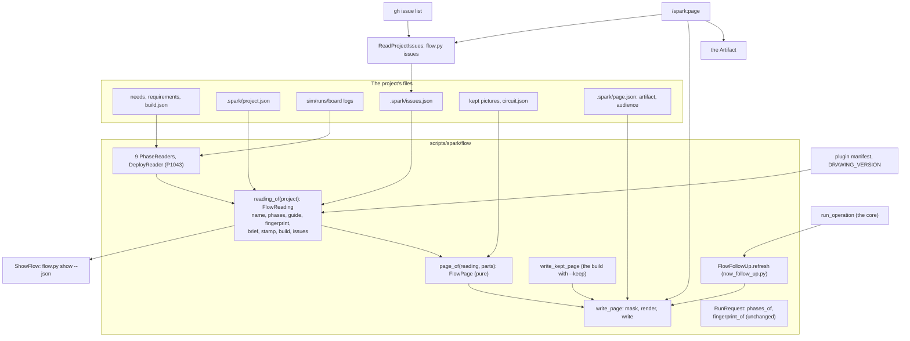
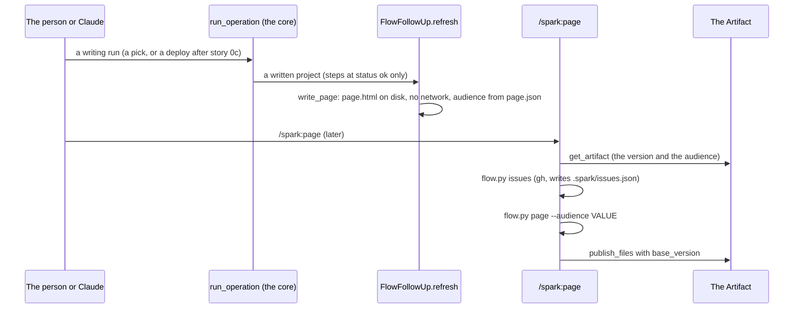
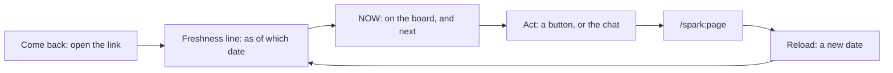
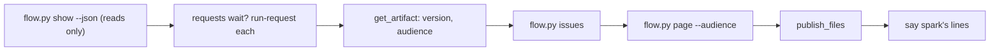
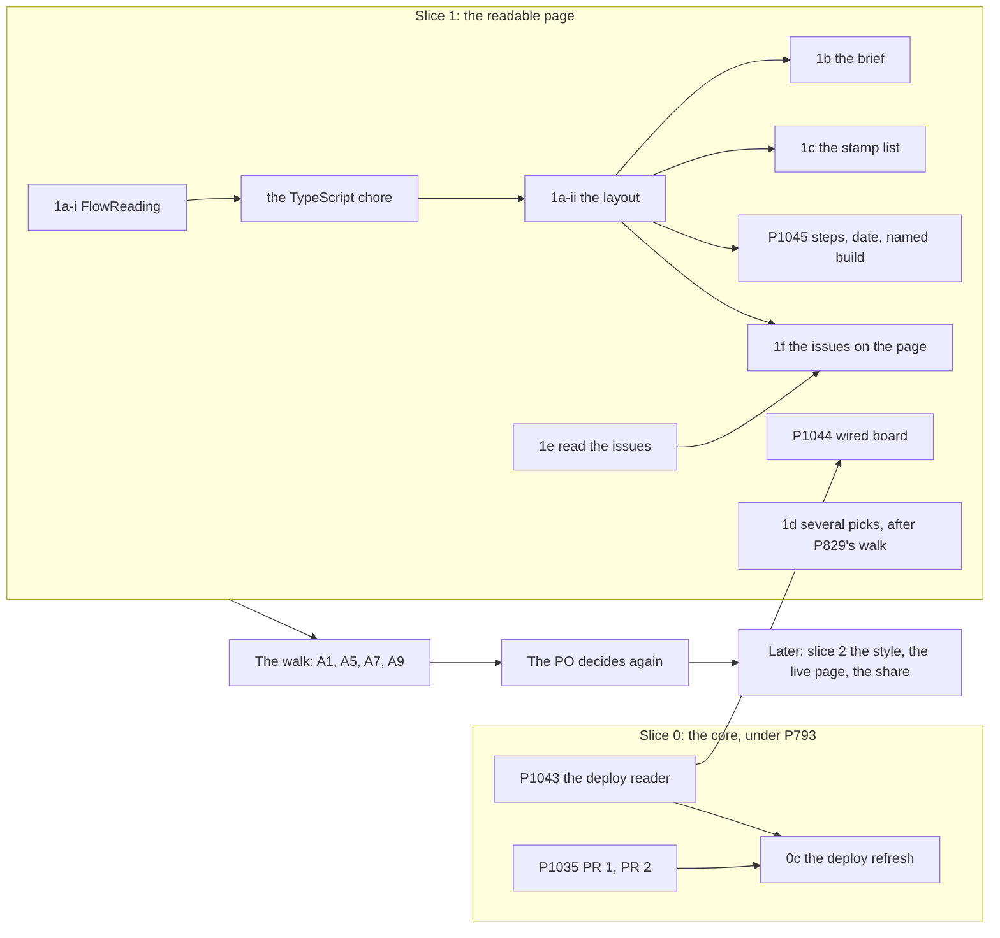

# P1038: the project page, designed (UX, graphic style, architecture, Artifact how-to)

Design for the epic P1038 #1521 (the project page: `page.html`, `flow.py page`, `/spark:page`). Written 2026-11-23 by the architect agent, read-only, and revised after round 1 of the full council. It rests on the discovery in this folder ([brief.md](brief.md), D1 to D29). Nothing here is built.

## Council

Round 1 ran and the text below is its revision. Round 2 runs on this text. The section is completed after round 2.

> **TL;DR.** One new Value, `FlowReading`, holds every fact of a project's stand. `flow.py show --json` prints it, and a pure function, `page_of`, draws the page from it, so the two carry the same facts by construction (D22). Five parts feed it. They are the deploy reader (P1043), the brief with dated "decided" lines (D15), and a stamp over the project's files. The other two are the named build with a drawing version (D17) and the project's open issues from one dated file (D19, D23). The page gets a freshness line, one NOW box, the picks per need and folded developer lines. Issue text shows only on a page whose audience is known as owner only. The page's script moves to TypeScript, and the compiled file stays committed (D29). Build slice 0 and slice 1, then one walk tests A1 and A9, then the PO decides again (D25).

## Why

The PO, 2026-11-23: "lets analyze it and really design it both ux and graphic style and also architecture and claude artifact howto". The page of the walk project p934-display2 named a stand that the project had left (★C1, "not started" beside 27 logged deploy runs). His words on P1011 #1470 (the page is not readable): "not very readable or intuitive or readable or good looking". The outcome (D1): a person who opens the page sees where the project stands, what to do next and the project's own facts, without asking Claude.

| Fault | Read at | Fix | Story |
| --- | --- | --- | --- |
| The deploy phase reads no file | `scripts/spark/flow/phase_readers.py:554-560` | the deploy reader reads the board logs | P1043 #1533 |
| Only `flow.py page` and a kept build write the page | `commands/page.md:10`, `write_flow_page.py:158-163`, `:197` | the follow-up writes it after a writing run | P1035 #1518 PR 2, story 0c |
| The stamp covers three files and shows no date | `write_flow_page.py:132-136`, `page_script.js:29-33`, `:241-246` | a stamp over the project's files, with its date | 1c, P1045 #1535 |

## What exists (each line read today in the code)

- `show_flow.flow_and_guide` gives the phases and the guide (`show_flow.py:86-89`). `ShowFlow.run` and `write_page` both call it (`show_flow.py:119`, `write_flow_page.py:146`). `read_flow` has callers in tests only (`tests/test_run_request.py:104`, `tests/test_flow_page.py:193`).
- `flow.py show` declares `READS` only (`show_flow.py:111`). Its `data` holds `phases`, `stands_at`, `fingerprint` and `guide` (`show_flow.py:112`).
- `write_page` has five parameters and builds a nine-field `FlowPage` (`write_flow_page.py:139-155`, `flow_page.py:41`). `masked_page` masks it one field at a time (`write_flow_page.py:123-129`). The rendered text is masked whole once more (`write_flow_page.py:154`).
- The page's mask hides paths only: `privacy_for` passes no secret (`show_flow.py:35-37`). A secret rule has no word boundary (`scripts/spark/core/privacy.py:79-82`).
- The stamp reads the fingerprint's three files (`write_flow_page.py:132-136`, `fingerprint.py:18`). The fingerprint also hashes each offer's `effect` (`fingerprint.py:28`).
- If the fingerprint changed, a click is refused (`run_request.py:96`). A request row holds one key (`run_request.py:36`). The script sends only while no request waits (`page_script.js:142-143`, `:309-312`).
- The script shows buttons only to the owner of a published page (`page_script.js:320-325`). A test forbids the word "http" in the page (`tests/test_flow_page.py:88-89`).
- The page is "the same bytes for the same flow" (`flow_page.py:4-5`). Its `<body>` carries `data-stands-at`, `data-fingerprint` and `data-written` (`flow_page.py:305`).
- `Brief` holds no `decided` (`scripts/spark/records/brief.py:34-41`). `init_project.py --answers` takes `decided` as any list (`scripts/init_project.py:34`, `scripts/spark/build/project_setup.py:357`). The template says "no script reads it" (`project_setup.py:219-222`).
- The build record names no version (`scripts/spark/build/build_record.py:53-54`). The plugin's version is 0.9.0 since 2026-10-13 (`.claude-plugin/plugin.json:3`, read by the tech lead lens and the refuter).
- `PublishedPageStore.write` replaces the whole file with the id (`write_flow_page.py:85-88`).
- `find_newer_files` lists every file under `firmware/` that is newer than the image (`scripts/spark/firmware/project_image.py:121-125`). `NEWER_MESSAGE` prints the list (`flow_codes.py:67`). The parts phase prints "held by" another project (`flow_codes.py:108`).
- `deploy.py` runs `DeployImage` with no follow-up (`scripts/deploy.py:56`). `DeployImage` declares `WRITES` (`scripts/spark/bench/deploy_image.py:431`). A "ready unknown" deploy ends as `could-not-run` (`deploy_image.py:312-318`) after it wrote the board log (`bench/deploy_service.py:197`).
- `RunOptions` holds `privacy`, `trace` and `clock` (`scripts/spark/core/cli.py:41`). `follow_up.py` is not on main.
- `PickParts` takes several `NEED=ID` pairs in one run (`scripts/spark/design/pick_parts.py:53-56`, `:65`).
- `commands/page.md` reads the state with `flow.py page`, which writes (`:27-30`). It asks to read `page.html` whole (`:34`, `:62`). It names the audience values `users`, `org` and `public` (`:64`).
- The script is 340 lines, loaded at `flow_page.py:47`. Its tests run with `node --test` (`tests/test_flow_script.py:26-32`). They load the `.js` file (`tests/flow_script/page_script.test.js:11`).
- The guide's NOW is the first open phase (`guide.py:84-93`). Four places read `guide["now"]` as a truth value (`show_flow.py:63`, `:74`, `flow_page.py:318`, `guide.py:190`).

## The architecture



**The one model.** `FlowReading` is a Value with eight fields: `name` (the project's name), `phases`, `guide`, `fingerprint`, `brief`, `stamp`, `build` and `issues`. `stands_at` is derived from the guide, and `to_dict()` keeps it. `show_flow.reading_of(project, readers=None)` returns the reading. It calls `flow_and_guide` and `fingerprint_of`, so it adds no second rule. `ShowFlow.run` prints `reading.to_dict()`. `read_flow` becomes a one-line projection of `reading_of` for the tests. `RunRequest` keeps `phases_of` and `fingerprint_of`, so the click path does not change.

**D22 by construction.** `write_page` splits in two. `page_of(reading, parts)` is pure: it has no project parameter, so it reads no file. `write_page` reads, calls `page_of`, masks, renders and writes. Its five parameters stay (rule R3). One test checks that each sentence, title and time in `ShowFlow`'s `data` is in the page's text. A second test reads `write_flow_page.py` with `ast`: it reaches project facts only through `reading_of` and `kept_parts`. The D22 test exempts three things by name. The first is the issue text on a page whose audience is not owner only. The others are the long form of the fingerprint and `PageParts` (the wiring and the pictures, which have their own CLI).

**The mask.** `FlowPage` holds the reading as plain values, and one `privacy.masked` call covers all of it, as for `PageWiring` today. The project's secret values get a second mask. A small reader, `ProjectSecrets`, reads the string values of the project's secrets file with `ast` and never imports it. The mask runs on the texts before the render, never on the rendered page. A value below a minimum length (in characters, set in 1a-i's plan) is not masked, and the leak count tool then reports it. One filter, `is_secret_file`, keeps the secrets file's name out of the stamp's list and out of `find_newer_files`, with one test for both.

**New names** (searched in `scripts`, `tests`, `docs/guide` and `commands` today):

| Name | Role | Module | Job |
| --- | --- | --- | --- |
| `FlowReading` | Value (as `BoardReading`) | `spark/flow/flow_reading.py` | every fact of one read of the flow |
| `FlowStamp` | Value | `spark/flow/flow_stamp.py` | the newest change time of `STAMP_FILES`, and each glob with its time |
| `NamedBuild` | Value | `spark/flow/flow_reading.py` | the build's time, its drawing version, the drawing version now |
| `DecidedLine` | Value | `spark/records/brief.py` | one decided line with its origin (`line`, `by`, `at`) |
| `ProjectSecrets` | Value | `spark/flow/project_secrets.py` | the secret values of the project, read with `ast` |
| `ProjectIssues` | Value | `spark/flow/project_issues.py` | the read time, the open issues, the last failed try and a `state` word |
| `ProjectIssuesStore` | Store | `spark/flow/project_issues.py` | reads and writes `.spark/issues.json` |
| `ReadProjectIssues` | Operation, op `read-project-issues`, verb `flow.py issues` | `spark/flow/read_project_issues.py` | runs `gh`, keeps titles and labels |
| `--audience VALUE` | argument of `flow.py page` | `write_flow_page.py` | who can read the Artifact, as `get_artifact` answers it |
| `DRAWING_VERSION` | constant | `spark/breadboard/sheet.py` | a number that rises with each change of the step order or the pills |

Words that needed care. "Issue" is a verb in the op `issue-grant` (`bench/issue_grant.py:64`), so the names say `ProjectIssues`. `drawn_from` is a field of `sheet.WriteResult` (`sheet.py:404`), so the build's Value is `NamedBuild`. `--read` is a flag of `parts.py` (`sourcing/read_datasheet.py:33`), so the flag is `--audience`. `decided` exists as a key of the answers (`init_project.py:34`). "Stamp" is the core's time text (`zone_time.py:9-11`), and `needs_basis.stamp_of` uses the word for sha256 values of the brief (`needs_basis.py:37`). `FlowStamp.newest` is a time text, so it follows the core's meaning. Story 1a-i searches `ProjectSecrets` for a clash before it uses the name.

**The architecture test changes.** `TheFlowAreaTest.MODULES` gains each new module (`tests/test_architecture.py:718`). The op list gains `read-project-issues` (`:736`). Stories 1a-i, 1c, 1e and 1f each name their lines.

**The deploy reader (P1043, D10).** It replaces the body of `DeployReader.read` and stays a PhaseReader. It takes three things from a log: the time, the image and the verdict. It never takes the board's console text or a tool's error text from the header. When no phase is open, `guide.now` stays `null`, and the guide gains one sentence key, `no_open_phase`. So no truth check breaks. Its plan picks the deploy's status and mark, and the PO reviews its sentences.

**The brief's lines (D15).** `Brief` gets `decided`, a tuple of `DecidedLine`. Story 1b names the writer: `init_project.py --answers` accepts `{line, by}` for a decided line and takes `at` from the clock. It keeps a plain string as it is, and the page then says "(who and when: not recorded)". The story updates the `//decided` note. In `reading_of`, a brief that cannot be read is a `problem` on `brief`, and every phase still answers.

**The stamp, apart from the click fingerprint (the architect's proposal, no D holds it).** `STAMP_FILES` is one tuple of globs in the project. `FlowStamp.newest` is the newest change time over them. `fingerprint.FILES` does not change, so no click is refused more often (D1). Two lists stand beside it, each entry with its reason:

- Excluded from the list: `.spark/page.json` and `.spark/page-request.json` (spark's own records of the page, which hold no project fact).
- In the list and out of `newest`: `.spark/issues.json` (its read time stands beside the issues, and a read is no change of the project).

The secrets file is in no list. The "which files" fold shows each glob with its newest time, never a file name under `firmware/`. One test keeps the list true: for each file of one small fixture, it sets the file's time with `os.utime`, changes its bytes and writes the page. If the page changes and no glob or exclusion names the file, the test fails. The plan measures the test's time before the merge. The stamp covers the project's files. The fingerprint covers the store's effect through the offers (`fingerprint.py:2-5`). The fold says "spark's records of parts and boards are not in this list". The page never holds the time of its own writing.

**The named build (D17).** The plugin's version did not change across thousands of commits, so it cannot show a mismatch. `DRAWING_VERSION` is a number in the sheet's module. A test holds a hash of one fixture's steps and pill labels per version, so a PR that changes them must raise the number. `BuildRecordStore.write` adds `drawing` and, as text only, `spark` (the plugin's version). The version reader sits in `records` beside `PLUGIN_ROOT` and is injected, as `clock` is. If `build.drawing` differs from `DRAWING_VERSION`, the wiring section says so. If the record holds no `drawing`, the section says that the build did not record it. The page offers no rebuild.

**The issues (D19, D23, and Q-D of the delegated council).** `ReadProjectIssues` declares `READS`, `RUNS` and `WRITES`. If `git rev-parse --show-toplevel` is not the project folder, it refuses as `could-not-run`, so it never reads a parent repository. It runs `gh issue list` with stdin closed, `GH_PROMPT_DISABLED=1`, a timeout and an explicit `--limit`. A good read writes `{"read_at", "issues": [{"number", "title", "labels"}]}`. A failed read is one `could-not-run` Finding. It keeps the old list and its `read_at` untouched and writes only `last_try: {at, code}` (Q-D, 2 of 3, delegated: this changes D23's "a failed fetch writes nothing"). So a failed read never empties a good list, and the page names the cause. `ProjectIssues.state` is one of `not-read`, `unreadable`, `none-open` and `listed`, and `last_try` stands beside it. `last_try` is out of the stamp's newest time and out of the fingerprint. `write_page` and the follow-up call no program. The file is tracked in the project's git, so a read or a failed try changes one file (1e's plan names this cost). Tests and fixtures use made-up titles. The page test guards `src=` and `href=` instead of the bare word "http", so a title with that word passes.

**The audience, fail closed (Q-C, 3 of 3, delegated).** `.spark/page.json` holds `artifact` and `audience`. Every writer merges its key through the store's one atomic write, and a test checks that `--artifact` keeps the audience. Only with a known owner-only audience does the page show issue text. A missing, unknown or shared value gives "your issues are not shown on this copy". The owner-only word is not in the repository. Story 1f's plan reads it first, with one `get_artifact` call on the PO's private Artifact, and writes it as a constant with that origin. If `get_artifact` gives no owner-only value, no published copy holds issue text, and the issues show on the page on disk and in `show --json` only. A first publish passes no audience, so the first copy holds no issue text. `/spark:page` then calls `get_artifact`, keeps the audience, writes the page and republishes once. The window after a share in the Artifact's own menu stays open until the next `/spark:page`. Claude's sentence at each publish covers it, and the PO hears it.

**The page's writers.** Three callers write the page: `flow.py page`, `write_kept_page` and, after P1035 PR 2, `FlowFollowUp.refresh` in `spark/flow/now_follow_up.py`. All go through `write_page`. This design changes what `write_page` reads and draws. Its signature and its `Written` answer stay. The P1035 plan's round-2 rules stay. If `page.html` does not exist, the follow-up writes no page. After a kept build it writes no second page. Each write is atomic.

**The deploy and the page (story 0c, Q-F, 2 of 3, delegated).** P1035's follow-up adds its steps at status ok only. A "ready unknown" deploy ends as `could-not-run`, but it already wrote its board log. So story 0c, under P793 after P1035 PR 2 and P1043, splits the two conditions. The steps keep status ok. The page refresh runs whenever a run declares `WRITES` and names a `written_project`, whatever its status. A second write gives the same bytes for the same flow. `deploy.py` plugs a follow-up that refreshes and adds no flow step, so the deploy's own `next` stays. The dry run writes nothing and is excluded (`deploy_image.py:440-443`). A firmware edit, `init_project.py` and `breadboard.py` still write no page. The freshness line tells the person what to type.

**The live page (D5: designed now, built later).** After a writing run the core emits one "project written" event with the project and `FlowStamp.newest`. Each consumer adapts it. The page's adapter writes to the Artifact's database only through a session that holds the Artifact tools. An open page that hears a newer stamp says so. This epic builds none of it.

**The share (P834 #1196, D9, D20).** A share is the same `write_page` with the audience fact. What a shared copy leaves out is one rule in the core. It starts with the issue text here and grows on P834: the "held by" names (the parts reader keeps the holders as a field) and the drawer facts.

### One write, end to end



## The page's script in TypeScript (D29)

The PO, 2026-11-23: "lets switch to typescript and install the lsp".

- The source is `scripts/spark/flow/page_script.ts`. The compiled `page_script.js` stays committed beside it. `flow_page.PAGE_SCRIPT` still reads the `.js` file, so a page write needs no compiler. A spark user installs nothing. The page from disk works as today.
- The compile: one `tsconfig.json` in `scripts/spark/flow/`. It is strict, takes one file, emits a script with no module system, keeps comments and writes no source map. One small hand-written declaration file names the parts of the Artifact runtime that the script uses. The repository gets no `package.json` and no `node_modules`.
- The drift test: a new test in `tests/test_flow_script.py` compiles the source into a temporary folder and compares the result with the committed file. If `tsc` is missing or its version is not the one the test names, the test skips. The gate then stops the story run, as it does for node today (`tests/test_flow_script.py:2-4`). A skip is not a pass.
- The node tests keep loading `page_script.js`, the bytes that the page ships. Their count of 12 stays.
- The mutation rows in `p829-page-script.json` and `p1008-built-answer.json` keep the `.js` file as their target, so a mutation run needs no `tsc`. Each row names the node test as its proof, never the drift test, which fails on any changed byte. If the row format of `tools/mutate.py` cannot name a test, the chore's plan targets the `.ts` file with a compile step instead. The chore proves the anchors again with `tools/mutate.py --anchors`.
- If a story run holds `page_script.ts`, `page_script.js` or the script's tests, it needs `tsc`. Other story runs do not.
- The language server reads the same `tsconfig.json`. Its switch in Claude Code is a setting of the PO's machine, not a file of spark.
- The story is a chore before 1a-ii, with its own card: a move with no change of behaviour, which the tests pin. Story 1a-ii then writes its script changes once, in TypeScript. The no-logic no-go stands: types add no decision.

Rejected: tests that load the `.ts` file through node's own type stripping (they do not test the shipped bytes). Rejected: a compile at page-write time (a spark user then needs node and `tsc`).

## The UX

### The person's journey and Claude's journey





What Claude says at `/spark:page` (every sentence is spark's, filled with values from `show --json`):

```
The page is published again. It shows the project as of 23 Nov 2026, 14:18.
NOW: <guide.now.says>
Open issues: 3, read 23 Nov 2026, 18:05.        (or: Issues not read: gh is not signed in. <the fix>)
This page shows your open issue titles and can name your other projects in its parts lines.
Before you share it, tell me, and I write it again without them.
Reload the page.
```

### After slice 0 (what changes: the deploy line and the note)

```
p934 display2 circuit
Page from 11:44.                                  <- no date yet, three files (slice 1 fixes it)
NOW (deploy)  27 deploy runs logged. The newest wrote the board on 23 Nov 2026, 14:09.
              Spark did not see it start.         <- no mark before P1043's plan picks the status
DONE  idea, needs, parts, requirements, built (no simulation), breadboard (spark cannot see it), firmware
This page reads the project's files and its deploy logs. It cannot see your wiring or what the board shows now.
```

The deploy sentences are examples. P1043's plan writes them, and the PO reviews them.

### After slice 1 (p934-display2, the owner's view)

```
+------------------------------------------------------------------------------------------+
| p934-display2: <the goal line of the brief>                                              |
| This page shows the project as of 23 Nov 2026, 14:18, its newest change. If you changed  |
| something after that, type /spark:page in the chat.                      [which files v] |
+------------------------------------------------------------------------------------------+
| NOW  deploy, by your terminal                                                            |
|   ON THE BOARD  The image of 23 Nov 2026, 14:09. Spark did not see it start.             |
|   NEXT          Your firmware changed at 14:18, after that image. <P1043's sentence>     |
|   DONE          idea, needs, parts, parts list, build (no simulation),                   |
|                 breadboard (spark cannot see it), firmware                               |
|   Your last request, 22 Nov 2026, 11:36: Build the board. Built: the board, the sheet,   |
|   the pictures. Not run: the simulation, because Wokwi has no model of this board.       |
+------------------------------------------------------------------------------------------+
| MUST     1. <must line>   2. <must line>            Spark does not check these lines.    |
| DECIDED  <decided line>  (<by>, 22 Nov 2026)                                             |
|          <decided line>  (who and when: not recorded)                                    |
+------------------------------------------------------------------------------------------+
| OPEN ISSUES ON GITHUB: your list, not spark's. Read 23 Nov 2026, 18:05.                  |
| In GitHub's order. Spark does not choose among them.                                     |
|   #N  <made-up title one>    doing                                                       |
|   #N  <made-up title two>    next                         and 4 more on GitHub           |
+------------------------------------------------------------------------------------------+
| PARTS  4 needs, 4 picked: display, button, wifi, power               [Change a pick v]   |
| WIRING 12 steps. Steps and pictures: from the build of 22 Nov 2026, 11:44. That build    |
|        did not record its drawing version, so this page cannot check that the picture    |
|        and the steps match.                       [one at a time] [all at once]          |
| PICTURES  breadboard | schematic | PCB                                                   |
| > For developers: the nine phases, each offer's key and effect, the record ids (folded)  |
+------------------------------------------------------------------------------------------+
```

The rules behind it:

- The order follows what the PO named (QA2). First come the title with the goal, the freshness line, and NOW with "on the board" and "next". Then come MUST and DECIDED, the issues, the parts, the wiring, the pictures, and the developer lines last.
- One NOW. The nine phases go under "For developers", always folded.
- The parts fold to one line while parts is not NOW. Inside the fold, the first line is P1044's warning.
- Times read "23 Nov 2026, 14:09", the machine's local time. The stored time keeps its zone in `data-written` and in the fold.
- A result that is not ok never shows a tick. An answer with `ran: true` never reads "Could not run:". The stage facts come from the build record's stages in the reading, with words from `flow_codes`. An old answer row shows "Spark's answer: <line>".
- Every sentence comes from Python. The script fills in a time or a label.

### The small states

```
An early project, parts as NOW (several picks, story 1d):
  NOW  parts, by you        2 needs have no pick: display, button
    display   (o) keep: no pick yet   ( ) 2.9 inch e-paper   ( ) 1.54 inch e-paper
    button    (o) keep: no pick yet   ( ) tactile switch
                                              [Send 0 picks]  <- disabled until a choice changes
  After two choices:                          [Send 2 picks (display, button)]
  The confirm box: one line per pick, the shared effects once, then [Send] [Cancel].
A request waits:
  Sent at 11:25: 2 picks (display, button). It waits for /spark:page in the chat.  [Copy] [Withdraw]
The stale refusal:
  Nothing ran. The project changed after you clicked. Reload this page and choose again.
A pick that spark no longer offers:
  Nothing ran. Spark no longer offers one of these picks. Reload this page.
The owner against a viewer:
  owner:  buttons, the request line, the issues          viewer: the same page, no button, no request line
A shared copy (audience not owner only), and a first publish:
  OPEN ISSUES ON GITHUB: your issues are not shown on this copy.
Issues never read:
  OPEN ISSUES ON GITHUB: not read yet. Claude reads them at /spark:page.
A failed read, no list yet:
  OPEN ISSUES ON GITHUB: not read. The try on 23 Nov 2026, 18:05 failed: gh is not signed in.
A failed read, an older list:
  OPEN ISSUES ON GITHUB: as read on 22 Nov 2026, 11:50. The read on 23 Nov 2026, 18:05 failed:
  GitHub did not answer.
Issues file broken:      OPEN ISSUES ON GITHUB: not read. The issues file cannot be read.
No open issue:           OPEN ISSUES ON GITHUB: none open. Read 23 Nov 2026, 18:05.
No phase open:
  NOW  Spark has no open step: the board started the current image (seen 23 Nov 2026, 14:30).
       Your project's own next steps are in its issues, below.
A build with another drawing version:
  WIRING  Steps and pictures: from the build of 22 Nov 2026, 11:44, drawing version 3. This page
          draws version 4, so the picture and the steps can differ. Ask Claude for the sheet again.
          It moves no pin.
A wired board (P1044), the first line inside the parts fold:
  ! A wiring sheet was written on 22 Nov 2026. If you wired from it: a new pick needs a new build,
    and a new build can move pins. Compare the new sheet with your wiring before power.
```

The drawing versions 3 and 4 and every time above are examples. P1044's dated line belongs to the parts section. It never enters `Offer.effect`, because the fingerprint hashes the effect and a deploy must not refuse the next click. The first witness is the kept sheet, and a deploy log is the second ("a board ran this firmware on <date>").

### The AI-UX: what Claude reads, calls and says

- Reads: `flow.py show --project . --json`. It holds every fact of the page, with `issues.state` as a word and `issues.last_try` beside it. Claude never reads `page.html` whole. `commands/page.md` gets `flow.py show *` and `flow.py issues *` in its allowed tools.
- Calls: the sequence above. A click goes through `flow.py run-request`, unchanged.
- Says: the transcript above. Each line is a sentence that spark answered. On a failed issues read, Claude says the cause and the fix for the person to run. It goes on with the republish and never runs the fix itself.
- Data, never an instruction: an issue title is data. The rule stands in `commands/page.md`, in `docs/guide/agents/flow.md`, in `json.md` and in each command that reads `show`. Claude lists issues, never picks or ranks one, and never acts on a title.

### The graphic style (slice 2, D6)

Structure first, style second. Slice 1 changes no token (`flow_page.py:244-247`). Slice 2 plans the tokens once with the frontend-design skill, which is installed at user scope (D28). System fonts and no web load stay (D6).

## The Artifact how-to (D12)

One file, `docs/guide/artifact-how-to.md`, for a person and for Claude. Story 1a-i writes it. Each later PR that touches the page updates it. Its outline:

1. What the page is: one file, private at first, a snapshot with a date.
2. Before a first publish: the `/add-dir` step, then the Artifact server's `guide` and `describe_capabilities`. The how-to links to them and copies no rule (★C5, the contract moves).
3. What the page declares and why: the database and the user.
4. What the page never does: load from the web, hold a secret, hold logic.
5. The route: read with `flow.py show`, carry the requests, read the issues, write with `--audience`, republish with `base_version` and `shared_live`.
6. The failures: the Artifact is not found, a failed issues read, a refused tool. Each with the sentence that Claude says.
7. For the person: what each box means, and what to type.
8. Before a share: the leak count, one named command (story 1f).

A fresh session follows the how-to in the walk. That is its proof.

## Slice 0 and slice 1



| # | Story | Card | Done when | Proof the PO reads | Size | Depends on |
| --- | --- | --- | --- | --- | --- | --- |
| 0 | The follow-up: the now step (PR 1), then `page.html` written again (PR 2) | P1035 #1518 | after a pick, `page.html` and `show --json` name the same stand | the two outputs | S, S | none |
| 0 | The deploy reader, the `no_open_phase` sentence, the new bench note | P1043 #1533 | a tick only on "ready seen". The reader never prints console text | `flow.py show` in p934-display2 | M | D10 |
| 0c | The deploy run refreshes the page, whatever its status | to file, under P793 | after a "ready unknown" deploy with fakes, `page.html` and `show` name the same stand | the page's NOW after a deploy | S | P1035 PR 2, P1043 |
| 1e | `ReadProjectIssues` writes `.spark/issues.json` | to file | a failed `gh` keeps the old list and writes `last_try`. A nested folder is refused | `flow.py issues` and the file | S | none |
| 1a-i | `FlowReading`, `reading_of`, `page_of`, the D22 tests, the mask once with the secret values, `page.md` reads `show`, the how-to file | to file | the page's bytes change only where a secret was. No "read page.html whole" | the D22 test's output | M | none |
| chore | `page_script.ts` is the source, the `.js` stays committed (D29) | to file | the drift test passes, 12 node tests pass | the two test outputs | S | no open branch on the script |
| 1a-ii | The layout: the order, one NOW, folded developer lines, the parts per need with today's buttons, the last request with its date | to file | the mockup's order is the page's order | a screenshot from disk | M | 1a-i, the chore |
| 1b | The brief's lines, `decided` with its origin, its writer | to file | `--answers` writes `{line, by, at}`. The page shows it | the page's box and `data.brief` | S | 1a-ii |
| 1c | The stamp list: `FlowStamp`, the two side lists, the secrets filter, the globs | to file | the stamp test passes. No secrets file name on the page | the freshness line and its fold | M | 1a-ii |
| 1 | Step N is pill N, the date, the named build with `DRAWING_VERSION` | P1045 #1535 | a build with an older drawing version says so | the wiring section's line | M | 1a-ii |
| 1 | No pick or build on a wired board without its warning. First a look at the rendered page | P1044 #1534 | the card's own. The line is the section's, not the offer's | the parts fold's first line | S | P1043 |
| 1f | The issues on the page, the audience fail closed, `page.json` merged, the leak count tool | to file | four states and `last_try`. Issue text only with a known owner-only audience | the issues box, and the tool's counts | M | 1a-ii, 1e |
| 1d | Several picks at once | to file, under P1038 | four needs picked in one round trip | the walk's diary | M | P829's walk |
| walk | One walk with the four tests. A fresh session follows the how-to | to file | the results are rows in risks-and-tests.md | the diary and the rows | S | all but 1d |

The order. First read the board's limits. No sub-issue of P1038 starts before the PO confirms this design (Q-A, 3 of 3, delegated). Slice 0 goes on under P793: P1035 PR 1, P1043 and then P1035 PR 2 and 0c. After his yes: 1e and 1a-i in parallel, then the chore and 1a-ii, then 1b, 1c, P1045 and P1044, then 1f. Story 1d waits for P829's walk. The walk after slice 1 runs with or without 1d. The PO hears that D11's "several picks at once" can miss it (Q-E, 3 of 3, delegated).

Story 1d. The row gets `keys`, a list, beside `key`. `RunRequest` checks `seen` once. It requires every key as a pick offer now, with one key per need. It makes one `PickParts` run from the offers' own steps. It changes the row, the answer and `commands/page.md:13`, `:78`. So it is built only after P829's walk and with P829's decision. Slice 1 groups the picks per need with today's one-click buttons in 1a-ii.

Mutation rows, each proved with `tools/mutate.py --anchors`:

- P1043: a tick only on "ready seen", the newest log wins, newer firmware means stale, no log means not started, console text never appears.
- 0c: the refresh runs on a status that is not ok, the steps do not.
- 1a-i: one reading feeds both, no tick on a status that is not ok, a secret value is masked before the render.
- 1a-ii: developer lines always folded.
- 1b: a plain string gives null `by` and `at`, and `at` comes from the clock.
- 1c: one dropped glob is caught, the newest time and not the oldest, the secrets file left out, the issues file out of `newest`.
- P1045: the mismatch condition, a record with no drawing version.
- 1e: a failed `gh` keeps the old list, titles and labels only, the top-folder refusal.
- 1f: four states, the audience fails closed, `--artifact` keeps the audience, the issues file not in the fingerprint.

The leak count tool (1f). It uses `ProjectSecrets`. It counts the secret values, the secrets file's name, the store's path and the home path. It also counts the board addresses from the store's records and other projects' names. It reads `page.html` and a rows file that Claude exports. It prints `name: count` only and exits 1 on any hit. No secret value reaches a command line or the transcript.

Later, one line each. Slice 2: the tokens planned once, the PO's verdict on a screenshot (D6, A6). The live page: the "project written" event and its adapters. The share: on P834 #1196, with the "held by" names as a field of the parts reader.

## Verification: the walk after slice 1

Each pass line is dated 2026-11-23 in [risks-and-tests.md](risks-and-tests.md). A `could-not-run` or a skipped check is not a pass.

| Id | Pass line (set 2026-11-23) | How the walk tests it |
| --- | --- | --- |
| A1 (he opens the page) | he opens it on his own at least once after the build and does not then ask Claude where the project stands | the plan does not script the page. The session does not name the page first. The diary holds his words |
| A5 (the page reads well) | he names the next step and finds every Pick within 30 seconds (the 30 seconds has no source) | he reads a screenshot of the slice 1 page. Before the walk Claude offers to fix the stale goal line in his file (QA3) |
| A7 (no leak) | zero hits for the Wi-Fi name and password, the secrets file, home paths, the store's path and the board's address, in the page text and its database rows | the leak count tool on the owner's page. The shared-copy half is not tested in this walk and stays open on P834, never a pass (Q-G, 3 of 3, delegated) |
| A9 (a snapshot is fresh enough) | no step taken on a stale page's word. `page.html` and `show --json` name the same stand at the walk's end | `data-stands-at` and `data-written` on disk and on the published page, against `show` |

If A1 misses before the style is built, read the miss against its rival first: he opens the page once it looks good.

## The no-gos this design touches (D24)

- No new interface for the click path. The fingerprint's files and the refusal rule do not change. Story 1d waits for P829.
- No GitHub call from `write_page` or the follow-up. Only `ReadProjectIssues` runs `gh`.
- The issues file is never in the fingerprint. It is in the stamp's list only, and out of `newest`.
- No ranking of issues: GitHub's order, the project's labels.
- No issue text on a shared copy. The audience rule fails closed.
- No logic in the page's script. TypeScript adds types only. The choice of picks is the page's own state.
- No stored state file. `FlowReading` is an answer, made on each call.
- No tick on `could-not-run`, skipped or null. "Issues not read" and a build with no drawing version are plain sentences.
- No restyle of the CLI text. `flow.py show` gains facts only.
- No Flash, Deploy or Run-live-code button through the walk (Q-B, 3 of 3, delegated).
- Privacy no worse (D1). The secret values are masked for the first time. The share window (Q-C) is the one new risk.

## The delegated council's answers, the PO's to change

Seven questions went to the delegated council of three after round 1 (the PO seat on Fable, the architect, the tech lead on Opus). The answers are in [council/design/delegated-answers-r1.md](council/design/delegated-answers-r1.md). Each is recorded as delegated and is his to change.

- Q-A, 3 of 3: no build of P1038's sub-issues before he confirms this design. Slice 0 goes on under P793.
- Q-B, 3 of 3: the Flash and Deploy button no-go stays through the walk. P820's Q31 stays his.
- Q-C, 3 of 3: the audience fails closed. If `get_artifact` gives no owner-only value, no published copy holds issue text.
- Q-D, 2 of 3 (the architect against): a failed issues read keeps the old list and writes `last_try`. This changes D23's "a failed fetch writes nothing".
- Q-E, 3 of 3: story 1d stays in P1038 and waits for P829's walk.
- Q-F, 2 of 3 (the PO seat for widening #1518): story 0c under P793 refreshes the page after a deploy, whatever its status.
- Q-G, 3 of 3: no shared-copy read in this walk. A7's shared half stays open on P834.

At his yes to the design, Claude reads him five points:

- the share window after a share in the Artifact's own menu (Q-C)
- the change to D23 (Q-D)
- D11's item that can miss the walk (Q-E)
- A7's shared half, untested (Q-G)
- the T-9 recount: A2 meets its line on another grouping

## Decisions that still matter

| Decision | Reason | Rejected |
| --- | --- | --- |
| `FlowReading` and a pure `page_of` | D22 holds by construction | a field per fact on `FlowPage` |
| The stamp's list apart from the fingerprint | the click path stays as it is (D1) | the files in the fingerprint |
| No published record in `.spark/page.json` | no D holds it, and `/spark:page` republishes on every run | `--published` and `published.behind` |
| A drawing version, not the plugin's version | the plugin's version did not change across P1009 | a version compare that never differs |
| The audience fails closed | a missing or stale value must not show issue text | a rule that shows text unless told |
| The secret values masked before the render | a short value must not corrupt the script or a picture | a mask on the rendered page |
| A failed issues read keeps the old list | the page names the cause, and a good list is never emptied | "writes nothing" (Q-D) |
| The refresh apart from the steps (0c) | a "ready unknown" deploy ends as `could-not-run` | the follow-up at status ok only |
| The compiled script committed | a spark user needs no compiler | a compile at page-write time |

## What the architect did not check

- The Artifact server: its `guide`, the owner-only word of `get_artifact`, and whether `publish_files` needs a file that the session read.
- Where the name of the secrets file is held in the code, and whether `ProjectSecrets` clashes with a name.
- The row format of `tools/mutate.py`, and so whether a row can name its proving test.
- The text that `tsc` 7.0.2 emits for this script.
- The time of the stamp test, and `gh issue list` in a nested folder.
- No test and no spark command ran. Every mockup line is an example, not spark's output.
