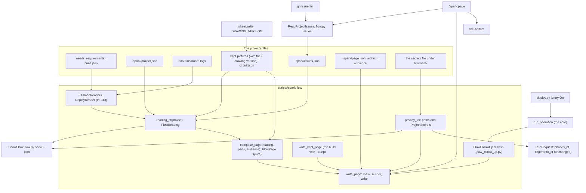
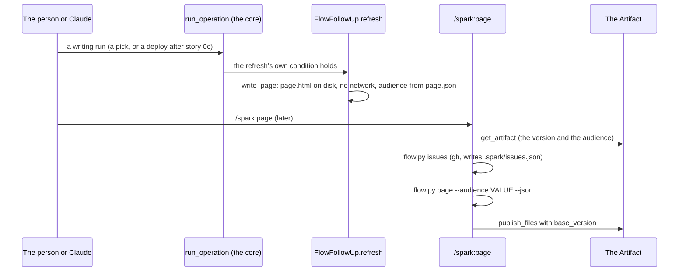
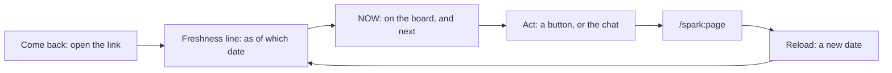
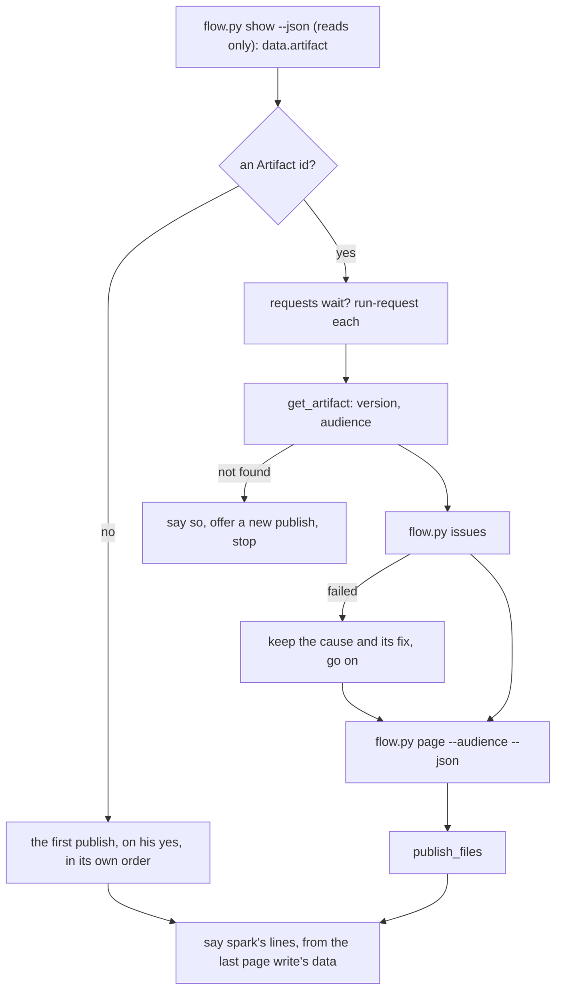
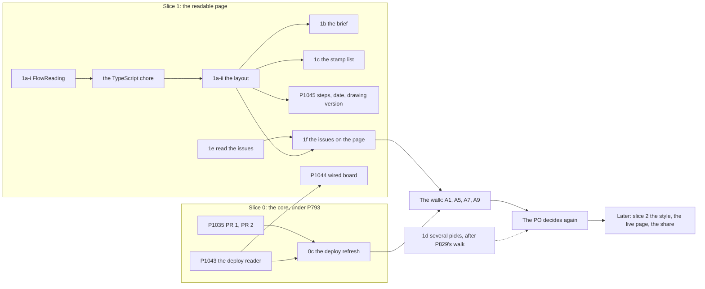

# P1038: the project page, designed (UX, graphic style, architecture, Artifact how-to)

Design for the epic P1038 #1521 (the project page: `page.html`, `flow.py page`, `/spark:page`). The architect agent wrote it on 2026-11-23, read-only, and revised it after each council round. It rests on the discovery in this folder ([brief.md](brief.md), D1 to D30). Nothing here is built. The full council's reports are in [council/design/](council/design/).

## Council

The full council ran two rounds on this design, as the PO's rules ask for a design.

- Round 1, on the architect's draft (5e99b392). Three lenses on Opus: architecture, UX and AI-UX, and tech lead with scope and privacy. The refuter ran last, launched on the best model (Fable). The revision cut the published record and kept the secrets file out of every list. It masked the project's secret values before the render and replaced the plugin version with a drawing version. It made the audience rule fail closed, split story 1a, added story 0c and the TypeScript route (D29).
- The delegated council after round 1. The PO seat (Fable), the architect and the tech lead (Opus) answered Q-A to Q-G alone. The answers are delegated and the PO's to change ([delegated-answers-r1.md](council/design/delegated-answers-r1.md)).
- Round 2, on the revision (31107da7, with main merged). Two lenses on Opus: architecture with TypeScript, and UX with AI-UX and the PO-assistant view. The refuter ran last, launched on the best model (Fable). Verdict: ready for the PO's confirmation after fixes, with no third round. The fixes: the secrets filter on shown names only, and the TypeScript drift check as a gate step. Also D10's exact words with a cause map, the steps drawn now, and the audience of the page on disk. Also the publish sentence, a paragraph on the D30 mock and the refresh's own condition in P1035 PR 2. Also one secret mask for `show`, `run-request` and the page. Also twelve points for his yes, and the walk order.
- A last read, not a round: the refuter read the diff of the last revision (31107da7 to bd9428b3). All eleven fixes landed. It found two one-sentence must-fixes: the Council line itself, and the source of Claude's closing lines in `Written`. Both are fixed here, with its smaller points R-3 to R-9 ([r2-refuter.md](council/design/r2-refuter.md), section "The last read").

> **TL;DR.** One new Value, `FlowReading`, holds every fact of a project's stand. `flow.py show --json` prints it, and a pure function, `compose_page`, draws the page from it, so the two carry the same facts by construction (D22). Five parts feed it. They are the deploy reader (P1043), the brief with dated "decided" lines (D15), and a stamp over the project's files. The other two are the picture's drawing version (D17) and the project's open issues from one dated file (D19, D23). The page gets a freshness line, one NOW box, the picks per need and folded sections. Issue text shows only on a page whose audience is known as owner only. The page's script moves to TypeScript, and the compiled file stays committed (D29). Build slice 0 and slice 1, then one walk tests A1 and A9, then the PO decides again (D25).

## Why

The PO, 2026-11-23: "lets analyze it and really design it both ux and graphic style and also architecture and claude artifact howto". The page of the walk project p934-display2 named a stand that the project had left (★C1, "not started" beside 27 logged deploy runs). His words on P1011 #1470 (the page is not readable): "not very readable or intuitive or readable or good looking". The outcome (D1): a person who opens the page sees where the project stands, what to do next and the project's own facts, without asking Claude.

| Fault | Read at | Fix | Story |
| --- | --- | --- | --- |
| The deploy phase reads no file | `scripts/spark/flow/phase_readers.py:563-569` | the deploy reader reads the board logs | P1043 #1533 |
| Only `flow.py page` and a kept build write the page | `commands/page.md:10`, `write_flow_page.py:158-163`, `:197` | the follow-up writes it after a writing run | P1035 #1518 PR 2, story 0c |
| The stamp covers three files and shows no date | `write_flow_page.py:132-136`, `page_script.js:29-33`, `:241-246` | a stamp over the project's files, with its date | 1c, P1045 #1535 |

## What exists (each line read today in the code)

- `show_flow.flow_and_guide` gives the phases and the guide (`show_flow.py:86-89`). `ShowFlow.run` and `write_page` both call it (`show_flow.py:119`, `write_flow_page.py:146`). `read_flow` has callers in tests only (`tests/test_run_request.py:104`, `tests/test_flow_page.py:193`).
- `flow.py show` declares `READS` only (`show_flow.py:111`). Its `data` holds `phases`, `stands_at`, `fingerprint` and `guide` (`show_flow.py:112`). It does not answer the Artifact's id. Only `flow.py page`, which writes, does (`write_flow_page.py:182`).
- `write_page` has five parameters and builds a nine-field `FlowPage` (`write_flow_page.py:139-155`, `flow_page.py:41`). `masked_page` masks it one field at a time (`write_flow_page.py:123-129`). The rendered text is masked whole once more (`write_flow_page.py:154`).
- One `privacy_for` serves `show`, `run-request` and the page (`show_flow.py:35-37`, `run_request.py:147`, `write_flow_page.py:183`). It passes no secret. A secret rule has no word boundary (`scripts/spark/core/privacy.py:79-82`).
- Spark's code names no secrets file of a project. `AccountSecrets` is an Adapter with `MIN_SECRET = 8` for account tokens (`scripts/spark/bench/bench_privacy.py:27-30`).
- The stamp reads the fingerprint's three files (`write_flow_page.py:132-136`, `fingerprint.py:18`). The fingerprint also hashes each offer's `effect` (`fingerprint.py:28`).
- If the fingerprint changed, a click is refused (`run_request.py:96`). A request row holds one key (`run_request.py:36`). The script sends only while no request waits (`page_script.js:142-143`, `:309-312`).
- The script shows buttons only to the owner of a published page (`page_script.js:320-325`). A test forbids the word "http" in the page (`tests/test_flow_page.py:88-89`).
- The page is "the same bytes for the same flow" (`flow_page.py:4-5`). Its `<body>` carries `data-stands-at`, `data-fingerprint` and `data-written` (`flow_page.py:305`).
- The steps on the page are drawn at each page write (`kept_wiring`, `write_flow_page.py:104-115`). Only the pictures are kept files (`write_flow_page.py:91-101`).
- `Brief` holds no `decided` (`scripts/spark/records/brief.py:34-41`). `init_project.py --answers` takes `decided` as any list (`scripts/init_project.py:34`, `scripts/spark/build/project_setup.py:357`).
- The build record names no version (`scripts/spark/build/build_record.py:53-54`). The plugin's version is 0.9.0 since 2026-10-13 (read by the tech lead lens and the refuter).
- `PublishedPageStore.write` replaces the whole file with the id (`write_flow_page.py:85-88`). A new Artifact "starts private to the person" (`commands/page.md:36`).
- `find_newer_files` lists every file under `firmware/` that is newer than the image (`scripts/spark/firmware/project_image.py:121-125`). The guide decides "the image is older" from it (`guide.py:69`). One line prints its names (`phase_readers.py:559`, `flow_codes.py:67`). The parts phase prints "held by" another project (`phase_readers.py:241`, `flow_codes.py:108`).
- A board log holds the moment, the port, the image, the simulation, a facts line, `verdict: sentence` and the console text (`scripts/spark/bench/deploy_service.py:55-62`). It holds no cause code.
- `deploy.py` runs `DeployImage` with no follow-up (`scripts/deploy.py:56`). `DeployImage` declares `WRITES` (`scripts/spark/bench/deploy_image.py:431`).
- `RunOptions` holds `privacy`, `trace` and `clock` (`scripts/spark/core/cli.py:41`). `follow_up.py` is not on main.
- `commands/page.md` reads the state with `flow.py page`, which writes (`:27-30`). It asks to read `page.html` whole (`:34`, `:62`). It names the audience values `users`, `org` and `public` (`:64`).
- The script is 340 lines, loaded at `flow_page.py:47`. Its tests run with `node --test` and load the `.js` file (`tests/test_flow_script.py:26-32`, `tests/flow_script/page_script.test.js:11`). The gate checks node in `node_refusal` (`tools/check_commit.py:61-68`, `:287`). Three mutation tables hold 18 rows on the script (`p829-page-script.json` 15, `p1008-built-answer.json` 1, `p993-blockers.json` 2).
- The guide's NOW is the first open phase (`guide.py:84-93`). Four places read `guide["now"]` as a truth value (`show_flow.py:63`, `:74`, `flow_page.py:318`, `guide.py:190`).

## The architecture



**The one model.** `FlowReading` is a Value with eight fields: `name` (the project's name), `phases`, `guide`, `fingerprint`, `brief`, `stamp`, `build` and `issues`. `stands_at` is derived from the guide, and `to_dict()` keeps it. P1043's plan adds the deploy's facts to `show`'s data, and the reading takes them over. `show_flow.reading_of(project, readers=None)` returns the reading. It calls `flow_and_guide` and `fingerprint_of`, so it adds no second rule. `ShowFlow.run` prints `reading.to_dict()`. `read_flow` becomes a one-line projection of `reading_of` for the tests. `RunRequest` keeps `phases_of` and `fingerprint_of`, so the click path does not change.

**D22 by construction.** `write_page` splits in two. `compose_page(reading, parts, audience)` is pure: it has no project parameter, so it reads no file. `write_page` reads, composes, masks, renders and writes. Its five parameters stay (rule R3). One test checks that each sentence, title and time in `ShowFlow`'s `data` is in the page's text. A second test reads `write_flow_page.py` with `ast`. That module reaches project facts only through `reading_of` and `kept_parts`. The test allows by name `privacy_for` and the two stores. The D22 test exempts four things by name:

- the whole issues section, its `last_try` sentence too, on a page whose audience is not owner only
- the long form of the fingerprint
- `PageParts` (the steps and the pictures, which have their own CLI)
- `data.artifact`, which `show` answers so that Claude's read-only route knows the Artifact's id

**The mask.** `FlowPage` holds the reading as plain values, and one mask call covers all of it, as for `PageWiring` today. `privacy_for` gains the project's secret values, so `show`, `run-request` and the page mask them alike. `write_page` uses two Privacy values. The first holds the paths and the secrets, and it masks the texts before the render. The second holds the paths only, and it masks the rendered page. So a short secret never corrupts the script or a picture. A test uses a short secret that also occurs in an SVG.

**The project's secrets.** `ProjectSecrets` is an Adapter in the firmware area, beside the filter `is_secret_file`. It reads the string values of the secrets file with `ast` and never imports the file. `MIN_SECRET` moves into `core.privacy`, for `AccountSecrets` and `ProjectSecrets` alike. Story 1a-i's plan states the rule that names the file. It weighs two rules:

- A name glob such as `firmware/*secret*.py` (recommended). It runs no program, so `write_page` stays free of `git`.
- "A file under `firmware/` that git ignores". It needs a `git` call or a parser of ignore files.

The firmware guide documents the rule. If a project names its file otherwise, spark knows no secret of it. The page then masks nothing, and the leak count tool reports its secret rows as `could-not-run`, never as zero. The tool also lists each ignored file under `firmware/` that the rule does not match.

**The filter touches shown names only.** `find_newer_files` stays whole, because the guide and the deploy decide from it. The filter runs in two places: the line that prints the newer files (`phase_readers.py:559`) and the stamp's fold. A third place prints the names, the deploy's note (`bench/image_evidence.py:348-350`), and it is not on the page. Story 1c's plan decides whether it joins the filter. The line then reads, for example, "main.py and 1 file that holds secrets". One test covers both places.

**New names** (searched in `scripts`, `tests`, `tools`, `commands` and `docs/guide` today):

| Name | Role | Module | Job |
| --- | --- | --- | --- |
| `FlowReading` | Value (as `BoardReading`) | `spark/flow/flow_reading.py` | every fact of one read of the flow |
| `reading_of` | function | `spark/flow/show_flow.py` | reads the flow once and returns the `FlowReading` |
| `compose_page` | function | `spark/flow/write_flow_page.py` | the `FlowPage` of a reading, its parts and the audience |
| `FlowStamp` | Value | `spark/flow/flow_stamp.py` | the newest change time of `STAMP_FILES`, and each glob with its time |
| `NamedBuild` | Value | `spark/flow/flow_reading.py` | the build's time, the picture's drawing version, the version now |
| `DecidedLine` | Value | `spark/records/brief.py` | one decided line with its origin (`line`, `by`, `at`) |
| `ProjectSecrets`, `is_secret_file` | Adapter, function | `spark/firmware/project_secrets.py` | the secret values, and the rule that names the file |
| `ProjectIssues` | Value | `spark/flow/project_issues.py` | the read time, the open issues, the last failed try and a `readout` word |
| `ProjectIssuesStore` | Store | `spark/flow/project_issues.py` | reads and writes `.spark/issues.json` |
| `ReadProjectIssues` | Operation, op `read-project-issues`, verb `flow.py issues` | `spark/flow/read_project_issues.py` | runs `gh`, keeps titles and labels |
| `--audience VALUE` | argument of `flow.py page` | `write_flow_page.py` | who can read the Artifact, as `get_artifact` answers it |
| `DRAWING_VERSION` | constant | `spark/breadboard/sheet.py` | a number that rises with each change of the step order or the pills |

Words that needed care. "Issue" is a verb in the op `issue-grant` (`bench/issue_grant.py:64`), so the names say `ProjectIssues`. `drawn_from` is a field of `sheet.WriteResult` (`sheet.py:404`), so the Value is `NamedBuild`. `--read` is a flag of `parts.py`, so the flag is `--audience`. `page_of` exists twice (`VendorFinder.page_of` and a helper in `tests/test_flow_page.py:128`), so the function is `compose_page`. "State" means the page's state in `flow_codes`, `drawer.listing()` exists, and `holds` is a method of `needs` (`design/needs.py:473`) and of `pin_assigner.py:198`. So the issues' word is `readout`, which has no hit in `scripts`, `tests`, `tools`, `commands` or `docs/guide`. "Stamp" is the core's time text (`zone_time.py:9-11`), and `needs_basis.stamp_of` uses the word for sha256 values. `FlowStamp.newest` is a time text, so it follows the core's meaning.

**The architecture test changes.** `TheFlowAreaTest.MODULES` gains each new module (`tests/test_architecture.py:718`). The op list gains `read-project-issues` (`:736`). Stories 1a-i, 1c, 1e and 1f each name their lines.

**The deploy reader (P1043, D10).** It replaces the body of `DeployReader.read` and stays a PhaseReader. It takes four things from a log: the time, the image, the verdict and the cause below. It never takes the port, the facts line, the console text or a tool's error text. D10's words stand exactly: a run with no read-back shows "written by the flasher, nothing read back, start not seen", with its cause and no tick. The cause has one source. The reader takes the start of spark's own sentence, before its first colon. A table in `flow_codes` maps that start to a code with its words. If the start is not in the table, the page says "cause not recorded". From P1043 on, `BoardLog` writes a reason line with the code. Two more rules go into P1043's plan, for the PO's review:

- Who acts first if the firmware is newer than the deployed image. Today's mapping serves the simulate phase only (`flow_codes.py:289`).
- The deploy's facts as fields in `show --json`: `at`, `image`, `verdict` and `cause`. Claude then answers "is the new firmware on the board" from fields.

When no phase is open, `guide.now` stays `null`, and the guide gains one sentence key, `no_open_phase`. So no truth check breaks.

**The brief's lines (D15).** `Brief` gets `decided`, a tuple of `DecidedLine`. Story 1b names the writer: `init_project.py --answers` accepts `{line, by}` for a decided line and takes `at` from the clock. It keeps a plain string as it is, and the page then says "(who and when: not recorded)". In `reading_of`, a brief that cannot be read is a `problem` on `brief`, and every phase still answers. `init_project.py` is off the core, so it writes no page (see D16's limit below).

**The stamp, apart from the click fingerprint (the architect's proposal, no D holds it).** `STAMP_FILES` is one tuple of globs in the project. `FlowStamp.newest` is the newest change time over them. `fingerprint.FILES` does not change, so no click is refused more often (D1). Two lists stand beside it, each entry with its reason:

- Excluded from the list: `.spark/page.json` and `.spark/page-request.json` (spark's own records of the page, which hold no project fact).
- In the list and out of `newest`: `.spark/issues.json` (its read time stands beside the issues, and a read is no change of the project).

The secrets file's time counts through its folder's glob. Its name never shows: the "which files" fold shows each glob with its newest time. One test keeps the list true. For each file of one small fixture, it sets the file's time with `os.utime`, changes its bytes and writes the page. If the page changes and no glob or exclusion names the file, the test fails. The plan measures the test's time before the merge. The stamp covers the project's files. The fingerprint covers the store's effect through the offers (`fingerprint.py:2-5`). The fold says "spark's records of parts and boards are not in this list". The page never holds the time of its own writing.

**The named build and the drawing version (D17).** The steps on the page are drawn now. Only the pictures come from the build or from the sheet's command. So the picture carries its own version. Each time `sheet.write` writes a drawing, it records `DRAWING_VERSION` and the time of writing in it. A test holds a hash of one fixture's steps and pill labels per version, so a PR that changes them must raise the number. `NamedBuild` holds the build's time (the record's `at`), the picture's version and the version now. If the two versions differ, the wiring section says so. If the picture holds no version, the section says that the picture is older than this check. The warning names the act that clears it: write the sheet again, then `/spark:page`. That act moves no pin. The build record gains no key, and the plugin's version is not used. The page offers no rebuild.

**The issues (D19, D23, and Q-D of the delegated council).** `ReadProjectIssues` declares `READS`, `RUNS` and `WRITES`. If `git rev-parse --show-toplevel` is not the project folder, it refuses as `could-not-run`, so it never reads a parent repository. It runs `gh issue list` with stdin closed, `GH_PROMPT_DISABLED=1`, a timeout and an explicit `--limit`. A good read writes `{"read_at", "issues": [{"number", "title", "labels"}]}`. A failed read is one `could-not-run` Finding. It keeps the old list and its `read_at` untouched and writes only `last_try: {at, code}` (Q-D, 2 of 3, delegated: this changes D23's "a failed fetch writes nothing"). `ProjectIssues.readout` is one of `not-read`, `unreadable`, `none-open` and `listed`, and `last_try` stands beside it. One table in `flow_codes` maps each failure code to its words, with one test. `last_try` is out of the stamp's newest time and out of the fingerprint. `write_page` and the follow-up call no program. The file is tracked in the project's git, so a read or a failed try changes one file there. Tests and fixtures use made-up titles. The page test guards `src=` and `href=` instead of the bare word "http".

**The audience, fail closed (Q-C, 3 of 3, delegated).** `.spark/page.json` holds `artifact` and `audience`. Every writer merges its key through the store's one atomic write, and a test checks that `--artifact` keeps the audience. Every page write, the refresh's too, takes the audience from that file. The rule has three cases:

- No Artifact id: the page was never published, so only its owner has it. The page shows the issues. This is the architect's pick, because a first publish starts private.
- An id and a known owner-only audience: the page shows the issues.
- An id and a missing, unknown or shared audience: the page shows no issue text, on disk too. The file on disk is the file that `publish_files` sends.

The owner-only word is not in the repository. Story 1f's plan reads it first, with one `get_artifact` call on the PO's private Artifact, and writes it as a constant with that origin. The plan also asks `describe_capabilities` whether a database path can be owner-read, which is another route to close the share window. The fallback: if `get_artifact` gives no owner-only word, no page of a published project shows issue text. The issues then stand in `show --json`, and Claude lists them. That case leaves D19 unmet on the page, and it is on the PO's list. The window after a share in the Artifact's own menu stays open until the next `/spark:page`.

**The first publish.** Its order in `commands/page.md` and the how-to: `publish_files`, `flow.py page --artifact`, `declare_capabilities`, `get_artifact`, `flow.py page --audience`, a republish, and only then the link.

**The page's writers.** Three callers write the page: `flow.py page`, `write_kept_page` and, after P1035 PR 2, `FlowFollowUp.refresh` in `spark/flow/now_follow_up.py`. All go through `write_page`. Its signature stays. Its `Written` answer and the op's data gain the reading (`FlowReading.to_dict()`), so Claude's closing lines at `/spark:page` have a source. `docs/guide/agents/json.md` and the contract test change with them. The P1035 plan's round-2 rules stay. If `page.html` does not exist, the follow-up writes no page. After a kept build it writes no second page. Each write is atomic.

**The deploy and the page (story 0c, Q-F, 2 of 3, delegated).** Story 0c stays its own story under P793. P1035 PR 2 gives the refresh its own condition function, apart from the steps' condition. In PR 2 the function is true at status ok, with `WRITES` declared and a written project. Story 0c widens it to every status, for a run that wrote to the project. A result that holds a Finding with the code `crash` never writes a page. Story 0c changes PR 2's test "writes nothing after a run that is not ok" on purpose, and its plan says so. `deploy.py` plugs a follow-up that refreshes and adds no flow step. The dry run writes nothing.

**D16's limit.** The follow-up serves the core's runs only. A firmware edit, `init_project.py` and `breadboard.py` write no page. So the DECIDED box and the wiring line can be old until the next `/spark:page`. The freshness line tells the person what to type.

**The live page (D5: designed now, built later).** After a writing run the core emits one "project written" event with the project and `FlowStamp.newest`. Each consumer adapts it. The page's adapter writes to the Artifact's database only through a session that holds the Artifact tools. This epic builds none of it.

**The share (P834 #1196, D9, D20).** A share is the same `write_page` with the audience fact. What a shared copy leaves out is one rule in the core. It starts with the issue text here and grows on P834: the "held by" names and the drawer facts.

**Older pictures in this folder.** Where [diagrams.md](diagrams.md) sections 3 to 5 or the rows of [story-map.md](story-map.md) differ from this file, this file holds. They still put the deploy refresh in P1035 and the named build in 1c.

### One write, end to end



## The page's script in TypeScript (D29)

The PO, 2026-11-23: "lets switch to typescript and install the lsp".

- The source is `scripts/spark/flow/page_script.ts`. The compiled `page_script.js` stays committed beside it, as spark's own output. `flow_page.PAGE_SCRIPT` still reads the `.js` file, so a page write needs no compiler. A spark user installs nothing. The page from disk works as today.
- The compile: one `tsconfig.json` in `scripts/spark/flow/`. It holds only options that TypeScript 6 and 7 both accept. It sets no `module` and no `outFile`: a file with no import compiles as a script. It sets `types: []`, `newLine: "lf"`, kept comments and no source map. Its target is ES2017 to ES2021, or it sets `useDefineForClassFields: false`. One hand-written declaration file names the Artifact runtime's parts and `module`. The repository gets no `package.json` and no `node_modules`.
- The drift check is a gate step beside `node_refusal` in `tools/check_commit.py`. It is not a unittest. Its key is the changed files (the `.ts`, the `.js`, `tsconfig.json` and the declaration file), not the story's test modules. It always runs under `--full`. It compiles the source into a temporary folder and compares the result with the committed file. One constant pins the compiler's major and minor version (7.0). If `tsc` is missing or has another version, the gate refuses, and that is not a pass. A mutation run never sees the check, so the node tests decide each row.
- The node tests keep loading `page_script.js`, the bytes that the page ships. Their count of 12 stays. One new test checks that the file holds no `__awaiter` and no `__generator`.
- The 18 mutation rows keep the `.js` file as their target, so a mutation run needs no `tsc`.
- If a story run holds the script or its tests, it needs `tsc`. Other story runs do not.
- The language server does not run today: TypeScript 7.0.2 ships no server part (D29). It runs once the PO installs TypeScript 6 for it. That install waits for him.

The refuter measured the installed compiler on today's script. The chore's plan starts from these facts:

- The output has 330 lines, 4-space indents and no blank line. So 8 of the 18 anchors no longer match, and the closing marker comment is dropped.
- A rewritten row gets a new ledger key. The chore rewrites the anchors in the same PR, proves them with `tools/mutate.py --anchors` and states the ledger reset.
- `strict` gives 163 errors before any type is written. So the chore writes real types. Its size is measured first and is likely M.

The story is a chore before 1a-ii, with its own card: a move with no change of behaviour, which the tests pin. Story 1a-ii then writes its script changes once, in TypeScript. The no-logic no-go stands: types add no decision. Rejected: tests that load the `.ts` file directly (they do not test the shipped bytes). Rejected: a compile at page-write time (a spark user then needs node and `tsc`).

## The UX

### The person's journey and Claude's journey





What Claude says at `/spark:page`. Every sentence is spark's, filled from the data of the last `flow.py page --json`, which holds the reading that the page shows:

```
The page is published again. It shows the project as of 23 Nov 2026, 14:18.
NOW: <guide.now.says>
Open issues: 3, read 23 Nov 2026, 18:05.
   (or: Issues not read: the GitHub tool on this computer is not signed in. <the fix, for you to run>)
Reload the page.
```

The publish sentence. Claude says it at three moments: the first publish, the first republish in a session, and a change of the audience. The words: "This page shows your open issue titles, and its parts lines can name your other projects. Before you share it, tell me, and I take the issue titles off. The names of your other projects stay on it for now."

### After slice 0 (what changes: the deploy line and the note)

```
p934 display2 circuit
Page from 11:44.                                  <- no date yet, three files (slice 1 fixes it)
NOW (deploy)  27 deploy runs logged. Last deploy 23 Nov 2026, 14:09: written by the flasher,
              nothing read back, start not seen. Cause in the log: <the cause>.
                                                  <- no mark before P1043's plan picks the status
DONE  idea, needs, parts, requirements, built (no simulation), breadboard (spark cannot see it), firmware
This page reads the project's files and its deploy logs. It cannot see your wiring or what the board shows now.
```

### After slice 1 (p934-display2, the owner's view)

```
+------------------------------------------------------------------------------------------+
| p934-display2: <the goal line of the brief>                                              |
| This page shows the project as of 23 Nov 2026, 14:18, its newest change. If you changed  |
| or deployed something after that, type /spark:page in the chat.          [which files v] |
+------------------------------------------------------------------------------------------+
| NOW  deploy, <who acts first: P1043's rule>                                              |
|   ON THE BOARD  Last deploy 23 Nov 2026, 14:09. Written by the flasher, nothing read     |
|                 back, start not seen. Cause in the log: <the cause>.                     |
|   NEXT          Your firmware changed at 14:18, after this image. <the act>              |
+------------------------------------------------------------------------------------------+
|  done: idea, needs, parts, parts list, build (no simulation),                    (muted) |
|        breadboard (spark cannot see it), firmware                                        |
|  Your last request, 22 Nov 2026, 11:36: Build the board. Built: the board, the sheet,    |
|  the pictures. Not run: the simulation, because Wokwi has no model of this board.        |
+------------------------------------------------------------------------------------------+
| MUST     1. <must line>   2. <must line>            Spark does not check these lines.    |
| DECIDED  <decided line>  (<by>, 22 Nov 2026)                                             |
|          <decided line>  (who and when: not recorded)                                    |
+------------------------------------------------------------------------------------------+
| OPEN ISSUES ON GITHUB: your list, not spark's. Read 23 Nov 2026, 18:05.                  |
| In GitHub's order. Spark does not choose among them.                                     |
|   #N  <made-up title one>    doing                                                       |
|   #N  <made-up title two>    next                         and 4 more on GitHub           |
+------------------------------------------------------------------------------------------+
| PARTS   4 needs, 4 picked: display, button, wifi, power              [Change a pick v]   |
| WIRING  12 steps. The picture is older than this check.                       [open v]   |
| PICTURES  breadboard | schematic | PCB                                                   |
| > For developers: the nine phases, each offer's key and effect, the record ids (folded)  |
+------------------------------------------------------------------------------------------+
```

A proposal for the NEXT line's act, for P1043's plan and the PO's review: "Ask Claude to make the image again and to look at the board. Then run the deploy line in your terminal."

The rules behind it:

- The order follows what the PO named (QA2). First come the title with the goal, the freshness line and NOW. Then come MUST and DECIDED, the issues, the parts, the wiring, the pictures, and the developer lines last.
- The NOW box holds three things: who acts, ON THE BOARD, and NEXT in the largest type. The done line and the last request stand under the box, muted.
- The parts and the wiring each fold to one line while their phase is not NOW. A drawing version warning shows in the wiring fold's summary. P1044's warning is the first line inside the parts fold.
- The issues show one row per issue, in the order that `gh` gave, capped with "and N more on GitHub".
- Times read "23 Nov 2026, 14:09", the machine's local time. The stored time keeps its zone in `data-written` and in the fold.
- A result that is not ok never shows a tick. An answer with `ran: true` never reads "Could not run:". The stage facts come from the build record's stages in the reading. An old answer row shows "Spark's answer: <line>".
- The fingerprint, tool names and folder names stand in the developer fold only. No box lists what spark does not check: the MUST line and the bench note say it.
- Every sentence comes from Python. The script fills in a time or a label.

**The mock of D30.** The mock ([mock-first-slice.html](mock-first-slice.html)) is input to slice 2's token plan, not a proof for slice 1. Slice 1 takes two things from it: the sections folded to a one-line summary, and NOW as the largest text. Its five colors, its serif heading and its words wait for slice 2 (D25, D6) and the stories' plans. Its banner on a step and wire count has no source in the reading, so the page holds none. Where the mock and the slice 1 mockup differ, the mockup holds.

### The small states

```
Parts as NOW in slice 1 (today's buttons, one pick per round trip):
  NOW  parts, by you        2 needs have no pick: display, button
    display   [Pick 2.9 inch e-paper]   [Pick 1.54 inch e-paper]
    button    [Pick tactile switch]
  After one pick the page waits for /spark:page. Several picks at once come with story 1d.
Parts as NOW with story 1d:
    display   (o) not now   ( ) 2.9 inch e-paper   ( ) 1.54 inch e-paper
    button    (o) not now   ( ) tactile switch
                                       [Send]  <- disabled: "Choose a part first."
  After two choices:                   [Send 2 picks (display, button)]
  The confirm box: one line per pick, the shared effects once, then [Send] [Cancel].
A request waits:
  Sent at 11:25: 2 picks (display, button). It waits for /spark:page in the chat.  [Copy] [Withdraw]
The stale refusal:
  Nothing ran. The project changed after you clicked. Reload this page and choose again.
A pick that spark no longer offers:
  Nothing ran. Spark no longer offers one of these picks. Reload this page.
The owner against a viewer:
  owner: buttons and the request line          viewer: the same text, no button, no request line
Issues not shown, three causes:
  OPEN ISSUES ON GITHUB: not shown. Spark does not yet know that only you can see this page.
                         /spark:page checks it.
  OPEN ISSUES ON GITHUB: not shown, because others can see this page.
  OPEN ISSUES ON GITHUB: not shown on the published page. Ask Claude to list them.   (the fallback)
Issues never read:
  OPEN ISSUES ON GITHUB: not read yet. Claude reads them at /spark:page.
A failed read, an older list:
  OPEN ISSUES ON GITHUB: as read on 22 Nov 2026, 11:50. The read on 23 Nov 2026, 18:05 failed:
  the GitHub tool on this computer is not signed in. Claude gives you the fix at /spark:page.
Issues file broken:      OPEN ISSUES ON GITHUB: not read. The issues file cannot be read.
No open issue:           OPEN ISSUES ON GITHUB: none open. Read 23 Nov 2026, 18:05.
No phase open:
  NOW  Spark has no open step: the board started the current image (seen 23 Nov 2026, 14:30).
       Your project's own next steps are in its issues, below.
The wiring fold, opened, a picture with no version:
  The picture was written on 22 Nov 2026, 11:44. The steps are drawn now.
  That picture is older than this check, so this page cannot check that the picture and the
  steps match. To clear this, ask Claude to write the sheet again. It moves no pin.
  Then type /spark:page.
The wiring fold, opened, another version:
  The picture was written on 22 Nov 2026, 11:44, drawing version 3. The steps are drawn
  now, with version 4. They can differ. To clear this, ask Claude to write the sheet again.
A wired board (P1044), the first line inside the parts fold:
  ! A wiring sheet was written on 22 Nov 2026. If you wired from it: a new pick needs a new build,
    and a new build can move pins. Compare the new sheet with your wiring before power.
```

Every time, version and cause above is an example. The issue text is a choice at write time, by the audience. The script never hides it, because text in the HTML reaches every viewer. P1044's dated line belongs to the parts section. It never enters `Offer.effect`, because the fingerprint hashes the effect. The first witness is the kept sheet, and a deploy log is the second ("a board ran this firmware on <date>").

### The AI-UX: what Claude reads, calls and says

- Reads: `flow.py show --project . --json`. It holds every fact of the page, `issues.readout` as a word, `issues.last_try` and `data.artifact`. If `publish_files` needs it, Claude reads `page.html`, but takes no fact from it. `commands/page.md` gets `flow.py show *` and `flow.py issues *` in its allowed tools.
- Calls: the journey above. A click goes through `flow.py run-request`, unchanged.
- Says: the transcript above. On a failed issues read, Claude says the cause and the fix for the person to run. It goes on with the republish and never runs the fix itself.
- Data, never an instruction: an issue title is data. The rule stands in `commands/page.md`, in `docs/guide/agents/flow.md`, in `json.md` and in each command that reads `show`. Claude lists issues, never picks or ranks one, and never acts on a title.

### The graphic style (slice 2, D6)

Structure first, style second. Slice 1 changes no token (`flow_page.py:244-247`). Slice 2 plans the tokens once with the frontend-design skill, which is installed at user scope (D28), and with the mock of D30 as input. System fonts and no web load stay (D6).

## The Artifact how-to (D12)

One file, `docs/guide/artifact-how-to.md`, for a person and for Claude. Story 1a-i writes it. Each later PR that touches the page updates it. Its outline:

1. What the page is: one file, private at first, a snapshot with a date.
2. Before a first publish: the `/add-dir` step, then the Artifact server's `guide` and `describe_capabilities`. The how-to links to them and copies no rule (★C5, the contract moves).
3. The first publish, in its order, with the link last.
4. What the page declares and why: the database and the user.
5. What the page never does: load from the web, hold a secret, hold logic.
6. The route of a republish: read with `flow.py show`, carry the requests, read the issues, write with `--audience`, republish with `base_version` and `shared_live`.
7. When Claude says the publish sentence, and the data rule for issue titles.
8. The failures, each with Claude's sentence: the Artifact is not found, a failed issues read, a folder that is not the repository's top, `gh` missing, a stale click, a refused tool.
9. For the person: what "as of", "not shown" and "not read" mean, what each box means, how to reload, what to type.
10. Before a share: the leak count, one named command (story 1f).

A fresh session follows the how-to in the walk. The walk only republishes. So the walk's card adds one first publish on a scratch project, on the PO's yes. Without it, the first publish stays untested, and the walk's rows say so.

## Slice 0 and slice 1



| # | Story | Card | Done when | Proof the PO reads | Size | Depends on |
| --- | --- | --- | --- | --- | --- | --- |
| 0 | The follow-up: the now step (PR 1), then `page.html` written again, with the refresh's own condition (PR 2) | P1035 #1518 | after a pick, `page.html` and `show --json` name the same stand | the two outputs | S, S | none |
| 0 | The deploy reader, D10's words with the cause, the `no_open_phase` sentence, the new bench note | P1043 #1533 | a tick only on "ready seen". The reader never prints a tool's text | `flow.py show` in p934-display2 | M | D10 |
| 0c | The deploy run refreshes the page, at every status but a crash | to file, under P793 | after a "ready unknown" deploy with fakes, `page.html` and `show` name the same stand | the page's NOW after a deploy. The real board waits on his bench | S | P1035 PR 2, P1043 |
| 1e | `ReadProjectIssues` writes `.spark/issues.json` | to file | a failed `gh` keeps the old list and writes `last_try`. A nested folder is refused | `flow.py issues` and the file | S | none |
| 1a-i | `FlowReading`, `reading_of`, `compose_page`, the D22 tests, one `privacy_for` with `ProjectSecrets`, `page.md` reads `show`, the how-to file | to file | the page's bytes change only where a secret was. Claude takes no fact from `page.html` | the D22 test's output | M | none |
| chore | `page_script.ts` is the source, the `.js` stays committed (D29) | to file | the gate's drift check passes, 12 node tests pass, 18 rows proved | the gate's output | measured first, likely M | no open branch on the script |
| 1a-ii | The layout: the order, the NOW box, the folds, the parts per need with today's buttons, the last request with its date | to file | the slice 1 mockup's order is the page's order | a screenshot from disk | M | 1a-i, the chore |
| 1b | The brief's lines, `decided` with its origin, its writer | to file | `--answers` writes `{line, by, at}`. The page shows it | the page's box and `data.brief` | S | 1a-ii |
| 1c | The stamp list: `FlowStamp`, the two side lists, the filter on shown names, the globs | to file | the stamp test passes. No secrets file name on the page | the freshness line and its fold | M | 1a-ii |
| 1 | Step N is pill N, the date, the picture's drawing version | P1045 #1535 | a picture with an older version says so. The sheet's command clears it | the wiring fold's lines | M | 1a-ii |
| 1 | No pick or build on a wired board without its warning. First a look at the rendered page | P1044 #1534 | the card's own. The line is the section's, not the offer's | the parts fold's first line | S | P1043 |
| 1f | The issues on the page, the audience rule, `page.json` merged, the leak count tool | to file | the issues' states and `last_try`. Issue text only by the audience rule | the issues box, and the tool's counts | M | 1a-ii, 1e |
| 1d | Several picks at once | to file, under P1038 | four needs picked in one round trip | a walk's diary | M | P829's walk |
| walk | One walk with the four tests. A fresh session follows the how-to | to file | the results are rows in risks-and-tests.md | the diary and the rows | S | all but 1d |

The order. First read the board's limits. No sub-issue of P1038 starts before the PO confirms this design (Q-A, 3 of 3, delegated). Slice 0 goes on under P793: P1035 PR 1, P1043, then P1035 PR 2 and 0c. After his yes: 1e and 1a-i in parallel, then the chore and 1a-ii, then 1b, 1c, P1045 and P1044, then 1f. Story 1d waits for P829's walk. The walk after slice 1 runs with or without 1d (Q-E, 3 of 3, delegated).

Story 1d. The row gets `keys`, a list, beside `key`. `RunRequest` checks `seen` once. It requires every key as a pick offer now, with one key per need. It makes one `PickParts` run from the offers' own steps. It changes the row, the answer and `commands/page.md:13`, `:78`. So it is built only after P829's walk and with P829's decision.

Mutation rows, each proved with `tools/mutate.py --anchors`:

- P1043: a tick only on "ready seen", the newest log wins, newer firmware means stale, and no log means not started. An unknown sentence start gives "cause not recorded", and a tool's text never appears.
- P1035 PR 2 and 0c: the refresh's condition apart from the steps', a crash writes no page.
- 1a-i: one reading feeds both, a secret value is masked in `show`, `run-request` and the page, the rendered page takes the paths-only mask.
- 1a-ii: developer lines always folded, no tick on a status that is not ok.
- 1b: a plain string gives null `by` and `at`, and `at` comes from the clock.
- 1c: one dropped glob is caught, the newest time and not the oldest, the secrets file's name never shown, the issues file out of `newest`.
- P1045: the mismatch condition, a picture with no version.
- 1e: a failed `gh` keeps the old list, titles and labels only, the top-folder refusal.
- 1f: the audience rule's three cases. `--artifact` keeps the audience for the same id, and a new id clears it. Also the issues file not in the fingerprint.

The leak count tool (1f). It uses `ProjectSecrets` and takes the audience. It counts the secret values, the secrets file's name, the store's path, the home path and the board addresses from the store's records. On a shared copy it also counts other projects' names and issue text. It counts a value under `MIN_SECRET` at word boundaries only and reports it apart. It reads `page.html` and a rows file that Claude exports. It prints `name: count` only and exits 1 on any hit. No secret value reaches a command line or the transcript.

Later, one line each. Slice 2: the tokens planned once, the PO's verdict on a screenshot (D6, A6). The live page: the "project written" event and its adapters. The share: on P834 #1196.

## Verification: the walk after slice 1

Each pass line is dated 2026-11-23 in [risks-and-tests.md](risks-and-tests.md). A `could-not-run` or a skipped check is not a pass. The walk's order: A1's observation runs first and unprompted. The how-to's fresh session comes after it, because it names the page. A7 and A9 follow. A5 comes at the end, because its screenshots name the page.

| Id | Pass line (set 2026-11-23) | How the walk tests it |
| --- | --- | --- |
| A1 (he opens the page) | he opens it on his own at least once after the build and does not then ask Claude where the project stands | the plan does not script the page. The session does not name the page first. The diary holds his words |
| A7 (no leak) | zero hits for the Wi-Fi name and password, the secrets file, home paths, the store's path and the board's address, in the page text and its database rows | the leak count tool with the owner's audience. The shared half is not tested here and stays open on P834, never a pass (Q-G) |
| A9 (a snapshot is fresh enough) | no step taken on a stale page's word. `page.html` and `show --json` name the same stand at the walk's end | `data-stands-at` on disk and on the published page, against `show`. `data-written` is never newer than `show`'s. Where it is older, the freshness line said what to type |
| A5 (the page reads well) | he names the next step and finds every Pick within 30 seconds (the 30 seconds has no source) | at the walk's end, two screenshots: the parts fold closed and open. Before the walk Claude offers to fix the stale goal line in his file (QA3) |

If A1 misses before the style is built, read the miss against its rival first: he opens the page once it looks good.

## The no-gos this design touches (D24)

- No new interface for the click path. The fingerprint's files and the refusal rule do not change. Story 1d waits for P829.
- No GitHub call from `write_page` or the follow-up. Only `ReadProjectIssues` runs `gh`.
- The issues file is never in the fingerprint. It is in the stamp's list only, and out of `newest`.
- No ranking of issues: the order that `gh` gave, the project's labels.
- No issue text on a shared copy. The audience rule fails closed for a published project.
- No logic in the page's script. TypeScript adds types only. The choice of picks is the page's own state.
- No stored state file. `FlowReading` is an answer, made on each call.
- No tick on `could-not-run`, skipped or null. "Issues not read" and a picture with no version are plain sentences.
- No restyle of the CLI text. `flow.py show` gains facts only.
- No Flash, Deploy or Run-live-code button through the walk (Q-B, 3 of 3, delegated).
- Privacy no worse (D1). The secret values are masked for the first time, in `show` and `run-request` too. The share window (Q-C) is the one new risk.

## The delegated council's answers, the PO's to change

Seven questions went to the delegated council of three after round 1 (the PO seat on Fable, the architect, the tech lead on Opus). The answers are in [council/design/delegated-answers-r1.md](council/design/delegated-answers-r1.md). Each is recorded as delegated and is his to change.

- Q-A, 3 of 3: no build of P1038's sub-issues before he confirms this design. Slice 0 goes on under P793.
- Q-B, 3 of 3: the Flash and Deploy button no-go stays through the walk. P820's Q31 stays his.
- Q-C, 3 of 3: the audience fails closed. If `get_artifact` gives no owner-only value, no published copy holds issue text.
- Q-D, 2 of 3 (the architect against): a failed issues read keeps the old list and writes `last_try`. This changes D23's "a failed fetch writes nothing".
- Q-E, 3 of 3: story 1d stays in P1038 and waits for P829's walk.
- Q-F, 2 of 3 (the PO seat for widening #1518): story 0c under P793 refreshes the page after a deploy.
- Q-G, 3 of 3: no shared-copy read in this walk. A7's shared half stays open on P834.

At his yes to the design, Claude reads him these points:

1. The share window after a share in the Artifact's own menu (Q-C).
2. The fallback: with no owner-only word from `get_artifact`, a published project's page shows no issue text, on disk too. That is against his D19.
3. The change to D23 (Q-D).
4. D11's "several picks at once" can miss the walk (Q-E).
5. Story 0c (Q-F): its proof on the real board waits on his bench, and it replaces the PO seat's reading of D16.
6. D16's limit: the page follows the core's runs only. A firmware edit, `init_project.py` and `breadboard.py` write no page.
7. A7's shared half, untested (Q-G).
8. D10's words stand exactly. If spark does not know a log's sentence start, the page says "cause not recorded".
9. D29: the language server does not run with TypeScript 7. Its fix is an install that waits for him.
10. The TypeScript chore sits before 1a-ii. Moving it after the walk is his choice.
11. `.spark/issues.json` is tracked in his project's git, so each `/spark:page` changes a file there.
12. The T-9 recount: A2 meets its line on another grouping.
13. The architect's pick "no Artifact id means owner only" narrows Q-C: the first published copy holds issue text, and it rests on "a first publish starts private" (`commands/page.md:36`).

## Decisions that still matter

| Decision | Reason | Rejected |
| --- | --- | --- |
| `FlowReading` and a pure `compose_page` | D22 holds by construction | a field per fact on `FlowPage` |
| The stamp's list apart from the fingerprint | the click path stays as it is (D1) | the files in the fingerprint |
| The filter on shown names only | the guide decides "the image is older" from the whole list | a filter inside `find_newer_files` |
| The picture records its drawing version | the steps are drawn now, and the sheet's command never touches the build record | a version in the build record, the plugin's version |
| No Artifact id means owner only | a first publish starts private, and D19 then holds on disk | no issues until `get_artifact` answered |
| One `privacy_for` with the secrets, two Privacy values in `write_page` | `show` and the answer rows reach a transcript and every viewer | a mask on the rendered page |
| The refresh's own condition (PR 2), widened by 0c | a "ready unknown" deploy does not end ok, and a crash must write no page | the follow-up at status ok only |
| The drift check as a gate step | a unittest catches every mutation row | a drift test in the suite |
| The compiled script committed | a spark user needs no compiler | a compile at page-write time |

## What the architect did not check

- The Artifact server: its `guide`, the owner-only word of `get_artifact`, an owner-read database path, and whether `publish_files` needs a file that the session read.
- A strict compile with real types, TypeScript 6, and the compiler's output on other platforms. The compile facts are the refuter's measures, not mine.
- Where `sheet.write` can record a version in a drawing, and how `kept_pictures` reads it back.
- The start words of spark's own sentences in the 27 board logs, and so how many get a cause.
- The status that each deploy verdict ends with, read by the main session and the lenses, not by me.
- The time of the stamp test, and `gh issue list` in a nested folder.
- No test and no spark command ran. Every mockup line is an example, not spark's output.

