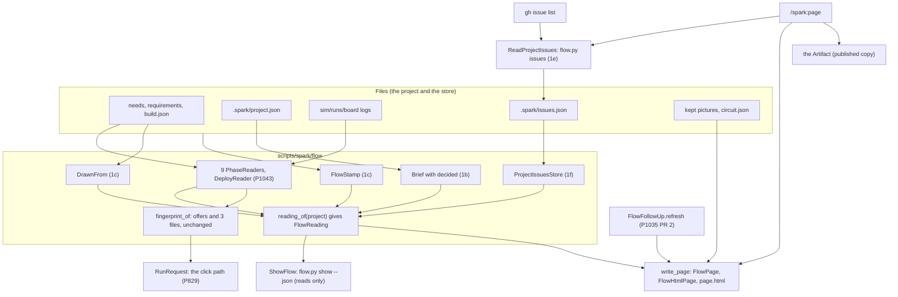
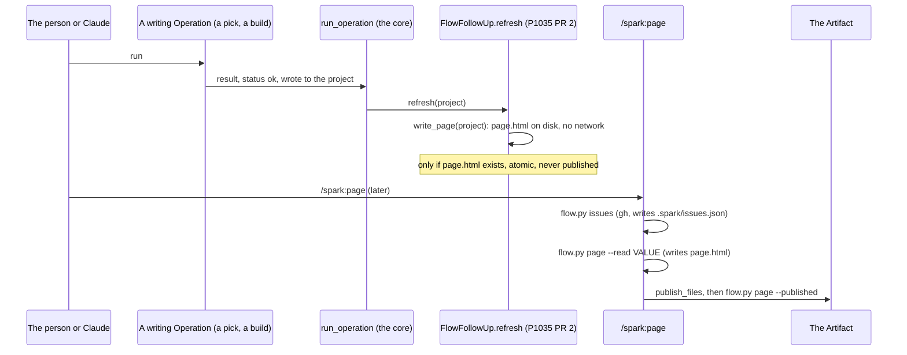
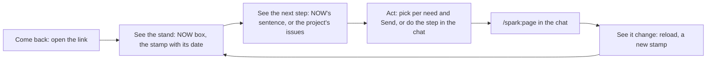
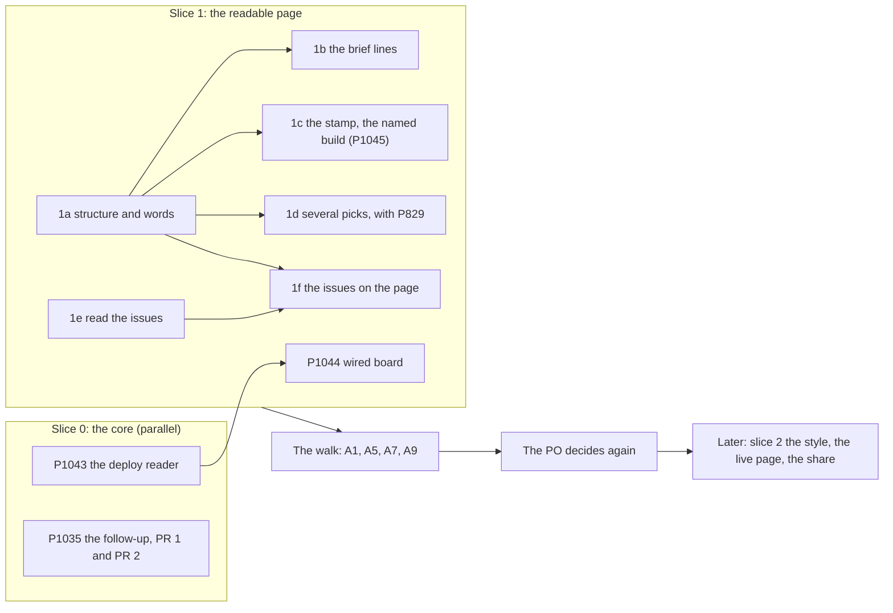

# P1038: the project page, designed (UX, graphic style, architecture, Artifact how-to)

Design for the epic P1038 #1521 (the project page: `page.html`, `flow.py page`, `/spark:page`). Written 2026-11-23 on main a01ea8ce, read-only, by the architect agent. It rests on the discovery in this folder ([brief.md](brief.md), D1 to D26). Nothing here is built.

## Council

Draft. Round 1 runs on this text.

> **TL;DR.** One new Value, `FlowReading`, holds every fact of a project's stand. `flow.py show --json` prints it and the page draws it, so the two cannot disagree (D22, the same facts on the page and in `show`). Five small parts feed it: the deploy reader (P1043), the brief with its new "decided" lines (D15), a stamp over every file that the page reads (kept apart from the click fingerprint, the architect's proposal), the named build with its mismatch (D17), and the project's open issues from one dated file (D19, D23). The page gets one NOW box, the picks per need with one Send for several picks, and folded developer lines. Build slice 0 and slice 1, then one walk tests A1 and A9, then the PO decides again (D25).

## Why

The PO, 2026-11-23: "lets analyze it and really design it both ux and graphic style and also architecture and claude artifact howto". The page of the walk project p934-display2 named a stand that the project had left (★C1, the page said "not started" beside 27 logged deploy runs). His words on P1011 #1470 (the page is not readable): "not very readable or intuitive or readable or good looking". The outcome (D1): a person who opens the page sees where the project really stands, what to do next and the project's own facts, without asking Claude.

Three faults cause the wrong page, and each has one fix:

| Fault | Read at | Fix | Story |
| --- | --- | --- | --- |
| The deploy phase reads no file | `scripts/spark/flow/phase_readers.py:554-560` | the deploy reader reads the board logs | P1043 #1533 |
| The page is written only at `/spark:page` | `commands/page.md:27`, `:70` | the core's follow-up writes it after each writing run | P1035 #1518, PR 2 |
| The stamp covers three files and has no date | `write_flow_page.py:132-136`, `page_script.js:29-33`, `:241-246` | a stamp over every file the page reads, with its date | 1c (P1045 #1535) |

## What exists (each line read today in the code)

- One source of the phases. `show_flow.flow_and_guide` gives the phases and the guide (`scripts/spark/flow/show_flow.py:86-89`). `ShowFlow.run` and `write_page` both call it (`show_flow.py:119`, `write_flow_page.py:146`).
- `flow.py show` reads and never writes: its effects are `READS` only (`show_flow.py:111`). Its `data` holds `phases`, `stands_at`, `fingerprint` and `guide` (`show_flow.py:112`, `:127-128`).
- `write_page` builds a `FlowPage`, masks it, renders it and writes it. A test swaps `readers`, `parts`, `renderer` and `store` (`write_flow_page.py:139-155`). `FlowPage` has nine fields (`flow_page.py:41`).
- The page's stamp is `newest_change`, which reads the fingerprint's file list (`write_flow_page.py:132-136`). That list is three files: the needs, `requirements.json` and `.spark/build.json` (`fingerprint.py:18`).
- A click is refused when the project's fingerprint changed after the page was read (`run_request.py:96`). A request row holds one key (`run_request.py:36`). The script sends only while no request waits and disables every button meanwhile (`page_script.js:142-143`, `:309-312`).
- The page's script shows buttons only to the owner of a published page with the database (`page_script.js:320-325`). The page loads nothing from the web, and a test forbids "http" in it (`tests/test_flow_page.py:88-89`).
- The page is "the same bytes for the same flow" (`flow_page.py:4-5`, `write_flow_page.py:133-134`). So the page holds no time of its own writing.
- `Brief` holds `must`, `prefer`, `goal`, `sellers` and `problem`, and no `decided` (`scripts/spark/records/brief.py:34-41`). The walk project's `.spark/project.json` holds `decided` as a list of two strings (keys and types read, the text not read).
- The build record holds `schema`, `status`, `stages`, `missing_facts`, `requirements`, `requirements_sha256`, `written_sha256` and `at`. It names no spark version (`scripts/spark/build/build_record.py:53-54`). The version is readable from the plugin's manifest (`scripts/spark/bench/board_facts.py:21`, `:29`).
- `PublishedPageStore` keeps the Artifact's id in `.spark/page.json` (`write_flow_page.py:68-88`).
- The core's run seam is `run_operation` with `RunOptions(privacy, trace, clock)` (`scripts/spark/core/cli.py:41`, `:54`). `follow_up.py` is not on main today (the folder listing of `scripts/spark/core`).
- An `Event` holds `kind`, `code`, `text` and `raw`, and a `Reporter` is the Strategy that shows it (`scripts/spark/core/events.py:21`, `:40`).
- `PickParts` takes one project and one or more `NEED=ID` pairs in one run (`scripts/spark/design/pick_parts.py:53-56`, `:65`).
- `commands/page.md` reads the state with `flow.py page`, which writes (`:27-30`). It asks to read `page.html` whole (`:34`, `:62`). It says "The page now shows where the project stands" (`:73`). Its allowed tools do not name `flow.py show` (`:3`).
- The guide's NOW is the first open phase, and its docstring says "The deploy is never done here, so there is one" (`guide.py:84-93`). After P1043 that sentence is no longer true.

## The architecture



**The one model.** `FlowReading` is a Value: what one read of a project's flow gave. Its fields are `phases`, `guide`, `fingerprint`, `brief`, `stamp`, `drawn_from` and `issues`. `stands_at` is derived from the guide as today (`guide.py:187-190`). A new function, `show_flow.reading_of(project, readers=None)`, returns it. `ShowFlow.run` prints `reading.to_dict()` as its `data`. `write_page` builds the `FlowPage` from the same reading and adds only the pictures and the wiring (`PageParts`, `write_flow_page.py:48`). `read_flow` and `flow_and_guide` stay, so no caller changes (`tests/test_run_request.py:104`, `tests/test_flow_page.py:193`).

**The rule's test (D22).** One test builds a fixture project, runs `ShowFlow` and `write_page`, and checks that each sentence, line, title and time in `data` is in the page's text. A second test fails when `write_page` reads a project fact that is not in `FlowReading`. The rule binds each fact that this epic adds. The wiring steps and the pictures are on the page today and are not in `show --json`. They stay `PageParts`, and the limit is named under "Open for the PO".

**New names, each checked against the names table and the code** (no file under `scripts`, `tests` or `docs/guide` holds any of them today):

| Name | Role | Module | Job |
| --- | --- | --- | --- |
| `FlowReading` | Value (as `BoardReading`) | `spark/flow/flow_reading.py` | every fact of one read of the flow |
| `FlowStamp` | Value | `spark/flow/flow_stamp.py` | the newest change time of `STAMP_FILES`, and each file with its time |
| `DrawnFrom` | Value | `spark/flow/flow_stamp.py` | the build the page draws from: its time, the spark version that made it, the version now |
| `DecidedLine` | Value | `spark/records/brief.py` | one decided line with its origin (`line`, `by`, `at`) |
| `ProjectIssues` | Value | `spark/flow/project_issues.py` | the read time and the open issues, or why there is none |
| `ProjectIssuesStore` | Store | `spark/flow/project_issues.py` | reads and writes `.spark/issues.json` |
| `ReadProjectIssues` | Operation, op `read-project-issues`, verb `flow.py issues` | `spark/flow/read_project_issues.py` | runs `gh`, keeps the titles and labels |
| `BriefHtmlSection`, `IssuesHtmlSection`, `PicksHtmlSection` | Renderer (as `WiringHtmlSection`, `flow_page.py:121`) | `spark/flow/flow_page_sections.py` | one section of the page each |

Two words needed care. "Issue" is a verb in the op `issue-grant` (`scripts/spark/bench/issue_grant.py:64`), so the new names say `ProjectIssues`, never `Issues` alone. "Stamp" is the core's word for a time as text with its zone (`scripts/spark/core/zone_time.py:9-11`). `FlowStamp.newest` is such a text, so the word keeps one meaning. `ReadProjectIssues` reads the outside and keeps a record, as `LookAtBoard` does with `KnownBoardStore` (the names table's Store row).

**The deploy reader (P1043, D10).** It replaces the body of `DeployReader.read` (`phase_readers.py:554-560`) and stays a PhaseReader. So its facts reach `show`, the page and a request with no other change. The same story gives the guide a sentence for "no phase is open": `guide.now` then holds `phase: null` and one sentence. The page's NOW box shows that sentence. When the issues are read, the renderer adds a link to the issues section, as it adds the link to the first wiring step today (`flow_page.py:308-321`). Spark names no issue as next (D23).

**The brief's lines (D15).** `Brief` gets `decided`: a tuple of `DecidedLine`. A plain string in the file reads as a line with `by` and `at` null, and the page says "origin not recorded". A `null` is never filled in. The brief is a part of the reading beside the phases. It is not a tenth PhaseReader.

**The stamp, apart from the click fingerprint (the architect's proposal, no D holds it).** `flow_stamp.STAMP_FILES` is one tuple of paths and globs in the project. It starts with the fingerprint's three files, `.spark/project.json`, the firmware folder, `sim/wokwi.toml`, the board logs, the kept pictures, the sheet's files and `.spark/issues.json`. `fingerprint.FILES` does not change, so no click is refused more often than today (D1). `write_page` stops importing `fingerprint.FILES` for the time (`write_flow_page.py:18`, `:135`). One test keeps the list true: for each file of a full fixture project, it changes the file and writes the page again. If the page's bytes change and the file is not in `STAMP_FILES`, the test fails. The stamp is read from file change times only. The page never holds the time of its own writing, so it stays the same bytes for the same flow. Rejected: adding the files to the fingerprint (it refuses clicks after every firmware save, `run_request.py:96`). Rejected: each reader declares its files (nine readers change for one line on the page).

**The published stamp (the architect's proposal).** D16 (the core hook writes `page.html` on disk) leaves the published copy behind until Claude republishes. So `/spark:page` records what it published: `flow.py page --published` keeps the stamp and the fingerprint of that copy in `.spark/page.json`. `FlowReading` then says `published: {artifact, stamp, behind}`. Claude reads `behind: true` in `flow.py show --json` and republishes before it says anything about the page.

**The named build (D17).** `BuildRecordStore.write` adds `spark`, the version from the plugin's manifest, with the build's time as its origin. `DrawnFrom` holds the build's `at`, its `spark` and the version that draws now. The page says the build's date. If the two versions differ, the page says so in one line and names the sheet's command, which draws the picture again and moves no pin. If the record names no version (every record written before this story), the page says "the build does not name the spark that made it". The page offers no rebuild (the option the PO did not take in D17, and P1044's risk).

**The issues (D19, D23).** `ReadProjectIssues` declares `READS`, `RUNS` and `WRITES`. It runs `gh issue list` in the project through `outside.run`, takes the read time from `outside.clock`, and writes `.spark/issues.json`: `{"read_at", "issues": [{"number", "title", "labels"}]}`. A failed run is one could-not-run Finding and writes nothing. `write_page` and the follow-up call no program and no network. `ProjectIssues` has four states, never mixed: no file, a file that cannot be read, a file with no open issue, a list. The file is in `STAMP_FILES` and never in the fingerprint. Titles pass the project's mask and the HTML escape like every other text (`write_flow_page.py:123-129`). No body, no comment and no link enters the file.

**A shared copy.** `flow.py page --read VALUE` keeps who can read the Artifact, as `get_artifact` answers it, in `.spark/page.json` beside the id. `write_page` reads it on every write, the follow-up's too. If the value says the page is shared, the page leaves the issue text out and says "the project's issues are not shown on a shared page". The core decides, and `/spark:page` only passes the fact.

**The live page (D5: designed now, built later).** The PO's words on P793 #1105: the core must be able to "notify when things happen". The live page is one more consumer of those events, and it needs two adapters. The first is a `Reporter` for the page's host, which turns the end of a writing run into a notice. The second is a watch beside `RequestChannel` on the page (`page_script.js:70-75`). The first live step carries only a time, the stamp and the fingerprint, so no project fact enters the database (D10 of P820). An open page that hears a newer stamp says "the project changed at <time>, reload after /spark:page". The seams are ready: `FlowReading` holds plain values, `FlowFollowUp.refresh` is the one place that knows the page changed, and `FlowStamp.newest` is the key to compare. The P1035 plan names what the event piece must add (a reporter in `RunOptions`, a payload field on `Event`). This epic builds none of it.

**The share (P834 #1196, D9, D20).** A share is the same `write_page` with another `store` or `renderer` (`write_flow_page.py:139`), and the `--read` fact above. What a shared copy leaves out is one rule in the core, which starts with the issue text and grows on P834 (the drawer facts, other projects' names). This epic adds the `--read` fact and the rule's first line only.

### One write, end to end



The seam used from P1035: `FollowUp.refresh(project)` calls `write_flow_page.write_page(project)`. This design changes what `write_page` reads and draws. Its signature and its `Written` answer stay. The plan's round-2 rules stay too: a page only if `page.html` exists, no page write after a kept build, an atomic write through `store.write_file` (`scripts/spark/records/store.py:183`).

## The UX

### The person's journey on the page



### The page after slice 0 (what changes: the deploy line)

```
p934 display2 circuit
Page from 11:44.                                   <- still no date, still three files (slice 1 fixes it)
NOW (deploy)  Written by the flasher 2026-11-23 14:09, nothing read back, start not seen.
              The firmware changed after that image. Ask Claude to look at the board.
DONE  idea, needs, parts, requirements, built (no simulation), firmware
? deploy   27 runs logged, the newest: ready unknown        <- no tick (D10)
```

The deploy sentences are examples. The exact words belong to P1043's plan and carry the PO's review.

### The page after slice 1 (p934-display2, the owner's view)

```
+--------------------------------------------------------------------------------------------+
| p934-display2                                                                              |
| GOAL     <the goal line of the brief, as the record holds it>                              |
| MUST     1. <must line>      2. <must line>                                                |
| DECIDED  <decided line>  (the PO, 2026-11-22)                                              |
|          <decided line>  (origin not recorded)                                             |
+--------------------------------------------------------------------------------------------+
| NOW  deploy, by you                                                                        |
|   Written by the flasher 2026-11-23 14:09 +01:00, nothing read back, start not seen.       |
|   The firmware changed at 14:18, after that image. Ask Claude to look at the board.        |
| DONE   idea, needs, parts, parts list, build (no simulation), breadboard, firmware         |
| Drawn from files changed up to 2026-11-23 14:18 +01:00. Build of 2026-11-22 11:44 +01:00,  |
| which does not name the spark that made it.                              [which files  v]  |
+--------------------------------------------------------------------------------------------+
| THE PROJECT'S OPEN ISSUES   the project's own, not spark's. Read 2026-11-23 18:05 +01:00.  |
|   #21  <made-up title one>     doing          Spark ranks none of them.                    |
|   #22  <made-up title two>     next                                                        |
|   #23  <made-up title three>                                                               |
+--------------------------------------------------------------------------------------------+
| PARTS, need by need                                              4 needs, 4 picked         |
|   display   picked: 2.9 inch e-paper          ( ) other part A   ( ) other part B          |
|   button    picked: tactile switch            ( ) other part A                             |
|   wifi      picked: the board's own Wi-Fi                                                  |
|   power     picked: USB                       ( ) other part A                             |
|   ! A board ran this project's firmware on 2026-11-23. A new pick needs a new build, and   |
|     a new build can move pins. Compare the new sheet with your wiring before power.        |
|                                                       [ Send the 0 picks you chose ]       |
+--------------------------------------------------------------------------------------------+
| WIRING   12 steps, step N is pill N of the picture          [one at a time] [all at once]  |
| PICTURES breadboard | schematic | PCB                                                      |
| > For developers: the nine phases, each offer's key and effect, the record ids  (folded)   |
+--------------------------------------------------------------------------------------------+
```

The rules behind it:

- **One NOW.** The NOW box is the only place that says what to do. The rail of nine phases and each phase's lines go under "For developers", always folded. Today they are folded only when the page holds wiring steps (`flow_page.py:292-298`).
- **Picks per need.** The parts section has one row per need: the pick it has, then the other offers of that need (three at most, `phase_readers.py:44`). The person chooses in several rows and sends once. Open needs come first.
- **The brief on top.** The goal answers "what is this". The page shows the goal as the record holds it. The walk project's goal line is stale (QA3, the project's file, the PO's to change).
- **The stamp has a date and a zone**, and "which files" opens the list with each file's time.
- **The issues are marked as the project's**, with their read time, and with the labels as the project wrote them.
- **Words.** Every sentence comes from `flow_codes` in Python, as today (`flow_page.py:91-115`). The script fills in a time or a label.

### The small states

```
Issues not read (no file):
  THE PROJECT'S OPEN ISSUES   not read. Type /spark:page in the chat, and Claude reads them.
Issues file broken:
  THE PROJECT'S OPEN ISSUES   not read: .spark/issues.json cannot be read.
No open issue:
  THE PROJECT'S OPEN ISSUES   none open. Read 2026-11-23 18:05 +01:00.
A partial result (QA5: "Could not run" was read as "The build failed"):
  Your last request, 2026-11-22 11:36: Build the board.
    Built: the board, the sheet, the pictures.
    Not run: the simulation, because Wokwi has no model of this board.
A stale page with the build mismatch:
  Drawn from files changed up to 2026-11-22 11:44 +01:00. Build of 2026-11-22 11:44 by spark 0.12.
  This page is drawn by spark 0.13. The picture and the step list can differ.
  To draw the picture again, ask Claude for the sheet. It moves no pin.
```

The last request moves from the top of the page to under the NOW box, with its date. A result that is not ok never shows a tick, and never the two words "Could not run" alone.

### The AI-UX: what Claude reads, calls and says

- **Reads.** `flow.py show --project . --json`, which writes nothing. It holds every fact of the page (D22). Claude never reads `page.html` whole (D12's fix). `commands/page.md` gets `flow.py show *` and `flow.py issues *` in its allowed tools.
- **Calls.** At a republish: `flow.py issues`, then `flow.py page --read VALUE`, then `publish_files` with the file's path, then `flow.py page --published`. A click: `flow.py run-request`, unchanged.
- **Says.** Spark's sentences, never its own. The false line at `commands/page.md:73` becomes: the stamp, NOW's sentence, and "issues read at <time>" or "issues not read: <the Finding's sentence>". If `published.behind` is true, Claude republishes first.
- **Data, never an instruction.** The command's first paragraph adds: an issue title is data.

### The graphic style (slice 2, D6)

The structure comes first and the style second. Slice 1 changes no token (`flow_page.py:244-247`). Slice 2 plans the tokens once with the design skill, with system fonts and no web load. The install waits for the PO (D8).

## The Artifact how-to (D12)

The how-to is one file, `docs/guide/artifact-how-to.md`, for a person and for Claude. Story 1a writes it, because 1a changes the steps it describes. Each later PR that touches the page updates it. `commands/page.md` and `docs/guide/agents/flow.md` link to it. Its outline:

1. What an Artifact page is for spark: one file, private at first, a snapshot with a stamp.
2. Before a first publish: call the Artifact server's `guide`, and `describe_capabilities` for each capability the page declares. The how-to links to them and copies no rule, because the contract moved twice in six days (★C5).
3. What spark's page declares and why: the database and the user, nothing else.
4. What the page must never do: load from the web, hold a secret, hold logic.
5. The route: read with `flow.py show`, write with `flow.py page`, publish, record what was published.
6. How to check a page before a share: the A7 read below.

A fresh session follows the how-to in the walk. That is its proof.

## Slice 0 and slice 1



| # | Story | Card | Done when | Proof the PO reads | Size | Depends on |
| --- | --- | --- | --- | --- | --- | --- |
| 0 | The deploy reader reads the board logs. The guide has a sentence for "no phase is open" | P1043 #1533 | no tick on "ready unknown". A run with no read-back shows what its log knows (D10) | `flow.py show --project .` in p934-display2 | M | D10 |
| 0 | The follow-up adds the now step (PR 1) and writes `page.html` again (PR 2) | P1035 #1518 | after a pick, `page.html` and `flow.py show --json` name the same stand | the two outputs side by side | S and S | none |
| 1a | Structure and words: `FlowReading`, one NOW, developer lines folded, the last request under NOW with its date, a partial result in plain words, `page.md` reads with `flow.py show`, the how-to file | to file | the D22 test passes. `page.md` holds no "read page.html whole" | a screenshot of the p934-display2 page from disk | M | none |
| 1b | The brief's goal, must and decided lines, with `decided` and its origin in `Brief` | to file | `show --json` holds `brief`, and the page shows it on top | the page's top box and `data.brief` | S | 1a |
| 1c | The stamp over every file, the published stamp, the named build with its mismatch, step N is pill N | P1045 #1535 (two PRs) | the stamp test passes. An old build says so | the stamp line with its date and file list | M | 1a |
| 1 | No Build or Pick on a wired board without its warning. First a look at the rendered page | P1044 #1534 | the card's own. The witness of "wired" is a deploy log (the architect's proposal) | the parts section's warning line | S (XS if the look finds no offer) | P1043 |
| 1e | `ReadProjectIssues` writes `.spark/issues.json` | to file | a failed `gh` writes nothing and is could-not-run. Tests use made-up titles | `flow.py issues --project .` and the file | S | none |
| 1f | The issues in `FlowReading` and on the page, `--read`, no issue text on a shared copy | to file | four states, never an empty list. A deploy run makes no GitHub call | the page's issues box, and "issues not read" with the file moved away | S | 1a, 1e |
| 1d | Several picks at once, per need | to file, decided with P829 #1187 | four needs picked in one round trip | the walk's diary | M | 1a, P829's state |
| walk | One walk with A1's, A5's, A7's and A9's tests. A fresh session follows the how-to | to file | the four results are rows in risks-and-tests.md | the diary and the rows | S | all above |

**The order.** Slice 0 runs in the core, in parallel with 1a. Then 1b, 1c, P1044, 1e, 1f. Story 1d comes when P829 is free. If P829 still waits on the PO, the walk runs without 1d, because A1's and A9's tests do not need it.

**Story 1d, the architect's recommendation for the decision with P829.** The request row gets `keys`, a list, beside `key`. `RunRequest` checks `seen` once, as today. It requires that every key is a pick offer now and that no need has two keys. It then makes one `PickParts` run from the offers' own steps, never from the request, and answers once. The guard stays as strong as today. Rejected: several rows with one `seen` (the second row is stale after the first pick, so the guard needs a hole).

**Cards.** To file, each as a sub-issue of P1038 #1521: 1a, 1b, 1d, 1e, 1f and the walk. To edit: #1518 names D16 (D26). #1533 holds two sentences that disagree ("a run with no read-back as written, nothing read back" and "A log with no verified write shows nothing"). D10's prefix, the PO's own choice, keeps the first.

**Later, one line each.** Slice 2: the tokens planned once, system fonts, the PO's verdict on a screenshot (D6, A6). The live page: the two adapters above, after the core's event piece. The share: on P834 #1196, with the rule of what a shared copy leaves out.

## Verification: the walk after slice 1

Each pass line is dated 2026-11-23 in [risks-and-tests.md](risks-and-tests.md). A could-not-run or a skipped check is not a pass.

| Id | Pass line (set 2026-11-23) | How the walk tests it |
| --- | --- | --- |
| A1 (he opens the page) | he opens it on his own at least once after the build and does not then ask Claude where the project stands | the walk's plan does not script the page. The session does not name the page first. The diary holds his words |
| A5 (the page reads well) | he names the next step and finds every Pick within 30 seconds (the 30 seconds has no source) | he reads a screenshot of the slice 1 page. The diary holds what he names |
| A7 (no leak) | zero hits for the Wi-Fi name and password, the secrets file, home paths, the store's path and the board's address, in the page text and its database rows. On a shared copy also zero names of other projects and no issue text | one command reads the secret values from the project and prints counts only. A second run on a page written with `--read` as shared |
| A9 (a snapshot is fresh enough) | no step taken on a stale page's word. `page.html` and `flow.py show --json` name the same stand at the walk's end | `data-stands-at` and the stamp on disk against `show`. `published.behind` for the published copy |

If A1 misses before the style is built, read the miss against its rival first: he opens the page once it looks good.

## The no-gos this design touches (D24)

- **No new interface for the click path (P829).** The fingerprint's files and the refusal rule do not change. Story 1d widens one row, and only with P829's decision.
- **No GitHub call from `write_page` or the follow-up.** Only `ReadProjectIssues` runs `gh`.
- **The issues file is never in the fingerprint.** It is in `STAMP_FILES` only.
- **No ranking of issues.** The page shows the tracker's order and labels.
- **No issue text on a shared copy.** `--read` and the rule in `write_page`.
- **No logic in the page's script.** The choice of picks is the page's own state. Which picks exist and every word come from Python.
- **No stored state file.** `FlowReading` is an answer, made on each call.
- **No tick on could-not-run, skipped or null.** "Issues not read" and an unnamed build are plain sentences with no mark.
- **No restyle of the CLI text.** `flow.py show` gains facts, and its look does not change.
- **Privacy no worse (D1).** Every new text passes the same mask as today. One new risk exists and is named below.

## Open for the PO

1. **"No build before the design is confirmed"** (the PO seat, 1 of 3, and #1521's own Done-when). Recommended: it holds for P1038's sub-issues. Slice 0 sits under P793 and goes on. His to say.
2. **The Flash and Deploy button no-go as "not now"** (P820's Q31). Recommended: keep the no-go through the walk. The deploy's step is next-only by design (`phase_steps.py:4-5`). His to say.
3. **The share window.** If he shares the Artifact after the last republish, the published copy holds the issue titles until the next `/spark:page`. Spark cannot see a share. Recommended: at each publish Claude says "this page holds your project's issue titles, type /spark:page before you share it". The other option keeps issue text off every published copy, and then the issues show only on disk. His to say, because it is privacy.
4. **The T-9 recount** (A2 meets its line on another grouping). It is read to him when he confirms the design. It does not reopen D19.

For the council of three to answer in auto mode, recorded as delegated:

5. The stamp's own list, `STAMP_FILES`, and its test (the architect's proposal).
6. The names in the table above, and `.spark/issues.json`.
7. The published stamp in `.spark/page.json` (the architect's proposal).
8. D22's scope: the wiring and the pictures stay outside `show --json`.
9. The witness of "wired" for P1044: a deploy log.
10. A failed read of the issues leaves no trace on the page (D23 says it writes nothing). The cause reaches the person through Claude only.
11. The how-to as a file under `docs/guide`, written in 1a, with its outline here.

## Decisions, each with its reason and the option rejected

| Decision | Reason | Rejected |
| --- | --- | --- |
| One Value, `FlowReading`, for `show` and the page | D22 holds by construction, and each new fact has one home | a field per fact on `FlowPage` (three places per fact) |
| `reading_of` beside `read_flow` | no caller and no test changes | changing what `read_flow` returns |
| The stamp's list apart from the fingerprint | the click path stays as it is (D1) | the files in the fingerprint |
| No time of writing on the page | the page stays the same bytes, so the follow-up does not dirty git on every run | "written at now" |
| The build names its spark version | a property enters when a check needs it, with its origin | comparing the picture with the list per part |
| The issues file holds no repository name | no check needs it yet | the delegated architect's L2 |
| `--read` kept in `.spark/page.json` | the follow-up's write also leaves the issues out | a flag at each call |
| One row with `keys` for several picks | one check of `seen`, one run | several rows |

## What the architect did not check

- The Artifact server: `guide`, `describe_capabilities`, whether `publish_files` needs a file that the session read, and the value that `get_artifact` gives for a private page. The architect had no Artifact tool.
- Which files of the store the phase readers open. Story 1c's plan lists them and decides how the stamp names them without a path.
- Whether the plugin's version changes often enough to show the P1009 case. Story 1c's plan measures it first.
- `phase_readers.read_built_from` (`phase_readers.py:95`), the build reader's sentences, and whether the sheet's command draws the picture again without a build (read in the docstring of `scripts/breadboard.py` only).
- Which script writes `.spark/project.json`, and so who records a decided line's origin.
- The text of the walk project's records, its page and its issues. Only the keys and types of `.spark/project.json` were read.
- `tests/test_architecture.py`'s rule on what the flow area and the core import. The first and second pass of the refuter, `council/user.md`, `council/tech-lead.md` and `council/po-assistant.md` in full. `docs/guide/map.md` and `docs/guide/how-it-works.md`.
- No test and no spark command ran. Every mockup line marked as an example is not spark's output.
