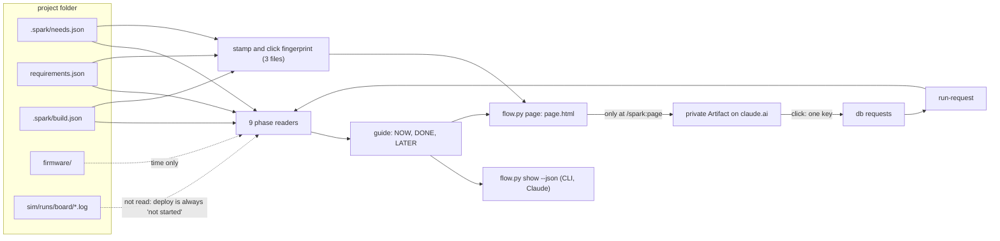
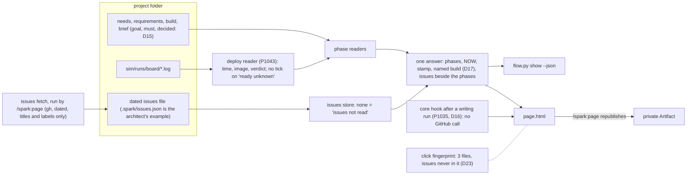
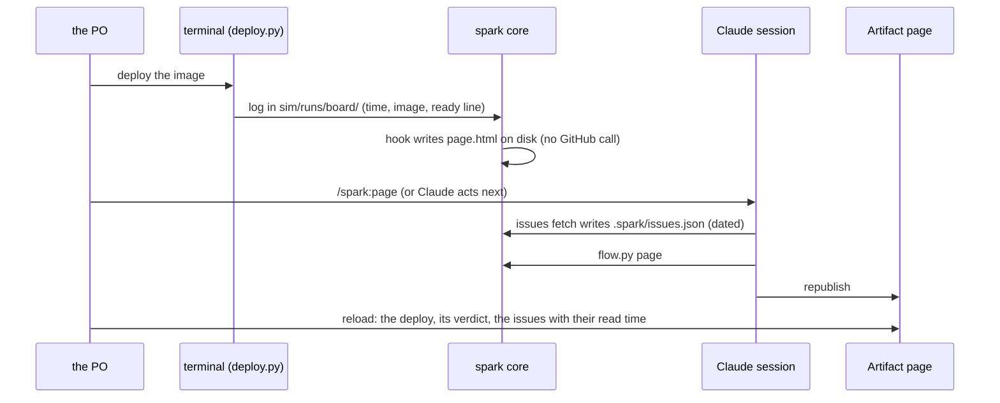
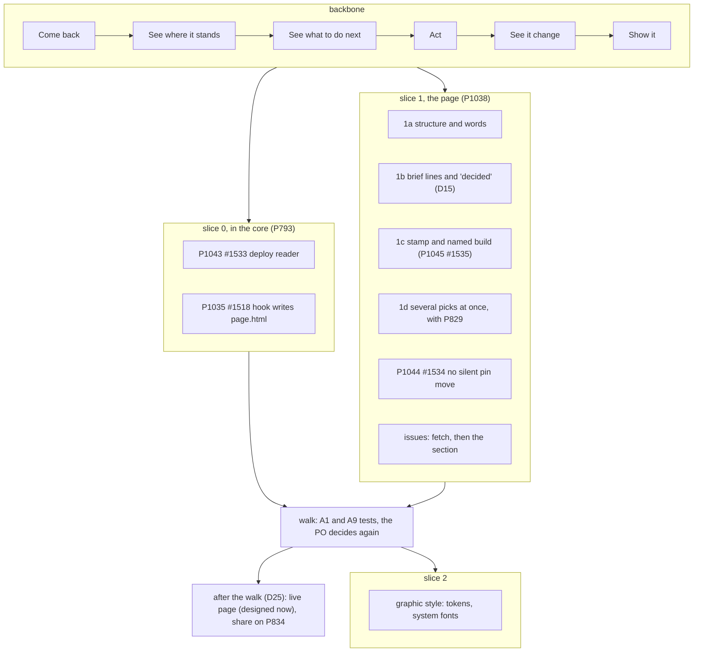

# P1038 diagrams: the page today, the decided shape, the map and a sketch

These diagrams draw what the brief's findings and decisions say. Each one names its source. They are for the
architect and the full council, and for the PO's reading. The design draws its own, finer versions.

## 1. Architecture today

Today one core path feeds three frontends. The page is a copy that only `/spark:page` writes again. The deploy reader
reads no file (★C10), and the stamp reads three files only (C11).



## 2. Architecture as decided

The deploy reader reads the logs (D7, D10). A core hook writes page.html after each run that writes to a project
(D16). The issues come from a dated file that a fetch writes at the republish (D19, D23). The stamp has its own file
list (the architect's route, decided by no D: council/refuter.md T-2), and the click fingerprint stays at three files (D23). The page and `flow.py show --json` carry the same
facts (D22).



## 3. The page's loop as decided

Where this picture and [design.md](design.md) differ, the design holds.

One deploy, from the terminal to the published page. Only Claude's republish changes the published copy (D16's
limit).



## 4. The story map

Where this picture and [design.md](design.md) differ, the design holds.

Slice 0 runs in the core in parallel with slice 1 (D7). After slice 1, one walk runs A1's and A9's tests, and the PO
decides again before slice 2 (D25).



## 5. A crude sketch of the first page slice

Where this picture and [design.md](design.md) differ, the design holds.

A sketch of the structure that D11 and the slice 1 rows name, on the clock project, with no style. The words are
placeholders: the exact sentences belong to the stories' plans and the PO's review (D10).

```text
+----------------------------------------------------------------------+
| E-paper quotes clock                       Page from 23 Nov, 17:40    |
| Drawn from the build of 22 Nov 11:44  (! wiring list 12 steps,        |
|   picture 13 wires: they do not match)                     (D17)     |
+----------------------------------------------------------------------+
| NOW  Look at the board: the last deploy's start was not seen, and     |
|      firmware/ is newer than the board's image.               (D10)  |
+----------------------------------------------------------------------+
| ON THE BOARD                                                          |
|   Last deploy 23 Nov 14:09, image 2811f223...                         |
|   Written by the flasher, nothing read back, start not seen:          |
|   mpremote could not read the board's files.            (no tick)     |
|   firmware/ changed 14:18, after this image: the board is behind.     |
+----------------------------------------------------------------------+
| GOAL AND MUST                                                         |
|   A quote with its author every hour, time over Wi-Fi                 |
|   Decided: battery probably 2000 mAh (the PO, 23 Nov)        (D15)    |
+----------------------------------------------------------------------+
| THE PROJECT'S ISSUES   read 23 Nov 17:40          (not spark's, D19)  |
|   #13 <issue title>                    (no label)                     |
|   #14 <issue title>                    (no label)                     |
|   #4  <issue title>                    doing                          |
|   #8  <issue title>                    doing                          |
|   #5, #6                               next                           |
+----------------------------------------------------------------------+
| NOT CHECKED BY SPARK: what the panel shows, the battery's life        |
+----------------------------------------------------------------------+
| > Parts and picks (4 needs, all picked)          [folded]             |
| > Wiring, 12 steps, with the picture             [folded]             |
| > Phases: idea ... deploy                        [folded]             |
+----------------------------------------------------------------------+
```

The issue titles are placeholders, because the project's repository is private and spark's is public. The page's
stamp (17:40) is the newest file it reads, here the issues file of the fetch in diagram 3. The sketch follows the
no-gos: no Flash or Deploy button, no tick on an unknown, no link to GitHub, and the issues stay unranked. The all-caps labels are placeholders. The design skill's list of tells names them (C15), so the
style slice replaces them.

The same structure as a rendered mock, in spark's light and dark tokens plus five colors of the mock's own. It is a
starting picture, not a decision: the style slice comes after the walk (D25), the story's plan sets the deploy words
(D10), and its goal line shortens the sketch's: [mock-first-slice.html](mock-first-slice.html),
with its screenshot [mock-first-slice.png](mock-first-slice.png) and a copy in the PO's Figma drafts (D30).
