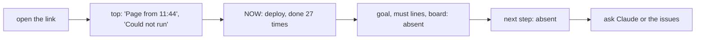
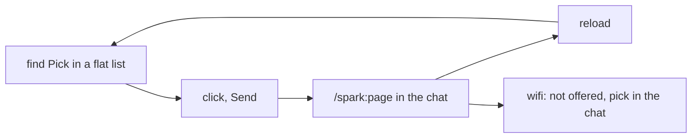
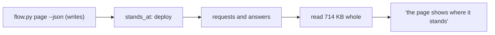

# Jobs and journeys
<!-- Tags as in the brief: E with a pointer, H with its source, D with who and when; an unknown is —. -->

## Who
<!-- One line per persona: who · evidence status (E pointer | H source).
e.g. `- Team leads who assign work · H Lena's belief, no interview yet` -->
- The PO, as the one user of his own project's page (n = 1) · E the P934 walk diary, ~/Development/spark-walks/p934-display2/diary.md, 2026-11-22, and P1011 #1470 · D1 (users: the PO only)
- Claude in the conversation, which fills the page, reads its clicks and answers them · E the spark:page skill text, read 2026-11-23 · H that Claude is a reader to design for, from the PO's rule on the UX and AI-UX lenses (memory, 2026-10-18)
- A future spark user is outside the frame (D1) and is not designed for here <!-- REQUIRED:who -->

## Jobs
<!-- One job story per line, each clause tagged: When …, I want to …, so I can ….
e.g. `- When I assign a task in a meeting [E tickets.csv:6], I want the assignee to see it that day [H Lena], so I can stop chasing people [E tickets.csv:7]` -->
- Job 1 · When I come back to a project after a break [H the facilitator's reading], I want to see where the project really stands and what to do next [E the request: "can show all the steps and guide", brief.md Frame], so I can go on without asking Claude [H the frame's outcome, D1] · caveat: ★C1 shows that the page today names a stand that does not match the project
- Job 2 · When I pick parts for the needs [E P1011 #1470, the walk 2026-11-22 11:27 CET], I want to pick more than one at the same time and see the picks per need [E P1011: "it might be good to allow the user to pick more at the same time"], so I can finish the picks in one sitting [H the facilitator's reading]
- Job 3 · When I show the project to someone [H memory spark-showcase-and-teaching: spark goes with his CV], I want a page that reads well and looks good [E the request: "be really UX perfect in graphic"; P1011: "not very readable or intuitive or readable or good looking"], so I can show the work and its state [H]
- Job 4 · When Claude finishes a step in the conversation [H], I want the page to show what changed [H], so the page and the conversation never disagree [E ★C1] <!-- REQUIRED:jobs -->

## Today they…
<!-- Per job: what they do instead today (a competitor, a workaround or nothing), tagged.
e.g. `- Job 1 · paste each task into Slack by hand · E tickets.csv:7` -->
- Job 1 · he asks Claude, or reads the logs and the diary; the page's NOW box names a step that the project already did · E ★C1 · H that he asks Claude (not asked, a candidate account question)
- Job 2 · one pick at a time: after one pick the other Pick buttons turn grey · E P1011 #1470
- Job 3 · — (not asked; a candidate account question)
- Job 4 · Claude writes the page again and republishes it with /spark:page, by hand · E the spark:page skill description, read 2026-11-23 <!-- REQUIRED:today -->

## Journeys
<!-- One ### per actor and scenario: the table, then a Mermaid flowchart of the same steps. Never a Mermaid
journey block: it forces a score on every task. "n/a — a one-step job" may replace both.
e.g. `| 2 | opens the app | E analytics, 90 days | never sees the task | not yet | Do they read email? |` -->
The full step tables, with every pointer, are in [council/user.md](council/user.md). The tables below keep the steps
that a decision rests on.

### The PO — Job 1, he comes back to p934-display2 on 2026-11-23 <!-- REQUIRED:journey -->
| step | what they do | evidence | friction or harm | today | open question |
| --- | --- | --- | --- | --- | --- |
| 1 | opens the Artifact link | E get_artifact, private, owner (USER, Job 1) | the title "p934 display2 circuit" names neither the quotes nor the clock | partly | — |
| 2 | reads the top of the page | E page.html:9, :732 (USER-6, USER-7) · H the render, read from the script, not seen | "Page from 11:44." has no date and is a day old; yesterday's "Could not run" answer stays on top | not yet | QA5 |
| 3 | reads the NOW box | E page.html:13, ★C10 | it tells him to plug in and deploy, a step the store records 27 times for this project | not yet | — |
| 4 | looks for the goal, the must lines and what is on the board | E .spark/project.json, the store record (USER-2, USER-9) | not on the page; the goal and the must lines disagree in the record | not yet | QA3 |
| 5 | looks for what to do next | E `gh issue list` in the project (PO-6) | the next steps live in the project's own issues (#13, #14), not on the page | not yet | QA1 |
| 6 | asks Claude, reads the diary or the issues instead | H the user lens, from the diary's later entries; whether he opened the page after 2026-11-22 11:50 is — | the page is not used for this job | — | QA1 |

### The PO — Job 2, picks for four needs, 2026-11-22 11:24 to 11:36 CET
| step | what they do | evidence | friction or harm | today | open question |
| --- | --- | --- | --- | --- | --- |
| 1 | finds a Pick button in a flat list | E diary.md:113 "take a look, it's not there" | the button is the 7th item; picked needs stay first | partly | — |
| 2 | clicks Pick, Send, then types /spark:page | E diary.md:74-76, :82-83 | the other Pick buttons turn grey; four needs cost four round trips | works, one at a time | — |
| 3 | wants the board's Wi-Fi for the wifi need | E diary.md:56-57, :132 | not offered (P990); the pick goes through the chat | not yet | — |
| 4 | the project is built and wired; the page still offers 12 Picks and Build | E page.html:424-431, :450 (USER-3) · H that a rebuild moves EPD_RST and EPD_BUSY, from the P1010 commit, not run | one click and Send can move two pins of a wired board | partly | — |

### Claude — fills the page, reads its clicks, answers them
| step | what they do | evidence | friction or harm | today | open question |
| --- | --- | --- | --- | --- | --- |
| 1 | reads the state with `flow.py page --json` | E commands/page.md:24-30 (USER-11) | the read writes page.html and changes a tracked file; the read-only `flow.py show` is not named | partly | — |
| 2 | reads `stands_at`, `guide.now`, `next` | E `flow.py show --json` (USER-13) | "deploy" and `next: []`; nothing points to the deploys, the project's git or its issues | not yet | — |
| 3 | reads the requests and writes the answers | E db_query, 5 requests and 5 answers (USER-14) | works; a row carries only a key, so no question reaches Claude from the page | works | — |
| 4 | reads page.html whole, then republishes | E commands/page.md:34, :62 (USER-12) | 714 KB does not fit one Read call | partly | — |
| 5 | tells the person "The page now shows where the project stands" | E commands/page.md:73 (USER-13) | the sentence is false on this project | not yet | — |

Job 3 (show the project to someone) and Job 4 (the page shows what Claude changed) have their tables in
council/user.md. Job 3 rests on H only (the CV memory, no account, QA4). Job 4 fails at its first step: a deploy, a
firmware change or an issue is no phase that the page reads (E USER-1, USER-9, USER-10).
