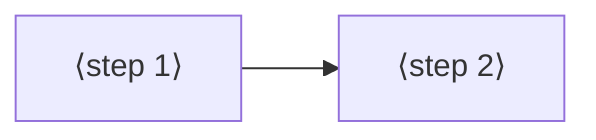

# Jobs and journeys
<!-- Tags as in the brief: E with a pointer, H with its source, D with who and when; an unknown is —. -->

## Who
<!-- One line per persona: who · evidence status (E pointer | H source).
e.g. `- Team leads who assign work · H Lena's belief, no interview yet` -->
- The PO, as the one user of his own project's page (n = 1) · E the P934 walk diary, ~/Development/spark-walks/p934-display2/diary.md, 2026-11-22, and P1011 #1470 · D1 (users: the PO only)
- Claude in the conversation, which fills the page, reads its clicks and answers them · E the spark:page skill text, read 2026-11-23 · H that Claude is a reader to design for, from the PO's rule on the UX and AI-UX lenses (memory, 2026-10-18)
- A future spark user is outside the frame (D1) and is not designed for here <!-- REQUIRED:who -->

## Jobs
<!-- One job story per line, each clause tagged: When …, I want to …, so I can ….
e.g. `- When I assign a task in a meeting [E tickets.csv:6], I want the assignee to see it that day [H Lena], so I can stop chasing people [E tickets.csv:7]` -->
- Job 1 · When I come back to a project after a break [H the facilitator's reading], I want to see where the project really stands and what to do next [E the request: "can show all the steps and guide", brief.md Frame], so I can go on without asking Claude [H the frame's outcome, D1] · caveat: ★C1 shows that the page today names a stand that does not match the project
- Job 2 · When I pick parts for the needs [E P1011 #1470, the walk 2026-11-22 11:27 CET], I want to pick more than one at the same time and see the picks per need [E P1011: "it might be good to allow the user to pick more at the same time"], so I can finish the picks in one sitting [H the facilitator's reading]
- Job 3 · When I show the project to someone [H memory spark-showcase-and-teaching: spark goes with his CV], I want a page that reads well and looks good [E the request: "be really UX perfect in graphic"; P1011: "not very readable or intuitive or readable or good looking"], so I can show the work and its state [H]
- Job 4 · When Claude finishes a step in the conversation [H], I want the page to show what changed [H], so the page and the conversation never disagree [E ★C1] <!-- REQUIRED:jobs -->

## Today they…
<!-- Per job: what they do instead today (a competitor, a workaround or nothing), tagged.
e.g. `- Job 1 · paste each task into Slack by hand · E tickets.csv:7` -->
- Job 1 · he asks Claude, or reads the logs and the diary; the page's NOW box names a step that the project already did · E ★C1 · H that he asks Claude (not asked, a candidate account question)
- Job 2 · one pick at a time: after one pick the other Pick buttons turn grey · E P1011 #1470
- Job 3 · — (not asked; a candidate account question)
- Job 4 · Claude writes the page again and republishes it with /spark:page, by hand · E the spark:page skill description, read 2026-11-23 <!-- REQUIRED:today -->

## Journeys
<!-- One ### per actor and scenario: the table, then a Mermaid flowchart of the same steps. Never a Mermaid
journey block: it forces a score on every task. "n/a — a one-step job" may replace both.
e.g. `| 2 | opens the app | E analytics, 90 days | never sees the task | not yet | Do they read email? |` -->
### ⟨actor⟩ — ⟨scenario⟩ <!-- REQUIRED:journey -->
| step | what they do | evidence | friction or harm | today | open question |
| --- | --- | --- | --- | --- | --- |
| 1 | ⟨fill⟩ | ⟨tag and pointer⟩ | ⟨fill⟩ | ⟨works, partly, not yet or —⟩ | ⟨fill or —⟩ |

