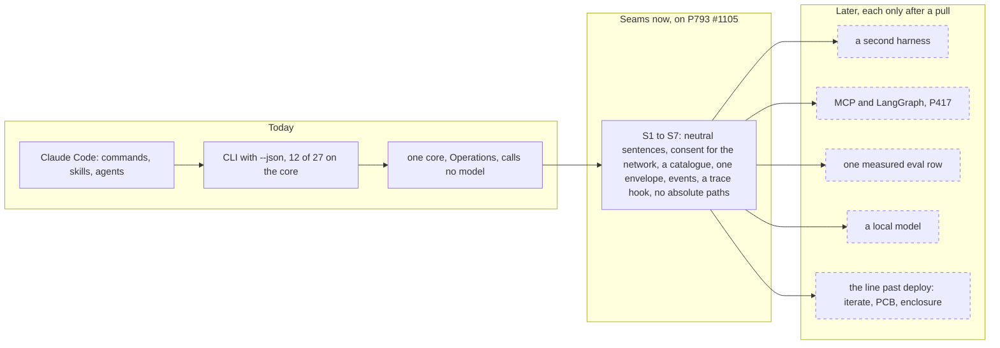

# P1039: spark past the MVP, the R&D discovery in short

> Short version: spark needs no second architecture to grow past the MVP, in the opinion of the lenses and the
> architect. The proposal is seams in the core work now (P793 #1105) and no new epic. A direction gets a first spike
> only after the PO's own answers show a pull for it. The PO confirmed this understanding (D5). Nothing is filed.

This folder is the discovery of the epic P1039 (#1522), run on 2026-11-23 at full depth. Six lenses on Opus read the
product. The architect on Fable wrote the synthesis, and the refuter on Fable read it twice. A council of three
answered the questions while the PO was away. The PO confirmed the understanding on 2026-11-23 (D5). Ready for: design. The skill's output test passes.

## The picture

## What the discovery found

- The core is plain Python that calls no model, and an Operation already describes itself as a tool (★C1, ★C9). No
  second interface has run, but one 20-line probe ran a read-only Operation with 0 core lines changed.
- What ties spark to Claude is the agent layer's frontmatter and variables, Claude names in the code, and at least
  seven network operations whose only yes is Claude Code's prompt (★C2, ★C3, ★C11).
- A second agent harness is installed on the PO's computer. Nothing of spark has run in it (★C6).
- The line has no end: the flow never shows a deploy as done, and the gadget's later work is outside the flow's phases
  (★C19, ★C20). Past the breadboard the line is thin (★C21).
- Nothing measures whether an agent succeeds. One eval once scored the plugin against a baseline (2026-09-24) and was
  cut five days later (★C17).
- No check makes sure that the agent pages teach a new script or flag. `cost.py` is on none of them (★C13, ★C14).
- Nobody outside the project uses spark yet, and the backlog grows faster than it closes (★C23, ★C24).

## What is decided

- D1, the PO: the frame, full depth.
- D5, the PO: the understanding, with D2 and D3 as the council answered them.
- D2 and D3, delegated to the council and the PO's to change: the ratings of the assumptions, A1 as the riskiest with
  a three-arm test, and an answer for each of Q2 to Q12 (mostly option a: seams only, no new epic, no rewrite now).

## What comes next, and what is open for the PO

1. Q10 and Q11, and the account questions Q13 to Q18 about his own use.
2. His parts of Q2, Q3 and Q7: which run proves v0.10, what "software factory" means, which "Hermes", and a trial on his account.
3. Whether this public folder can name the installed harness. It names none.
4. His yes to file anything from [items.md](items.md). Nothing is filed.

## The files

- [direction.md](direction.md): the one-page picture, with the factory line, the architecture today and the target, the interface options and the use cases.
- [diagrams.md](diagrams.md): the factory line as a process, the seams, the decision path, the team's loop, the story map and crude interface sketches.
- [brief.md](brief.md): the frame, every claim with its source, the options, the questions and the decisions.
- [jobs-and-journeys.md](jobs-and-journeys.md), [story-map.md](story-map.md), [risks-and-tests.md](risks-and-tests.md), [items.md](items.md), [verification.md](verification.md).
- [council/](council/): the six lens reports, the two refuter passes and the council's answers, with their tally in [council/delegated-answers.md](council/delegated-answers.md).
