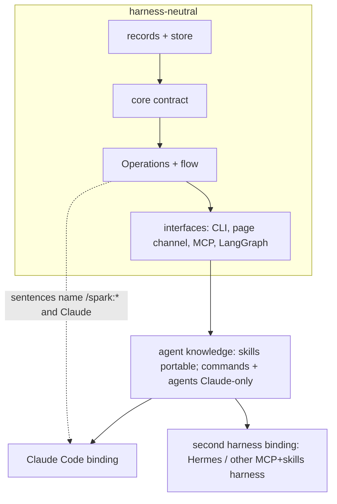

# P1039 council: the architecture lens

The lens: Opus, 2026-11-23, read-only on worktree branch `p1039-rd-discovery` at e0c0dc77. The questions are (a) to
(e) from the session's brief to this lens. Tags: E with a pointer, H with its source, D with who and when, — for an
unknown. Paths are relative to the repository, and `~/` is the PO's store. Every opinion below is marked "opinion (this
lens)". This lens decides nothing.

## 1. Findings

### The core as it is (the base for (a) to (e))

- **AR-1** · The core is one blocking call. `run_operation` runs `operation.run(...)` and returns one OperationResult. An Operation tells a reader what happens only through `outside.report(Event)`, and an Event has two kinds only, `line` and `begin`: there is no "step done", no "finding" and no "next step" event. No module in `scripts/spark/core` imports asyncio. One module in `scripts/` imports threading: `records/store.py`, for its lock. · E `scripts/spark/core/cli.py:54`, `scripts/spark/core/events.py:14`, grep for `import (asyncio|threading)` over `scripts/` (2026-11-23) · supports only: the PO's streaming rule (D, 2026-11-23, #1105 12:54 CET) is not met yet. It is a seam, not a stream. P1031's finding already proposes the fix: the END and FINDING kinds and a `QueueReporter` for an async frontend that runs the core in a thread (E #1511 finding, items 9 and 10).
- **AR-2** · Langfuse already has a seam in the core, but nothing uses it. `RunOptions.trace` sees each run once: the name, the masked values, the masked result and the seconds. A trace that raises cannot change the answer. Outside `cli.py` and `tests/test_core.py`, no code builds a `RunOptions`, and no call passes `trace=` (grep over `scripts/` and `tools/`). `run_cli` always runs with `DEFAULT_RUN`, whose trace is None. · E `scripts/spark/core/cli.py:41-43`, `:65`, grep for `trace=` and `RunOptions` (2026-11-23) · supports only: P417's "a Langfuse trace through `run_operation`'s one `trace` hook" (E #545 body) needs no change to the core. It needs a frontend that passes a trace.
- **AR-3** · There is no single `--json` envelope. The default Renderer is `JsonEnvelope`, and three others override it. `FlatJsonLine` (data only, no status, no `next`) is used by five Operations: build-board, reach, issue-grant, check-grant and live. `JsonDocument` is used by check-design. `FullEnvelope` is used by describe, audit and answer. The build puts its `next` inside `data`. · E grep for `json_renderer =` (2026-11-23), `scripts/spark/build/build_board.py:77`, `:123`, `scripts/spark/core/renderers.py` · supports only: the shape that every Operation shares is `OperationResult.to_envelope()`, not what the CLI prints. Any adapter (MCP, LangGraph, ACP or a page) calls `run_operation` and reads the OperationResult. It must never parse a script's stdout. Option family (1) as the epaper session wrote it ("a stable --json envelope") is true of the core and not of the CLIs.
- **AR-4** · Twelve of the 27 CLIs in `scripts/` call `run_cli`. The other fifteen do not, and seven of those have a `--json` of their own shape. The fifteen include the firmware and setup steps of the journey: `run_scenario.py`, `flash_image.py`, `import_firmware.py`, `init_project.py` and `tools.py`. · E `grep -l run_cli scripts/*.py` (2026-11-23); the core-gaps finding counts 11 and 15 (`~/finding-core-gaps-2026-11-23.md`, "Measured") · supports only: any second interface covers only part of the journey until P793's piece 5 moves these steps. A harness other than Claude Code cannot walk the MVP journey through Operations today.
- **AR-5** · An Operation already describes itself as a tool. It has `input_schema()` (JSON Schema, one property per Argument), `output_schema()`, `summary`, `effects`, `data_keys` and `stages`, and `DescribeOperations` reflects over a registry to list them. Two gaps: a group of arguments that exclude each other is "not in it yet", and the ops live in eight `OPERATIONS` tables with no single catalogue. `run_request.STEP_OPERATIONS` is a ninth hand table. · E `scripts/spark/core/operation.py:105-117`, `scripts/spark/core/describe_operations.py`, `scripts/spark/flow/run_request.py:42`, core-gaps finding piece 4 · supports only: an MCP or LangGraph tool list is a reflection over a catalogue that does not exist yet. That catalogue is the smallest thing that the leaning's "thin adapter" needs.
- **AR-6** · Effects work like capabilities, and they are spark's strongest asset for portability. An Operation declares READS, RUNS, BOARD, DELETES, WRITES, ASKS or FETCHES, and `build_outside_world` gives it a refusing stub for each effect it does not declare. A question that an Operation cannot answer is a typed `Question`: its kind is yes_no, value or choice, `asked_of` is person, agent or either, and it can carry a citation. A `ReplyStrategy` answers it: from the replies file (scripted), live in a terminal, or "not now", which ends the run as could-not-run with `needs_reply`. · E `scripts/spark/core/outside.py:74`, `scripts/spark/core/operation.py:31`, `scripts/spark/core/replies.py` (docstring and `Question`) · supports only: each harness's permission and input mechanism is one more ReplyStrategy or ConsentStrategy, not new logic. They map closely to three protocols. ACP has `session/request_permission` (E, read 2026-11-23, https://agentclientprotocol.com/protocol/prompt-turn). A2A has the task states INPUT_REQUIRED and AUTH_REQUIRED (E, read 2026-11-23, https://aaif.io/blog/a2a-v1-0-a-builder-s-guide-part-1-discovery-tasks-and-clients). For MCP, elicitation is the likely match (H, this lens's knowledge: the MCP elicitation page was not read).
- **AR-7** · The Claude-specific binding leaks below the interface layer and into the areas' own sentences and data:
  - 79 lines in 42 `.py` files under `scripts/` name a `/spark:` command.
  - The flow's model of who does a phase has "claude" as an actor (`BY_CLAUDE`).
  - The page's sentences say "type /spark:page in Claude Code".
  - `tool_finder` writes a `claude mcp add` command line.
  - `run_cost` finds a run's cost only through `CLAUDE_CODE_SESSION_ID` and the transcripts under `~/.claude/projects`.
  - `ai_files` writes CLAUDE.md beside AGENTS.md.

  · E `grep -rn '/spark:' scripts --include='*.py' | wc -l` gives 79, and `-l` gives 42 (2026-11-23); `scripts/spark/flow/flow_codes.py:17`, `:160`, `:167`; `scripts/spark/records/tool_finder.py:393`; `scripts/spark/sourcing/run_cost.py:73`, `:81`, `:100`; `scripts/spark/build/ai_files.py:39` · supports only: a second harness needs more than a new adapter. Piece 6 of the core-gaps finding ("sentences say the job, and each interface adds its own how") is also the harness-portability piece. Cost is the one measure of evaluation that is bound to one vendor.
- **AR-8** · The agent-knowledge layer is the thickest layer and the most Claude-specific one. The 9 commands, 3 skills and 4 agent files hold 2164 lines; build.md alone has 404 and idea.md 249. Twelve of these files use `${CLAUDE_PLUGIN_ROOT}`. The commands are Claude Code slash commands whose `allowed-tools` frontmatter uses Claude Code's syntax and names Claude-only MCP tools (`commands/page.md` names nine `mcp__claude-artifacts__*` tools). Each agent file names a Claude model (`model: sonnet`, `opus` or `haiku`). The three skills are folders with a SKILL.md and references. · E `wc -l commands/*.md skills/*/SKILL.md agents/*.md`, `grep -l CLAUDE_PLUGIN_ROOT` gives 12, `agents/*.md` frontmatter (2026-11-23) · supports only: for knowledge, the portable unit is the skill folder. The Agent Skills spec requires only `name` and `description`, loads the body progressively, and marks `allowed-tools` as "Experimental" (E, read 2026-11-23, https://agentskills.io/specification). A command and an agent file have no cross-harness format that this lens found.
- **AR-9** · Family (3), "one state document", exists already, but as a read and not as a stored file. The phase readers "each read the files one stage wrote". `ShowFlow` assembles the phases, `fingerprint_of` hashes the offers and the files, and `page.html` is rendered from them. The page's only channel back is the one-shot `.spark/page-request.json`, which `run-request` runs only when the fingerprint still matches and spark offers that key now. · E `scripts/spark/flow/phase_readers.py:1-5`, `scripts/spark/flow/fingerprint.py:25-31`, `scripts/spark/flow/run_request.py:1-6`, `commands/page.md` · supports only: a stored state document is a second truth beside the project's files. The design to keep is the derived read with its fingerprint, which works like an ETag. Opinion (this lens): "one state document that every view renders" means the `show-flow` answer, and never a file that the core keeps in step.
- **AR-10** · MCP today has two transports, stdio and Streamable HTTP. Streamable HTTP "replaces the HTTP+SSE transport from protocol version 2024-11-05", which is now deprecated. In stdio, the server must write nothing to stdout that is not an MCP message, and messages are newline-delimited JSON-RPC. In Streamable HTTP, a request can get an SSE stream as its answer that carries notifications before the response, and a local server binds to 127.0.0.1 ("SHOULD") and validates `Origin` ("MUST"). · E read 2026-11-23, https://modelcontextprotocol.io/specification/2025-11-25/basic/transports · supports only: three consequences.
  - The PO's "SSE MCP" (D, #1105 12:55 CET) is now Streamable HTTP with optional SSE.
  - An MCP adapter must never call `run_cli`, which prints the envelope on stdout (`cli.py:213`). Its Reporter must send child output to stderr: `echo_fd` exists for exactly this (`events.py:47`, `:72`).
  - Its ProgramRunner must never inherit stdout.

  A stdio server is newline-delimited JSON over stdin and stdout, which the standard library can do (H, this lens's estimate of the effort; the scripts' imports are standard library plus `mpremote` only, E grep of top-level imports, 2026-11-23).
- **AR-11** · ACP connects an editor to an agent. It is JSON-RPC over stdio: the editor launches the agent, sends `session/prompt`, and receives `session/update` notifications (`agent_message_chunk`, `tool_call`, `tool_call_update`, `plan`), permission requests and a stop reason. It "reuses MCP's JSON representations where possible". Zed created it with Google's Gemini CLI as the first agent, announced on 2025-08-27 under the Apache licence, and Neovim joined through Code Companion. · E read 2026-11-23, https://agentclientprotocol.com/overview/introduction, https://agentclientprotocol.com/protocol/prompt-turn, https://zed.dev/blog/bring-your-own-agent-to-zed · supports only: spark has no model and no prompt loop, so spark is no ACP agent. ACP sits on the harness's side: it lets a person keep their editor while they switch the harness. Spark reaches an ACP world through the tools that the agent calls (MCP) and the knowledge that it reads (skills). Opinion (this lens): no ACP work for spark.
- **AR-12** · A2A is a protocol from agent to agent. Its v1.0 spec froze on 2026-03-12. An agent publishes an Agent Card (skills, supported interfaces, capabilities) at `/.well-known/agent-card.json`. A task has nine states, among them INPUT_REQUIRED and AUTH_REQUIRED. Progress arrives by polling, by SSE streaming or by a webhook push. The bindings are JSON-RPC, gRPC and HTTP+JSON. The project now sits in the Agentic AI Foundation beside MCP. · E read 2026-11-23, https://aaif.io/blog/a2a-v1-0-a-builder-s-guide-part-1-discovery-tasks-and-clients (a builder's guide from the foundation, not the spec itself) · supports only: spark's three outcomes and its `needs_reply` map well onto A2A's task states. But an A2A peer is an agent with its own model, and spark is a tool. It fits only when spark ships an agent of its own, which the firmware decision does not forbid but nobody has asked for (— no source).
- **AR-13** · Hermes Agent (Nous Research) is MIT-licensed and runs as a CLI and through a messaging gateway. It "works with Nous Portal, OpenRouter, OpenAI, or any endpoint", connects "to any MCP server", and its skills are "Compatible with agentskills.io". Ollama documents how to point it at a local OpenAI-compatible endpoint (`http://127.0.0.1:11434/v1`). · E read 2026-11-23, https://hermes-agent.nousresearch.com/docs, https://docs.ollama.com/integrations/hermes · supports only: the PO's "Hermes or others" and "local AI" (D, #1522 15:5x CET) can be tested with the same two artefacts, an MCP adapter and skills in the Agent Skills format. Hermes is not installed here (— not checked), and no page that was read says how well a local model calls tools.
- **AR-14** · Langfuse takes OpenTelemetry traces over OTLP/HTTP (JSON or protobuf, no gRPC) at `/api/public/otel`, with Basic auth. It aims to follow the GenAI semantic conventions, and `langfuse.*` attributes take precedence. `langfuse.observation.type` can be `tool`, `agent`, `evaluator` and other types, and `langfuse.session.id` groups the spans of one session. · E read 2026-11-23, https://langfuse.com/integrations/native/opentelemetry · supports only: the trace hook of AR-2 can emit one span per Operation (type `tool`, the op's name, status, codes and seconds) without the Langfuse SDK. Each value is already masked (`cli.py:65`). Sending it is a network effect with keys, so it lives in an optional adapter, as P417 already says (E #545, "First, before any install").
- **AR-15** · Evaluation sources exist, but each one is narrow:
  - `history.jsonl` in the store holds the events step, reused, passed_over and built.
  - `run_cost` reads the cost of a run only from Claude Code transcripts.
  - The walks are free-form, "no predictions file, no score, no scenario in advance" (D, the PO, 2026-10-31, in P934 #1323's notes).
  - The tests and the mutation ledger measure spark's code, not an agent.

  · E `scripts/spark/records/store.py:420-421`, `scripts/spark/sourcing/run_cost.py:73-100`, `gh issue view 1323` (2026-11-23) · supports only: an agent eval that scores is a new kind of run beside the walk, never a change to the walk. The PO's rule keeps walks without scores.
- **AR-16** · The scripts call no model. Model choice lives only in the harness binding: the agent files' `model:` frontmatter, the launch's `model=`, and the hand-kept table in scrum/README.md (the token budget). · E `agents/*.md` frontmatter; `scrum/README.md:263-282` · supports only: a local model plugs in at the harness layer, and the core needs no change for it. What the core can do for a smaller model is make the answers smaller and the next step explicit (part (c)).
- **AR-17** · The effect words have no word for money, an order, or a wait of hours or days. `--describe` prints only network, writes and deletes. · E `scripts/spark/core/operation.py:31`, `scripts/spark/core/describe_operations.py:15` · supports only: the factory's later stages (a PCB order, a print) each enter as an effect word, a consent strategy and a phase reader, as DELETES and WRITES did with deploy (E `operation.py:28-30`). That adds Operations, not a second architecture (part (e)).
- **AR-18** · The flow's phases stop at deploy: idea, needs, parts, requirements, build, breadboard, firmware, simulate, deploy. The deploy phase never ends (DeployReader is always not-started), so the flow has no "done" state yet. · E `scripts/spark/flow/flow_codes.py:9`; #1105 comment of 15:17 CET · supports only: a factory line needs a phase model that can end and can go on past deploy. That is a change to the flow area, not to the core.

### Testing the epaper session's leaning as a hypothesis

The leaning (H, the epaper session's, #1522 15:3x CET): keep (1) and (3), add (5) as a thin adapter, and no server until
a case needs it.

- **(1) "keep the scripts with a --json envelope."** It holds for the core, and it is not yet true for the CLIs. There are four Renderers (AR-3) and 15 CLIs off the core (AR-4). "Keep" really means "finish": P793's pieces 1 to 5. This lens finds no evidence against the direction.
- **(3) "one state document."** It holds if it means the derived `show-flow` read with its fingerprint (AR-9). It breaks if it means a stored document. Today's gap is that the read is shaped for the page, not for every view: `flow.py show --json` answers `next: []` (E core-gaps finding, "Measured").
- **(5) "MCP as a thin adapter."** It holds technically: the tool schemas exist (AR-5), and the asks map onto strategies (AR-6). It is thin only after four things exist: the catalogue (core-gaps piece 4), an MCP Reporter that keeps stdout clean (AR-10), a ReplyStrategy for MCP, and event kinds for progress (AR-1). MCP alone gives tools and no knowledge (AR-8): a harness without spark's skills gets a tool list and no journey.
- **"No server until a case needs it."** This part conflicts with a stated case. The PO named "a live web page or an SSE MCP" as consumers (D, #1105, 2026-11-23 12:55 CET), and both are a long-lived process: Streamable HTTP is "an independent process" (AR-10). The case exists. Its order does not. The stdio MCP needs no server. Opinion (this lens): the claim to keep is "no server before the CLI and a stdio MCP are whole". After that, one local server, bound to 127.0.0.1 with the `Origin` check, can serve the live page and the HTTP MCP from the same event stream.
- **What the leaning misses.** Family (7), skills in the Agent Skills format, is needed for portability, because MCP carries no knowledge. It also misses the Claude-specific sentences in the areas (AR-7) and the cost measure that only Claude transcripts give (AR-15).

### Options table for (a): ways to separate the core from human and AI interfaces

Columns: the family · what it is · who uses it (tag) · spark today (tag) · cost to spark · what it would prove · fit with the PO's rules. The rules: one core, many interfaces; facts, never behaviour; free, few and local; the core ready for streaming with LangGraph, a live page and an SSE MCP as its consumers; the CLI works fully first.

| # | family | what it is | who uses it | spark today | cost to spark | what it would prove | fit |
| --- | --- | --- | --- | --- | --- | --- | --- |
| 1 | scripts with a JSON answer and thin human views | each job is a process; stdout carries the answer; exit code is the status | git, gh, esptool, mpremote (H, this lens's knowledge) | 12 of 27 CLIs on the core; four JSON shapes (E AR-3, AR-4) | finish P793 pieces 1–7 (E core-gaps finding) | an agent can walk the whole journey from `next` alone | fits every rule; it is the "CLI first" rule |
| 2 | core library with ports and adapters | the Operations are called in-process; each interface is an adapter | LangGraph tools, P417's plan (E #545) | exists: `run_operation`, OutsideWorld, Reporter, ReplyStrategy (E AR-1, AR-6) | small: import `spark` and call `run_operation`; a catalogue | the core needs no change for a second interface (P417's question) | fits; it is what "one core" means |
| 3 | one state document that every view renders | the views read the same derived state | Elm's model and React's store (H) | `show-flow`, the fingerprint, `page.html` (E AR-9) | P793 piece 1: one step shape, `next` filled | the page, the CLI and an agent agree on "now" | fits if it is derived, breaks if it is stored |
| 4 | a local server with one API (HTTP, JSON-RPC or a socket) | one long-lived process; many clients | Jupyter, LSP hosts (H) | none; the core is synchronous (E AR-1) | a process to run, a port, the Origin check, auth (E MCP transports page); an async loop with the core in a thread | live streaming to a page and several clients at once | fits "free and local" only bound to localhost; violates "CLI first" if it comes first |
| 5 | an MCP server as the AI interface | the tools are the Operations; stdio or Streamable HTTP | Claude Code, Hermes (E AR-13), many harnesses (H) | the schemas exist; no server (E AR-5) | stdio: a stdlib JSON-RPC loop or the third-party SDK; a catalogue; an MCP Reporter and ReplyStrategy | a second harness calls the same Operations | fits; the stdio form needs no server |
| 6 | a protocol shaped like a language server | one protocol, a standard set of requests, many front ends | LSP, DAP (H); ACP copies the pattern (E AR-11) | none | design a protocol of spark's own | — | poor: a new protocol where MCP exists breaks "few" |
| 7 | skills as folders of text and scripts | knowledge travels as SKILL.md with name and description, loaded progressively | the Agent Skills spec; Hermes (E AR-8, AR-13) | 3 skills in folders; 9 commands and 4 agent files in Claude-only formats (E AR-8) | move the command knowledge into skills; drop Claude-only fields or mark them | a harness that reads skills walks the journey | fits; the cheapest knowledge port |
| 8 | a durable workflow engine underneath | runs that survive restarts, retries, timers, waits for a person | Temporal; LangGraph checkpointers (H; P1033 read LangGraph's: "a checkpoint is the graph's run state", E #1515) | none; the flow reads files (E AR-9) | heavy: a service and a dependency | multi-day unattended runs | poor now: "free, few, local"; the flow's files already persist state between runs |
| 9 (added) | an editor protocol for agents (ACP) | the editor launches the agent; JSON-RPC over stdio; streamed updates; permission requests | Zed, Gemini CLI, Neovim (E AR-11) | spark is no agent (E AR-16) | none for spark | — | out of spark's layer: the harness's choice, not spark's |
| 10 (added) | agent-to-agent protocols (A2A) | an Agent Card, tasks with states, SSE and push | foundation projects; 150+ organisations, per the guide (E AR-12) | spark has no agent of its own | an agent with a model inside spark and an HTTP server | spark works as a peer agent in a multi-agent system | poor now: it adds a model and a server; reopen if spark ships its own agent |
| 11 (added) | an events stream as JSON lines beside the answer | each Event as one JSON line on stderr, or behind a flag; the answer stays one document | P1031's finding item 10 ("JSON lines later, as its own Reporter and flag") (E #1511) | the Reporter seam exists (E AR-1) | one Reporter, two event kinds | streaming with no server: LangGraph reads the lines from a child process | fits every rule; it serves the streaming rule before any server |
| 12 (added) | an instructions file that harnesses read (AGENTS.md) | one Markdown file at the project root that many agent CLIs read | spark's own repository; `ai_files` writes one in each project (E `ai_files.py:39-42`); "many CLIs read it" is H | exists | small: keep the project's AGENTS.md free of Claude-only words | a new harness finds spark's rules in a project | fits |
| 13 (added) | a UI generated from schemas | a page or a form built from `input_schema` and `--describe` | — (H: generic pattern; AG-UI and similar protocols were not read) | the schemas exist (E AR-5) | a renderer per kind of field | one declaration drives the CLI help, the MCP tool and a page form | fits "one core"; it belongs in P1038's page discovery |

Opinion (this lens), not a decision: 1 + 2 + 3 (derived) + 11 + 7 + 5 (stdio), in that order. Then 4 only when the
live page is ordered, and one server for both the page and the HTTP MCP. 6, 8, 9 and 10 are no-gos for now, each for
the reason in its row.

### Layer diagram for (b): harness portability

```
                     ┌─────────────────────────────────────────────────────────────────────┐
 L5 harness binding  │ .claude-plugin/plugin.json + marketplace.json, .mcp.json,           │  CLAUDE-SPECIFIC
                     │ ${CLAUDE_PLUGIN_ROOT}, allowed-tools syntax, agent `model:` fields, │  (all of it)
                     │ claude-artifacts MCP (the page), CLAUDE_CODE_SESSION_ID (cost),     │
                     │ `claude mcp add` (tools.py), CLAUDE.md (init)                       │
                     ├─────────────────────────────────────────────────────────────────────┤
 L4 agent knowledge  │ commands/*.md (9, slash commands)   agents/*.md (4, subagents)      │  CLAUDE-SPECIFIC format
                     │ skills/*/SKILL.md (3)               docs/guide/agents*.md           │  skills: portable format (agentskills.io)
                     │                                                                     │  guide pages: portable text
                     ├─────────────────────────────────────────────────────────────────────┤
 L3 interfaces       │ run_cli (12 CLIs)  run-request (page channel)  [MCP]  [LangGraph]   │  neutral code; [ ] = not built
                     │ Reporters: Terminal, Masking   [JSON lines] [queue] [MCP progress]  │
                     ├─────────────────────────────────────────────────────────────────────┤
 L2 Operations       │ ~40 Operations in 8 OPERATIONS tables; NextStep; Question; effects  │  neutral code, BUT sentences
                     │ flow: phases, offers, guide, fingerprint                            │  name /spark:* and "Claude"
                     ├─────────────────────────────────────────────────────────────────────┤     (79 lines, 42 files)
 L1 core contract    │ Operation, OperationResult, Finding, outcomes, OutsideWorld,        │  neutral
                     │ Event/Reporter, ReplyStrategy, Privacy, RunOptions.trace            │
                     ├─────────────────────────────────────────────────────────────────────┤
 L0 records + store  │ records/, the person's store, [Storage, P1033]                      │  neutral
                     └─────────────────────────────────────────────────────────────────────┘
   Model choice plugs in at L5 only (agent `model:`, the harness's provider). L0–L3 call no model.
```

What a second harness (for example Hermes, or any MCP and skills harness) needs at each layer:

- **L0, L1:** nothing (E AR-1, AR-16).
- **L2:** the harness-neutral sentences of core-gaps piece 6. A step says the job, and the interface adds the "how". `BY_CLAUDE` becomes "the agent" (E AR-7). Cost and session become a value that the harness passes, not a Claude transcript read.
- **L3:** the catalogue, the MCP adapter (stdio first), an MCP ReplyStrategy and Reporter, and the 15 CLIs on the core (E AR-4, AR-5, AR-10).
- **L4:** the knowledge in the commands moved into skills in the Agent Skills format, each one short because the Operations' `next` carries the path (core-gaps: "after pieces 1 to 3, each command's markdown shrinks to 'run it, read next, relay the lines'"). The agent files become skills, or the harness's own subagent format, with no model in them.
- **L5:** one binding per harness: its install, its MCP config and its permission words. This layer stays harness-specific by design. Opinion (this lens): spark keeps the Claude Code binding as the first binding and adds one small binding per harness, never a general harness layer.



### (c) A local AI: what the architecture must give a smaller model

- **AR-19** · The answers are already bounded: `outcomes.page` cuts a listing at about 3400 bytes "so an agent's answer stays under 4 KB by default", and it puts the step that fetches the rest into `truncated.next`. The status has three words, and each Finding has a `code` and a `fix`. · E `scripts/spark/core/outcomes.py:152`, `scripts/spark/core/result.py` (`Finding`) · supports only: the short answer that a smaller model needs exists for listings, but not for the CLIs off the core.
- **AR-20** · The next step is not yet in every answer. The flow's `show --json` answers `next: []` (E core-gaps finding), five Operations print no envelope (AR-3), and the build puts `next` inside `data` (E `build_board.py:77`). · supports only: "the next step in the envelope" is P793 pieces 1 to 3. For a smaller model this matters more than for Claude, because a small model cannot read build.md's 404 lines to find the path (E AR-8; the size limit of a local model is H).
- **AR-21** · "Fewer, typed tools" has no mechanism yet. The ~40 Operations are listed per CLI and are not filtered by phase. `input_schema` does not express arguments that exclude each other (E `operation.py:108`). · supports only: opinion (this lens), one proposed seam, tool profiles. A frontend asks the catalogue for the Operations that the flow's now phase offers (the offers' NextSteps, P1030), plus a fixed small set (show-flow, describe). Then a local model sees five tools, not forty. The choice of tools is derived from the flow, so it adds no logic per model.
- **Where model choice plugs in:** only at L5, as the harness's provider setting and the agent files' model (E AR-16). Opinion (this lens): spark never takes a model name as an Operation argument. An agent eval (part (d)) measures which model does which job. That moves the model table in scrum/README.md from hand-set to measured, without touching the core.

### (d) Evaluation in the architecture

```
  within a run    Operation ── Event ──▶ Reporter (terminal │ JSON lines │ queue │ MCP progress)
                      │
  per run         run_operation ── RunOptions.trace(name, masked values, masked result, seconds) ──▶ [OTel span → Langfuse]
                      │
  per journey     history.jsonl (step, reused, passed_over, built)   +   show-flow (the phase reached)
                      │
  per session     the harness's transcript (Claude Code only today: run_cost)   +   session id (CLAUDE_CODE_SESSION_ID)
                      │
  per walk        the diary and its rows (free-form, no score: the PO, 2026-10-31)
```

- **AR-22** · Each source exists, but none joins the others. The trace hook has no caller (AR-2). The session id comes from Claude Code only (AR-7). The history holds journey events but not Operation results (E `store.py:420`). · supports only: one join key and one sink make an agent eval possible: a session id that the harness passes, and the trace as an OTel span with `langfuse.session.id` (E AR-14). The Events stay a view, and the result stays the truth (E #1511 finding item 10).
- **How an agent eval would read them** (opinion, this lens): a scripted run, separate from the free-form walk, gives a task to a harness and a model on a fixture project. Its score comes from facts that spark already holds:
  - the phase reached (show-flow);
  - the count of could-not-run and `needs_reply` loops;
  - the steps the agent took that were not in a `next` (from the trace), which counts how far it went off the path;
  - the seconds per Operation (the trace);
  - the tokens and the cost (the harness, or Langfuse for a local model).

  P711 #960 (the walk through spark's own skills and agents) is the nearest existing card (E #1105's first comment). A walk reads the same trace for its diary, with no score, which keeps the PO's rule (D 2026-10-31).
- **Privacy:** the trace already sees masked values only (E `cli.py:65`). A span leaves the computer only through an optional adapter with the PO's yes (E #545, "First, before any install"). A private namespace's event carries no key (E #1515, the council's synthesis on stage 4).

### (e) The software factory as architecture

| stage | fits the one core as more Operations? | what it needs | tag |
| --- | --- | --- | --- |
| firmware: import check, flash image, scenario run | yes; the logic exists off the core | P793 piece 5: run_scenario, flash_image with import_firmware, onto the core | E AR-4 |
| writing the firmware | no, by decision: "the conversation writes the firmware"; spark exports facts | stays in the agent knowledge layer, fed by the pins file and missing_facts | D firmware decision (AGENTS.md) |
| test on the bench | yes, with `needs_person` steps and Questions asked of the person | a phase reader for a bench test; the REPL as an event stream (P1005 #1464) | E `result.py` (`NextStep.needs_person`), #1105 12:58 CET |
| deploy | yes, already (deploy, look, grant) | a deploy phase that can end | E AR-18 |
| PCB: gerbers, BOM, design rules | yes; tsci builds the board, and order_check reads the fab package | an export Operation; the review skill's gate becomes facts in an envelope | E `grep gerber` (5 files), `scripts/spark/checks/order_check.py` |
| PCB order | partly: the check and the cart are Operations; the payment stays the person's | a new effect word (money), a ConsentStrategy, a phase reader that waits days | E AR-17; H on the shop's API |
| enclosure and 3D | yes as Operations over a CAD tool behind an Adapter (as `board_engine` wraps tsci) | a free local CAD tool (an OpenSCAD- or build123d-like tool is H), its role in tools.json | E `scripts/spark/build/board_engine.py` (map), H on the tool |
| print or fabricate, wait, receive | not as one run: it takes hours or days | the flow's file-based state (a record plus a phase reader), not a workflow engine; a durable engine only for unattended multi-day runs with retries | E AR-9; opinion (this lens) |

- **AR-23** · Every stage that is a job with files in, files out and declared effects fits the core as more Operations, more effect words and more phases. Two things do not: the writing of firmware, which is out by decision, and anything that waits longer than a run. Spark already keeps the second kind of state in files that a phase reader reads again. · E the table above · supports only: the factory needs no second architecture now. It needs a flow whose phases go past deploy and can end (AR-18), and effect words for money and orders (AR-17).

## 2. What I could not check, and why

- Hermes Agent's behaviour with spark: it is not installed here, and this lens installs nothing (the brief's rules). How well a local model calls tools: no page that I read says, and nobody measured it here.
- MCP's elicitation and progress notification pages: not read (the search budget). The mapping of `needs_reply` to elicitation and of Events to progress notifications is H.
- AG-UI and other protocols from agent to UI: not searched. Row 13 is H.
- The A2A spec itself: I read the foundation's builder's guide, not the normative spec.
- "AGENTS.md is read by many agent CLIs": not read today (H).
- The claim that every script starts under `python3 -I` (#1511 finding item 4): the shebangs read `#!/usr/bin/env python3` (E `head -1 scripts/look.py scripts/flow.py`), and I did not find where `-I` is added. The top-level imports are standard library plus `mpremote` (E grep), and there is no `pyproject.toml` or requirements file.
- Whether the Artifact page counts as "a live web page" for the PO: it is hosted, Claude-specific and not streamed (E `commands/page.md`). Its role beside a local live page is P1038's question.
- Any run of a script or of the suite: not done (the brief's rules). Every count above comes from grep and `wc` on the tree at e0c0dc77.
- LangGraph's tool and store interfaces: not read again. I rely on P1033's reading of 2026-11-23 (E #1515).

## 3. Questions for the decider

- Is "no server" read as "no server before the CLI and a stdio MCP are whole"? The live page and the SSE MCP are servers, and you named both on 2026-11-23. · decides: whether one local server (localhost, the Origin check) enters the plan after P793, and whether it serves both the page and the HTTP MCP.
- Should the areas' sentences stop naming `/spark:*` commands and "Claude", with each interface adding its own "how"? · decides: whether core-gaps piece 6 is also the harness-portability piece, and whether it comes before a second harness.
- Is the Agent Skills format the target for spark's agent knowledge, with the commands shrinking to "run it, read next" and their knowledge moving into skills? · decides: what a second harness reads, and whether the Claude-only command and agent formats become a binding layer only.
- Which second harness proves portability first: Hermes, another MCP and skills harness, or LangGraph (P417) as a framework? · decides: the first proof of "generally runnable", and whether it also proves a local model.
- Should an agent eval that scores exist beside the free-form walk, read from the trace, the history and show-flow? · decides: whether the model table in scrum/README.md becomes measured, and whether the trace hook gets its first caller.
- Should tool profiles derived from the flow's now phase be the way spark serves a smaller model? · decides: whether a local AI needs any core work beyond P793.
- Should the factory's later stages enter as phases past deploy, with effect words for money and orders, before any PCB or 3D epic is designed? · decides: whether the flow area or a new mechanism carries the factory.

## 4. Searches

| query, verbatim | the decision it served | used |
| --- | --- | --- |
| `Agent Client Protocol Zed specification agents editors JSON-RPC` | (a) row 9: whether an editor protocol for agents is an interface option for spark | used: agentclientprotocol.com introduction and prompt-turn pages, the Zed blog (all read 2026-11-23) |
| `Model Context Protocol specification transports Streamable HTTP SSE deprecated` | (a) row 5 and the leaning's "no server": what "SSE MCP" is today, and what stdio demands of stdout | used: modelcontextprotocol.io 2025-11-25 transports (read 2026-11-23) |
| `Agent Skills open standard SKILL.md agentskills.io compatible agents` | (a) row 7 and (b) L4: whether skills are a portable format | used: agentskills.io/specification (read 2026-11-23) |
| `Hermes Agent Nous Research skills MCP local models documentation` | (b) the second harness the PO named, and (c) a local model | used: hermes-agent.nousresearch.com/docs and docs.ollama.com/integrations/hermes (read 2026-11-23) |
| `Agent2Agent A2A protocol specification Linux Foundation agent card tasks streaming` | (a) row 10: whether agent-to-agent protocols fit spark | used: aaif.io's A2A v1.0 builder's guide, part 1 (read 2026-11-23) |
| `Langfuse OpenTelemetry endpoint GenAI semantic conventions self-hosted traces scores` | (d): whether the trace hook can feed Langfuse without its SDK | used: langfuse.com/integrations/native/opentelemetry (read 2026-11-23) |
