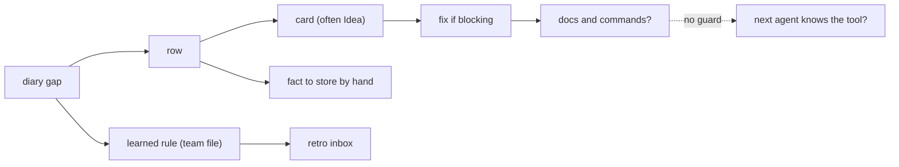
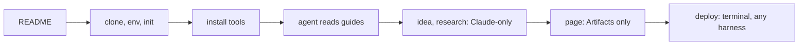
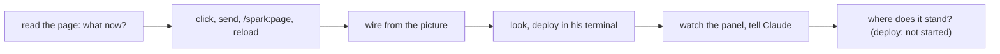

# P1039 council: the user's journey lens

Read-only lens, Opus, 2026-11-23. Tags: E with a pointer, H with its source, D with who and when, — for an unknown.
Walk diaries are under `~/Development/spark-walks/` (the PO's files, outside the repository). "display" is
`p934-display/diary.md` (2026-11-22 morning), "display2" is `p934-display2/diary.md` (2026-11-22 to 23), "epaper" is
`p934-epaper/diary.md` (2026-11-19 to 21). A time is the diary's own CET heading.

## 1. Findings

Most important first.

- UJ-1 · After the deploy, spark loses track of the project. `flow.py show` on p934-display2, run on 2026-11-23,
  prints "deploy: not started". The folder's `sim/runs/board/` holds 27 deploy logs, from 2026-11-22T13-04 to
  2026-11-23T12-53. `DeployReader.read` returns `NOT_STARTED` whatever the project holds. The P867 discovery already
  found this on 2026-11-17 ("the deploy always reads 'not started'"). The page, the agent and the person all read the
  same wrong state. · E · `scripts/spark/flow/phase_readers.py:554-560`. The command:
  `SPARK_HOME=~/.local/share/spark python3 scripts/flow.py show --project ~/Development/spark-walks/p934-display2`
  (2026-11-23). The count: `ls sim/runs/board | wc -l` = 27. P867: `docs/discovery/2026-11-17-p867-journey-redefined/jobs-and-journeys.md`,
  the maker's table, step 9. P1038 #1521's body ("stands at deploy … deploy not started" while it was flashed more than
  ten times) · supports only: the product (what exists), not how often it hurts
- UJ-2 · J1 ran end to end once: a vague idea became a deployed gadget that works. It happened only because three
  spark fixes merged during the walk, and some steps ran outside spark. The e-paper clock on the FireBeetle 2 C6
  showed the time at 14:08 on 2026-11-22. The first deploy with `ready seen` came at 16:46. The button met its must
  line at 19:07. P1001 (#1460, deploy with no simulation), P1006 (#1473, stale shelf copy) and P1007 (#1475, mpremote
  on the C6) merged during the walk. Three tools ran outside spark's commands. One was a trial firmware for the controller. One was the
  session's own pyserial REPL helper ("a script in the session's scratchpad, not kept", 20:02). One was a button
  logger on the board ("not kept in the repo", 22:31). · E · display2 11:52 to 16:46, rows 10, 13, 14, 20:02, 22:31 · supports
  only: an account, n = 1 (the PO with Claude)
- UJ-3 · After the deploy, the gadget lived on outside spark's journey. Between 2026-11-22 19:05 and 2026-11-23
  14:18 the walk folder became its own git repository with 33 commits and issue numbers of its own (#2 to #12). The
  work was battery research and steps, a quote mode with Czech text, deep sleep, and host tests (`tests/test_quotes.py`,
  `tests/test_schedule.py`). spark's phases end at deploy. None of them covers iteration, bench trials or a gadget's
  own backlog. · E · `git log` in `~/Development/spark-walks/p934-display2`, `flow.py --help` (nine phases, idea to
  deploy) · supports only: an account
- UJ-4 · Past the breadboard, the PCB is a draft made by hand. No walk has made one, and enclosure and 3D are not
  there yet. The build writes `dist/board/pcb.svg` and `schematic.svg`. Gerbers come from a hand command,
  `npx --no tsci export board.tsx -f gerbers` (`commands/build.md:399-403`). The guide calls ordering "not designed
  yet" and the board "a draft": a column of modules, no mounting holes (`docs/guide/journey/from-draft-to-order.md:5-8`).
  No flow phase and no README "What works today" row goes past Bench. P203 (#163, Fusion 360 and 3D) is open. Yet the
  plugin's own description still offers "the board (PCB) and its 3D model on request". · E · README.md:118-127,
  `.claude-plugin/plugin.json` (description), `gh issue view 163` (OPEN, 2026-11-23), the p934-display2 `dist/board`
  listing · supports only: the product
- UJ-5 · Inside the team, knowledge of spark's own bench tools got lost. P1005 (#1464), filed during the walk, says
  "Spark has no way to talk to a running board". But `live.py` (P247) runs code on the running board inside a grant,
  and `commands/deploy.md:148` names it. Before P1007, the walk diaries never name `live.py`, `grant.py` or
  `reach.py`. The session wrote its own helper instead. · E · `python3 scripts/live.py --help`, `/usr/bin/grep -n
  "live.py\|reach.py\|grant.py"` over the display2 and epaper diaries (one hit, 16:10, after P1007),
  `gh issue view 1464` · caveat: live.py runs mpremote. mpremote failed on this C6 until P1007. So live.py probably failed
  there too (H, from P1007 #1466's root cause). The loss is in the card's claim and the missing first try, not in a
  working tool that went unused · supports only: an account
- UJ-6 · An untaught flag led to the same idea being invented again. `flash_image.py --config` ("JSON written as
  /config.json into the image") is in spark since 2026-09-29. No command, skill or agent page names it. On 2026-11-22
  at 13:22 the session put the Wi-Fi password into `firmware/wifi_secrets.py`. It then filed P1004 (#1463), whose
  sketch puts the secret "into the image as /config.json". · E · `python3 scripts/flash_image.py --help`,
  `git log -S'--config' -- scripts/flash_image.py` (3a9808c9, 2026-09-29), display2 13:22 · supports only: the
  product plus one account
- UJ-7 · No check finds a script or flag that the agents are never taught. The measured gap is small but real.
  The method: each flag in the `--help` of 13 scripts, searched in commands/, skills/, agents/ and docs/guide/agents*.
  None of these names `cost.py`. Untaught flags: `parts.py --signals` and `--view`, `reach.py --cure-first`,
  `flash_image.py --config`, `run_scenario.py --timeout-ms`. · E · the loop run on 2026-11-23 (zsh, `/usr/bin/grep
  -rq`) · caveat: 13 of 27 scripts checked. A flag named only in other prose was not looked for. This agrees with the
  #1522 comment's "one direction is guarded" reading for these scripts only · supports only: the product
- UJ-8 · The walk agent repeated slips that the learned rules already hold, and one of them reached the store. Three
  diary headings carried times estimated ahead of the clock. The learned rules hold the clock rule eight times or more
  (R11.2 lists the lines). The session also wrote that the PO saw a second trial draw, which he never said. That claim
  went into the e-paper record's source in the store at 13:14 and was corrected at 14:08. The learned rules are a
  team file. The R11 retro found that one more rule does not stop a repeated slip. · E · display2 13:24 ("three diary
  headings carried estimated times"), 13:36, row 21, `~/.local/share/spark/learned-rules.md` (2026-11-20 entry on
  times), `docs/discovery/2026-11-22-r11-retro/retro.md` (R11.2) · supports only: an account
- UJ-9 · A finding at the bench reaches the store only by hand. A stale store copy cost the person his wiring
  picture. The shelf copy of the e-paper record had no `based_on`, so it was never refreshed. The build had no drawn
  breadboard. The PO wired from the text steps and then said: "I don't see the names on the pins". Three bench facts went into the store by the session's
  `--fact-set`, each after the PO's yes: the controller, the deep-sleep wake and the BUSY level. P1002 (#1461, "always offer new findings to the store") is in Idea. · E · display2 11:40,
  11:46, 13:14, 14:08, rows 10, 15, 16 · supports only: an account
- UJ-10 · As the person's interface for picking, the page failed four times. The PO called it "not very readable or
  intuitive" (11:28). He did not find a Pick button that was on the page (11:32). One request at a time meant four
  round trips for four picks: click, Send, /spark:page, reload. The first publish was refused until he ran /add-dir
  (display 07:00). On 2026-11-20 at 19:19 he said "it just doesn't guide a person". · E · display2 11:26 to 11:32,
  rows 5 to 7, display 07:00, row 6, epaper 19:09, 19:19 · supports only: an account. P1011 #1470 and P1038 #1521 are
  open
- UJ-11 · The person sees the physical state of the bench, and Claude does not. That cost time, and it touched the
  board without the PO's yes. A battery kept the panel powered through a USB unplug, and the session did not know.
  From 13:36 to 14:03 its hypotheses were wrong, and one wrong cause went into the diary and was corrected at 14:03.
  Opening the C6's port restarts the board, so "a passive read is not passive" (13:27). During the P1007 probe the
  session restarted the running clock about 20 times, and "the PO was not asked to do anything" (14:54). · E ·
  display2 13:27 to 14:03, 14:54 · supports only: an account
- UJ-12 · A board with no Wokwi model shows a built board as a failure. `flow.py show` on 2026-11-23 still prints
  "? build: could not run" for a build that built, while its DONE line says "build (no simulation)". Row 9 became
  P1008 (#1467), which is in Ready. · E · the `flow.py show` run above, display2 11:40, row 9 · supports only: the
  product
- UJ-13 · Claude only hands over the deploy. The person runs it in his own terminal, and Claude learns the result from
  log files. `deploy.py` says "no terminal to ask you in" and gives the line (11:52, 13:24, 16:30). The person types
  yes and sees esptool's output. The session reads `sim/runs/board/*.log`. The diaries never name a deploy grant
  (`grant.py --scope deploy`). `look.py`'s text is a list of loose lines that ends "token … It is not your yes", P1032
  (#1512) is open. · E · display2 entries above, `tests/golden/look-ok.txt`, `docs/guide/agents/scripts.md` (grant,
  `relayed_yes_refused`) · supports only: an account and the product
- UJ-14 · The research agent's record guessed the wrong e-paper controller, and the breadboard sheet repeated the
  guess. The record said SSD1675A, from a community README. The bench showed the IL0373/UC8151 command set. Until the
  evening's `--fact-set`, the sheet's before-power line told the person to use the SSD1675/SSD1680 driver, which drew
  nothing. Counted at 13:18: the e-paper record had 3 verified facts and 30 unverified, the C6 board record had 0
  verified and 61 unverified. · E · display2 11:39, 13:05 to 13:14, 13:18, row 15, epaper 23:36 · supports only: an
  account
- UJ-15 · Need matching never offers the board's own radio. The PO had to ask "does the c6 even have a wifi?"
  (11:34). In both runs a wifi need is offered only a separate module (P990 #1443). The need's condition "e-paper"
  does not lift the owned e-paper above colour displays (P1015 #1476). · E · display 06:58, display2 11:22, 11:34,
  rows 1 and 2 · supports only: an account
- UJ-16 · In the walk project, the agent's file points to the guide on GitHub's main branch, not the installed copy.
  `/spark:init`'s AGENTS.md links `blob/main/docs/guide/agents.md`. The project's CLAUDE.local.md links the PO's team
  rules (lanes, hook, cards) into the gadget's folder. · E · `~/Development/spark-walks/p934-display2/AGENTS.md`,
  CLAUDE.local.md links to `~/.local/share/spark/rules.md` · caveat: the effect is H. A guide on main can name a
  flag that the installed plugin lacks, and the team rules load into a gadget session. No walk shows either harm
- UJ-17 · Walk rows become cards reliably, but most of those cards wait in Idea. The next session learns only what
  reached a command or a guide. The morning run had 14 rows, and 5 cards were filed the same day (P989 to P993). The
  restarted run had 26 rows and cards P1001 to P1015. Of these, P1002, P1003, P1004, P1005 and P1015 are in Idea, and
  so is P992. R11 counted 657 cards opened and 375 closed from 10-20 to 11-22, with 402 open. · E · the rows of both
  diaries, `docs/discovery/2026-11-22-r11-retro/retro.md` (R10.2 row) · caveat: "the next session reads commands, not
  cards" is H. A team session reads the board. A gadget session reads the plugin's commands · supports only: data for the board, an account for the walk
- UJ-18 · After the flash, the check still sometimes misses a firmware that runs. The same image gave `ready seen`
  at 23:10 and `ready unknown` at 23:22 (row 26, P1022 #1490). This branch's base has P1022 slice 2 merged. · E ·
  display2 row 26, `git log` (e521db8f) · supports only: an account
- UJ-19 · All J1 evidence is n = 1: the PO directs Claude. No hobbyist has run spark. The library's XIAO ESP32-C6 is
  held by another project: the flow run shows "Seeed XIAO ESP32-C6 (none free, held by reaction-game)". The
  P100 discovery found the same hold pattern on 2026-10-09 (★C1). · E · scrum/VISION.md (Who it is for), the
  `flow.py show` run above, `docs/discovery/2026-10-09-p100-real-use/brief.md:48` · supports only: the product
- UJ-20 · J2 is a hypothesis: no user on another harness or a local model is known. From the install text, the
  first thing they meet is this: every command, skill and agent is written for Claude Code. `scripts.md:7-14`
  asks them to `export CLAUDE_PLUGIN_ROOT`. 76 lines in 12 command, skill and agent files use
  `${CLAUDE_PLUGIN_ROOT}`. 10 files carry Claude Code `allowed-tools` frontmatter. `/spark:page` calls only
  `mcp__claude-artifacts__*` tools (`commands/page.md:3`). `tools.py --on` runs the `claude` CLI. The agent-facing text
  is about 63,500 words (commands, skills, agents, docs/guide/agents*). · E for the files (`/usr/bin/grep -rl`, `wc -w`,
  2026-11-23). H for the person's steps on another harness, and for the context of a local model · supports only:
  the product

### J1 · the maker (the PO) and the agent at the keyboard: from a vague idea to a deployed gadget, past the breadboard

| step | what they do | evidence | friction or harm | today | open question |
| --- | --- | --- | --- | --- | --- |
| 1 | photos of a new module. /spark:identify | E epaper 23:28 to 23:36 | no ruler in the photos and no step to ask for a fourth. The matcher read the "e" of "e-paper" as a match | partly | Q-A7 |
| 2 | research the module (parts-researcher, Opus, 6 min 18 s) | E epaper 23:36, display2 13:18 | the controller was a guess and turned out wrong. 3 of 33 facts verified | partly | Q-A5 |
| 3 | bring his own board (the C6) | E epaper 15:07 to 16:41 | an agent followed the documented path. The drawing came out mirrored until the PO looked. The board file stayed in one project until P989 | partly | — |
| 4 | folder, goal, must lines (init) | E display2 11:20 to 11:22 | none seen in the restarted run | works | — |
| 5 | needs and match | E display2 11:22 | the board's Wi-Fi never offered. E-paper ranked under colour displays | partly | — |
| 6 | picks on the published page | E display2 11:24 to 11:34 | /add-dir first. Four round trips. A button he did not find. Wifi had to be picked in the chat | partly | Q-A2, Q-A8 |
| 7 | parts list by a click | E display2 11:36 | the offer stays after it ran | works | — |
| 8 | build | E display2 11:40 | a built board shows "could not run" (no Wokwi model of the C6) | partly | — |
| 9 | breadboard sheet and picture. Wiring | E display2 11:40 to 11:50, epaper 06:42 | a stale shelf copy cost the picture, so he wired with no pad names. A 3V3 jumper too many. Plain control lines on the I2C pads | partly | Q-A1 |
| 10 | settle a fact only the bench can settle (the controller) | E display2 11:39, 13:05 | done by a hand-written trial firmware. No spark step (P1003 in Idea) | not yet | Q-A5 |
| 11 | firmware written by the conversation, importing pins.py | E display2 13:15 | by design (facts, not behaviour). Nothing said that the C6 has 2.4 GHz Wi-Fi only. The secret went into a project file, `--config` unused | partly | — |
| 12 | simulate | E display2 11:40 | no Wokwi model of the C6 | — | — |
| 13 | look, then deploy in his own terminal | E display2 11:51 to 16:46, row 26 | blocked until P1001 and P1007 merged. "ready unknown" still now and then | partly | Q-A3 |
| 14 | debug the running board live | E display2 13:38 to 14:03, 20:02 | done with the session's scratch helper. Spark's live.py was not tried. The board restarted on each port open | not yet (in the walk) | Q-A6, Q-A9 |
| 15 | keep what the bench taught in the store | E display2 13:14, 14:08, row 16 | by hand, after his yes each time | partly | Q-A10 |
| 16 | iterate the gadget (battery, quotes, deep sleep) | E the walk repo's git log | outside spark. Flow says deploy "not started" | not yet | Q-A4 |
| 17 | order a PCB | E from-draft-to-order.md:5-8, commands/build.md:399-403 | Gerbers by a hand command. A draft layout. Not walked | partly (by hand, unwalked) | — |
| 18 | enclosure and 3D model | E VISION.md (later). P203 #163 open | nothing does it | not yet | — |

### J3 and J4 · the team: a finding at the bench becomes a card, a fix, a rule, a retro row, and the next agent's knowledge

| step | what they do | evidence | friction or harm | today | open question |
| --- | --- | --- | --- | --- | --- |
| 1 | the session writes a gap in the diary, with the PO's words | E both diaries | times written from feel. A claim the PO never made (UJ-8) | works, with slips | Q-A11 |
| 2 | rows at the walk's end: raised, acted, dropped | E display rows 1 to 14, display2 rows 1 to 26 | — | works | Q-A12 |
| 3 | a row becomes a card | E P989 to P993, P1001 to P1015 | most of them wait in Idea. 402 cards are open | works (filing) | — |
| 4 | a blocking row gets fixed in the walk | E P1001, P1006, P1007 merged on 11-22 | the walk waits on a PR and its review (11:52 to 12:30) | works | — |
| 5 | a fact goes into the store | E display2 13:14, 14:08 | by hand. A card for the write-back is in Idea (P1002) | partly | Q-A10 |
| 6 | a slip becomes a learned rule | E learned-rules.md, R11.2 | the walk repeated slips the file already holds. The file is the team's, and a gadget session does not read it | partly | — |
| 7 | the retro sorts the inbox | E r11 retro.md (62 entries: 6 caught by a gate, 10 on a card, 46 dropped) | walk rows are not in the inbox. R11 came 26 days late | partly | — |
| 8 | a new script or flag reaches the commands, skills and guides | E #1522 comment (16:0x). UJ-7 | an untaught flag fails no check. `--config` and `--cure-first` are untaught | partly | — |
| 9 | the next agent uses spark's own tool, not a scratch one | E UJ-5, UJ-6 | P1005 claims a tool spark already has. P1004 sketches a flag spark already has | not yet (seen twice) | Q-A9 |
| 10 | the scratch helpers of a walk are kept | E display2 20:02, 22:31 | "not kept". What P1007 kept came through a card | partly | — |

### J2 · a builder on another harness or a local model (H: a thought experiment from the install text)

| step | what they do | evidence | friction or harm | today | open question |
| --- | --- | --- | --- | --- | --- |
| 1 | read the README and see "In Claude Code, type /spark:build" | E README.md:24-29 | the second road is a clone plus python3. It works | partly | — |
| 2 | clone, `export CLAUDE_PLUGIN_ROOT`, init, `tools.py --status` | E scripts.md:7-14, 29-31 | a variable named for Claude. Exit 2 while any tool is missing | partly (H) | — |
| 3 | install tscircuit (npm, bun), node, wokwi-cli, littlefs-python, gh | E scripts.md (What the scripts need) | heavy for a first try. `tools.py --on` registers MCP through the `claude` CLI | partly (H) | — |
| 4 | point their agent at the guide | E docs/guide/agents.md. ~63,500 words of agent-facing text | the commands carry `allowed-tools` and `${CLAUDE_PLUGIN_ROOT}`. A small local model cannot hold the text (H) | — | Q-A13 |
| 5 | the conversation steps: idea, research | E commands/idea.md, research.md, agents/*.md | research runs as Claude subagents with web tools. With none, records stay unwritten | not yet (H) | — |
| 6 | the page | E commands/page.md:3 | Claude Artifacts only | not yet | — |
| 7 | deploy | E scripts.md (grant, the person's terminal) | the yes typed in a terminal works on any harness | works (H, not run) | — |

### J5 · the person at the bench or on the page, against what Claude sees

| step | what they do | evidence | friction or harm | today | open question |
| --- | --- | --- | --- | --- | --- |
| 1 | reads the page for what to do now | E epaper 19:09, 19:19, display2 11:29 | "doesn't guide a person". Narrow small text. Developer lines | partly (the NOW guide since P977) | Q-A8 |
| 2 | clicks a pick, sends, types /spark:page, reloads | E display2 11:26 to 11:34 | four round trips. The offer list changes between reloads | partly | Q-A2 |
| 3 | wires from the page's picture | E display2 11:41 to 11:46 | no picture (stale shelf copy). Wired from the text | partly | Q-A1 |
| 4 | reads look.py and runs deploy.py in his own terminal | E display2 11:51, 13:24, tests/golden/look-ok.txt | loose lines. "It is not your yes". Claude learns the result from logs | partly | Q-A3 |
| 5 | watches the panel and the LED, and tells Claude | E display2 13:07, 13:36, 14:03 | Claude cannot see the panel. It claimed once what he never said. It did not know about the battery | partly | Q-A6, Q-A11 |
| 6 | asks where the project stands, on the page or in flow | E flow.py show, 2026-11-23, scripts/spark/flow/phase_readers.py:554-560 | "deploy not started" after 27 deploys. "build could not run" for a built board | not yet (deploy) | Q-A4 |

## 2. What you could not check, and why

- Whether `live.py` reached the C6 before P1007. I did not run it, because that needs the board and a
  grant. It is H from P1007's root cause.
- The status of each card filed from the walks today, beyond those named on P1038, P1011, P1005, P1008 and P1022. I
  read no board view, to keep the GraphQL limit.
- The walk project's own issues #2 to #12. Their numbers are in commit subjects. I did not find or read where they
  are hosted.
- The rest of the epaper diary (about 330 lines) and the p711 and walk 2 to 4 diaries. I read the headings and the
  parts named above. Older friction is possibly missing here.
- How a harness other than Claude Code reads `commands/*.md`, AGENTS.md or `allowed-tools`. No other harness is
  installed here, and the brief allowed no web search. All of J2 stays H.
- Flags of the 14 scripts not in my loop, and flags named in other words. UJ-7 is a lower bound.
- Which session ran each of the 27 deploys, and who typed yes. The logs hold that, but I read only their names.
- The PO's session transcripts. Whatever the diaries left out is not here.

## 3. Questions for the decider

Account questions are past tense, about his own use, the answer is E, account, n = 1.

| # | question | what it decides |
| --- | --- | --- |
| Q-A1 | On 2026-11-22 around 11:41 you wired from the text steps before the drawn picture existed. How did you find each pad, and did any wire go to a wrong one? | whether the drawn picture must exist before any wiring step is offered (J5) |
| Q-A2 | Around 11:25 to 11:35 you picked four needs on the page, one click and one /spark:page at a time. Was it quicker or slower than the picks said in the chat? Which of the two did you want at that moment? | whether the page or the chat comes first for choices (J5, the interface question) |
| Q-A3 | Between 11-22 13:04 and 11-23 12:53 the walk folder logged 27 deploys. How many did you type in your own terminal, and did you think of a deploy grant then? | whether the deploy's yes stays in the person's terminal or moves to a grant or the page |
| Q-A4 | After the clock worked on 11-22 evening, you went on with battery and quotes in the walk repo. Did you open the page or `flow.py` again after that? If yes, what did it tell you, and what did you use to see where the gadget stood? | whether spark's journey covers iteration after the deploy (the factory question) |
| Q-A5 | On 11-22 at 11:39 you asked whether to find out the controller first or let the test find it. When the bench showed that the record's guess was wrong, what did you then trust less: the record, the research agent or the sheet? | where bench trials sit in J1 (P1003), and the weight of a researched record |
| Q-A6 | From 13:36 to 14:03 the panel did not draw while a battery was connected. When did you remember the battery, and did anyone ask you what was plugged in? | whether spark asks for the bench's physical state before a hypothesis |
| Q-A7 | On 11-19 your photos had no ruler. Did you have one or calipers at the bench? Did you think of a fourth photo with a scale? | the identify step's photo checklist |
| Q-A8 | On 11-20 at 19:19 you said the page "just doesn't guide a person". On 11-22 at 11:28 you said "not very readable". During the walk, did you decide each next step from the page, from the chat, or from both? | which interface carries "what now" (J5) |
| Q-A9 | During the walk, did you know that spark had `live.py` and `grant.py` before you asked for a REPL on 11-22 around 13:45? | whether the gap is the tool or how the tool is taught (J4) |
| Q-A10 | Each `--fact-set` into the store on 11-22 waited on your yes after a dry run. What did you read in the dry run before saying yes? | how write-back is checked by a person (P1002) |
| Q-A11 | At 13:12 the session wrote that you saw the second trial draw, and it corrected this itself at 13:36. Did you notice the wrong claim before it said so? | how much a person catches of what Claude writes in their name |
| Q-A12 | After the walk of 11-22, which of its 26 rows or cards did you read yourself? | whether rows and cards are a channel he uses, or one only for the team |
| Q-A13 | Have you ever run spark's scripts, or one of your gadget projects, outside Claude Code: another agent CLI, an IDE agent, CI or a local model? | whether J2 has any account behind it, or stays H |
| Q-A14 | On 11-22 from 14:54 to 15:10 the session restarted your running clock about 20 times while it probed the port, without asking. Did you see it, and was that all right? | the consent line for bench probes on a board that runs |

## 4. Searches

none
