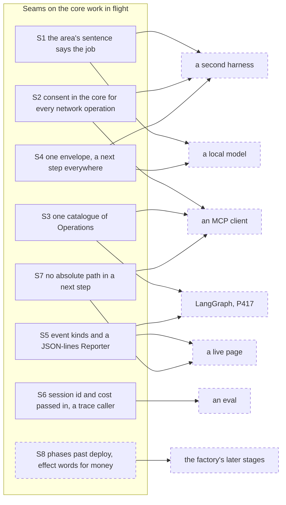
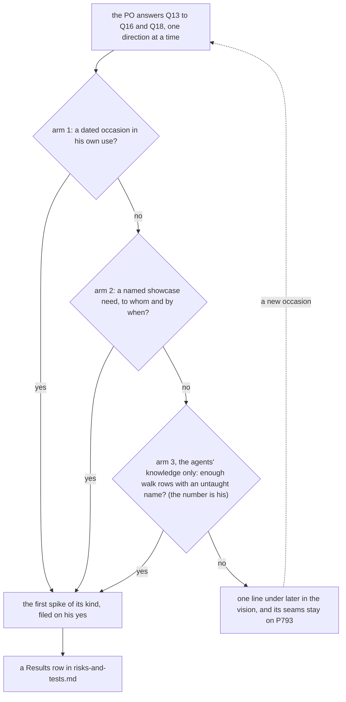
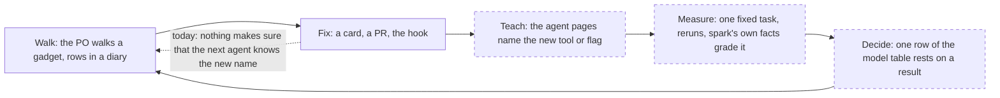

# P1039 diagrams: the line, the architecture, the journeys, the story map and crude interface sketches

The PO's standing rule of 2026-11-23, relayed by the page-design session through spark-main: "Whenever you do a
discovery or design, its super helpful when you use diagrams. Especially for architecture and for processes and
journeys and story maps, etc. Also, if possible crude interface drawings etc."

Every diagram here is a picture of the folder's text. It adds no claim, and nothing in it is decided. Where a diagram
and the text disagree, the text holds. A dashed box is not built. A sketch shows a layout, never a value: a word in
angle brackets stands for a value that spark or the PO supplies.

## Where the other diagrams are

| diagram | file |
| --- | --- |
| the architecture today | [direction.md, The architecture today](direction.md#the-architecture-today) |
| the proposed target architecture, with the seams S1 to S8 | [direction.md, The proposed target](direction.md#the-proposed-target) |
| how spark evaluates itself, as a loop | [direction.md, How spark evaluates itself](direction.md#how-spark-evaluates-itself-as-a-loop) |
| J1, the maker from an idea to a deployed gadget | [jobs-and-journeys.md, Journeys](jobs-and-journeys.md#journeys) |
| J3 and J4, a finding at the bench reaches the next agent | [jobs-and-journeys.md, Journeys](jobs-and-journeys.md#journeys) |
| J2, a builder on another harness (all H) | [jobs-and-journeys.md, Journeys](jobs-and-journeys.md#journeys) |
| J5, the person at the bench against what Claude sees | [jobs-and-journeys.md, Journeys](jobs-and-journeys.md#journeys) |

## 1. The factory line as a process

The sixteen stages of direction.md's table, by their status today. The architect's opinion (Q3, not decided) puts the
end of the line (stages 9 to 12) before its extension (13 to 16).

```mermaid
flowchart LR
  s1["1 shape the idea"]:::partly --> s2["2 research a part"]:::partly --> s3["3 pick parts"]:::partly --> s4["4 build and check"]:::partly
  s4 --> s5["5 wire the breadboard"]:::partly --> s6["6 settle a fact at the bench"]:::missing --> s7["7 firmware, by the conversation"]:::exists
  s7 --> s8["8 simulate"]:::partly --> s9["9 look and deploy"]:::partly --> s10["10 debug the running board"]:::partly
  s10 --> s11["11 keep what the bench taught"]:::partly --> s12["12 iterate the gadget"]:::partly
  s12 --> s13["13 PCB files"]:::partly --> s14["14 order the PCB"]:::missing --> s15["15 enclosure and 3D"]:::missing --> s16["16 fabricate, wait, receive"]:::missing
  s12 -. "a change goes round again" .-> s4
  classDef exists fill:#d8f0d8,stroke:#2a7a2a
  classDef partly fill:#fff2cc,stroke:#a07800
  classDef missing fill:#f4d6d6,stroke:#a02a2a,stroke-dasharray: 5 5
```



Green exists, yellow works in part or by hand, red with a dashed border is missing.

## 2. The seams and who uses them

The seams that Q5 puts onto the open pieces of P793 #1105 (D3, delegated), and the later consumer that each one keeps
open. S8 waits for the factory's first Operation.



## 3. The decision path after the riskiest test

How a direction moves under the council's pass line for A1 (D2, delegated, the PO's to change). Nothing is filed
without his yes.



## 4. The team's loop, as a process

The backbone's second row: how the team finds out whether spark got better (J3, J4). Steps in dashed boxes do not
exist today.



## 5. The story map as a picture

The backbone left to right, and the slices from top to bottom, from story-map.md. The map is proposed and not applied.

```text
 BACKBONE  Shape → Pick → Build → Wire → Firmware → Deploy → Iterate → PCB → Enclosure
           ─────────────────────────────────────────────────────────────────────────────
           the team's loop across all of it:  Walk → Fix → Teach → Measure

 SLICE 0   [the PO reads one picture and answers the queue ........................ all ]
 skeleton  [seams S1 to S7 as lines on P793 #1105 ................................... all ]
           [no-install trial in the second harness, on his yes ...................... all ]
           [the riskiest test: which direction has a pull .................... Measure ]

 SLICE 1                                         [deploy reads as recorded]
 the end                                                   [after the deploy: where the gadget stands]

 SLICE 2   [entry page names the flow call; each untaught name gets a line ...... Teach ]
 agents on [one walk through spark's own pages only ........................... Walk  ]
 spark's   [a new script or flag fails the hook until a page names it ......... Teach ]
 pages

 SLICE 3   [one fixed task, 5 runs, graded by spark's facts ................... Measure ]
 measured  [one model-table row rests on a result ............................ Measure ]

 SLICE 4   [LookAtBoard as MCP tool and LangGraph node, 0 core lines (P417) ...... all ]
 a second  [the job of /spark:build in one other harness ........................ all ]
 binding

 LATER                                                              [order]  [enclosure]
           [a local model reads an answer and names the next step ............... all ]
           [one local server streams to a live page and the HTTP MCP ........... all ]
```

## 6. Crude interface sketches

Sketches of layouts only, for the interfaces that the epic names. They are not designs: the CLI view is P1032 #1512's
work, and the page is P1038 #1521's own discovery.

### 6.1 One answer, two readers: the person and the AI

The PO's rule of 2026-10-18: every interface serves a person and an AI. The same core answer is shown twice. The key
names on the right are among those that `flow.py show --json` gave on a scratch copy of the walk-c6 fixture on 2026-11-23
(top level: envelope, tool, op, status, data, problems, unchecked, next, truncated). The values are placeholders.

```text
 A person in a terminal                     │ An AI reading --json
────────────────────────────────────────────┼─────────────────────────────────────────
 <project>                  <phase>: <state>│ {
                                            │   "status": "<status>",
 Facts                                      │   "data": { "phases": [ ... ],
   <fact>                                   │             "stands_at": "<phase>", ... },
   <fact>                                   │   "problems": [ ... ],
 Findings                                   │   "next": [
   ! <finding>, fix: <fix>                  │     { "op": "<operation>", "argv": [ ... ],
                                            │       "why": "<one sentence>",
 Next: <one sentence>                       │       "effects": [ "<effect>", ... ],
   $ <command>                              │       "needs_yes": <true or false> } ] }
```

### 6.2 The no-install trial in a second harness (Q7, on the PO's yes)

The cheapest proof for J2: the harness already on his computer runs one read-only call on a fixture. Nothing of spark
is installed into it.

```text
 ┌ a second agent harness ─────────────────────────────────────────────┐
 │ > Run `python3 <spark>/scripts/flow.py show --json` in <fixture>     │
 │   and tell me the next step.                                         │
 │                                                                      │
 │ ran: flow.py show --json                                             │
 │ The next step is <operation>: <why>. It <effects>.                   │
 │ It needs your yes: <true or false>.                                  │
 └──────────────────────────────────────────────────────────────────────┘
   pass: the harness names the same next step that the envelope holds
```

### 6.3 spark as tools in an MCP client (P417, later)

What an MCP client lists once the catalogue (S3) exists. A tool's line comes from the Operation's own
declarations: name, summary, effects.

```text
 ┌ tools from spark ────────────────────────────────────────────────────┐
 │ show-flow      where the project stands, and the next step   reads    │
 │ look-at-board  what is on the USB port                       reads    │
 │ build-board    the board from the requirements file          writes   │
 │ research       one part from the maker's documents           network  │
 │ ...                                                                   │
 └───────────────────────────────────────────────────────────────────────┘
   a tool with the network effect asks the person first (S2), in any client
```

### 6.4 The person's yes, the same in every interface (Q12)

```text
 Claude Code, an MCP client, a page, another harness
        │
        ▼
 spark's core: this step reaches the network / writes to the board
        │
        ├── the network: the core asks, and records the yes (S2)
        │
        └── a flash: the yes is a word that the person types in their own
            terminal, or a grant. No click and no "accept" stands for it.
```

### 6.5 Did spark get better? (Q10, later)

One line per measured row, in the layout of a release note. No row exists today.

```text
 measure                     before        after        source
 ─────────────────────────── ───────────── ──────────── ──────────────────────
 <fixed task> passes         <k> of 5      <k> of 5     <eval run, date>
 tokens per run              <n>           <n>          cost.py, <date>
 model for <job>             <model>       <model>      <result that moved it>
```
