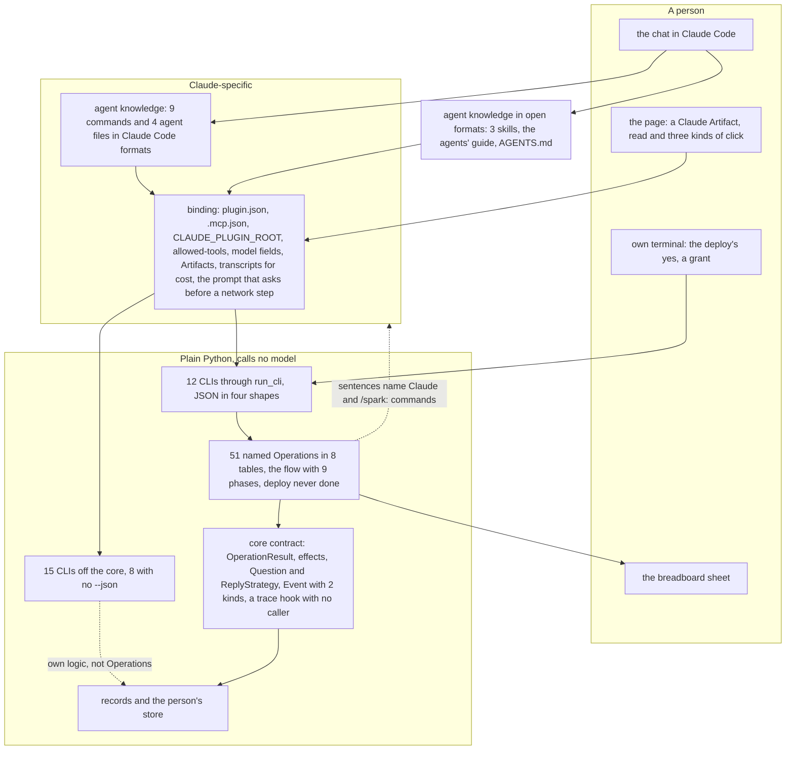
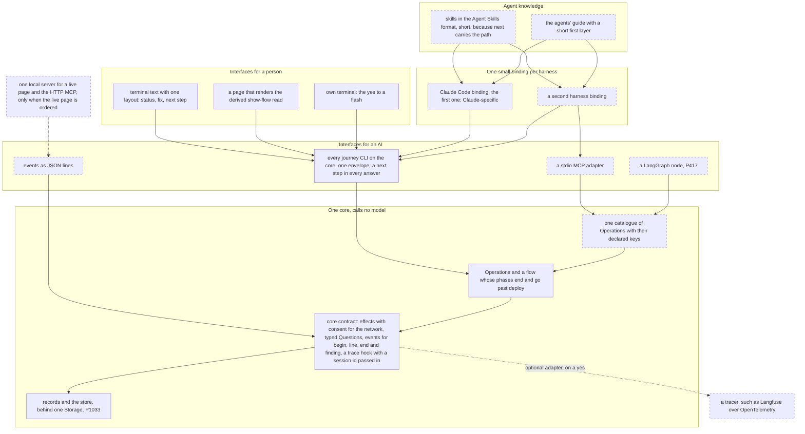
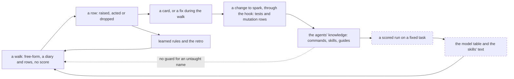

# P1039, spark past the MVP: the direction in one picture

A synthesis of six lens reports (council/), written on 2026-11-23 by the architect agent. It proposes and decides nothing. A ★C number points to a claim in [the brief](brief.md), with its caveat there. E is evidence with a pointer, H is a hypothesis with its source, D is a decision with who and when. Every recommendation says whose opinion it is.

## The short version

1. Past the MVP, spark is one line from a vague idea to a gadget in use. Today the line has no end: the deploy never shows as done (E ★C19), the PO's own gadget went on outside spark after its first deploy (E ★C20, an account, n = 1), and everything past the breadboard is by hand or missing (E ★C21).
2. The architecture needs no second design. The core calls no model (E ★C1) and its seams exist (E ★C9, ★C10). What ties spark to Claude is the agent layer (E ★C2), the sentences of the areas (E ★C3) and five yes gates (E ★C11). Opinion (the architecture lens's, shared by the architect): finish today's split and keep eight seams open on the core work in flight.
3. Every reason for the five directions is the PO's wish (D, #1522), and the evidence of use is nil (E ★C6, ★C23). Opinion (the architect's, with the risks lens): seams only and no new epic now, one free test that says which direction a project reaches for, and the first spike goes to that direction.

## The product past the MVP: the factory line

"Exists" means that a spark step does it. "Partly" means that it works with a named gap or by hand. "Missing" means that nothing does it.

| # | stage | today | what the evidence says |
| --- | --- | --- | --- |
| 1 | shape the idea, the needs | partly | `/spark:idea` writes needs. The README reads "partly" for Idea (E council/risks-and-assumptions.md:19, RA-6) |
| 2 | know what you own, research a part | partly | a researched record guessed the wrong controller, with 3 of 33 facts verified (E UJ-14, an account) |
| 3 | pick parts, on the page or in the chat | partly | four round trips for four picks on the page (E UJ-10, an account). The page is P1038 #1521's own discovery |
| 4 | build and check the board | exists | Build and Checks read "works" (E RA-6) |
| 5 | wire the breadboard from the sheet | partly | one walk wired from text, because a stale store copy cost the picture (E UJ-9, an account) |
| 6 | settle a fact at the bench | missing | done by a hand-written trial firmware (E UJ table, step 10). P1003 is in Idea |
| 7 | firmware, written by the conversation | exists, by decision | spark exports facts, never behaviour (D the firmware decision, AGENTS.md) |
| 8 | simulate | partly | no Wokwi model for the C6 (E UJ-12) |
| 9 | look and deploy | partly | it works after three fixes of 2026-11-22 (E ★C20). The phase never shows as done (E ★C19) |
| 10 | debug the running board | partly | `live.py` exists, and the walk used a scratch helper (E ★C15, an account) |
| 11 | keep what the bench taught | partly | by hand, after a yes each time. P1002 #1461 is in Idea (E UJ-9) |
| 12 | iterate the gadget after it runs | missing | 33 commits outside spark's journey (E ★C20). The flow's nine phases end at deploy (E council/architecture.md:48, AR-18) |
| 13 | PCB: Gerbers, parts list, rules | partly | a draft layout and a hand command. No walk made one (E ★C21) |
| 14 | order the PCB | missing | "not designed yet" (E ★C21). The effect words have no word for money or an order (E ★C22) |
| 15 | enclosure and 3D model | missing | P203 #163 is open (E ★C21). The CAD tool is H (council/architecture.md:175) |
| 16 | print or fabricate, wait, receive | missing | a wait of days fits the flow's files and a phase reader, not one run (opinion, the architecture lens's, council/architecture.md:176) |

Opinion (the architect's): the next product step is the end of the line (stages 9 to 12), not its extension (13 to 16). Every later stage fits the core as more Operations, effect words and phases (E ★C22, a reading of the code). An unattended line that writes behaviour is a proposed no-go (D the firmware decision).

## The architecture today

Sources: E ★C1, ★C2, ★C3, ★C7, ★C8, ★C9, ★C10, ★C11, ★C19, and the layer diagram of the architecture lens (council/architecture.md:85-131).

## The proposed target

Opinion (the architecture lens's, council/architecture.md:81 and :112-118, shared by the architect). Nothing in it is decided. Dashed boxes are not built.

What changes between the two pictures, as seams on the core work in flight (Q5 in the brief):

| seam | what it keeps open | evidence |
| --- | --- | --- |
| S1 an area's sentence says the job, and each interface adds its own how | another harness, a local model | E ★C3 |
| S2 consent in the core for the five network operations | the gates in any harness | E ★C11 |
| S3 one catalogue of Operations, each with its declared keys | MCP, LangGraph, a knowledge guard | E ★C9, ★C14 |
| S4 one envelope, a next step in every phase's answer, the four journey CLIs on the core | every interface, a smaller model | E ★C7, ★C12 |
| S5 event kinds for a step done and a finding, and a JSON-lines Reporter | streaming with no server | E ★C8 |
| S6 the session id and the cost as values that the harness passes, and a first caller of the trace hook | evaluation in any harness | E ★C17, ★C3 |
| S7 no absolute path in a next step for a remote client | a page or an MCP client on another machine | E council/feasibility.md:246 (FE-21) |
| S8 phases that end and go past deploy, effect words for money and an order | the factory's later stages | E ★C19, ★C22 |

## The interface options, for the PO's question

The PO, 2026-11-23, #1522: "What are other ways of separating the interface and the core, and what are other options in general for the human interface and AI interface at the same time?" The verdicts are the architecture lens's opinion (council/architecture.md:61-83), not a decision.

| # | family | spark today | the lens's verdict |
| --- | --- | --- | --- |
| 1 | scripts with a JSON answer and thin human views | 12 of 27 CLIs on the core, four JSON shapes (E ★C7) | keep, and "keep" means "finish": P793's pieces |
| 2 | a core library with ports and adapters | exists: `run_operation`, the outside world, the Reporter, the ReplyStrategy (E ★C9, ★C10) | keep. It is what "one core" means |
| 3 | one state document that every view renders | the derived `show-flow` read with its fingerprint (E council/architecture.md:28, AR-9) | keep as a derived read. A stored document is a second truth |
| 4 | a local server with one API | none, and the core has no async code (E ★C8) | later, one server, only when the live page is ordered, after the CLI and a stdio MCP are whole |
| 5 | an MCP server as the AI interface | the tool schemas exist, no server (E ★C9) | add, stdio first. It gives tools and no knowledge |
| 6 | a protocol of spark's own, shaped like a language server | none | no. A new protocol where MCP exists breaks "few" |
| 7 | skills as folders of text and scripts | 3 skills, and 9 commands and 4 agent files in Claude-only formats (E ★C2) | add. It is the cheapest carrier of knowledge to another harness (E ★C4) |
| 8 | a durable workflow engine | none. The flow reads files | no for now. It breaks "free, few and local" |
| 9 | an editor protocol for agents (ACP) | spark is no agent (E ★C1) | no work. It is the harness's layer |
| 10 | agent-to-agent protocols (A2A) | spark has no agent of its own | no for now. Reopen if spark ships an agent |
| 11 | events as JSON lines beside the answer | the Reporter seam exists (E ★C8) | add. It serves the streaming rule before any server |
| 12 | an instructions file (AGENTS.md) | `/spark:init` writes one in each project (E council/feasibility.md:236, FE-19) | keep, free of Claude-only words |
| 13 | a UI generated from the schemas | the schemas exist (E ★C9) | a question for the page's discovery, P1038 #1521 |

The lens's order: 1, 2, 3, 11, 7, 5, then 4. The epaper session's leaning (keep 1 and 3, add 5, no server until a case needs it) holds in part: it misses 7 and the neutral sentences, and its "no server" meets two servers that the PO named as consumers on 2026-11-23 (E council/architecture.md:50-59). No other lens proposes another order. The risks lens warns against a second redesign while P793 is in flight (H, pre-mortem 8).

## The use cases

Each line names what the person does and sees, and what the AI reads and calls.

| use case | the person does and sees | the AI reads and calls | today |
| --- | --- | --- | --- |
| U1 a vague idea becomes a deployed gadget (J1) | talks, picks on the page or in the chat, wires from the sheet, types the yes in his own terminal, sees the gadget run | the commands and skills, `flow.py show --json`, `parts.py`, `check_spine.py`, `look.py`, `deploy.py --json` | ran once (E ★C20, n = 1) |
| U2 the gadget changes after it runs (proposed J7) | asks where it stands, changes a part or the firmware, sees what is out of date | `flow.py show --json` with a deploy that reads as recorded | missing (E ★C19, ★C20) |
| U3 a PCB to order, then an enclosure (J1, later) | says yes to an order and pays himself, waits, receives | an export Operation, an order check, a phase that waits | by hand or missing (E ★C21) |
| U4 the same journey in another harness (J2) | the same chat in another tool, and the same yes in his terminal | AGENTS.md, skills, the scripts with `--json`, or MCP tools | not tried (H). The text says "Ask Claude" there (E ★C3) |
| U5 a small local model drives one step (J2) | the same, slower | one small answer with its next step, a few tools | not tried (H ★C27). The guide is too large for it (H ★C16) |
| U6 a change to spark reaches the agents' knowledge (J4) | the PO sees a red hook when a new script or flag is taught nowhere | the agent pages, generated from what the Operations declare | one direction only (E ★C13) |
| U7 the team sees whether spark got better, and which model did the job (J3) | the PO reads one row per release beside the journey picture (H, the UX lens's shape, council/ux-and-ai-ux.md:148) | a fixed task, graded by spark's own exit codes and phases | missing (E ★C17) |
| U8 the bench and the page show what Claude sees (J5) | reads the same status, fix and next step in the terminal and on the page | the same envelope | partly (E ★C12). The page is P1038's |
| U9 spark is shown as a project (J6) | a reader sees one picture of the line and the architecture | — | this page is the first draft (H) |

## The features, grouped by the five questions

| question | exists | partly | missing |
| --- | --- | --- | --- |
| 1 the factory | idea to build, the checks, the simulation, the deploy with its yes | bench facts, live debug, the write-back, the PCB draft | a deploy that shows as done, iteration, the order, the enclosure (E ★C19 to ★C22) |
| 2 harnesses, runtimes, boards, kinds of project | a core that calls no model, AGENTS.md per project, 3 skills, `--json` on 19 of 27 scripts (E ★C1, ★C7) | the firmware platform seam for MicroPython (D the PO, 2026-10-15 and 2026-10-31), bringing your own board (E UJ table, step 3) | neutral sentences, consent for the network in the core, a catalogue, an MCP adapter, commands in a portable form, a second binding (E ★C2, ★C3, ★C9, ★C11). Other runtimes wait on P356 #457 (E ★C28) |
| 3 evaluation and improvement | tests, mutation rows, walks with diaries and rows, learned rules, retros, `cost.py` (E council/feasibility.md:187, FE-15) | a docs guard in one direction, an inventory that is no gate (E ★C13) | a scored agent run, a measured model table, a join key across the sources, a guard for untaught names (E ★C14, ★C17) |
| 4 the core and its interfaces | the Operation contract, effects, typed Questions, the page from a derived read (E ★C9, ★C10) | 12 of 27 CLIs on the core, a next step for the build only, two event kinds (E ★C7, ★C8, ★C12) | one envelope, JSON-lines events, an MCP adapter, one human layout for every CLI (P1032 #1512) |
| 5 a local AI | small answers, and Claude Code's own road to a local model through Ollama (E ★C16, ★C27) | — | any run of spark on a local model, a short first layer of the guide, tools offered by phase (H, council/architecture.md:137, AR-21) |

## How spark evaluates itself, as a loop

- Walks: they exist and stay without a score (D the PO, 2026-10-31). Rows become cards reliably, and most cards then wait in Idea (E council/users-journey.md:112, UJ-17).
- Evals: none exists, and one was pruned (E ★C17). Free tools exist (E ★C18). Opinion (the architecture lens's): a scored run is a new kind of run beside the walk, graded by facts that spark already holds, such as the phase reached and the count of `needs_reply` loops (council/architecture.md:155-162).
- Model choice: set by hand (E ★C17). Opinion (the risks lens's, shared by the architect): the PO first names one row and the result that changes it, and only then does a test run (A5).
- Agent knowledge: guarded in one direction (E ★C13). The lenses split on whether the walks fail there (E ★C15). Opinion (the architect's): sort the walk rows by cause before any guard is built (Q9).
- What the loop costs: one full council is "about 90 M input tokens", measured once (E ★C26). The backlog grew by 173 filed against 93 closed in the 7 days to 2026-11-23 (E ★C24).

## What this page does not show

No harness other than Claude Code and no local model was run (E ★C6). No hobbyist has used spark (E ★C23). The refuter has not read this synthesis yet.
