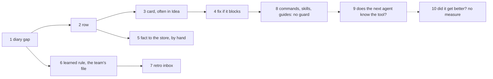
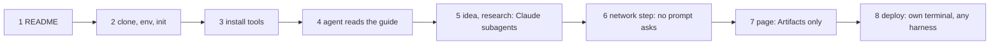
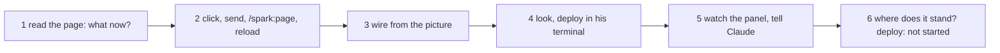

# Jobs and journeys
<!-- Tags as in the brief: E with a pointer, H with its source, D with who and when; an unknown is —. -->

## Who
- The hobbyist: an idea in words, an ESP32 board in the drawer, some modules · H, the PO's choice; no person outside the project installed spark (scrum/VISION.md, Who it is for) <!-- REQUIRED:who -->
- The maker at the bench (the PO, n = 1): directs Claude, walks spark end to end · E scrum/VISION.md (The test bench); walk diaries, P934 #1323
- The agent at the keyboard: acts on a script's answer without reading its source · E scrum/VISION.md (A constraint)
- The team that improves spark (the PO with Claude and its agents): plans, councils, walks, retros · E scrum/README.md, scrum/WORKING_AGREEMENTS.md
- A builder on another harness or a local model (another agent CLI, an IDE, CI, a local LLM) · H, the PO's words on #1522, 2026-11-23; nobody of this kind is known
- A reader of spark as a showcase (an employer, a peer) · E scrum/VISION.md (Versions: "so I can show it as a project")

## Jobs
- J1 · When I have a vague idea for a gadget [E scrum/VISION.md], I want one conversation to take me to a thing that is built, tested and deployed [H the epaper session's reading of the PO's "how to make it a software factory", #1522, for him to confirm], so I can use it without learning each tool [H scrum/VISION.md, the hobbyist] <!-- REQUIRED:jobs -->
- J2 · When I work in a harness other than Claude Code, or with a local model [D the PO, 2026-11-23, #1522], I want spark's steps to run there with the same facts [H], so I am not tied to one vendor or one paid model [H the PO's words "generally runnable"]
- J3 · When the team changes spark [E scrum/README.md], I want to know whether the change made the agents and the journey better, and which model does which job well [D the PO, 2026-11-23, #1522], so I can steer by evidence instead of by hand [H]
- J4 · When a script, a flag, an exit code or a JSON key is added or changed [E #1522 comment, posted 15:37 CET], I (the agent) want the skills, commands and guides to teach it [D the PO, 2026-11-23], so I can use it without reading the source [E scrum/VISION.md, the 09-24 run]
- J5 · When I work at the bench or on the page [E P934 #1323, P829 #1187], I want the same facts, findings and next step that Claude sees [D the PO, 2026-10-18, UX and AI-UX; #1522 interface question], so I can act in whichever interface is at hand [H]
- J6 · When I show spark as a project [E scrum/VISION.md, Versions], I want its architecture and its direction in one clear picture [H], so I can explain it [H]

## Today they…
- J1 · walk the journey with Claude Code: /spark:idea, /spark:build, the breadboard sheet, /spark:deploy; it stops at the bench, with no enclosure or PCB order in one flow · H, to be read by the lenses <!-- REQUIRED:today -->
- J2 · nothing: spark is a Claude Code plugin · H, to be read by the lenses
- J3 · walks with diaries, retros, learned rules, the hook's tests and mutation rows; the model table is set by hand · E scrum/README.md, the token budget
- J4 · tools/check_docs.py guards one direction only · E #1522 comment, posted 15:37 CET (spark-main's reading, checked and corrected in ★C13)
- J5 · the CLI with --json, the Artifact page through /spark:page · E P829 #1187
- J6 · the README, the vision, the docs/guide pages · H

## Journeys
<!-- Filled at step 4, after the lenses. -->
The tables come from the user's-journey lens (council/users-journey.md:134-219), with rows shortened. "display2", "display" and "epaper" are the three P934 walk diaries in the walks folder, outside the repository (2026-11-22 to 23, 2026-11-22 morning, 2026-11-19 to 21). A time is the diary's own CET heading. Each E row of J1, J3, J4 and J5 is an account, n = 1: the PO with Claude. Every row of J2 is H, because nobody ran it. A second agent harness is installed on the PO's computer (★C6), and nothing of spark has run in it. Q-A numbers are the lens's account questions (council/users-journey.md:243-256), and Q numbers are the brief's.

### The maker and the agent at the keyboard — J1, from a vague idea to a deployed gadget, and past the breadboard <!-- REQUIRED:journey -->
| step | what they do | evidence | friction or harm | today | open question |
| --- | --- | --- | --- | --- | --- |
| 1 | takes photos of a new module and runs /spark:identify | E epaper 23:28 to 23:36 | no ruler in the photos, and no step asks for a fourth photo. The matcher read the "e" of "e-paper" as a match | partly | Q-A7 |
| 2 | has the module researched (parts-researcher, Opus, 6 min 18 s) | E epaper 23:36, display2 13:18 | the controller was a guess and it was wrong. 3 of 33 facts were verified | partly | Q-A5 |
| 3 | brings his own board (the C6) | E epaper 15:07 to 16:41 | the drawing came out mirrored until the PO looked. The board file stayed in one project until P989 | partly | — |
| 4 | makes the folder, the goal and the must lines (init) | E display2 11:20 to 11:22 | none seen in the restarted run | works | — |
| 5 | gets needs and matches | E display2 11:22 | the board's own Wi-Fi was never offered. The owned e-paper ranked under colour displays | partly | — |
| 6 | picks on the published page | E display2 11:24 to 11:34 | /add-dir first. Four round trips. A button he did not find. Wi-Fi was picked in the chat | partly | Q-A2, Q-A8 (P1038 #1521) |
| 7 | writes the parts list by a click | E display2 11:36 | the offer stays after it ran | works | — |
| 8 | builds | E display2 11:40 | a built board shows "could not run", because the C6 has no Wokwi model (P1008 #1467) | partly | — |
| 9 | reads the breadboard sheet and wires | E display2 11:40 to 11:50, epaper 06:42 | a stale shelf copy cost the picture, so he wired with no pad names | partly | Q-A1 |
| 10 | settles a fact that only the bench can settle (the controller) | E display2 11:39, 13:05 | a hand-written trial firmware did it. Spark has no step for it (P1003, in Idea) | not yet | Q-A5 |
| 11 | lets the conversation write the firmware, which imports pins.py | E display2 13:15 | by design (facts, never behaviour). The secret went into a project file, and P1004 #1463 names `flash_image.py --config` for it (★C15) | partly | — |
| 12 | simulates | E display2 11:40 | the C6 has no Wokwi model | — | — |
| 13 | has Claude look, then deploys in his own terminal | E display2 11:51 to 16:46, row 26 | blocked until P1001 and P1007 merged. "ready unknown" still now and then (P1022 #1490) | partly | Q17 |
| 14 | debugs the running board live | E display2 13:38 to 14:03, 20:02 | mpremote failed on that board ("could not enter raw repl"), so the session wrote its own helper (★C15). The board restarted on each port open | partly (mpremote failed until P1007) | Q15, Q-A6 |
| 15 | keeps what the bench taught in the store | E display2 13:14, 14:08, row 16 | by hand, after his yes each time (P1002 #1461, in Idea) | partly | Q-A10 |
| 16 | iterates the gadget (battery, quotes, deep sleep) | E the walk folder's `git log`, 36 commits on main (★C20) | in the walk's own repository, with spark's deploy step still in use. The flow says "deploy: not started" (★C19) | partly | Q14 |
| 17 | orders a PCB | E docs/guide/journey/from-draft-to-order.md:5-8, commands/build.md:399-403 (★C21) | Gerbers by a hand command. A draft layout. No walk did it | partly (by hand, not walked) | Q3 |
| 18 | gets an enclosure and a 3D model | E scrum/VISION.md (later), P203 #163 open | nothing does it | not yet | Q3 |

```mermaid
flowchart LR
  s1["1 photos, identify"] --> s2["2 research"] --> s3["3 own board"] --> s4["4 goal, must lines"] --> s5["5 needs, match"]
  s5 --> s6["6 picks on the page"] --> s7["7 parts list"] --> s8["8 build"] --> s9["9 sheet, wire"] --> s10["10 bench fact: by hand"]
  s10 --> s11["11 firmware"] --> s12["12 simulate: none for the C6"] --> s13["13 look, deploy"] --> s14["14 live debug: mpremote failed, scratch helper"]
  s14 --> s15["15 keep facts: by hand"] --> s16["16 iterate: own repository, spark's deploy"] --> s17["17 PCB: by hand"] --> s18["18 enclosure, 3D: none"]
```

### The team — J3 and J4, a finding at the bench becomes a card, a fix, a rule and the next agent's knowledge
| step | what they do | evidence | friction or harm | today | open question |
| --- | --- | --- | --- | --- | --- |
| 1 | the session writes a gap in the diary, with the PO's words | E display and display2 | times written from feel. One claim that the PO never made (UJ-8) | works, with slips | Q-A11 |
| 2 | the walk ends with rows: raised, acted, dropped | E display rows 1 to 14, display2 rows 1 to 26 | — | works | Q16 |
| 3 | a row becomes a card | E P989 to P993, P1001 to P1015 | 6 of these 20 cards wait in Idea (UJ-17). 407 issues are open (★C24) | works (the filing) | Q4 |
| 4 | a blocking row gets fixed during the walk | E P1001, P1006, P1007 merged on 2026-11-22 | the walk waits on a PR and its review (11:52 to 12:30) | works | — |
| 5 | a fact goes into the store | E display2 13:14, 14:08 | by hand. The card for the write-back is in Idea (P1002 #1461) | partly | Q-A10 |
| 6 | a slip becomes a learned rule | E the store's learned-rules.md, docs/discovery/2026-11-22-r11-retro/retro.md (R11.2) | the walk repeated slips that the file already holds. A gadget session does not read the team's file | partly | — |
| 7 | the retro sorts the inbox | E retro.md (62 entries: 6 caught by a gate, 10 on a card, 46 dropped) | walk rows are not in the inbox. R11 came 26 days late | partly | — |
| 8 | a new script or flag reaches the commands, skills and guides | E ★C13, ★C14 | an untaught flag fails no check. `--config` and `--cure-first` have no line on an agent page | partly | Q9 |
| 9 | the next agent uses spark's own tool, not a scratch one | E ★C15 | no clean case on file: the scratch helper came after mpremote failed, and P1004 names the flag itself. Rows undercount this cause | — (not shown) | Q15 |
| 10 | the team learns whether the change made the agent better, and which model did the job | E ★C17 | no score and no comparison. The model table is set by hand | not yet | Q10 |

### A builder on another harness or a local model — J2, a thought experiment from the install text (all H)
| step | what they do | evidence | friction or harm | today | open question |
| --- | --- | --- | --- | --- | --- |
| 1 | reads the README and sees "In Claude Code, type /spark:build" | H, from README.md:24-29 | the second road is a clone and python3 | partly (H) | Q13 |
| 2 | clones, exports `CLAUDE_PLUGIN_ROOT`, runs init and `tools.py --status` | H, from docs/guide/agents/scripts.md:7-14, :29-31 | a variable named for Claude. Exit 2 while any tool is missing | partly (H) | — |
| 3 | installs tscircuit, node, wokwi-cli, littlefs-python and gh | H, from scripts.md (What the scripts need) | heavy for a first try. `tools.py --on` registers MCP through the `claude` CLI (★C3) | partly (H) | — |
| 4 | points their agent at the guide | H, from docs/guide/agents.md and ★C16 | the commands carry `allowed-tools` and `${CLAUDE_PLUGIN_ROOT}` (★C2). A small local model cannot hold the text (H) | — | Q8, Q11 |
| 5 | talks through the idea and the research | H, from commands/idea.md, research.md, agents/*.md | the research runs as Claude subagents with web tools. With none, the records stay unwritten | not yet (H) | Q7 |
| 6 | runs a network step (a fetch, an install) | H, from ★C11 | no prompt asks first in a harness that has none | not yet (H) | Q12 |
| 7 | opens the page | H, from commands/page.md:3 | Claude Artifacts only | not yet (H) | P1038 #1521 |
| 8 | deploys | H, from scripts.md (the grant, the person's terminal) | the yes typed in a terminal works in any harness | works (H, not run) | — |

### The person at the bench or on the page — J5, against what Claude sees
| step | what they do | evidence | friction or harm | today | open question |
| --- | --- | --- | --- | --- | --- |
| 1 | reads the page for what to do now | E epaper 19:09, 19:19, display2 11:29 | "it just doesn't guide a person". Small text, developer lines | partly (the NOW guide since P977) | Q-A8 (P1038 #1521) |
| 2 | clicks a pick, sends, types /spark:page, reloads | E display2 11:26 to 11:34 | four round trips for four picks | partly | Q-A2 (P1038 #1521) |
| 3 | wires from the page's picture | E display2 11:41 to 11:46 | no picture (a stale shelf copy). He wired from the text | partly | Q-A1 |
| 4 | reads `look.py` and runs `deploy.py` in his own terminal | E display2 11:51, 13:24, tests/golden/look-ok.txt | loose lines (P1032 #1512). Claude learns the result from the logs | partly | Q17 |
| 5 | watches the panel and the LED, and tells Claude | E display2 13:07, 13:36, 14:03 | Claude cannot see the panel. It did not know about the battery | partly | Q-A6, Q-A11 |
| 6 | asks where the project stands, on the page or in the flow | E ★C19 | "deploy: not started" after 27 deploy attempts. "build: could not run" for a built board | not yet (the deploy) | Q14 answered (D7): the chat told him. Q14b is open |

<!-- Part 2: proposed changes to the lines above "## Journeys". Proposals only. -->
## Proposed changes to Who, Jobs and Today (a short list, not applied)
- Who, "A builder on another harness or a local model": add that a second agent harness and an AI code editor are installed on the PO's computer, that no local model runtime was found, and that his use of them is unknown (E ★C6). Nothing of spark has run there, so the actor stays H.
- Who, "A reader of spark as a showcase": add the open point that the risks lens raises: for each direction, the first value is either the hobbyist's journey or the showcase (council/risks-and-assumptions.md:103). The PO is the only source for this actor (H).
- Jobs, new J7 (proposed): When my gadget runs and I go on changing it [E ★C20, one reading of two, n = 1], I want spark to know where it stands and what a change makes out of date [H, P867's direction], so I can stay on the line after the first deploy [H]. Reason: step 16 of J1 has no job today. Q14 says whether the PO's gadget left the line or stayed on it.
- Jobs, J3: split off the model question as its own clause or job: "which model does which job" has its own evidence (★C17) and its own test (A5). Opinion (the architect's): keep one job, and name the two measures in Today.
- Today, J1: replace the H line with the account: J1 ran end to end once on 2026-11-22, with three fixes during the walk and three tools outside spark's commands. The gadget then went on in its own repository and kept using spark's deploy step (E ★C20, an account, n = 1).
- Today, J2: replace "nothing: spark is a Claude Code plugin" with: the scripts run anywhere once `CLAUDE_PLUGIN_ROOT` is exported, 19 of 27 take `--json`, and nobody tried a command page outside Claude Code (E ★C7, ★C2).
- Today, J4: replace the line with FE-1's reading: pages are checked against the code in one direction, one test fails on a script that no routing page names and counts human pages too, and nothing fails on an untaught flag, key or code (E ★C13).
- Today, J5: add the person's own terminal for the deploy's yes, and that the page runs three kinds of click (E council/ux-and-ai-ux.md:94, UX-9).
- Today, J3: add that two earlier evals were pruned, one of which scored the plugin against a baseline once (2aad7674, 2026-09-24), and that two model tests were offered and not run (E ★C17).
