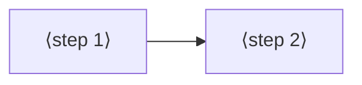

# Jobs and journeys
<!-- Tags as in the brief: E with a pointer, H with its source, D with who and when; an unknown is —. -->

## Who
- The hobbyist: an idea in words, an ESP32 board in the drawer, some modules · H, the PO's choice; no person outside the project installed spark (scrum/VISION.md, Who it is for)
- The maker at the bench (the PO, n = 1): directs Claude, walks spark end to end · E scrum/VISION.md (The test bench); walk diaries, P934 #1323
- The agent at the keyboard: acts on a script's answer without reading its source · E scrum/VISION.md (A constraint)
- The team that improves spark (the PO with Claude and its agents): plans, councils, walks, retros · E scrum/README.md, scrum/WORKING_AGREEMENTS.md
- A builder on another harness or a local model (another agent CLI, an IDE, CI, a local LLM) · H, the PO's words on #1522, 2026-11-23; nobody of this kind is known
- A reader of spark as a showcase (an employer, a peer) · E scrum/VISION.md (Versions: "so I can show it as a project")

## Jobs
- J1 · When I have a vague idea for a gadget [E scrum/VISION.md], I want one conversation to take me to a thing that is built, tested and deployed [D the PO, 2026-11-23, "software factory", #1522], so I can use it without learning each tool [H scrum/VISION.md, the hobbyist]
- J2 · When I work in a harness other than Claude Code, or with a local model [D the PO, 2026-11-23, #1522], I want spark's steps to run there with the same facts [H], so I am not tied to one vendor or one paid model [H the PO's words "generally runnable"]
- J3 · When the team changes spark [E scrum/README.md], I want to know whether the change made the agents and the journey better, and which model does which job well [D the PO, 2026-11-23, #1522], so I can steer by evidence instead of by hand [H]
- J4 · When a script, a flag, an exit code or a JSON key is added or changed [E #1522 comment, 16:0x CET], I (the agent) want the skills, commands and guides to teach it [D the PO, 2026-11-23], so I can use it without reading the source [E scrum/VISION.md, the 09-24 run]
- J5 · When I work at the bench or on the page [E P934 #1323, P829 #1187], I want the same facts, findings and next step that Claude sees [D the PO, 2026-10-18, UX and AI-UX; #1522 interface question], so I can act in whichever interface is at hand [H]
- J6 · When I show spark as a project [E scrum/VISION.md, Versions], I want its architecture and its direction in one clear picture [H], so I can explain it [H]

## Today they…
- J1 · walk the journey with Claude Code: /spark:idea, /spark:build, the breadboard sheet, /spark:deploy; it stops at the bench, with no enclosure or PCB order in one flow · H, to be read by the lenses
- J2 · nothing: spark is a Claude Code plugin · H, to be read by the lenses
- J3 · walks with diaries, retros, learned rules, the hook's tests and mutation rows; the model table is set by hand · E scrum/README.md, the token budget
- J4 · tools/check_docs.py guards one direction only · E #1522 comment, 16:0x CET (spark-main's reading, to be checked)
- J5 · the CLI with --json, the Artifact page through /spark:page · E P829 #1187
- J6 · the README, the vision, the docs/guide pages · H

## Journeys
<!-- Filled at step 4, after the lenses. -->
### ⟨actor⟩ — ⟨scenario⟩ <!-- REQUIRED:journey -->
| step | what they do | evidence | friction or harm | today | open question |
| --- | --- | --- | --- | --- | --- |
| 1 | ⟨fill⟩ | ⟨tag and pointer⟩ | ⟨fill⟩ | ⟨works, partly, not yet or —⟩ | ⟨fill or —⟩ |

