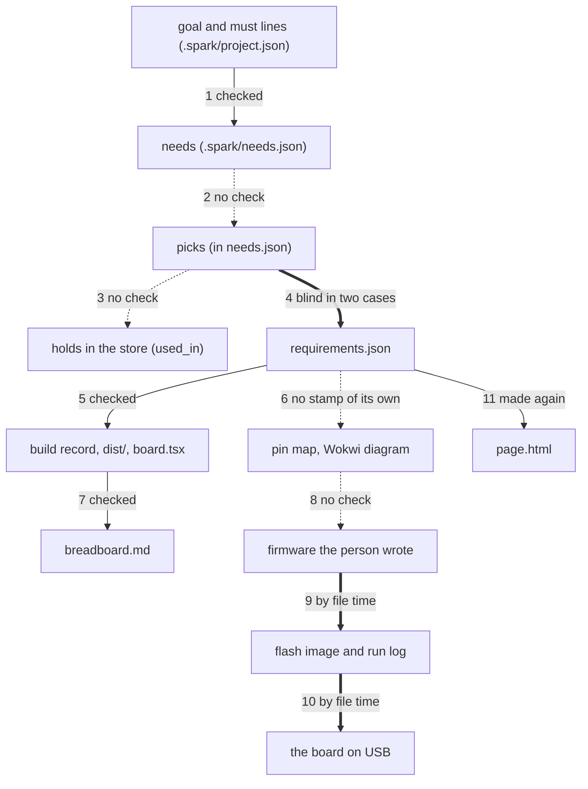

# P1160: what goes out of date after a take-back. Finding

> Git is enough for the bytes, and spark's own stamps are enough for the chain. Spark needs no dependency record.
> It needs two small checks first: the store's holds against the picks, and a parts list entry whose pick is gone.
> Today's `flow.py show` reading then is the check after a take-back, in both cases.

Spike [P1160 (#1696)](https://github.com/xmejkal/spark/issues/1696), 2026-11-25, under
[P1152 (#1688)](https://github.com/xmejkal/spark/issues/1688). It follows the discovery
`docs/discovery/2026-11-25-spark-and-git/` (D5 to D14). Council: a code map (Explore, Sonnet), the architect and the
refuter (Opus). The architect checked the map in the code on origin/main 5130caa4 and ran two scratch experiments. The
refuter's result is in the section "Refuter" at the end.

Spark already knows what is out of date, because each phase compares hashes of the files as they are now. That
reading does not care how a file changed, so it works after a git take-back, a hand copy or a server's restore (D5).
Four links have no check today, one link is blind in two cases, and the take-back slice needs two of them closed.

## The PO's question

"in both cases, it might be a bit dangerous and some unforseen consequences might happen, is there a way to check if
its all working still when we revert some step or a set of steps ? Somwe files might need to be regenerated, etc..
Code rewritten.. Should we quickly analyze that? Is git enough for us or should we keep some dependency tree or
anything like that"

"Both cases" are the two take-backs on the design canvas's artboard "Moment: undo that, take a step back": take back
only this step, or take back this step and the steps after it. The PO chose to have both.

## The answer: no dependency record

1. Spark already holds the chain, in code. Each phase has one reader that names its inputs and compares them
   (`flow/phase_readers.py:128-573`). A dependency file repeats that list.
2. The readers compare state, never events. A stamp holds a sha256 of what a file was made from, and the reader
   hashes the file again. A take-back needs no special case.
3. A dependency record is one more file that a take-back can leave out of date. It then needs its own stamp.
4. Git restores bytes of tracked files only. It cannot reach the store, which never sits in a git work tree
   (`records/store.py:145-148`), and D8 keeps build outputs out of the kept steps.
5. No dependency record exists today. `MAKES_STALE` is a fixed table for an offer's words and the page's fingerprint
   (`flow/flow_codes.py:131`, `flow/fingerprint.py:28`). It judges nothing.

Three results will change this answer. A2's scratch test finds a link that no hash can catch at read time. A strategy
cannot restore exact bytes. One record feeds several builds (P318's option A). The next step then is a `made_from` map
of sha256 values in each generated record, still no graph.

## The chain

Paths below start at `scripts/spark/`. A solid arrow is stamped and checked. A thick arrow is stamped, but blind or
noisy in a named case. A dotted arrow has no check. Links 12 to 14, found by the refuter, are in the table only.

## Every link

| # | Made from → made | Stamp today | Check today, where a person sees it | After a take-back |
| --- | --- | --- | --- | --- |
| 1 | goal and must lines → needs | `.spark/needs-basis.json`: two sha256 values and the need ids (`design/needs_basis.py:21-24`) | needs phase: "the goal changed after the needs were written" (`flow/phase_readers.py:164-184`, `flow/flow_codes.py:36`) | Works. The stamp must travel with needs.json (change 3) |
| 2 | a need → its pick | none. A needs write keeps the pick (`design/needs.py:94-95`) | none | No check. A need's text goes back and its pick stays |
| 3 | picks → the store's holds | `used_in` on the drawer entry (`sourcing/drawer.py:131`) | none. Only a pick or a drop recomputes it (`design/pick_parts.py:81-86`, `design/needs.py:406-423`). No file in `flow/` reads it | No check. The store keeps the old hold |
| 4 | picks → requirements.json | `.spark/requirements-origin.json`: rows and a sha256 of the parts (`design/entry_origin.py:22-23`) | requirements phase recomputes the file from the picks (`flow/phase_readers.py:436-437`) | Blind in two cases, below |
| 5 | requirements.json → build record, dist/, board.tsx | `.spark/build.json`: `requirements_sha256`, `written_sha256` (`build/kept_files.py:505-507`) | build phase: "requirements.json changed after the build" (`flow/phase_readers.py:441-449`) | Works |
| 6 | requirements.json → pin map, Wokwi diagram | a header line, no hash (`design/pin_assigner.py:562`). The diagram has none (`build/board_engine.py:228`) | none of their own. Link 5 covers them while the build writes them | No own check. Covered by link 5 |
| 7 | build → breadboard.md | `dist/board/built-from.json`, a copy of the requirements (`breadboard/sheet.py:119-121`) | breadboard phase (`flow/phase_readers.py:531-532`) | Works |
| 8 | pin map → firmware | none | none in the flow. The import check runs only on request (`firmware/import_probe.py:48-67`, through `scripts/import_firmware.py`) | No check before a scenario run |
| 9 | firmware → image and verdict | the run log: sha256 of the image and of each file (`firmware/scenario_run.py:229-248`) | simulate phase: the verdict by sha256 (`firmware/project_image.py:86-102`), "changed after the image" by file time (`:121-125`) | Safe, with false alarms |
| 10 | image → board | the board log's image sha256 | deploy phase (`flow/deploy_reading.py:29-41`) | As link 9 |
| 11 | records → page | a fingerprint of three files (`flow/fingerprint.py:18-36`) | an older click is refused | Works. The page is made again |
| 12 | part records, boards, `.spark/rules.json` → build | none. The build stamp holds only `requirements_sha256` (`build/kept_files.py:505`), while the build reads parts/, boards/ and rules.json (`loader.py:300-307, 445-458`) | none | No check. Outside the kept steps today, but a rules.json change goes unseen |
| 13 | Wokwi diagram → scenario run and verdict | none. The run log stamps the image and the firmware files, not sim/diagram.json (`firmware/scenario_run.py:240-248`) | only at the next run, which checks the scenario's step ids (`firmware/scenario_run.py:160-165`) | No check. The refuter's experiment: a changed diagram still read "a passed run tested the current image" |
| 14 | wiring sheet → the wired bench | the sheet's file time (`breadboard/wired_board.py:25-33`) | "Spark cannot see whether you wired from it" | No check, by design. Not in the preview |

Link 4, measured in a scratch project with `flow.py show`. A pick goes and its need stays: the phase says stale.
A need goes with its pick: the phase says ok, and the file still lists the part. One of two picks of the same part
goes: the phase says ok. `_merge_parts` keeps every entry that no pick explains (`design/need_requirements.py:142-175`).
The reader never reads the `unexplained` value that names them (`design/need_requirements.py:338-339`).

Links 9 and 10. Git rewrites only the files whose content changes, and they get the time of the take-back. So
"changed after the image" is correct after a take-back. Every kept build writes the pin map again, same bytes or not
(`build/kept_files.py:469`). That gives false alarms, but today it is also the only alarm for a changed circuit
(link 13).

## The check after a take-back

The check is the `show-flow` Operation as it is (`flow/show_flow.py:148-159`). It reads every phase from the files
and says which are out of date. It is blind on links 2, 3, 8, 12 and 13 and on link 4's two cases. Changes 1 and 2
close links 3 and 4. The other links stay open and are named below.

The take-back then runs in this order:

1. The preview: each file with its content after (D14), and each hold that will change. The holds come from the
   difference of two `needs.plan_holds` results, on the needs before and after, as `dropped_holds` does
   (`design/needs.py:400-423`). `plan_holds` writes nothing (`design/needs.py:355-393`). A hold that another project
   took is named in the preview as "not held".
2. The person's yes through the core (D7, D14).
3. Spark applies that difference with `drawer.apply` (`design/pick_parts.py:82`). It moves no hold that no kept step
   made, so a hold set by hand stays (council Q6). A plain `plan_holds` rebuild, as a pick does, releases such a hold
   (`design/needs.py:396-403`). The project's own files come last, as in a pick (`design/pick_parts.py:84-87`).
4. The strategy takes the step back. Spark reads each record again with its own reader. A record that does not read
   undoes the take-back, and spark refuses in plain words. A failure between steps 3 and 4 leaves holds that differ
   from the picks, and change 1 names them.
5. The `show-flow` reading runs. The answer names each phase that went out of date and the one next offer.

The take-back makes nothing again by itself. The flow's own offers do that, one yes at a time.

## The two cases

| | Only this step | This step and the steps after it |
| --- | --- | --- |
| What git does | a three-way merge of each file | no merge among spark's steps |
| Conflict | Likely in needs.json, which holds needs and picks together. Scratch result: a later pick on the same need conflicts, and one on another need merges clean (n = 2) | none among spark's steps |
| Result | can be a record that nobody decided, so step 3 above is required | a state that spark wrote before |
| Preview | needs a dry merge to show the content after | reads the content from the earlier step |
| The check | later records rest on a basis that is gone. Links 1, 4 and 5 say so | the records fit each other. Link 5 says the build outputs are newer |
| Holds | computed from the merged needs | computed from the earlier needs |

On a conflict, spark refuses, changes nothing (A2) and offers the other take-back.

## The changes, in order

1. Before the take-back slice. The store's hold is never compared with the picks → one small class over
   `needs.plan_holds` names each hold that differs. The parts phase says it, and P1152's preview reuses it. It must
   name a hold that the person set by hand as "held by hand", never as a fault (council Q6). Today a pick releases
   one and a drop keeps one (`design/needs.py:406-410`, the refuter's experiment). The class computes the difference
   of two plans in both directions, and the take-back's preview shares it.
2. Before the take-back slice. The flow reads a parts list as current while it lists a part whose pick is gone →
   the requirements phase reads `unexplained.removable` and says out of date, with the entries named.
3. A line in P1152's kept-step slice. A stamp can go back without its record → a kept step holds needs.json with
   needs-basis.json, and requirements.json with requirements-origin.json. It never holds build.json, dist/, the pin
   map, the sheet or sim/.
4. Lines in P1152's take-back slice. Nobody reads the chain after a take-back → the five steps above. A2's test
   gains three cases: a need gone with its pick, a later pick on the same need, a hold that another project took.
5. Can wait. A changed Wokwi diagram leaves a passed run reading current, and "changed after the image" compares
   file times → each run log also stamps the sha256 of sim/diagram.json, and the simulate phase compares the diagram
   and each file's sha256 with the log (`firmware/scenario_steps.py:470-472`). The file-time alarm stays until the
   diagram stamp exists, because it is the only alarm for a changed circuit today.
6. Can wait. The build stamp leaves out the part records, the boards and `.spark/rules.json` → the build record
   also stamps the records it read, and the build phase compares them (link 12).
7. Can wait. Nothing checks the firmware against a changed pin map before a scenario run → if the pin map changed
   after the image, the flow's guide names the free import check.

Link 2 gets no card now. It exists without any take-back, and no check asks for it yet.

## Decisions proposed

- No dependency record. Rejected: a graph file, because it repeats the readers and goes out of date itself.
- The check is the existing reading. Rejected: a checker only for take-backs, because a hand edit needs the same check.
- A stamp travels with the record that it describes. Rejected: stamps outside git, because link 1 then reports a false change.
- The hold check reuses `plan_holds`. Rejected: a hold list inside the project, because it is a second truth.
- Nothing is made again without a yes. Rejected: a rebuild inside the take-back, because one yes then covers two writes.

## Risks and open questions for the PO

The PO delegated these questions to a council of three on Fable on 2026-11-25. Their answers are in the next section.

1. A hold cannot come back because another project holds the part now. Recommended: take back and say "not held".
2. Is D8's "the board" the file board.tsx? A taken-back board.tsx then reads as the person's file, and every build
   leaves it alone (`build/kept_files.py:111-114`).
3. A conflict in "only this step". Recommended: refuse and offer the other take-back, never a merge by Claude.
4. The person's own commits between spark's steps. Recommended: the preview names them and the range take-back refuses.
5. The store's history after a take-back. Recommended: one new "taken back" event, and no event is removed.
6. Risk: a clean merge gives valid JSON with a wrong meaning. Step 3 catches only a record that does not read.
7. Risk: links 2, 8 and 14 stay with no check after these changes.
8. A hold that the person set by hand: does a take-back keep it, or does it follow the picks like a pick does?

## Council answers

Delegated by the PO, 2026-11-25 about 20:55 CET, and the PO's to change. Seats on Fable: the PO assistant, the
architect and the tech lead, one written brief, the majority decides. No seat marked a question as one for the PO
himself.

| Question | Answer | Votes |
| --- | --- | --- |
| 1. Another project holds the part now | Take back the records, and the preview and the answer say "not held: <project> holds it". Spark never takes a part from another project | 3 of 3 |
| 2. D8's "the board" | The `board` key of requirements.json (`build/build_service.py:234`, `design/loader.py:307`). board.tsx stays a build output, not a kept step | 3 of 3 |
| 3. A conflict in "only this step" | Refuse with a code from the core, change nothing, and offer the other take-back. No merge by Claude, because the CLI, MCP and a server have no Claude (D12) | 3 of 3 |
| 4. The person's own commits between spark's steps | Spark takes back only its own steps and leaves the person's commits. The preview names them as left alone. Spark refuses when one of them changed a file that a kept step holds | 2 of 3 (the PO assistant chose to refuse every such range) |
| 5. The store's history | One new "taken back" event, no event removed. It needs a row in `EVENT_KEYS` with the step's id in its key (`records/store.py:463-465, 500-503`) | 3 of 3 |
| 6. A hold set by hand | A take-back never moves a hold that no kept step made. It keeps the hold and names it "held by hand" | 3 of 3 |

Remarks the seats raised, for the cards:

- Q4 rests on telling spark's commits apart. Today the only mark is the message prefix "spark: "
  (`build/project_setup.py:400`). The kept-step slice needs a firmer mark, for example the step ids spark records.
  The core's contract speaks of kept steps and kept files only, because a human or server strategy has no commits.
- Q4, the architect's scratch test (n = 1): a revert of spark's two steps around a firmware commit was clean and left
  main.py alone. The same revert conflicted in needs.json after a hand edit of it.
- Q3 needs a dry merge to change nothing, for example `git merge-tree --write-tree` (git 2.38 or newer). Not tested.
- Q5: the tally counts only picks that exist now (`design/tally_cost.py:37-38`). Which other readers of the history
  must read the new event is not checked.
- Changes 1 and 2 serve the MVP bar without any take-back, because a wrong hold or a stale parts list misleads a real
  walk. Changes 5 to 7 can pause (the tech lead).

## Checked and not checked

Checked in the code: every file and line in this finding, except the two rows below. Checked by experiment in scratch
folders, removed after: link 4's three cases through `flow.py show`, and two reverts of an older needs step.

Not checked: the board log's stamp (link 10) and the page's writers (link 11), which come from the code map. The A2
walk on a real project with an origin record. Whether P1150's ignore list will cover build.json, dist/ and the pin
map. What a renamed project does to its holds. No size here is measured.

## Sources

- Cards: [P1160 #1696](https://github.com/xmejkal/spark/issues/1696), [P1152 #1688](https://github.com/xmejkal/spark/issues/1688) and its comment of 2026-11-25 about 20:10 CET.
- Discovery: `docs/discovery/2026-11-25-spark-and-git/brief.md` (D5, D7, D8, D9, D12, D14, claims C21, C24), `risks-and-tests.md` (A1, A2), `items.md` (P1150).
- Flow: `scripts/spark/flow/phase_readers.py:128-143, 164-184, 412-449, 479-532, 548-570`, `flow_codes.py:36, 55, 58, 69, 73, 131`, `fingerprint.py:18-36`, `show_flow.py:148-159`, `deploy_reading.py:29-41`.
- Design: `scripts/spark/design/needs.py:94-95, 112-116, 355-423`, `pick_parts.py:81-86`, `set_needs.py:31-37`, `needs_basis.py:21-24, 57-74`, `need_requirements.py:142-175, 206-220, 300-339`, `entry_origin.py:22-23, 62-87, 125-143`, `pin_assigner.py:484-485, 562`.
- Build and firmware: `scripts/spark/build/kept_files.py:89-123, 136-144, 449-472, 489-511`, `build_record.py:22-30, 96-105`, `board_engine.py:228`, `scripts/spark/breadboard/sheet.py:119-121`, `scripts/spark/firmware/project_image.py:86-125`, `scenario_run.py:229-248`, `scenario_steps.py:470-472`, `scripts/import_firmware.py:47`.
- Store and git: `scripts/spark/records/store.py:145-148`, `scripts/spark/sourcing/drawer.py:131`, `scripts/spark/records/project_commit.py:1-7`, `scripts/spark/idea/drop_need.py:22-24`.
- The code map of 2026-11-25 (Explore, Sonnet), checked by the architect. Three of its claims were wrong or too wide: a pick that goes while its need stays is reported stale, the new file times after a git take-back are correct, and `MAKES_STALE` also fills the offers' JSON, the page and the fingerprint.

## Refuter

The refuter (Opus) reproduced the claims in scratch folders with a scratch store, and removed them after. Verdict:
holds with fixes. All three fixes are in the text above.

- The main answer: confirmed, with a gap. A changed Wokwi diagram still read "a passed run tested the current
  image" (link 13). The gap is a missing stamp, not a reason for a graph.
- Link 4: confirmed by experiment, also through a real `--needs-drop`. `unexplained.removable` named the leftover
  entry, so change 2 works.
- Link 3: confirmed. A dropped need, then a git revert of the drop: the flow read ok while the hold stayed empty.
- Links 9 and 10: confirmed for file content.
- Citations: 16 checked, all hold. One was too weak and now cites `firmware/import_probe.py`.
- The take-back order: rejected as first written. The holds now come before the project's files, as in a pick.
- Added: links 12, 13 and 14, change 5 rewritten, change 6 new, open question 8.

Not checked: the "only this step" conflict cases beyond n = 2, a real build, and a Wokwi run, which is paid.
