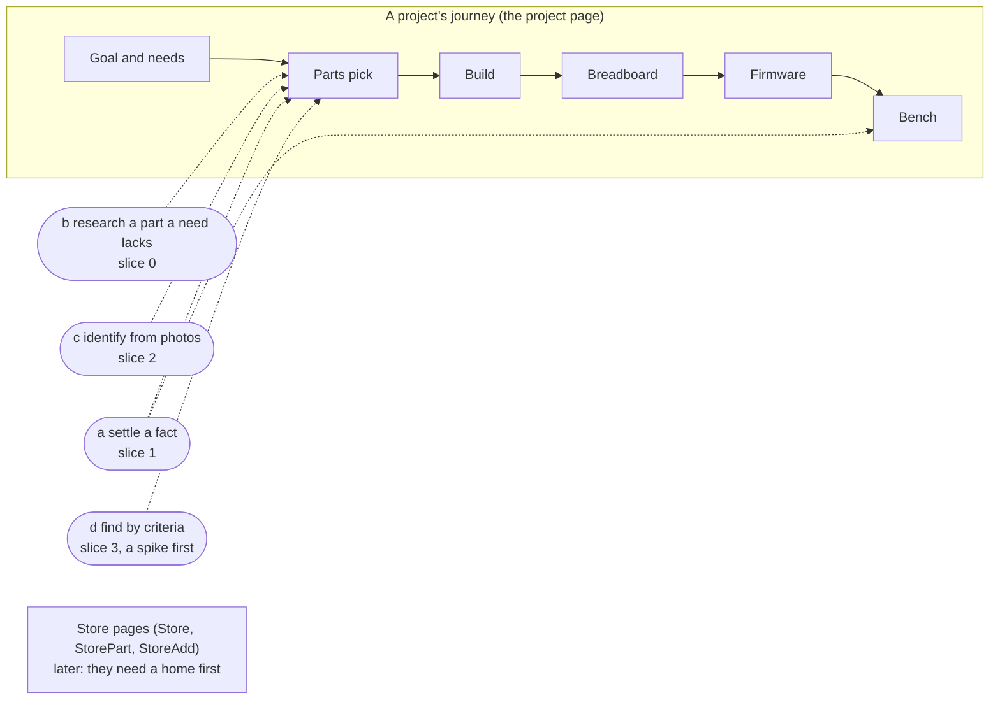

# P1161: research and record editing from the page

> Every research and record edit starts on the page as an "Ask Claude" sentence that spark fills from its own records.
> Nothing new travels from the page. The first slice researches the DFR0928 for a need with no part. The PO answered the rest:
> tokens are named with no ask, the two misfits become cards, and design comes after the MVP cards.

The discovery of epic P1161 #1697 ran on 2026-11-25. Five lenses on Opus read the code, the canvas, the store and the
walk diaries. The architect wrote the synthesis, and the refuter on Opus checked every claim. The PO was away, so a
council of three on Fable answered his choices. Each answer is delegated, the PO's to change (D1 to D14). The
coordinator time-boxed the discovery: it ends here, at the decisions and the items. No design or build follows until
the PO orders it.

## What we found

- The write Operations already exist: `fact-set` and `drawer-set`, each with a dry run (★C3).
- Research, identify and an online find are jobs only Claude can do, so each is an "Ask Claude" offer (★C2).
- A typed value, criteria or a photo cannot travel from the page today. The channel carries `id, key, seen` (★C1).
- Nothing marks a build out of date after a part record changes (★C4).
- A fact set `verified: true` with any words as its source can make a check pass falsely (★C5).
- In the one case seen, a bench trial settled a wrong fact, and the earlier research did not (★C8, 1 of 1 case).
- The Parts design has no way out for a need with no fitting part (★C10).
- spark has no cost figure before a research, and no command records a research step (★C9).

## Where each job sits in the journey



## How it fits the core

Each job enters the page as a chat Offer whose sentence spark fills from its records (one flow change). The person
pastes it, Claude does the search or the reading, and spark's existing Operations write the record after his yes. The
build record gains a stamp of the records it read. The only new Operation in the whole epic is a catalog write, and it
waits for find by criteria. The architecture is drawn in [council/synthesis.md](council/synthesis.md) part 3.

## The screens that change

| Artboard | What changes | Slice |
| --- | --- | --- |
| Parts | a "Not here?" tile on each need card: research by name, identify from photos, find by what it does | 0, 2, 3 |
| Bench | a wiring step that rests on an unchecked fact asks one plain question | 1 |
| Change | a changed record fact makes the build and the sheet out of date | 1 |
| Undo | one line: a record edit is no kept step yet, with the old value | 1 |
| StorePart, StoreAdd, Store | design fixes now, built later with the store pages | later |
| Find a part (new) | the local search first, then the criteria as words, the cost line and "Ask Claude" | 3 |

Slice 0's Parts card, as a crude sketch:

```
| Need 2 · A screen · shows the status: a small colour display               |
| No part of yours fits by its words.                                        |
| [ Fermion 2.0 IPS   Held by p581 ]   [ Fermion 1.8 IPS  o no record ]      |
| [ + Not here? ]                                                            |
|    I know its name   Ask Claude  "Research the “Fermion 1.8 in IPS         |
|                      display” for the screen need of this project          |
|                      with me."                                    [Copy]   |
|    It is in my hand  (photos, slice 2)                                     |
|    Find one          (by what it does, slice 3)                            |
| It runs in Claude Code. Cost: not measured yet. No prices, no stock.       |
```

More sketches: [council/synthesis.md](council/synthesis.md) part 4, [council/ux-ai-ux.md](council/ux-ai-ux.md) and
[council/user.md](council/user.md).

## What is decided (delegated, the PO's to change)

- D4: nothing new travels from the page. P1122's "no channel carries text" stands.
- D5: the first slice researches the DFR0928 for a need with no part. P992 #1445 is refined in place. P1002 #1461
  stays open and linked.
- D6: the store pages stay designs. A sentence can name the one part he chose, by maker and part number only.
- D8: the chat alone writes `verified: true`, and its source names who, when and how. A one-click mark is a no-go.
- D9: the build goes out of date after a record it read changes, before slice 1's offer ships.
- D12, D13: find by criteria starts with a spike. The page says "not measured yet" until a run is measured.
- D2, D15: the riskiest assumption is A1, that he starts a job from the page's sentence. It is tested in the slice 0 walk's diary (D15, the PO's).
- D16 (the PO's): tokens are not money. Each run names its model and expected tokens, then runs with no question.
- D17 (the PO's): the misfits M1 and M3 are filed as cards.
- D18 (the PO's): design comes after the MVP cards. P1161 waits in Discovery.
- D14: six cards filed by spark-main: P992 #1445 (refined), P1168 #1707, P1169 #1708, P1170 #1709, P1171 #1710, P1172 #1711. See [items.md](items.md).

## What waits on the PO

1. The drawer rule's new words (D6), read to him before the slice 0 PR merges.
2. Design, after the MVP cards (D18).
3. Any delegated answer he wants to change.

## Files

[brief.md](brief.md) · [jobs-and-journeys.md](jobs-and-journeys.md) · [story-map.md](story-map.md) ·
[risks-and-tests.md](risks-and-tests.md) · [items.md](items.md) · [verification.md](verification.md) · council/: the
five lens reports, [synthesis.md](council/synthesis.md), [refuter.md](council/refuter.md),
[delegated-answers.md](council/delegated-answers.md)
