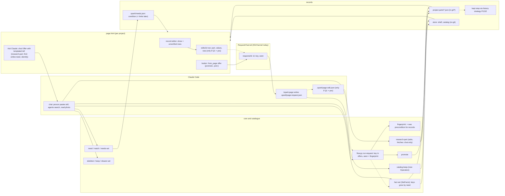

# P1161 council: the architecture lens

Lens: architecture, on Opus, 2026-11-25 (Prague). It read the code and the files named in the task and ran read-only
commands. It changed nothing else. The store is cited as `<store>/<path>`.

## Findings

- ARCH-1 · A record edit that carries a new value does not fit today's channel. A request is `(id, key, seen)` and a test
  pins it. `run-request` takes the step's values only from spark's own offer, and the key must be one that spark offers
  now. A free value (a new voltage, a pin name) cannot be an enumerated offer key, so it can reach spark only as text.
  The accepted answer says a channel carries "Never text, argv or a path" · E · `scripts/spark/flow/run_request.py:35`, `:98`,
  `:165-170`, `tests/test_run_request.py:272-276`, `<store>/councils/p1113/architect-page-actions.md` §2 · supports
  only: an editor that writes a value from the page needs the PO's decision (Q1). Without one, every value edit is
  "Ask Claude".

- ARCH-2 · Research, research by name, identify from a photo and finding a part online cannot be `from_page` offers.
  `research-part` declares ASKS and FETCHES. `fetch`, `find-documents` and `sources` reach the network. The accepted
  answer bars from a page any Operation that declares `asks` or `fetches`. A web search, reading a photo or drawing, and
  choosing candidates are tools only Claude has (the agents' `WebSearch`, `WebFetch`, `Read`). So each is a chat offer
  (`from_page` false, with a `tell`) · E · `scripts/spark/sourcing/research/research_part.py:145`, the effects column of
  the catalogue listing (command below), `architect-page-actions.md` §3, `agents/parts-researcher.md:4`,
  `agents/part-finder.md:5` · supports only: the page starts these jobs by "Ask Claude", and spark's Operations hold
  the deterministic halves.

- ARCH-3 · Today a chat offer cannot name a record or a need. `tell` is one fixed sentence per kind in `OFFER_KINDS`.
  The `Offer` value has no `tell` field. The page shows only the one chat offer that the guide's `now` names. "Research
  the missing facts of “X” with me" or "Find a part online for the soil need" needs: (a) a tell template filled from
  spark's record, as `PICK_LABEL` is filled, and (b) chat offers as Offer instances, more than one per page · E ·
  `scripts/spark/flow/flow_codes.py:144-157`, `scripts/spark/flow/phase_readers.py:42`,
  `scripts/spark/flow/page_sections.py:210-212`, `:288-298` · supports only: the smallest flow change for ARCH-2 is a
  templated tell plus chat Offers, with no new channel.

- ARCH-4 · The fingerprint does not cover part records. It hashes the offers and three files (needs, requirements,
  build record), never `parts/*.json` or a store record. A page written before Claude changed a record in the chat would
  still pass the `seen` check, so an edit from that page would overwrite the newer value without a word · E ·
  `scripts/spark/flow/fingerprint.py:18`, `:25-36` · supports only: any edit from the page must carry the value it read
  (`was`) and be refused when the record now says something else. `SetFacts` already answers `was`
  (`scripts/spark/sourcing/set_facts.py:29`, `scripts/spark/sourcing/record_home.py:206-216`), but has no precondition
  argument.

- ARCH-5 · If the PO allows a value from the page (Q1), the smallest shape that reuses the core is a payload beside the
  request. The page writes a row `edits/<id>` with `{part, values, was}` and sends the usual `{id, key: "fact-set:<part>",
  seen}`. `/spark:page` writes the row as `.spark/page-edit.json`. `run-request` checks the key against spark's offers,
  then hands the file to `SetFacts` as its payload. The core already models "a JSON file the frontend reads for the
  Operation" (`Argument.payload`), so the Operation does not change. Spark writes the `source` ("the person, on the page,
  <time with zone>"), never the page. The cost: P1122's done-when ("no channel carries text") and its test change;
  `STEP_OPERATIONS` gains `fact-set`; a new key kind · H (this lens's design) on E
  `scripts/spark/core/operation.py:21-23`, `scripts/spark/sourcing/set_facts.py:30-32`,
  `scripts/spark/flow/run_request.py:40-42` · supports only: one option for Q1. It is not a recommendation over "Ask
  Claude".

- ARCH-6 · Some edits fit today's channel unchanged, because spark can enumerate their whole value from its own
  records. `promote:<id>` copies a catalog record into the project's parts/ (READS, WRITES, values in the key). A pick of
  a candidate is already an offer. Confirming an unverified fact (`verify:<part>:<fact>`, from the `unverified` list)
  would fit too, but only if spark's own `source` sentence is enough. The `--fact-set` help asks a bench result's source
  to say "who, when and how", and a click says no "how" · E `scripts/spark/sourcing/promote_record.py:25-38`,
  `scripts/spark/sourcing/set_facts.py:31` · H for `verify:` · supports only: a narrow first editor with no channel
  change (Q8).

- ARCH-7 · A record edit already has its Operation, `fact-set`, but only for some keys. It accepts `CHAIN_FACTS`
  (footprint, pin_order, pin_order_proof, body_mm, simulation), `facts` entries, about, description and tags, the
  provenance keys and the sheet keys. It does not accept `name`, `vendor`, `sku`, `needs`, `power`, `unused_pins`,
  `sources`, `also_known_as` or `alternatives`. Those are written by the parts-researcher agent, whole, with the Write
  tool · E `scripts/spark/sourcing/set_facts.py:41`, `scripts/spark/records/record_kind.py:42`,
  `scripts/spark/sourcing/drawer.py:32`, `:42`, `:48`, `agents/parts-researcher.md:4`, `:16-19` · supports only: no new
  edit Operation. `fact-set`'s key set grows by need (one key per field an editor shows), and the page reads `show`
  and `unverified`, which exist.

- ARCH-8 · `fact-set` refuses to empty a fact ("a write fills a fact, it never empties one"). So the page cannot clear a
  wrong value, and a take-back of a fact that was null before cannot be written as the inverse `fact-set` · E
  `scripts/spark/sourcing/set_facts.py:49` · supports only: an editor that clears a value, and the take-back of an edit,
  each need a rule of their own (Q3).

- ARCH-9 · A candidate becomes a catalog record only by the agent's Write tool. No Operation writes into the catalog: the
  catalog's readers are `catalog_records`, `--catalog`, `promote` and `record_path`. The catalog record's shape (what the
  part is, its kept documents, `why_not`, the part facts with sources, no `sourcing`) is written in two prompts, and is
  checked only when something reads it · E `commands/research.md:151-158`, `agents/parts-researcher.md:78-82`,
  `scripts/spark/sourcing/datasheets.py:48-60`, the grep for `place("catalog")` over `scripts/spark` (writers: none) ·
  supports only: the one new Operation of this epic is a catalog write (for example `catalog-keep`, payload Argument,
  WRITES, refusing a record without `why_not` or with `sourcing`). `promote` already takes it on into a project.

- ARCH-10 · Criteria already have homes. A need holds `condition` (words), and the matcher ranks by the condition's
  hits. The brief holds `prefer`, `sellers` and `must`, and `need --json` answers `vendor_order`. The part-finder takes
  "any limits (supply voltage, current)" as prose in its launch text. The needs file "may be public" and holds no part
  numbers, places or reasons. Price is excluded by rule (W21) · E `scripts/spark/design/needs.py:4-8`, `:31`,
  `scripts/spark/sourcing/offers.py:46-52`, `scripts/spark/records/brief.py:34-40`,
  `scripts/spark/design/find_offers.py:58`, `agents/part-finder.md:15-17`, `:41-45`, `commands/research.md:87-88` ·
  supports only: per-need criteria go in the need (the `condition` words now, a structured `limits` field only when a
  check or a stage reads it). Project criteria go in the brief. A chat offer `find-online:<need>` then carries only the
  need's id, and Claude reads the criteria from `needs --json`. No research-request record is needed. Setting the
  criteria from the page is a `needs-set` payload, so it meets the same value question as ARCH-1.

- ARCH-11 · An edit can land outside the page's project. `set_fields` writes the record's own home. That can be the
  catalog, or another listed project's `parts/` when the shelf copy came from there. The shelf is a private place,
  never inside a git work tree. The catalog and the shelf are also outside the Storage seam · E
  `scripts/spark/sourcing/record_home.py:52-55`, `:179-189`, `scripts/spark/records/store.py:145-148`,
  `scripts/spark/records/storage.py:24-25` · supports only: from project A's page, an edit can change project B's file
  or a store file that no repository keeps (Q2, Q3, Q4). A later MCP or web interface cannot reach these records through
  Storage.

- ARCH-12 · Nothing marks an edit as a kept step today. D8 keeps "the brief, the needs, the picks, the requirements, the
  board" as steps, not part records. `fact-set` does not override `written_project`. Only pick, build and deploy do, so
  after a `fact-set` no follow-up writes the page again, and the history strategy has no file to keep · E
  `docs/discovery/2026-11-25-spark-and-git/brief.md:125`, `scripts/spark/core/operation.py:108-112`, the grep for
  `def written_project` (pick_parts.py:68, build_board.py:132, deploy_image.py:501) · supports only: the kept step can
  come from `data.path` (a data key of `fact-set`) when that path is inside a project folder. A store record has no kept
  step unless the PO decides one (Q2, Q3).

- ARCH-13 · `research-part` is invisible to `--describe`. `parts.py --describe` does not list it. `research.py` has no
  `--describe` (it answers "the following arguments are required: --part"). `--describe` prints no `asks` word
  (`EFFECT_WORDS` holds only network, writes and deletes), so a page guard or an agent that reads `--describe` cannot see
  that research asks · E `python3 -I parts.py --describe --json` (ops listed, no research-part),
  `python3 -I research.py --describe` (the error above), `scripts/spark/core/describe_operations.py:18` · supports only:
  P1082's guard needs the `asks` word, and the research Operation needs one place where the interfaces list it.

- ARCH-14 · Misfits in today's code for the four jobs: logic in a prompt, repeated, or a write outside the core.
  (a) The table of the facts each kind needs is in `commands/research.md:76-84`. The fact needs live in
  `data/fact-needs.json`, which `research-part` reads and which holds module rows only. That makes two lists, and they
  differ.
  (b) The header geometry rule (flush_edge, first_pad_from_edge_mm, face, scaled by the pitch) is written three times:
  `commands/identify.md:31-34`, `agents/parts-researcher.md:128-132`, `commands/research.md:136-139`.
  (c) The default vendor order "DFRobot then Seeed" is in `commands/research.md:72-73` and in
  `scripts/spark/sourcing/brief_choices.py:14`. `need --json` already answers it.
  (d) The catalog record's shape is in two prompts and written by hand (ARCH-9).
  (e) Whole records are written by hand with Write, beside `fact-set` (ARCH-7).
  (f) The page's allow-list and the step ops are hand lists: `run_request.py:40-42`, `offer_steps.py:4-5`. P1082
  already covers these.
  (g) Prompts spell the store's layout as literal paths: `agents/parts-researcher.md:72`, `:79`,
  `commands/research.md:154`. In the code, `store.place` owns it · E pointers inline · supports only: the list of
  refactors a plan for this epic takes along.
  The Operations these jobs reuse fit: `fact-set`, `function-set`, `skeleton`, `keep`, `promote`, `drawer-set`,
  `need`, `match` and `show` are small classes in the catalogue, and `parts.py` reads the catalogue.

- ARCH-15 · The line between spark and Claude, read off the code. Spark's own deterministic jobs: read, validate and
  write a record; keep a file the person has; fetch a URL that a rule derives from a record's fact (the DFRobot wiki by
  `sku`); match the store's offers by words. Claude's jobs: a web search, choosing and comparing candidates, reading a
  photo or a drawing, and judging a fit. Claude's findings enter records only through spark's write Operations, so the
  write belongs to spark and the judgement to Claude · H (this lens, from `research_source.py:1-8`, the agents' tools,
  `set_facts.py`) · supports only: the smallest set of new Operations is one (the catalog write, ARCH-9), plus `fact-set`
  keys and the flow's chat offers (ARCH-3). The research by name, identify and find-online jobs need no new Operation.

- ARCH-16 · The store pages on the canvas (StorePart, StoreAdd) have no project behind them. The page, its Artifact id
  (`.spark/page.json`), `run-request` (`--project`) and `seen` (a project's fingerprint) are all per project · E
  `scripts/spark/flow/run_request.py:145`, `:153-157`, `commands/page.md:43-49`, `scripts/spark/flow/fingerprint.py:25`
  · supports only: a page for the store needs a host project or a store-scoped request path (Q6).

- ARCH-17 · A photo has no way into spark from the page. The channel carries no file. identify keeps the photo in the
  person's store, never the project, and AGENTS.md forbids committing a photo with GPS data. An upload into the
  Artifact would put the photo in the Artifact's storage, outside the machine · E `commands/identify.md:75`, AGENTS.md
  (Principles: "Never commit … a photo with GPS data") · H for the Artifact storage (not checked) · supports only:
  identify from a photo stays "Ask Claude" with the photo given in the chat, unless the PO decides otherwise (Q7).

### The proposed parts and the data flow

Dashed boxes and dashed arrows are new or wait on a decision. Solid ones exist today.

## What could not be checked, and why

- Whether the Artifact database takes another collection (`edits`) and its size limits on a row. No Artifact call was
  made, because the brief said web: none.
- Whether a page can take an upload, and where an uploaded photo is kept. `describe_capabilities` was not called, for
  the same reason.
- Whether the parts phase's pick offers already include catalog records. `phase_readers.py` names no catalog, and the
  pick offers were not traced to `needs.LAYERS`.
- The canvas artboards StorePart and StoreAdd. The Artifact was not opened.
- No test suite was run, and no scratch experiment of a payload request was made.
- Whether `test_architecture.py` pins anything a payload Argument on `run-request` would break.

## Questions for the decider

- Q1 · May a page request carry a value (a payload row beside `id, key, seen`, read as the Operation's existing payload
  Argument), which changes P1122's done-when "no channel carries text"? · decides: whether the record editor writes
  values from the page (ARCH-5), or every value edit is "Ask Claude" (ARCH-1).
- Q2 · Is an edit of a project's `parts/<id>.json` a kept step, though D8 does not name part records? · decides: whether
  `fact-set` hands its `data.path` to the history strategy (ARCH-12).
- Q3 · An edit of a store record (catalog or shelf, outside every repository): no take-back, one previous version kept
  in the store, or such records not editable from the page? This also decides clearing a value, which `fact-set`
  refuses · decides: ARCH-8, ARCH-11.
- Q4 · May project A's page change a record whose home is project B (a shelf copy's `based_on`)? · decides:
  cross-project writes from a page, and whose history keeps them (ARCH-11).
- Q5 · Where do find criteria live: the need's `condition` words only, a structured `limits` field per need, or a
  research-request record? Is a cost limit a criterion despite W21? · decides: ARCH-10.
- Q6 · Does a store page (StorePart, StoreAdd) hang off a project's page, or does spark get a store-scoped request path
  with no project? · decides: ARCH-16.
- Q7 · A photo for identify: only in the chat, or uploaded through the page into the Artifact? · decides: ARCH-17.
- Q8 · Can one click on the page mark a fact `verified: true`, and what `source` does spark then write when there is
  no "how"? · decides: whether `verify:` is the first editor that needs no channel change (ARCH-6).

## Searches

None.
