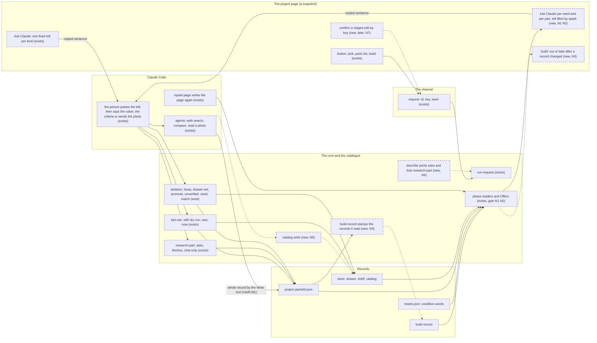

# P1161 council: the synthesis (the architect)

Written on 2026-11-25, about 20:55 CET (Europe/Prague, the machine's clock), on branch p1161-research-pages. This text proposes options and a direction. It decides nothing. Every recommendation is labelled "the architect's opinion". The PO, or the delegated council of three, decides.

Tags: E = read at a pointer or run as a command. H = a guess, with its source. D = a decision, with who and when. Pointers: `<store>/<path>` is the PO's store, `<walks>/<path>` his walk folders, `canvas:<file>:<line>` the design canvas copy. Lens ids: PO-n (PO assistant), USER-n, TL-n and PHYS-n (tech lead), ARCH-n, UX-n.

## Short version

- All five lenses agree on the frame. The write Operations exist (`fact-set`, `drawer-set`). Research, identify and an online find are Claude's jobs, so each is an "Ask Claude" offer with a sentence. A typed value, criteria and a photo cannot travel on today's channel. No store page exists in code (E, part 1).
- The smallest thing that works end to end needs no channel change and one small flow change: a chat Offer whose `tell` spark fills from its own records, and more than one such Offer per page (E ARCH-3, checked at `scripts/spark/flow/flow_codes.py:144-157` and `scripts/spark/flow/page_sections.py:288-298`).
- The architect's opinion on the direction: first the way out of the Parts moment for a need with no fitting part (research a named part, on the DFR0928). Then "settle a fact" on the DFR0664's 9 unchecked facts, with the build going out of date after a record changes. Then identify from photos. Find by criteria starts as a spike. An editor that sends a value from the page, and the store pages, come later and wait on the PO's own answers.
- One new Operation in the whole epic: a catalog write, and only when find by criteria is built (E ARCH-9, checked). Everything else is an Offer, a stamp, or a key that `fact-set` gains by need.
- Thirteen misfits with the core are listed in part 3. Three need the PO: agents write whole records with the Write tool outside any Operation, a value from the page contradicts P1122's pinned test of the same day, and the store's shelf and catalog sit outside the Storage seam.
- The riskiest assumption is about value: that he starts a job from the page's sentence more readily than by typing his own words (PO-16). The next walk can test it with no build.

## 1. Where the lenses agree, and where they split

### Agreements

| # | The lenses agree that | Lens ids | Tag |
| --- | --- | --- | --- |
| G1 | A record edit already has its Operations. `fact-set` and `drawer-set` have a dry run and answer `was` and `now`. No new edit Operation is needed | PO-1, TL-3, TL-26, ARCH-7 | E `scripts/spark/sourcing/set_facts.py:28-37` |
| G2 | Research, identify and an online find are never sent from the page. `research-part` declares `asks` and `fetches`, and the accepted answer bars both from a page | PO-3, USER-10, TL-10, ARCH-2, UX-12 | E `scripts/spark/sourcing/research/research_part.py:145`, `<store>/councils/p1113/architect-page-actions.md:63-64` |
| G3 | A typed value, criteria and a photo cannot travel on the channel. A request is `id, key, seen`, and a test pins it | PO-3, USER-10, TL-2, ARCH-1, UX-1 | E `scripts/spark/flow/run_request.py:35`, `tests/test_run_request.py:272-276` |
| G4 | No store page exists in code, and the store screens have no project behind them. A new record is born only in a project | TL-12, TL-13, ARCH-16, USER-11 | E grep of `scripts`, `commands`, `tools` for `StorePart`, `store_page`: no match. `scripts/spark/sourcing/write_skeleton.py:54-55` |
| G5 | "Tell me the cost first" has no step and no figure behind it | PO-7, USER-15, TL-24, UX-3 | E the lenses' greps (not re-run) |
| G6 | Find by criteria is new behaviour. Nothing filters records by a number, and no agent compares modules before it writes a record | PO-14, USER-7, TL-9, UX-4 | E `agents/parts-researcher.md:37` |
| G7 | Against the bar, the part that moves a project is the need with no fitting part (P992) and a bench result written back | PO-30, PO-31, TL-27, USER-6, UX-10 | H, each lens's judgement |
| G8 | An edit lands in a home the person cannot see, and nothing goes out of date after it | USER-5, TL-17, TL-21, ARCH-11, UX-5 | E `scripts/spark/sourcing/record_home.py:179-217`, `scripts/spark/build/build_record.py:25-32`, `scripts/spark/flow/phase_readers.py:441-449` |
| G9 | `verified: true` is bound to nothing but the writer's honesty | PO-17, TL-19, PHYS-2, PHYS-3, PHYS-7, ARCH-6, UX-14 | E the tech lead's pointers (not re-read) |
| G10 | No record edit is a kept step today, and a store edit lives outside every repository | PO-28, TL-23, ARCH-12, UX-2 | E `docs/discovery/2026-11-25-spark-and-git/brief.md:125`, `scripts/spark/core/operation.py:108-112` |
| G11 | Job (a) mostly ends at his eyes, his meter or a bench trial, not at a web search | USER-1, USER-2, USER-3, USER-17, PO-29 | E `parts.py --unverified dfr0664-tft-2in` (9 items, exit 0, run 2026-11-25). The split by who settles each is H, the user lens's reading |

### Splits, each one a question

| # | The split | Who says what | Becomes |
| --- | --- | --- | --- |
| S1 | How a typed value ever reaches spark from the page | TL-2: chat first, then a staged edit confirmed by key. ARCH-5: a payload row, which changes P1122. UX-1: records first, so a key is enough, or copy-only for good. PO-11: a `from_page` drawer kind | Q1 |
| S2 | What goes first | TL slice 0: the stale stamp before anything. PO-31: the offers on Parts first. The P1160 finding rates the same stamp "Can wait" | Q2, Q6 |
| S3 | Where a research with no project lands | TL Q-TL7: every research starts from a need. USER and UX draw it on the store screens. ARCH-16 asks for a host | Q3 |
| S4 | Which control leads job (a) | USER: "tell spark what you saw". The canvas's NOW card: research it again. UX-5: a typed edit card. ARCH-6: a `verify:` click | Q5 |
| S5 | Whether `verified: true` can come from a page | TL Q-TL3: no, except a bench result with a source spark forms. ARCH-6: a click has no "how". UX-15: four source words | Q5 |
| S6 | Where criteria live, and whether they are numbers | ARCH-10: the need's `condition` words, `limits` only when a check reads it. TL Q-TL6: on the need, with limits. UX-9 draws numeric fields. PO-14: a numeric filter is new core work | Q8 |
| S7 | Whether a module find shows candidates before it writes a record | UX-4, USER-7: yes, two-step. ARCH-15: no new Operation, the researcher "asked to compare" | Q9 |
| S8 | Whether "check this one fact online" is a missing Operation | USER-16: a missing operation. ARCH-15: Claude's job, with spark's `unverified` list | Part 3 (the architect's opinion: Claude's job, started by a chat Offer) |
| S9 | The cost line | UX-3: spark's words from the budget, the model and the last measured run. PO-7: Claude's own words, spark has no figure | Q10 |
| S10 | Photos | USER's sketch draws a drop zone on the page. ARCH-17 and UX-8: the chat only | Q1 |
| S11 | The drawer rule against a tell that names a drawer part | USER-18, UX-9 | Q3 |
| S12 | Whether a record edit is a kept step | TL Q-TL5, ARCH Q2 and Q3, UX Q2 | Q7 |
| S13 | The epic's relation to P992, P1002, P276 and P735 | PO-19, PO-20, PO-29, the coordinator's ask | Q2 |

## 2. The decisions, merged and ordered by what they unblock

Ten questions. Each "would prove" names what the PO could read afterwards.

### Q1. May anything other than `id, key, seen` travel from the page: a typed value, criteria, a photo?

Unblocks: every screen. It says whether a screen is a sentence or a form.

| Option | Cost | What it would prove |
| --- | --- | --- |
| A. Nothing travels. Each job is an "Ask Claude" Offer. Spark fills the `tell` from its own records (a need's id, a record's id and name). The person says the value, the criteria or sends the photo in the chat | Small. One flow change (part 3, N1). No change to P1122 | Whether the page's sentence is used at all (the riskiest assumption) |
| B. As A, then a staged edit. The value still arrives in the chat or from a fixed choice. Spark keeps the proposed write as a file. The page shows `was` and `now` and confirms by key | Medium. A staged-edit record, a `was` precondition on `fact-set`, the fingerprint must cover the record (ARCH-4) | Whether a confirm on the page beats a yes in the chat |
| C. A payload row beside the request (ARCH-5), or a photo upload | Medium, plus it changes P1122's done-when and its test, decided by the PO on 2026-11-25. A photo would also leave the machine | Whether a form on the page works end to end |

The architect's opinion: A for this epic's MVP. B is the named next step and needs its own spike. C goes to the PO himself and to nobody else, because it reverses his decision of the same day. Rests on: PO-3, PO-18, USER-10, TL-2, ARCH-1, ARCH-4, ARCH-5, ARCH-17, UX-1, UX-8.

### Q2. What is the first slice, and what does the epic absorb?

Unblocks: items.md and the board actions.

| Option | Cost | What it would prove |
| --- | --- | --- |
| A. First the way out on Parts (research a named part for a need). P1161 absorbs the research and identify half of P992 #1445. P1002 #1461 becomes the second slice ("settle a fact"). P276, P735 and P1164 stay their own cards | Two cards merged or closed by the coordinator | A project with a need the store cannot fill reaches a pick and a build |
| B. First "settle a fact" on the DFR0664, with no network and no tokens beyond the chat. Then A | The same flow change, a cheaper walk | The mechanism, and a fact he trusts before wiring |
| C. P1161 stands beside all of them and absorbs nothing | No board work now, two cards per job later | Nothing new |

The architect's opinion: A. The brief's outcome line names the DFR0928 walk as the proof (E `brief.md:17`), and a need with no part stops a project earlier than an unchecked fact does. B is a fair second choice if the PO wants a walk with no network. Rests on: PO-19, PO-20, PO-29, PO-30, PO-31, TL-14, TL-27, USER-6.

The overlap with P735 #1010 (E `gh issue view 1010`, Idea): P735 asks for one refactored research run that makes a full record of each DFRobot part, with a picture, the schematic, holes and connectors, in batches. P1161 is the on-demand path for one part that the person chooses. They share the research run and the records. Two things follow. First, the batch must not enter P1161: "owning a part never starts research" (D-e), and 90 of the 95 record-less entries carry a DFRobot number (E USER-12, a count over `<store>/drawer/*.json`, 2026-11-25). Second, whichever card comes first should fix the misfit M1 (agents write whole records by hand), because both would otherwise multiply those writes.

### Q3. Where does a research with no project land, and are the store pages part of this epic's build?

Unblocks: where jobs (b) and (c) may start, and the Store, StorePart and StoreAdd artboards.

| Option | Cost | What it would prove |
| --- | --- | --- |
| A. Every research starts from a project's need. The store screens stay designs. A record reaches the shelf as today, through a drawer link | None beyond Q2 | The jobs work at the moment they arise in a project |
| B. The store screens become sections of a project's page (a host project) | Medium. The page, its request file and its fingerprint are per project (E `scripts/spark/flow/fingerprint.py:18`) | Store work on a page with no new channel |
| C. A store-scoped page and request path, and a skeleton born on the shelf | Large. A second page, a second fingerprint, a new home for a record | Store work with no project |

The architect's opinion: A for the MVP. B or C is one later card ("the store pages get a home"), with the PO's words, because nothing in this epic's first slices needs it. The same question holds a smaller one for the PO: may a `tell` name a part from his drawer, given `commands/drawer.md:93-94` ("A research agent gets the need, never the drawer")? The architect's opinion: yes when the person chose that part on the page, and the tell says so in its words. The rule's text should then say it. Rests on: TL-12, TL-13, ARCH-16, USER-11, USER-18, UX-7, UX-9.

### Q4. Which records may the page's offers touch?

Unblocks: the "where it lands" line and the first edit's scope.

| Option | Cost | What it would prove |
| --- | --- | --- |
| A. A record whose home is the page's project, and a catalog record. A record whose home is another project is named and handed to the chat with no offer. No board record | Small. The page reads the home that `record_path` already finds | An edit whose landing place the person saw first |
| B. Also drawer entries and any shelf copy, wherever its home is | Small in code, since `fact-set` already writes there. Larger in risk: project A's page changes project B's file (ARCH-11) | The store as one place to edit |
| C. Also board records | New core work. Only `pin_roles` and `joined_pads` are writable (PO-10) | Board facts from the page |

The architect's opinion: A. Board edits wait for P230 #218. Rests on: PO-10, TL-16, TL-17, ARCH-11, USER-5, UX-5.

### Q5. Who may set `verified: true`, with which source, and which control leads job (a)?

Unblocks: the "settle a fact" card and its guard.

| Option | Cost | What it would prove |
| --- | --- | --- |
| A. As today. Only the chat writes it, with a source in words that names who, when and how (`commands/research.md:108-109`). The page's card leads with "tell spark what you saw or measured" | None in code. The tell asks Claude to show the dry-run lines first | Whether the bench path is what he uses |
| B. Spark forms the source sentence from a fixed method word (read on the part, measured, bench trial), the date and "the person". No schema change, since `source` stays words | Small. One class that forms the sentence | A source that no writer can leave vague |
| C. One click, `verify:<part>:<fact>` | Small, but a click says no "how", and PHYS-2 and PHYS-3 show a false pass | The fastest edit |

The architect's opinion: A in the first slice, B when a staged edit exists (Q1 B). C is a proposed no-go. The four source words of UX-15 need a new field per fact. That is a record change, so it enters only when the PO or a check needs it (records grow by need). Until then the page avoids the word "checked" where it collides. Rests on: PO-17, TL-19, TL-20, PHYS-1 to PHYS-3, PHYS-7, ARCH-6, USER-1 to USER-3, UX-14, UX-15.

### Q6. Must a build go out of date when a record it read changes, and when?

Unblocks: the order of the second slice.

| Option | Cost | What it would prove |
| --- | --- | --- |
| A. Before any offer that edits a fact. The build record stamps the sha256 of each record it read, and the build phase compares | Small. One stamp and one comparison. It is change 6 of the P1160 finding | An edit in the chat marks the build and the sheet stale on the page |
| B. Later. Until then the edit's words say "build again" | None | Nothing. A board can read current while built on the old fact |
| C. Before everything, as the tech lead's slice 0 | The same code, but it delays the Parts exit, which writes a new record before any build | The same as A |

The architect's opinion: A. It sits beside the "settle a fact" slice, not before the research slice. Note for the decider: the P1160 finding rated this "Can wait" for take-backs, because part records are outside the kept steps (E finding.md at commit e20c05d9, lines 78 and 146-147). A page that invites fact edits changes that rating. Rests on: TL-21, TL-22, PHYS-1, PHYS-4, PHYS-6, PO-28, UX-5.

### Q7. Is a record edit a kept step, and what does the page say when it is not?

Unblocks: the Undo artboard and the edit card's last line.

| Option | Cost | What it would prove |
| --- | --- | --- |
| A. Plain words now: "This edit is no kept step. The old value was X." `fact-set` already answers `was` | None | Honest words, no false promise of "undo that" |
| B. A project's `parts/<id>.json` joins D8's kept records, through P1152 #1688. `fact-set` then names the project it wrote | Small, but it waits on P1152 and adds to the PO's D8 | A take-back of a project's fact edit |
| C. The store keeps one previous version of a shelf, catalog or drawer file | Medium. A second history beside git | A take-back in the store |

The architect's opinion: A now, B as a line in P1152's kept-step slice when it is built. C is a rabbit hole until the PO rules on the store and git. Clearing a fact stays out, since `fact-set` refuses it (E `set_facts.py:49`). Rests on: TL-23, ARCH-8, ARCH-12, UX-2, UX-11, PO-17.

### Q8. Where do find criteria live, and are any of them numbers that spark filters by?

Unblocks: the find-by-criteria moment and its Offer key.

| Option | Cost | What it would prove |
| --- | --- | --- |
| A. In the need's `condition` words and the brief's `prefer`, `sellers` and `must`. The Offer key carries the need's id, and Claude reads the rest with `needs --json`. No numeric filter | Small. No new record | Whether criteria as words give useful candidates |
| B. A structured field on the need (supply volts, current, width, breadboard fit), written by `needs-set`, and a local numeric filter over records | Medium. A contract change, a matcher change, and a name other than `limits`, which `--match` already uses (UX-9) | "Spark checks this" beside each criterion (USER-8) |
| C. A research-request record | Medium. A new noun that repeats the need | Nothing A does not |

The architect's opinion: A. B enters when a check or the matcher reads a number. C is rejected. A price is no criterion (D-e). Rests on: PO-14, USER-8, TL-9, ARCH-10, UX-9.

### Q9. For a module, does the person see candidates before any record is written, and how is that found out?

Unblocks: whether job (d) is one card or a spike and a card.

| Option | Cost | What it would prove |
| --- | --- | --- |
| A. A spike first. One real need (the e-paper and cursor need of USER-9) run two ways: `part-finder` on a module, and `parts-researcher` "asked to compare". Tokens counted afterwards with `run_cost.py` | One short session and its tokens, named before the run | Candidates, their "fits" and "lacks" lines, and a measured cost per way |
| B. Build on `parts-researcher` with "compare" | It writes a record before he chooses, on the larger model | A find with today's agent |
| C. An outside parametric API | Accounts, terms not read, queries leave the machine (PO-4, PO-5) | Nothing spark's rules allow |

The architect's opinion: A, then one build card. C is a proposed no-go. Rests on: PO-4, PO-5, PO-6, USER-7, USER-9, TL-9, UX-4, UX-13.

### Q10. What does the page say about cost before a research?

Unblocks: the words of every research tell and the "Not known yet" card.

| Option | Cost | What it would prove |
| --- | --- | --- |
| A. The page says "not measured yet" until a run of that kind is measured. The walking skeleton's walk measures one. The command gains a step where Claude names the model and the agent's limits before it starts | Small. A line in `commands/research.md`, and a diary row | The first measured module research in this store |
| B. The page shows the agent's limits and model as spark's words | Small, but the limits live in the agent prompts today. A second copy would repeat them, so they would need one data file first | A cost line with no run behind it |
| C. Keep "Tell me the cost first" in the sentence as it is | None | Nothing. The promise has no step (PO-7) |

The architect's opinion: A. Whether tokens on his plan count as "costs money" under his rule D-g is his to say. Rests on: PO-7, USER-15, TL-24, TL-25, UX-3.

## 3. How the four jobs fit the core as Operations

### What exists and is reused

| Part | Where | Role in this epic |
| --- | --- | --- |
| `fact-set` (SetFacts), with a dry run, a payload argument, `was`, `now`, `shelf_copy` | E `scripts/spark/sourcing/set_facts.py:24-37` | The write of job (a). No change in the first slices |
| `set_fields` and `write_fields`: the record's own home, the library refused | E `scripts/spark/sourcing/record_home.py:165-217` | "Where it lands" |
| `drawer-set`, `function-set`, `features-set`, `skeleton`, `keep`, `keep-picture`, `promote`, `unverified`, `show`, `need`, `match`, `validate` | E the lenses' catalogue listing (TL-6, not re-run) | The deterministic halves of all four jobs |
| `research-part` (reads, writes, asks, fetches) | E `scripts/spark/sourcing/research/research_part.py:145` | Job (b) for a DFRobot `sku`, in the chat only |
| The Offer and the OfferKind with `from_page` and `tell` | E `scripts/spark/flow/flow_codes.py:144-157`, `scripts/spark/flow/phase_readers.py:42` | Every job's entry on the page |
| The parts phase already says the two states that start a job | E `flow_codes.py:182` ("No pick fits %s by its words. Ask Claude to run parts.py --match."), `:193` ("%s still lacks what spark needs: %s. Ask Claude how to fill it in."), used at `phase_readers.py:267` and `:374` | The hook for the new Offers. Today each is a sentence with no key |
| `run-request` and its allow-list | E `scripts/spark/flow/run_request.py:35`, `:42`, `:86-100` | Unchanged. No new sendable kind in the MVP |
| The need's `condition`, the brief's `prefer`, `sellers`, `must` | E `scripts/spark/design/needs.py:4-8`, `:31`. The brief's fields are ARCH-10's pointer, not re-read | The home of criteria |

### The smallest set of new parts

| # | New part | Kind | Needed by | Slice |
| --- | --- | --- | --- | --- |
| N1 | A `tell` template filled from spark's records, as `PICK_LABEL` is, and chat Offers as Offer instances, more than one per page. Today `tell` is one fixed sentence per kind, and the page shows only the one chat offer that the guide's `now` names (E `flow_codes.py:148-155`, `page_sections.py:288-298`, `scripts/spark/flow/guide.py:138-146`) | A flow change | All four jobs | 0 |
| N2 | The parts phase gives a need with no plausible pick, and a pick that still owes facts, a chat Offer with a key. Proposed kinds (names for the plan's name check): research a part for a need, identify from photos for a need, find online for a need, settle the facts of a part | Offers | a, b, c, d | 0, 1, 2, 3 |
| N3 | The build record stamps the records it read, and the build phase compares them | A stamp and a reader | Q6 | 1 |
| N4 | `--describe` prints the word `asks`, and `research-part` is listed where the interfaces read it. A test pins "never from a page: asks, fetches" | A core change and a guard | G2, P1082 #1587 | 0 or beside it |
| N5 | A catalog write Operation (for example `catalog-keep`: a payload argument, writes, refuses a record with no `why_not` or with `sourcing`). No code creates a catalog record today. The five uses of `place("catalog")` read or address it (E `scripts/spark/records/store.py:131`, `scripts/spark/sourcing/record_home.py:70`, `part_facts.py:165`, `part_records.py:549`, `datasheets.py:51`) | The one new Operation | d | 3 |
| N6 | `fact-set` gains a key only when a screen or a finding needs the field (for example `power`). Not before | Keys by need | a | later |
| N7 | A `was` precondition on `fact-set`, the fingerprint covering the record, and a staged-edit file confirmed by key | Core and flow changes | Q1 B | 4 |
| N8 | A measured research run (`run_cost.py`, step G) and a cost step in the command | A measure and prompt words | Q10 | 0 |
| N9 | A home for a record born with no project, and a store page | Core and a new interface | Q3 B or C | 5 |

The names in N2 need care. "Research" already names `/spark:research` and the op `research-part`, which does DFRobot geometry only. "Find" names three reaches (UX-16). The plan checks its names: one word for one thing.

### What stays Claude's job

A web search. Choosing and comparing candidates. Reading a photo or a drawing. Judging a fit. Asking the person what he saw, and writing the "how" of his source from his words. Writing a trial firmware for the bench. Spark never does these and never estimates their result (facts, never behaviour). Claude's findings enter records only through spark's write Operations (H ARCH-15, the architecture lens's line, which this synthesis adopts).

What stays spark's: reading, validating and writing a record, the dry-run lines, where a write lands, what goes out of date, the list of unchecked facts, the Offer's key, and the `tell` sentence.

On split S8: "check this one fact online" needs no new Operation. `unverified` already lists each open fact with its write key. The search is Claude's. A chat Offer for the part starts it (the architect's opinion).

### The proposed parts and the data flow



Solid boxes and arrows exist today. Dashed ones are new or wait on a decision.

### Misfits to raise, none accepted in silence

| # | The misfit | Evidence | For whom |
| --- | --- | --- | --- |
| M1 | The research agents write whole records, and catalog records, with the Write tool. No Operation stands between the agent and the file. `--validate` is the only gate. A page that starts more research multiplies these writes | E `agents/parts-researcher.md:78-82`, `commands/research.md:151-158`, TL-4, ARCH-7, ARCH-9 | The PO. It also belongs in P735's first step |
| M2 | A typed value from the page contradicts P1122's done-when and its test | E `tests/test_run_request.py:272-276`. D the PO, 2026-11-25, #1652 | The PO only (Q1 C) |
| M3 | The shelf and the catalog are outside the Storage seam, so a later MCP or web interface cannot reach these records through it | E ARCH-11 (`scripts/spark/records/storage.py:24-25`, not re-read) | The PO. It limits "one core, many interfaces" for every store edit |
| M4 | `research-part` is in no `--describe`, and `--describe` has no word for `asks`. The rule "never from a page: asks, fetches" has no test | E `python3 -I scripts/research.py --describe` (error: "the following arguments are required: --part", run 2026-11-25), `scripts/spark/core/describe_operations.py:18`, `tests/test_operation_catalogue.py:154-157` | P1082 #1587, or a chore card (C7) |
| M5 | `--promote` copies a project's record into spark's own library, which `set_fields` refuses to write, and it checks no `verified` flag | E `scripts/spark/sourcing/part_facts.py:154-177`, `record_home.py:165-176`, `commands/research.md:111-112` | Its own card, outside P1161 (TL-18) |
| M6 | Logic lives in prompts and is repeated: the fact-needs table, the header geometry rule (three places), the vendor order (two places), the catalog record's shape (two places), store paths as literals | E ARCH-14. Checked here only for the catalog shape and its literal path | A chore, taken along when a slice touches the prompt |
| M7 | The store screens have no project. The page, its request and its fingerprint are per project | E `fingerprint.py:18`, TL-12, ARCH-16 | Q3 |
| M8 | The fingerprint does not cover part records. A page read before a record changed still passes `seen` | E `fingerprint.py:18`, `:25-36` | Matters only once a page sends an edit (N7) |
| M9 | `verified: true` binds to no person, date or document. The build reads `pin_order` whatever its proof says | E TL-19, PHYS-1, PHYS-7 (not re-read) | Q5. An edit screen makes it easier to reach |
| M10 | `fact-set` does not name the project it wrote, so no follow-up writes the page again and no history step exists | E `operation.py:108-112`. Overrides exist only at `pick_parts.py:68`, `build_board.py:132`, `deploy_image.py:501` | Q7, P1152 |
| M11 | The drawer rule against a tell that names a drawer part, and against part-finder's input "what they already own" | E `commands/drawer.md:93-94`, USER-18, UX-9 | Q3 |
| M12 | The canvas promises a cost first, and no command has a cost step | E PO-7, UX-3 | Q10 |
| M13 | Two canvas lines say what the code does not. StoreAdd: "every fact marked not checked", while identify marks a chip's datasheet facts verified (E `commands/identify.md:53-56`). StorePart's NOW card sends two "not published" facts to a datasheet (USER-2) | E UX-8, USER-2 (canvas lines not re-read) | The canvas's next edit |

## 4. The screens

The Store, StorePart, StoreAdd, StoreMove and Undo artboards were not read for this synthesis. Their lines below are the lenses' citations. An older copy of Parts was read.

| Artboard | Changes or new | What changes, in one line | Slice |
| --- | --- | --- | --- |
| Parts | Changes | Each need card gets a last tile, "Not here?", with three ways: I know its name, I have it in my hand (photos), find one by what it does. A pick that owes facts gets "settle its facts". Send stays grey today until every need is picked (E `<store>/councils/p1113/canvas-2026-11-25/Parts.dc.html:179`, an older copy) | 0, 1, 2, 3 |
| Bench | Changes | A wiring step that rests on an unchecked fact asks one plain question, and its answer goes to "Ask Claude". After a bench finding, an offer to keep it (P1002) | 1 |
| Change | Changes | A changed record fact becomes a cause: the build and the sheet of each project that holds the part read out of date | 1 |
| Undo | Changes | One plain line: a record edit is no kept step yet, with the old value shown | 1 |
| Main and the journey picture | Changes | Research sits between Needs and Parts, and again after the Bench. `tools/journey.py` and the README table change only in a PR that changes a step's status | 0 |
| StorePart | Changes | Fact rows say who can settle each. The NOW card leads with "tell spark what you saw or measured". A "Lands in" line names the file. A second state, "Not known yet", holds the research card | Design now, build with slice 5 |
| StoreAdd | Changes | "From photos" says how to shoot (both sides, flat, a ruler) and hands over to the chat. Its "not checked" line is corrected (M13). "Research a new part" waits on Q3 | Design now, build with slice 5 |
| Store | Changes | The record-less row leads to StorePart's "Not known yet". The verb "find" gets one meaning | Slice 5 |
| StoreMove | No change | Named only because its "undo that" promise meets Q7 | None |
| Find a part (new) | New moment on the project page, under one need | The local search first, free. Then the criteria as words, the cost line, and "Ask Claude". Afterwards the kept candidates with what each lacks | 3 |
| A "research is running" state | Not proposed | The page is a snapshot. It says in words that the job runs in Claude Code | None |

### Wireframe 1: Parts, one need card with the way out (slice 0)

```
+----------------------------------------------------------------------------+
| Need 2 · A screen · shows the status: a small colour display               |
| No part of yours fits by its words.                                        |
|                                                                            |
| [ Fermion 2.0 IPS   Held by p581 ]   [ Fermion 1.8 IPS  o no record ]      |
|                                                                            |
| [ + Not here? ]                                                            |
|    I know its name   Ask Claude  "Research the “Fermion 1.8 in IPS         |
|                      display” for the screen need of this project          |
|                      with me."                                    [Copy]   |
|    It is in my hand  Ask Claude  (photos, slice 2)                         |
|    Find one          Ask Claude  (by what it does, slice 3)                |
|                                                                            |
| It runs in Claude Code. Cost: not measured yet. No prices, no stock.       |
| This page shows the new part after /spark:page.                            |
+----------------------------------------------------------------------------+
| [ Pick 1 more first ]                                                      |
+----------------------------------------------------------------------------+
```

### Wireframe 2: settle a fact of a picked part (slice 1)

```
+----------------------------------------------------------------------------+
| Fermion 2.0 in IPS display · DFR0664 · picked for "A screen"               |
| 9 facts nobody has checked.                                                |
|                                                                            |
| NOW · Settle what you can see or measure · you, with Claude                |
|  Pad order          ?  check the names on the board in hand before wiring  |
|  Peak current       ?  not published: measure on the bench                 |
|  Logic thresholds   ?  not published                                       |
|  ... 6 more                                                                |
|                                                                            |
|  Ask Claude  "Go through the facts of “Fermion 2.0 in IPS display”         |
|               that nobody has checked with me. Show me the lines           |
|               before you write."                                  [Copy]   |
|                                                                            |
|  Lands in     this project's record. Your shelf copy follows.              |
|  Out of date  after a change: the board files and the wiring sheet.        |
|  No kept step yet. Claude shows the old value before your yes.             |
+----------------------------------------------------------------------------+
```

### Wireframe 3: find a part for a need (slice 3, new moment)

```
+----------------------------------------------------------------------------+
| Find a part for: "A screen" · e-paper quotes clock                         |
|                                                                            |
| 1 Free, on your machine    your drawer: 1 fits, 1 held     [ see them ]    |
|                                                                            |
| 2 What it must do (the need's words, change them in the chat)              |
|     shows a quote · keeps the picture with the power off                   |
|     moves a cursor                         your call: no fact for it       |
|     shops: DFRobot, Seeed (from your project)                              |
|                                                                            |
| 3 Online   cost: not measured yet · no prices, no stock                    |
|     Ask Claude  "Find at most two parts online for the screen need         |
|                  of this project. Show me both before you write            |
|                  a record."                                       [Copy]   |
+----------------------------------------------------------------------------+
| after, once kept:                                                          |
|   1 Maker A  PN-1234   fits: 3.3 V, 2.54 mm header   lacks: no width       |
|   2 Maker B  PN-5678   fits: e-paper                 lacks: 5 V only       |
|   [ Research 1 ]  [ Research 2 ]                                           |
+----------------------------------------------------------------------------+
```

## 5. The story map

### The backbone

| Activity | Notice the gap | Start the job from the page | Do it in the chat | See what will be written, and where | Keep it | Go on |
| --- | --- | --- | --- | --- | --- | --- |
| Who | spark's readers | the person, with a copied sentence | Claude, the agents, spark's Operations | spark's dry run | the person's yes, then spark's write | the page, written again |

### The slices

| Slice | What runs end to end | Real part | Bar | New parts | Cards it absorbs, touches or leaves |
| --- | --- | --- | --- | --- | --- |
| 0, the walking skeleton | A need with no fitting pick shows "Ask Claude: research". He pastes it. `/spark:research` writes the record in the project. `/spark:page`. The part is a pick. Pick, parts list, build. The diary notes whether he copied the sentence, and the run's cost | DFR0928, in the drawer with count 1 and no record (E `<store>/drawer/dfrobot-dfr0928.json`, no shelf or catalog file names it) | MVP | N1, N2 (one kind), N8, and N4 beside it | Absorbs the research half of P992 #1445. Touches P1082 #1587. Leaves P734 #1005 and P276 #312 (the picture) |
| 1, settle a fact | A picked part with unchecked facts shows "Ask Claude: settle". Claude lists them, he says what he saw, `fact-set` shows its lines, his yes writes. The build reads out of date and is built again | DFR0664, 9 unchecked facts (E the command in G11). The pad order needs only his eyes | MVP | N2 (one more kind), N3 | Absorbs P1002 #1461 (E `gh issue view 1461`, Idea). Touches P998 #1457 (the person's word), P1003 #1462 (a bench trial), P340 #434 (what is still open). Builds change 6 of P1160 #1696 (Done). Leaves P997 #1454 |
| 2, identify from photos | The same tile offers "It is in my hand". The page says how to shoot. The photos go to the chat. Claude shows "Read / Not read" before any search | An unmarked module from his drawer. How many wait is not known (USER-13: 4 of 114 entries keep a photo) | MVP, small once slice 0 exists | N2 (one more kind), words | Absorbs the identify half of P992. Touches P1164 #1700 (E `gh issue view 1700`, Idea): both take a photo in, for different jobs. P1164 stays whole. Leaves P1162 #1698 |
| 3, find by criteria | Local search first. Then "Ask Claude: find online" for a need. Two candidates shown. The ones not chosen are kept through the catalog write. The chosen one goes to slice 0's research | The e-paper and cursor need (USER-9) | Later. It starts with the spike (Q9) | N2 (one more kind), N5 | Touches P340, P997. Leaves P884 #1252, which fences off prices and buying |
| 4, the page shows an edit | A staged edit confirmed by key, with a `was` check, and a project's record edit as a kept step | DFR0664 | Later. Waits on Q1 and P1152 | N7, M10 | Depends on P1152 #1688 (Idea). Touches P998 |
| 5, the store pages | StorePart "Not known yet", a drawer entry's edit, research with no project | DFR0928 from the Store row | Later. Waits on Q3 | N9 | Touches P1124 #1654 (Build), P735 #1010 (shares the research run and the records, leaves its batch and its pictures) |
| Paused | Board record edits (after P230 #218, P286 #336). Pins on a picture (P276). A numeric filter. A source-kind field. A photo upload | none | Later | N6 by need | Leaves P269 #304, P230, P286, P276 |

Done already and relied on: P1122 #1652 (chat offers), P1006 #1465 (the shelf copy follows its record), P1160 #1696 (the finding).

## 6. The proposed cards for items.md

Eight cards. `?` is the coordinator's number. Each "needed by" quotes the PO.

**C1 · P?: a need with no fitting part has no way out on the page → the Parts moment offers "Ask Claude" to research a part the person names, with spark's own sentence**
- Type: story. Slice 0.
- Needed by: the PO, 2026-11-25, #1697: "We should also have pages for editing records and possibly for researching when adding new parts". And in the P934 walk, on #1445: "what if it's not in the store ? I can still have it and want to add it" (E USER-6, `<walks>/p934-display/diary.md:86-90`, the lens's quote).
- Value proven by: a walk row on the DFR0928. `flow.py show --json` lists the offer's key and its tell for the need. After the research and `/spark:page`, the part is a pick, and the board builds.
- Depends on: nothing. Q2 and Q3 decide its scope. The coordinator may refine P992 #1445 into this card in place of a new number.

**C2 · P?: a fact nobody has checked is settled only when Claude writes a file by hand → the page offers "Ask Claude" per picked part to go through its unchecked facts, and the dry run names where the write lands**
- Type: story. Slice 1.
- Needed by: the PO, 2026-11-25, #1697: "When I want to edit a record and change something there". And 2026-11-22, #1461: "lets make it so that its always offering the new findings to be stored to the store in general".
- Value proven by: `parts.py --unverified dfr0664-tft-2in` prints 9 before and fewer after. The record's fact holds a source that names who, when and how.
- Depends on: C1 (the same flow change), Q4, Q5. Absorbs P1002 #1461.

**C3 · P?: a build reads current after a part record it read has changed → the build record stamps each record it read, and the build phase says out of date**
- Type: story. Slice 1.
- Needed by: the PO, 2026-11-25, #1696: "Somwe files might need to be regenerated, etc.". And #1700: "what changes influence in later steps".
- Value proven by: a row from a real run. Change one fact with `--fact-set`, then `flow.py show` names the build as out of date. Build again, and it reads current.
- Depends on: nothing. It is change 6 of the P1160 finding. Q6 decides its order.

**C4 · P?: identify from photos starts only from a typed command, and nothing says what a photo can settle → the "Not here?" tile offers it with the way to shoot and spark's own sentence**
- Type: story. Slice 2.
- Needed by: the PO, 2026-11-25, #1697: "researching when adding new parts, based on photos".
- Value proven by: a walk row on one unmarked module. The record validates on the first try, with a size from a ruler shot (USER-14 names the four breaks to watch).
- Depends on: C1.

**C5 · P?: nobody knows what a find by criteria returns or costs for a module → one real need run two ways, with the candidates and the tokens measured**
- Type: spike. Slice 3. Its answer is a finding with sources.
- Needed by: the PO, 2026-11-25, #1697: "just finding online a part/board/module that could do what we need, setting up criteria".
- Value proven by: a finding with the candidates of each way, their "fits" and "lacks" lines, and `run_cost.py`'s count for each run.
- Depends on: Q8, Q9. The token cost is named and asked before the run.

**C6 · P?: a need with no part has no find, and a candidate not chosen is written by hand → "Ask Claude: find online" for a need, with the criteria read from the need, and a catalog write Operation**
- Type: story. Slice 3.
- Needed by: the same words as C5. And in the P934 walk: "ask if I want it to search for alternatives online" (E USER-9, `<walks>/p934-epaper/diary.md:196-205`, the lens's quote).
- Value proven by: a walk row. Two candidates shown before any record. `parts.py --catalog` lists the one not chosen, written by the Operation.
- Depends on: C1, C5.

**C7 · P?: `--describe` hides that research asks and fetches, so no test can keep it off the page → `--describe` prints `asks`, lists `research-part`, and a test pins the rule**
- Type: chore. Beside slice 0.
- Needed by: the PO, 2026-11-25, rules.md: "Every plan and every PR with new logic says how it fits the core". And his choice of "the architect stuff" for P1122 (D, #1652, as TL-10 cites it).
- Value proven by: `parts.py --describe --json` shows the op with `asks` and `network`. A test fails when an Operation with `asks` or `fetches` enters the page's allow-list.
- Depends on: nothing. The coordinator may fold it into P1082 #1587.

**C8 · P?: an edit is confirmed only in the chat, and a page read before a record changed would overwrite it → spike: a staged edit that the page confirms by key, with a `was` check**
- Type: spike. Slice 4.
- Needed by: the PO, 2026-11-25, #1697: "pages for editing records".
- Value proven by: a finding with an experiment in a scratch folder. A stale page's confirm is refused. P1122's test still passes.
- Depends on: Q1 (only if B is chosen), C2, C3, P1152 #1688 for the kept step.

Slice 5 (the store pages) and the paused work stay one line each in the epic, with the PO's words, until he orders them (plans shrink with distance).

### Findings outside the scope, each its own proposal

- F1 · `--promote` writes into spark's own library and checks no `verified` flag, against the rule that the library changes only in spark's repository (M5, TL-18). A card.
- F2 · The research agents write whole records outside any Operation (M1). A card, or the first line of P735's discovery.
- F3 · The shelf and the catalog are outside the Storage seam (M3). A line for the architecture cards.
- F4 · Prompt text repeated in two or three places (M6). A chore.
- F5 · Seller names differ in case in the drawer, `aliexpress` and `AliExpress` (PO-32). A data fix.
- F6 · Two canvas lines to correct (M13).
- F7 · The brief says P1002 #1461 is "in Discovery". The board says Idea (E `gh issue view 1461`, 2026-11-25). Two lens reports call P1160 #1696 open. It closed as Done on 2026-11-25 at 20:43 CET (E `gh issue view 1696`, closedAt 19:43 UTC). Its finding is not on this branch.
- F8 · Clock times do not agree. The PO assistant's report says it read "about 21:00 to 21:40 CET", and card #1700 quotes the PO at "about 21:25 CET". The machine's clock read 20:53 CET while this synthesis was written (E `date`). The times in the cards and that report look about one hour ahead. Not resolved here.

## 7. Assumptions

| # | Belief | Type | Evidence now | Cheapest test | Proposed pass line |
| --- | --- | --- | --- | --- | --- |
| A1 | He starts a research or an edit from the page's sentence more readily than by typing his own words | Value | None for it. Every edit and research in the walks ran in the chat (E PO-2, n = 1, the PO) | The next walk's diary: one row at each moment he wants research or an edit, with what he did | He copies the page's sentence at 3 or more of the first 5 such moments. The decider sets the line before the walk |
| A2 | Copy, paste, wait 3 to 6 minutes, `/spark:page`, reload is a loop he accepts | Usability | Waits of about 3 min, 6 min 18 s and 6 min 20 s, one run each (E USER-15) | The same walk: count his steps, note each complaint | No row where he asks why he must do a step |
| A3 | A tell filled only from ids and names in spark's records is enough for Claude to start the right job | Feasibility | Three fixed tells work today (E `flow_codes.py:152-154`) | Paste each new tell into a fresh session in a scratch project, 3 times each | 3 of 3 start the right command and ask before any network use |
| A4 | Stamping the records a build read gives no false "out of date" | Feasibility | Not tested. The shelf copy is rewritten on a refresh (E `record_home.py:179-189`) | Unit tests, then one walk's builds | 0 false marks across the walk |
| A5 | Job (a) is mostly "what I saw or measured" | Value | 0 of 9 facts of one part need a new web search, by the user lens's reading (E and H, USER-3, n = 1 part) | Sort the 107 unverified facts in the 10 shelf records (PO-8's count) by who can settle each | 60% or more are not for the web. Then the bench control leads |
| A6 | A research started from the page costs tokens he accepts | Viability | No research run is measured in this store (E TL-24). Older runs: about 0.17 M to about 5.0 M tokens, n = 1 or not stated, 2026-10-03 (E TL-25) | `run_cost.py` on the slice 0 walk | The PO names a ceiling before the run, and the run stays under it |
| A7 | Two module candidates can be shown before any datasheet is read | Feasibility | Only for commodity parts, and that path never ran in a walk (E PO-6, UX-4) | The spike C5 | 2 candidates with maker, part number, "fits" and "lacks" for 2 of 3 real needs |
| A8 | No path of this epic lets an unproven fact become `verified: true` | Ethics (safety at the bench) | The guard holds only as far as the writer is honest (E PHYS-7) | Read every `fact-set` of the walk | Every `verified: true` has a source that names who, when and how |
| A9 | No drawer text beyond a chosen part's name, and no photo, leaves the machine through this epic | Ethics (privacy) | The rule exists (E `commands/drawer.md:93-94`). The page already shows pick labels | A test on the tell templates | The test passes, and Q3's small question is answered |
| A10 | The hobbyist the vision names has these four jobs too | Value | None. Nobody beyond the PO was reached (E `brief.md:21`) | None available now | Not set |

The riskiest is A1. If it fails, the page's worth in this epic is in what it shows (what is unchecked, which need has no part) and not in how a job starts. It can be tested before any build, because the canvas already carries the sentences (H PO-16).

## 8. Proposed no-gos and rabbit holes

Proposals until the decider confirms.

No-gos:
- Prices, stock and seller listings (D-e, P884).
- An outside parametric search that needs an account or sends queries off the machine (PO-4, PO-5).
- Text, a file or argv in the channel without the PO's own yes (P1122).
- A photo upload into the Artifact. The photo would leave the machine, and the Artifact's ability was not checked.
- A one-click `verified: true`.
- A batch research of the drawer. Owning a part never starts research. The batch is P735's.
- An edit of spark's library from any page. The core refuses it.
- Board record edits before P230. Pins on a picture (P276). Drag and drop (P1162).
- A model call from the page to estimate a cost or explain a result.

Rabbit holes:
- A generic form for every field of a record. `fact-set` gains keys by need.
- A structured provenance schema, or the four source words as a field, before a check or the PO needs it.
- A numeric filter over records, and the word `limits`, which `--match` already uses.
- A live "running" state on a page that is a snapshot.
- A take-back for store edits while the store is outside git.
- Clearing a fact, which `fact-set` refuses.
- A write from project A's page into project B's record.
- A store-scoped page and request path inside the MVP.
- Renaming "research", "find" and "checked" across the docs. The plan checks only its own names.
- Fixing every repeated prompt inside this epic.

## The architect's opinions, each with its reason and the option set aside

| Opinion | Reason | Set aside |
| --- | --- | --- |
| Every job enters the page as a chat Offer with a tell that spark fills | It reuses the Offer, keeps P1122, and a later direct channel then needs only the key | A payload row, a form that writes |
| The key carries ids only, and the value lives in a record or in the chat | "Never text, argv or a path" (`architect-page-actions.md:52`) | Criteria or a value inside the sentence's slots |
| No new Operation for research, identify, find or "check one fact" | The search and the judgement are Claude's. Spark's halves exist | A `find` or `identify` Operation |
| One new Operation, the catalog write, and only with slice 3 | It closes the one write that has no Operation and that find needs | Leaving it to the agent's Write tool |
| The stale stamp rides with "settle a fact", not before research | Research adds a record before any build. An edit changes one after | The stamp as slice 0, or "can wait" |
| Research on the DFR0928 is the walking skeleton | The brief names it as the proof, and a need with no part stops a project first | The DFR0664 fact as the first walk (a fair second) |
| The store pages wait | No first slice needs them, and they need a home the core does not have | Building StorePart now |
| Find by criteria starts as a spike | No path has run, and no cost is measured | A build card now |

## Claims checked for this synthesis

| Claim | Where |
| --- | --- |
| Seven offer kinds, none for the store or a record. `tell` is fixed per kind | `scripts/spark/flow/flow_codes.py:144-157` |
| An Offer has no `tell` field | `scripts/spark/flow/phase_readers.py:42` |
| The page shows only the chat offer that `now` names | `scripts/spark/flow/page_sections.py:288-298`, `scripts/spark/flow/guide.py:138-146` |
| The two "ask Claude" sentences of the parts phase exist with no key | `flow_codes.py:182`, `:193`, `phase_readers.py:267`, `:374` |
| A request is `id, key, seen`. Three Operations on the allow-list. A chat kind is refused | `scripts/spark/flow/run_request.py:35`, `:42`, `:86-100` |
| A test pins that no channel carries text | `tests/test_run_request.py:272-276` |
| `fact-set`: its data keys, payload, dry run, key set, never empties a fact | `scripts/spark/sourcing/set_facts.py:28-37`, `:41`, `:49` |
| A write goes to the record's own home. The library is refused. The answer holds `was` and `now` | `scripts/spark/sourcing/record_home.py:165-217` |
| The fingerprint hashes the offers and three files, no part record | `scripts/spark/flow/fingerprint.py:18`, `:25-36` |
| The build stamps only `board.tsx` and the requirements. The stale check reads only the requirements | `scripts/spark/build/build_record.py:25-32`, `phase_readers.py:441-449` |
| `research-part` declares reads, writes, asks, fetches | `scripts/spark/sourcing/research/research_part.py:145` |
| `--describe` prints network, writes, deletes, and no `asks` | `scripts/spark/core/describe_operations.py:18` |
| `research.py --describe` fails | The command, run 2026-11-25: "the following arguments are required: --part" |
| The payload Argument and the effect words | `scripts/spark/core/operation.py:21-25`, `:31` |
| `written_project` is overridden only by pick, build and deploy | `operation.py:108-112`, `pick_parts.py:68`, `build_board.py:132`, `deploy_image.py:501` |
| No code creates a catalog record | grep of `scripts/spark` for `place("catalog")`: five uses, all read or address it |
| `promote` copies a project's record into spark's library | `scripts/spark/sourcing/part_facts.py:154-177` |
| A skeleton needs a project and a kind | `scripts/spark/sourcing/write_skeleton.py:54-55`, `:67` |
| The catalogue's NETWORK list. The allow-list test checks only membership | `scripts/spark/operation_catalogue.py:30-32`, `tests/test_operation_catalogue.py:154-157` |
| A need holds `condition` as words | `scripts/spark/design/needs.py:4-8`, `:31` |
| "Ask Claude" sends nothing | `commands/page.md:113` |
| Research rules: a match ends it, no prices, a bench source, promote, candidates not chosen | `commands/research.md:25`, `:86-89`, `:108-109`, `:111-112`, `:151-158` |
| The drawer rule | `commands/drawer.md:93-94` |
| The researcher stops at the first vendor. It writes catalog records by hand | `agents/parts-researcher.md:37`, `:78-82` |
| Identify marks photo-only facts not verified. The photo stays in the store | `commands/identify.md:53-56`, `:75` |
| D8, the kept steps and its caveat | `docs/discovery/2026-11-25-spark-and-git/brief.md:125` |
| The core rule, the PO, 2026-11-25 | `<store>/rules.md:39-42` |
| The channel rule and "never from a page" | `<store>/councils/p1113/architect-page-actions.md:52`, `:63-64` |
| 9 unchecked facts on the DFR0664 | `parts.py --unverified dfr0664-tft-2in`, exit 0, run 2026-11-25 |
| 114 drawer entries, 19 linked, 95 not. The DFR0928 entry has count 1 and no record | A count over `<store>/drawer/*.json`, 2026-11-25. `<store>/drawer/dfrobot-dfr0928.json`. No shelf or catalog file names dfr0928 |
| No store page in code | grep of `scripts`, `commands`, `tools`: no match |
| Card states: #1010, #1700, #1461, #1445, #312, #434, #1454, #1457, #1688, #1587, #218, #336, #1252, #1698, #1005 Idea. #1697 Discovery. #1654 Build. #1696, #1652, #1465 Done. #1462 open | `gh issue view`, 2026-11-25 |
| The P1160 finding: link 12 has no stamp, change 6 "Can wait" | `docs/discovery/2026-11-25-p1160-take-back-chain/finding.md:78`, `:146-147` at commit e20c05d9 (not on this branch) |
| Parts: Send stays grey until every need is picked | `<store>/councils/p1113/canvas-2026-11-25/Parts.dc.html:179` (an older copy than the lenses read) |

## What was not checked

- The Store, StorePart, StoreAdd, StoreMove and Undo artboards. No copy was found under `<store>/councils/`. Every `canvas:` line for them is a lens's citation.
- The walk diaries. Every `<walks>/` pointer and every quote from a walk is a lens's.
- The counts of facts on the shelf and in the catalog (PO-8), and the web claims about outside services (PO-4, PO-5).
- Whether a Claude Artifact page can take an upload or hold a second collection. No lens checked it, and neither did this synthesis.
- Whether the parts phase offers a record-less drawer entry as a pick today. The code handles such a pick (`phase_readers.py:221-222`, `:288-298`). No run was made.
- The tech lead's physics pointers (PHYS-1 to PHYS-7), the readers of each fact (TL-22), the refusals of `fact-set` (TL-20), the Storage seam (ARCH-11) and the brief's fields (ARCH-10).
- The agents' budgets and models, `run_cost.py`, and the repeated prompt text of ARCH-14 beyond the catalog shape.
- The refuter's report. None is in the council folder.
- No test suite ran. No experiment was made. No file in the tree was changed.
- Whether a card already exists for change 6 of the P1160 finding. Two `gh` searches found none. The search was not exhaustive.
- Whether a card already exists that builds the store pages.

Files read, all under the repository root unless marked: `docs/discovery/2026-11-25-p1161-research-pages/brief.md`, `jobs-and-journeys.md` and the five reports in `council/` of that folder, `AGENTS.md`, `docs/guide/patterns-and-names.md` (its head only), `docs/discovery/2026-11-25-spark-and-git/brief.md`, and the code and command files in the table above.

## Searches

None.
