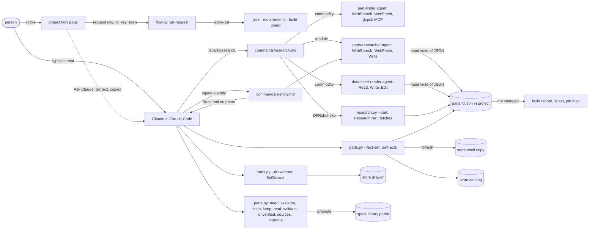

# P1161 council: the tech lead (feasibility; physics lens narrowed)

Tags: E = evidence with a pointer; H = hypothesis, with where it comes from; D = a decision, with who and when; — = unknown.
Paths are from the repository root unless they start with `<store>/` (the person's spark store) or `canvas:` (the
read-only copies of the design canvas).

## Today's research and edit paths (who calls what)

## Findings

### The four jobs: what exists, what is missing

- TL-1 · No record edit, research, identify or find can be sent from the page today. The page's allow-list is three
  Operations (PickParts, WriteRequirements, BuildBoard), and a request carries only `id, key, seen`; "the values of the
  step come from spark's own offer key, never from the request" · E `scripts/spark/flow/run_request.py:4-5`, `:42`,
  `:86-100`; `scripts/spark/flow/flow_codes.py:148-157` (SENDABLE = pick, requirements, build) · supports: the channel
  as built; not whether a wider one would be safe.

- TL-2 · An edit carries the person's own values, and the channel carries none by decision. SetFacts and SetDrawer take
  their values as a payload file (`payload=1`, `payload=0`). So a page edit needs one of three carriers: (a) a chat
  offer, where Claude runs `--fact-set` or `--drawer-set` after the person states the value; (b) a staged edit that
  spark writes first (a dry run's `was`/`now`), offered under a key that names its hash, which the page confirms with
  `id, key, seen` alone; (c) a payload in the request, which reverses D-c · E `scripts/spark/sourcing/set_facts.py:30-32`,
  `scripts/spark/sourcing/set_drawer.py:20-22`; D-c the PO 2026-11-25 (P1122 #1652: "A later direct channel ... carries
  only `id, key, seen`") · options (a) to (c) are H, the tech lead's, from these pointers.

- TL-3 · Job (a), edit. `fact-set` (SetFacts; effects reads, writes; `--dry-run` reads only) writes: the chain facts
  `footprint, pin_order, pin_order_proof, body_mm, simulation`; `facts` entries by name; `about, description, tags`; the
  provenance blocks `body_mm, pin_order_proof, pin_roles, physical, physical_proof, own_socket, joined_pads`; and the
  sheet keys `legs, host_requirements, short_name`. Its answer holds `was`, `now`, `written`, `shelf_copy`. `drawer-set`
  (SetDrawer; reads, writes, dry run) sets an entry's `label, count, part_number, revision, is, function, place, used_in,
  from, bought, unsure, skip, photos, about, description, tags`, "every write sets, never adds", all or none. Also
  `function-set`, `features-set`, `keep`, `keep-picture` (each reads, writes) · E `set_facts.py:29`, `:41`;
  `scripts/spark/records/record_kind.py:42`; `scripts/spark/sourcing/drawer.py:28-29`, `:32`, `:42`, `:48`;
  `set_drawer.py:19-30`; effects from the catalogue (python over `sourcing_operations.OPERATIONS`) · supports: what a
  write can touch.

- TL-4 · The gap in (a): no Operation writes a part record's `power`, `needs`, `host_parts`, `name`, `kind`, `variant`,
  `on_board` or `sources`. The research agents write the record as JSON by hand: `parts-researcher` has the Write tool
  and "write[s] it down as a record ... `parts/<id>.json`"; `datasheet-reader` has Write and Edit. `--validate` is the
  only gate on those writes · E `set_facts.py:41` (the key set), `agents/parts-researcher.md:4`, `:16-19`,
  `agents/datasheet-reader.md:5` · supports: the edit path for these fields is outside the core today.

- TL-5 · Job (b), research a named part. One Operation: `research-part` (ResearchPart; effects reads, writes, asks,
  fetches). It is deterministic only for a DFRobot `sku`: it reads one wiki page, keeps at most twelve documents, fills
  only the geometry gaps the fact-needs file lists (outline, thickness, holes, header), and asks one question per gap
  that a person or Claude answers by reading the drawing. Supply range, thresholds, currents, pull-ups and pin order are
  the agents' (part-finder, datasheet-reader, parts-researcher) · E `scripts/spark/sourcing/research/research_part.py:30-33`
  (SOURCE_ORDER), `:80-89` (`find_gaps`), `:104-115`, `:145`; `commands/research.md:69-74`, `:78-84` · supports.

- TL-6 · The other sourcing Operations a research uses, with their declared effects (from the catalogue, run with a
  scratch SPARK_HOME): `sources` ResolveSources reads, fetches; `fetch` FetchDocuments reads, writes, fetches;
  `find-documents` FindDocuments reads, writes, fetches; `keep` KeepFile reads, writes; `keep-picture` reads, writes;
  `read` ReadDatasheet reads; `kept` FindKept reads; `unverified` ListUnverified reads; `validate` reads; `skeleton`
  WriteSkeleton reads, writes; `promote` PromoteRecord reads, writes. `operation_catalogue.NETWORK` = `sources, fetch,
  find-documents, research-part` · E python over `spark.operation_catalogue` (output above in this run);
  `scripts/spark/operation_catalogue.py:30-32` · supports.

- TL-7 · `research.py` has no `--describe`: `research.py --describe` prints the usage and "the following arguments are
  required: --part" · E command output, this run · supports: the research CLI does not list its Operation as `parts.py
  --describe` does.

- TL-8 · Job (c), identify from a photo. No Operation. `/spark:identify` reads the image with Claude's Read tool, writes
  a "Read / Not read / header" list, then launches `parts-researcher`, which searches the web. Deterministic pieces:
  `keep` (the photo into the store), `skeleton`, `drawer-set`, `validate`, `unverified` · E `commands/identify.md:3`,
  `:22-34`, `:47-56`, `:75` · supports: reading the image and the web search need Claude.

- TL-9 · Job (d), find by criteria. Locally, `need` (FindOffers; reads only) ranks the store's records and drawer entries
  by words (`word-overlap` or `name-contains`), and `--match` adds a need's condition words (P1015). Neither takes a
  numeric limit (a supply voltage, a current, a size). Online, `part-finder` (model haiku; WebSearch, WebFetch, the jlcpcb
  MCP) returns at most two candidates for a commodity part and writes nothing; a module goes to `parts-researcher`. No
  record holds criteria, and no Operation runs a search by criteria · E `scripts/spark/design/find_offers.py:40-46`;
  `scripts/spark/sourcing/matching.py:232-239`; `agents/part-finder.md:1-6`; `.mcp.json` (jlcpcb) · supports.

- TL-10 · Under the architect's rule, research cannot be a page button: "Never from a page: ... an Operation that
  declares `board`, `deletes`, `asks` or `fetches` (`operation.py:31`). No test pins this today (P1082)." ResearchPart
  declares asks and fetches; fetch, find-documents and sources declare fetches. The one test only checks that the
  allow-list is in the catalogue; P1082 #1587 is open · E `<store>/councils/p1113/architect-page-actions.md:63-64`;
  `tests/test_operation_catalogue.py:154-157`; `gh issue view 1587` (OPEN) · D the PO chose "the architect stuff" for
  P1122, 2026-11-25 (#1652) · supports: research, identify and online find stay "Ask Claude" offers.

- TL-11 · What the page could send itself, if a carrier for values existed (TL-2): the local writes `fact-set`,
  `drawer-set`, `skeleton`, `promote`, each with a dry run whose effect is reads only, and `keep`, `keep-picture`,
  `function-set`, `features-set` (reads, writes; their dry run not checked here). What stays "Ask Claude": research,
  identify, online find, `fetch`, `find-documents`, `sources` · E `set_facts.py:36-37`, `set_drawer.py:26-27`,
  `write_skeleton.py:49-50`, `promote_record.py:30-31`; TL-10 · supports.

- TL-12 · No store page exists in code. The only page spark writes is a project's flow page; the request file is
  `<project>/.spark/page-request.json`, and the fingerprint hashes a project's needs, requirements and build record.
  A drawer, shelf or catalog edit has no project to hold its request or its fingerprint · E grep for `StorePart`,
  `store page`, `store_page` in scripts/, commands/, tools/: no match; `run_request.py:29`, `:45-46`;
  `scripts/spark/flow/fingerprint.py:17-18` · supports: the Store canvas screens are designs only.

- TL-13 · A new record is born only in a project: `--skeleton` needs `--project` and `--kind` and writes
  `<project>/parts/<id>.json`; ResearchPart reads "the project's parts/ or the person's shelf". So StoreAdd's "Research a
  new part", started from the store with no project, has no home for its record today · E
  `scripts/spark/sourcing/write_skeleton.py:54-55`, `:67`; `research_part.py:44`; canvas:StoreAdd.dc.html:33 · supports.

- TL-14 · The walk's part has no record. The store's drawer holds `dfrobot-dfr0928.json` (count 1, `part_number`
  DFR0928, no `is`), and no shelf or catalog file names DFR0928. Its walk is skeleton (needs a project), research.py
  (fetches), then an agent for the electrical facts: no step of it is page-sendable today · E
  `<store>/drawer/dfrobot-dfr0928.json`; grep of `<store>/drawer`, `shelf`, `catalog` for dfr0928: one file · supports.

- TL-15 · The canvas's op keys exist in the catalogue: StorePart lists `op:drawer-set`, `op:needs-drop + op:pick`,
  `op:sources`, `op:find-documents`, `op:keep`, `op:unverified`, and its header `op:unverified · op:read · op:fact-set`;
  Store lists `op:need → /spark:research` with "may cost tokens". `sources` and `find-documents` declare fetches · E
  canvas:StorePart.dc.html:26, :59-65; canvas:Store.dc.html:175-178; TL-6 · supports: the canvas names real ops; whether
  each row is a button or a tell is a design choice.

### Record layers and what an edit means (Q2)

- TL-16 · The layers and who wins: `find_nearest_records` gives the project's own, the shelf, spark's library and the
  catalog; the first of an id wins, and the project layer wins over every other ("A project record wins over every other
  layer") · E `scripts/spark/sourcing/drawer.py:165-171`, `:174-187`; `commands/research.md:52-55`;
  `write_skeleton.py:58-66` · supports.

- TL-17 · Where an edit lands, by layer: `set_fields` writes the record's own home. A project record is written, and its
  shelf copy is refreshed (or "not refreshed" with the reason when the copy would break the contract). A shelf copy is
  never written itself: the write goes to the project it was shelved from (`based_on`, or the one listed project that
  adopts an orphan). A catalog record is written in the catalog. A record of spark's library is refused with
  `library_record`. A record that only another listed project holds is refused with `other_project_record` · E
  `scripts/spark/sourcing/record_home.py:30-56`, `:86-101`, `:165-176`, `:179-217` · supports: so a page that shows a
  shelf part writes a project's file, which the page must say.

- TL-18 · `--promote` contradicts the library rule. From a project it copies the record into `record_kind.LIBRARY`
  (spark's own `parts/` folder) and checks no `verified` flag, while `set_fields` refuses the library because it "is
  changed in spark's repository, not by parts.py"; research.md says promote "copies a verified record into the plugin's
  library" · E `scripts/spark/sourcing/part_facts.py:154-177`; `record_home.py:165-171`; `commands/research.md:111-112`;
  LIBRARY resolves to the repository's `parts/` (python, this run) · supports the mismatch; that a plugin update
  replaces a promoted file is H (AGENTS.md: "installing spark copies the whole repository") · a card, outside P1161.

- TL-19 · A source carries no structure: `source` must be non-empty words; nothing stamps who, when or how. research.md
  asks that a bench result's source "names who did it, the date and the method", in words. `verified` is a boolean the
  writer sets; nothing ties `verified: true` to a document, a page or a person. The answer's `was` and `now` are not kept
  anywhere after the run · E `scripts/spark/records/provenance.py:13`, `:33-40`, `:44-62`; `commands/research.md:108-109`;
  `record_home.py:212-217` · supports: a page edit needs its own source sentence (for example "the person, on the page,
  <date>"), which today only the caller writes.

- TL-20 · What a fact write refuses: a key outside the writable set (`bad_argument`); a fact entry without `value`,
  `verified` or `source`; `verified: true` with a null value; an unverified value with no `why_it_matters`; a fact name
  that is not lowercase with `_`; an absent value ("a write fills a fact, it never empties one"); a `pin_order` with no
  `pin_order_proof {verified, source}`; a `physical` with no `physical_proof`; a text with control characters (scrubbed,
  cut at 1000); and any contract problem the write adds that the record did not have. It does not refuse a wrong number
  · E `set_facts.py:41-51`; `provenance.py:52-61`, `:89-91`; `scripts/spark/sourcing/part_rules.py:105-122`;
  `scripts/spark/sourcing/part_records.py:329-361`; `drawer.py:42-44` · supports.

### After an edit: what goes stale, and kept steps (Q3)

- TL-21 · Nothing marks a build, a breadboard sheet or a pin map out of date after a part record changes. The build
  record stamps `requirements_sha256` and the sha256 of `board.tsx` only; the sheet's `built-from.json` holds the
  requirements' content; `why_build_stale` compares only the requirements file; the page fingerprint hashes the needs,
  the requirements and the build record. No stamp reads `parts/<id>.json`, the shelf, the catalog or a board record · E
  `scripts/spark/build/build_record.py:25-33`; `scripts/spark/breadboard/sheet.py:119-121`;
  `scripts/spark/flow/phase_readers.py:441-449`, `:525-531`; `fingerprint.py:17-18` · supports: a page edit of a fact
  leaves a board that says current while built on the old fact; P1160 #1696 (open) asks this for take-backs.

- TL-22 · The readers of an edited fact, today: `pin_order` (pin assignment, the netlist, the sheet); `facts.*_ma`,
  `*_ua`, `*_a` named by a power pin's `draws` (the rail budget); `*_volts` facts named by a supply pin; board
  `power.io_volts` and part `facts.forward_voltage_v` (a series resistor's value); `facts.module_has_i2c_pullups` and
  `facts.i2c_pullup_ohms` (the contract's I2C rule); `physical`, `body_mm`, `legs`, `host_requirements` (the sheet and its
  picture); a board's on-board facts (pin-map constants the firmware imports) · E
  `scripts/spark/design/power_rails.py:221-253`; `scripts/spark/design/board_sections.py:159-182`;
  `scripts/spark/sourcing/part_rules.py:125-148`; `scripts/spark/design/pin_assigner.py:544-552`;
  `drawer.py:45-48` · supports: the list a "what goes stale" mark must cover; not exhaustive (grep of checks, design,
  build, breadboard, firmware for fact names).

- TL-23 · Kept steps: spark's only git write today is `project_commit`, one file per commit, called from
  `project_setup` (the brief). D8 names "the brief, the needs, the picks, the requirements, the board" as kept steps; a
  part record in `<project>/parts/` is none of them. The shelf, catalog and drawer are in the store, outside the
  project's git, as a pick's hold is (D8's caveat) · E `scripts/spark/records/project_commit.py:1-6`;
  `scripts/spark/build/project_setup.py:33`; `docs/discovery/2026-11-25-spark-and-git/brief.md` D8 · D the PO 2026-11-25
  (D8) · supports.

### Cost (Q4)

- TL-24 · No research run is measured in the store. `run_cost` counts a spine step's window from session transcripts;
  its steps include `G` (research the gap). `<store>/history.jsonl` holds 106 lines with steps S 14, M 12, C 13, L 10 and
  no `G` · E `scripts/spark/sourcing/run_cost.py:1-12`, `:45`; `grep -o '"step": *"[A-Z]"' <store>/history.jsonl | sort
  | uniq -c` (this run) · supports: a research cost line before a run has no measured base in this store.

- TL-25 · The only numbers read: measured from transcripts on 2026-10-03 (`docs/guide/research-cost.md:3-11`, provenance
  measured): the full research protocol P80 replaced, a median of 78 tool calls, about 5.0 M tokens processed and about
  25 minutes (population: that protocol's runs, n not stated); one LED (Kingbright L-7113ID) on a lean brief, 19 calls,
  about 0.55 M tokens, 148 s (n = 1); `part-finder`'s first use, 14 calls, 91 s, about 0.17 M tokens (n = 1). The page
  says the counter's numbers for the same run differ. `research.py` itself runs no model: per record, one wiki page and
  at most twelve documents, fetched once (stated, `research_part.py:104-108`). Identify: — . A criteria search: — .

### Fit with the core (Q6)

- TL-26 · The writes fit the core as they stand: `fact-set` and `drawer-set` are Operations with a dry run and a
  `was`/`now` answer, so a page edit is a new offer kind over an existing Operation, not new logic. Research, identify
  and find are agent prompts in `commands/` and `agents/`; only ResearchPart is an Operation, and the agents' hand
  writes bypass the Operation layer (TL-4). A chat offer per job (`from_page` false, a `tell`) fits D-c with no new
  channel · E TL-3, TL-4, TL-10; `flow_codes.py:142-157` · H the fit judgment is the tech lead's.

- TL-27 · The bar (AGENTS.md: "does it move a basic project closer to a breadboard with working firmware?"). Serves it:
  adding a part the store lacks for a project's need (P992 #1445), because without a record no pick and no build; and a
  bench result written back (a fact verified) that turns a `needs-measurement` into a check. Weaker on the bar: editing
  shelf and catalog records outside a project, a store-wide criteria search, pins marked on a picture (P276 #312) · H
  the tech lead's, from AGENTS.md and TL-14, PHYS-2.

### Physics lens, narrowed

- PHYS-1 · Pin order. A wrong `pin_order` edit "reverses a supply or swaps a signal". The contract asks only that a
  `pin_order_proof` with `verified` (true or false) and a `source` exists; the build reads `pin_order` whatever its
  proof says (no read of `pin_order_proof` in build, design, breadboard or firmware; the only `verified` branch there is
  own-socket's comment) · E `scripts/spark/records/provenance.py:97`; `part_rules.py:105-122`; grep of
  `scripts/spark/build`, `design`, `breadboard`, `firmware` for `pin_order_proof` (no match) and
  `board_sections.py:381-385` · supports: a page edit of pin order reaches the board and the sheet unguarded.

- PHYS-2 · Rail current. The rail check sums the currents that power pins name; any unverified figure makes the rail
  `needs-measurement`; all verified gives a pass or a problem. A page edit that writes `verified: true` with any words as
  source turns `needs-measurement` into a pass · E `power_rails.py:221-238`;
  `scripts/spark/checks/physics_check.py:172-199`; TL-19 · supports: the false-pass route.

- PHYS-3 · I2C pull-ups. `facts.module_has_i2c_pullups` with value true silences the "bus that nothing pulls up"
  refusal, whatever its `verified`; `i2c_pullup_ohms` is held to a band. identify.md records a DS3231 whose pull-ups,
  read from one photo through a bag, were wrong · E `part_rules.py:138-148`; `commands/identify.md:16-20` · supports: an
  edit or an identify can make a floating bus pass the contract.

- PHYS-4 · LED current. A series resistor's value is computed from the board's `power.io_volts` and the part's
  `facts.forward_voltage_v`, with no read of `verified`; a wrong forward voltage gives a wrong resistor on the sheet ·
  E `board_sections.py:159-182` · supports.

- PHYS-5 · Supply range and logic thresholds. research.md asks for a module's supply range and input thresholds, but no
  check in checks, design or build reads a supply range or a threshold (grep for threshold, input_high, min/max volts,
  tolerant: no match); `volts_of` reads only a fact named `*_volts` that a supply pin names. A wrong edit of these
  changes no check: no false pass, and no catch either · E `commands/research.md:84`; `power_rails.py:241-253`; grep
  (this run) · supports: today these facts are words for the person and Claude, not inputs of a check.

- PHYS-6 · Firmware. A board's on-board facts become pin-map constants that the firmware imports, each with its source
  and "not verified" in the comment when it is not; an edit reaches the firmware at the next build · E
  `pin_assigner.py:544-552` · supports.

- PHYS-7 · The guards that exist: `verified` with `why_it_matters` (an unverified value with no why is refused); the proof
  blocks; `--unverified`, which lists each unchecked fact with its `write` key for the result; `--show`'s CONFLICT lines
  ("on verified facts a problem (exit 1), on unverified ones an assumption", from `parts.py --describe`); the rail
  check's `needs-measurement`. None ties `verified: true` to a person, a date or a document, so the guard holds only as
  far as the writer is honest · E `provenance.py:56-61`, `:94-115`; `parts.py --describe --json` (this run, scratch
  SPARK_HOME); `physics_check.py:193-199` · supports.

## What I could not check, and why

- A real `fact-set --dry-run` or `drawer-set --dry-run` on a copy of a project: not run, for time; the refusals in TL-20
  are read from code, not seen in an answer.
- The dry run of `keep`, `keep-picture`, `function-set`, `features-set`: not read.
- Whether a Claude Artifact page can take a photo upload and hand it to the project: — (no web, no Artifact docs read).
- `<store>/backups/` and any store-side history of drawer or shelf writes: not read.
- The canvas beyond the op rows (layout, other screens such as Parts, Change, Undo): not read.
- Every reader of every fact: TL-22 and PHYS-5 rest on a grep of fact names in checks, design, build, breadboard and
  firmware; a reader under another name may exist.
- `scripts/cost.py` on a real research transcript: no transcript named, not run.
- P1160's progress and P874's full previous-copy design beyond `build_record.py`: not read.
- Tests that cover SetFacts' refusals: not read.

## Questions for the decider

- Q-TL1 · Which carrier does a page edit use: (a) a chat offer (Claude runs the write after the person says the value),
  (b) a staged edit that spark writes and the page confirms by key (keeps D-c), or (c) a payload in the request
  (reverses D-c)? Recommendation: (a) for the first slice, (b) next · decides: the channel, and whether P1122's rule
  holds.
- Q-TL2 · Which layers may the page edit: the project's records only, also a drawer entry, also shelf and catalog
  records? Recommendation: the project's records first; a drawer entry after a store page has a home for its request ·
  decides: whether a store page and a non-project request are in the MVP.
- Q-TL3 · May a page edit write `verified: true`? Recommendation: no, except a bench result with its source sentence
  formed by spark (who, date, method), shown before Send · decides: the false-pass risk of PHYS-2 and PHYS-3.
- Q-TL4 · Must a build go stale when a part or board record it read changes, before any page edit ships? Recommendation:
  yes; the build record stamps the sha256 of each record it read (with P1160) · decides: the order (a prerequisite
  slice).
- Q-TL5 · Is a part record edit in the project a kept step (an addition to D8)? · decides: whether the edit can be taken
  back from the history.
- Q-TL6 · Where do criteria live: on the need (its condition plus limits, a record the person already decides), or in a
  new record? Recommendation: on the need · decides: the shape of "find by criteria" and its kept step.
- Q-TL7 · Does research from the store with no project get a home (a skeleton on the shelf), or does every research
  start from a project's need (P992)? Recommendation: from a need · decides: StoreAdd's research row and TL-13.
- Q-TL8 · File a card for the `--promote` library contradiction (TL-18)? · decides: a separate fix, outside P1161.

## Proposed split and order (the PO decides value and order)

1. Slice 0, stale after an edit: the build stamps the records it read; the flow says "out of date" after a fact edit.
   End to end: edit with `--fact-set` in chat, see the build and the sheet marked stale on the page. Reason: TL-21; every
   later slice writes facts a build reads.
2. Slice 1, research for a need, as chat offers: on the project page, a need with no fitting part offers "Ask Claude"
   jobs (research this part, identify from photos, find a part for this need), each a `tell`; the new record then shows
   as a pick. End to end: the DFR0928 walk in a project, need → research in chat → record → pick on the page → build.
   Reason: TL-10, TL-14, P992; no new channel.
3. Slice 2, edit a fact from the page: a staged edit with `was`/`now`, project layer only, `verified: false` unless a
   bench result, then the build goes stale. Reason: TL-2, TL-11, PHYS-1 to PHYS-3.
4. Later: a drawer entry edit from a store page (needs a request home outside a project, TL-12); criteria as need fields
   with an online find (TL-9).
5. Pause: shelf and catalog editing from a page, pins marked on a picture (P276), a numeric parametric search engine.
   Reason: furthest from the bar (TL-27).

## Searches

None.
