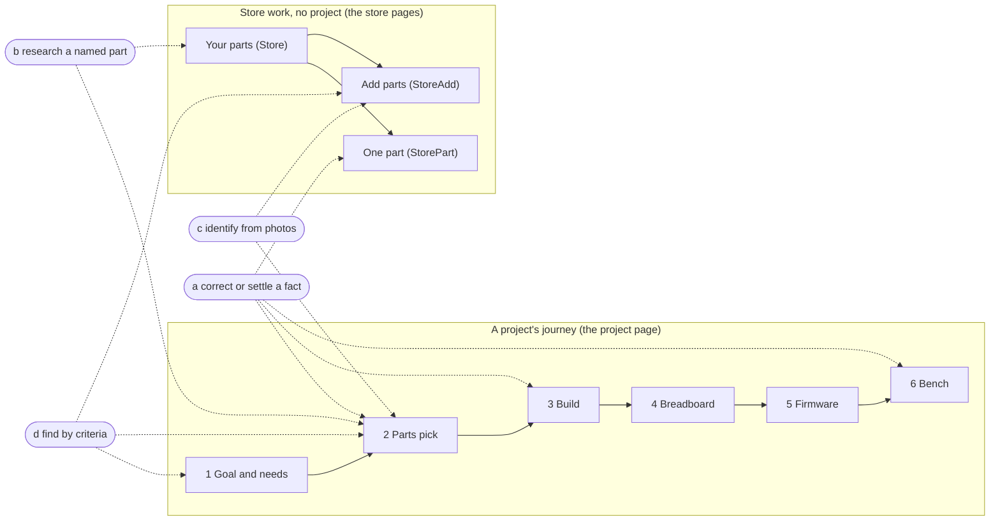
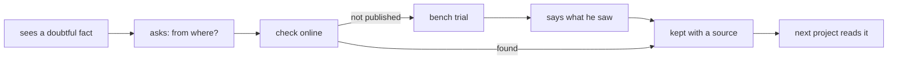
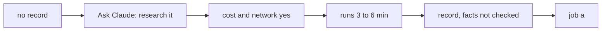
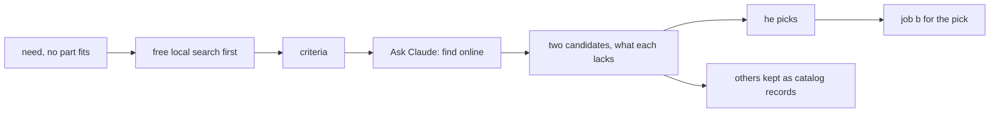

# Jobs and journeys
<!-- Tags as in the brief: E with a pointer, H with its source, D with who and when, — for an unknown. -->

Pointers: `council/<lens>.md` is a lens report in this folder, `canvas:<file>:<line>` is the design canvas copy read on
2026-11-25, `<store>/<path>` is the PO's spark store, `<walks>/<path>` is his walk folders.

## Who
<!-- One line per persona: who · evidence status (E pointer | H source). -->
- The PO, the one user (n = 1): a maker in Prague who builds ESP32 gadgets from modules, with 114 drawer entries, 19 of them linked to a record. He works in Claude Code and on a project page (a Claude Artifact) · E `council/user.md` USER-12, a count over `<store>/drawer/*.json` on 2026-11-25 <!-- REQUIRED:who -->
- Claude, the second reader of every screen: it reads the offer's sentence and spark's JSON, and calls spark's Operations · D the PO, 2026-10-18 (every interface for a person and for Claude) · E `council/ux-ai-ux.md` UX-12 to UX-14

## Jobs
<!-- One job story per line, each clause tagged: When …, I want to …, so I can …. -->
- Job a, correct or settle a fact: When a fact of a part record is wrong or not checked [E `canvas:StorePart.dc.html:33`, 9 facts by `parts.py --unverified dfr0664-tft-2in`, `council/user.md` USER-3], I want to tell spark what I saw, measured or read, with where it came from [E `<walks>/p934-display2/diary.md:268-287`, USER-1, USER-17], so I can wire and write firmware from a fact I trust, in this project and the next [E USER-5, `<walks>/p934-display2/diary.md:190-201`] <!-- REQUIRED:jobs -->
- Job b, research a named part: When I own a part that spark does not know, by its name or part number [E 95 of 114 drawer entries have no record, 90 of the 95 carry a DFRobot part number, USER-12], I want spark to look it up and write its record [E `<walks>/walk4/walk4-diary.md:24-25`, "research it and lets update our records"], so I can pick it for a need [H the PO's words on #1697]
- Job c, identify from photos: When I hold a module whose marking I do not know [E 4 of 114 entries keep a photo, USER-13], I want to give spark photos and have it say what the module is [E `commands/identify.md`, the PO's words on #1697: "based on photos"], so I can add it to my store and use it [E P992 #1445: "I can still have it and want to add it"]
- Job d, find by criteria: When a need has no part I own, or a picked part cannot do the job [E `<walks>/p934-epaper/diary.md:196-205`, USER-9], I want to set what it must do and its limits and get candidates online [E the PO's words on #1697: "finding online a part/board/module that could do what we need, setting up criteria"], so I can choose one before I buy [H, from USER-9: his words "ask if I want it to search for alternatives online"]
- Job e, see where each fits: When I am at a step of my project [H the PO's words on #1697: "how does it all fit to the journey, what screens change"], I want the page to offer a, b, c and d at the moment they arise, so I can stay on the page and not compose a chat sentence myself [H, from USER-10: every research job today is a sentence he copies]

## Today they…
<!-- Per job: what they do instead today (a competitor, a workaround or nothing), tagged. -->
- Job a · Claude writes `parts.py --fact-set <id> <file>` with a `write` key and a `source`, after his yes. One field once had no key and was fixed by hand. A bench trial, not research, settled the one wrong fact seen · E USER-1, USER-4, `<walks>/p934-display2/diary.md:280-281` <!-- REQUIRED:today -->
- Job b · `/spark:research` in Claude Code, inside a project. A run takes 3 to 6 minutes, with no cost number shown · E USER-11, USER-15
- Job c · `/spark:identify` in Claude Code with photos sent in the chat. The one end-to-end walk broke in four places · E USER-14
- Job d · nothing. A need's words only order the parts already in the store. `part-finder` is for commodity parts and returns at most two. `parts-researcher` stops at the first vendor that fits · E USER-7, `council/ux-ai-ux.md` UX-4
- Job e · the canvas draws a store row with folds that hold each job as an "Ask Claude" sentence to copy. The Parts moment has no exit for "none of these fits" · E `canvas:Store.dc.html:175-178`, `canvas:StoreAdd.dc.html:33`, `canvas:Parts.dc.html:153-161`, USER-6

## Where each job arises in spark's journey

The project journey runs from a goal to a working gadget. The store work runs beside it, with no project. Each job
enters at the moments below (E USER-1 to USER-17, UX-10. The placement is this discovery's reading).

## Journeys
<!-- One ### per actor and scenario: the table, then a Mermaid flowchart of the same steps. -->

### The PO — job a, a fact is wrong or not checked <!-- REQUIRED:journey -->
| step | what they do | evidence | friction or harm | today | open question |
| --- | --- | --- | --- | --- | --- |
| 1 | sees a doubtful fact on a sheet, a page or the bench | E `<walks>/p934-display2/diary.md:186`, `:280` | the sheet named the wrong driver, with no mark that it was a guess | partly | — |
| 2 | asks what spark knows and from where | E `<walks>/p934-epaper/diary.md:96-98`, `canvas:StorePart.dc.html:33` | no command groups a record's facts by source. StorePart draws it, not built | not yet | four source words in place of "checked" (UX-15)? |
| 3 | asks Claude to check it online | E `commands/research.md:23-25` | a match ends research, and no step checks one fact. The canvas sends two "not published" facts to a datasheet | not yet | is "settle it" or "research again" the first control? |
| 4 | learns that only the bench settles it | E `<walks>/p934-display2/diary.md:157-165` | no step offers the trial | not yet (P998, P1003) | — |
| 5 | runs the trial and says what he sees | E `<walks>/p934-display2/diary.md:268-271` | works when Claude writes the trial firmware | partly | — |
| 6 | asks Claude to keep the finding | E `<walks>/p934-display2/diary.md:277-287` | `--fact-set` after his yes. A field had no key, and a store edit has no take-back | partly | is an edit a kept step (Q-edit-kept)? |
| 7 | the next project reads it | E `<walks>/p934-display2/diary.md:190-201` | a stale shelf copy once lost the drawn breadboard (fixed, P1006) | works | — |

### The PO — job b, an owned part has no record
| step | what they do | evidence | friction or harm | today | open question |
| --- | --- | --- | --- | --- | --- |
| 1 | sees "spark does not know it yet" | E `canvas:Store.dc.html:20`, USER-12 | 95 of 114 entries, and nothing says which one a project needs | partly | — |
| 2 | asks to research it | E `<walks>/walk4/walk4-diary.md:24-25` | needs a project, and the record lands in its `parts/` | works in a project | where does it land from the store page (USER-11)? |
| 3 | answers network and cost questions | E `commands/research.md:56-58`, UX-3 | each fetch asks, and no cost shows before the start | partly | what cost line (UX-3)? |
| 4 | waits | E USER-15: about 3 min, 6 min 18 s, 6 min 20 s | the page shows nothing meanwhile | partly | — |
| 5 | reads the result: facts not checked | E `<walks>/walk4/walk4-diary.md:26` | goes on to job a | works | — |

### The PO — job c, a module from photos
| step | what they do | evidence | friction or harm | today | open question |
| --- | --- | --- | --- | --- | --- |
| 1 | takes photos and gets them to the Mac | E `<walks>/p934-epaper/diary.md:8-10` | the page cannot take a file. How the photos travelled is — | partly | photos through the page or the chat only (ARCH-17)? |
| 2 | gives them to `/spark:identify` | E `commands/identify.md:22-29` | no ruler in frame, and nothing asked for one first | partly | — |
| 3 | reads Claude's "Read / Not read" list | E `<walks>/p934-epaper/diary.md:16-40` | works. This is the natural yes before searches (UX-8) | works | — |
| 4 | waits for the agent | E `<walks>/p934-epaper/diary.md:57` | files kept in his store with no question | partly | — |
| 5 | the record fails `--validate` | E `<walks>/p934-epaper/diary.md:66-69` | blocked until a size was guessed | fixed by hand | — |
| 6 | a fact the photo cannot show stays a guess | E USER-1 | settled at the bench two days later | not yet | — |

### The PO — job d, a need has no part
| step | what they do | evidence | friction or harm | today | open question |
| --- | --- | --- | --- | --- | --- |
| 1 | says the need with conditions | E `commands/idea.md:40` | conditions only order store candidates | partly | — |
| 2 | sees no fitting part, or one that cannot do it | E `<walks>/p934-epaper/diary.md:182-185`, `:201-205` | he found the conflict himself | not yet | — |
| 3 | asks for alternatives online | E `<walks>/p934-epaper/diary.md:253-256` | no command, and part-finder is for commodity parts only | not yet | two candidates first for a module too (UX-4)? |
| 4 | sets criteria | E USER-8, UX-9 | two of his example criteria map to record facts, two to none, and no need has a limits field | not yet | where criteria live (ARCH-10)? |
| 5 | compares candidates | E `agents/parts-researcher.md:36-37` | the researcher stops at the first fit | not yet | — |
| 6 | picks one, and the others are kept as catalog records | E `commands/research.md:151-158`, ARCH-9 | no Operation writes the catalog, and the agent writes it by hand | partly | — |

